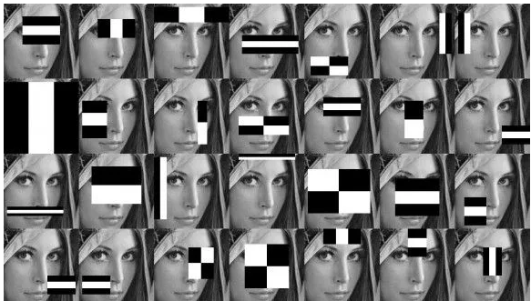

#+TITLE: Apuntes de Inteligencia Artificial
#+AUTHOR: Eduardo Alcaraz
#+LANGUAGE: es
#+LaTeX_HEADER: \usepackage[spanish]{inputenc}
#+SETUPFILE: /home/likcos/Materias/IA/theme-readtheorg-local.setup
#+EXPORT_FILE_NAME: index.html
#+OPTIONS: num:nil
#+HTML_HEAD: 
#+BIND: org-confirm-babel-evaluate nil
#+bibliography: /home/likcos/Materias/IA/bibliografia.bib
#+cite_export: csl

*  Tutorial — Entornos virtuales en Python (Windows, Linux, macOS)

Aprender a crear y usar *entornos virtuales* en Python cuando tienes *varias versiones* de Python instaladas (3.9, 3.10, 3.11, 3.12, 3.13…) en:

- *Windows*
- *Linux* (Debian/Ubuntu, Fedora, Arch…)
- *macOS* (Intel y Apple Silicon)

Al terminar sabrás:

1. Qué es un entorno virtual y por qué no instalar todo con =pip= global.
2. Cómo ver qué versiones de Python tienes en cada sistema.
3. Cómo crear un =venv= con una versión *concreta*.
4. Cómo gestionar muchas versiones con *pyenv* (recomendado).
5. Cómo activar, desactivar, exportar dependencias y borrar entornos.
6. Cómo resolver errores típicos.

** Conceptos básicos

*** ¿Qué es un entorno virtual?
Un *entorno virtual* es una carpeta aislada que contiene:

- Un intérprete de Python (o un enlace a uno concreto).
- Su propio =pip=.
- Sus propios paquetes en =site-packages=.

Cada proyecto puede tener versiones distintas de Django, NumPy, etc., sin pelearse.

*** Entorno virtual ≠ versión de Python
| Idea | Qué es |
|------+--------|
| *Versión de Python* | 3.10, 3.12… el lenguaje en sí |
| *Entorno virtual* | Carpeta aislada de paquetes *para un proyecto* |

Puedes tener Python 3.12 instalado y crear tres entornos 3.12 con librerías diferentes.

*** Herramientas que verás en este tutorial
| Herramienta | Viene con Python | Varias versiones de Python | Uso típico |
|-------------+------------------+----------------------------+------------|
| =venv= | Sí (3.3+) | Solo si ya tienes ese binario | Proyectos simples, estándar |
| =virtualenv= | No (=pip install=) | Igual que =venv= | Compatibilidad extra |
| *pyenv* | No | *Sí*, instala y cambia versiones | Desarrollo con 3.9–3.13 |
| *conda* / Miniconda | No | Sí (canales propios) | Ciencia de datos, CUDA |
| *uv* | No | Sí, muy rápido | Proyectos modernos (mención) |

*Recomendación general:*
- *Principiante / curso:* =python3.12 -m venv .venv= (o la versión que pida tu materia).
- *Varias versiones en la misma máquina:* *pyenv* + =pyenv virtualenv=.

** Paso 0 — Ver qué Python tienes instalado

*** Linux y macOS (terminal)

#+begin_src shell :exports code
# Versiones en PATH
python3 --version
python3.12 --version 2>/dev/null
python3.11 --version 2>/dev/null

# Dónde está cada binario
which python3
which python3.12 2>/dev/null

# Todas las que encuentre el sistema (Debian/Ubuntu)
ls -la /usr/bin/python3* 2>/dev/null
#+end_src

*** Windows (PowerShell o CMD)

#+begin_src powershell :exports code
python --version
py --version
py -0p
#+end_src

El lanzador =py= en Windows lista versiones instaladas. Ejemplo de salida:

#+begin_example
 -V:3.12 *        C:\Users\tu\AppData\Local\Programs\Python\Python312\python.exe
 -V:3.11          C:\Users\tu\AppData\Local\Programs\Python\Python311\python.exe
#+end_example

*** Tabla rápida por sistema

| Sistema | Comando habitual | Varias versiones |
|---------+------------------+------------------|
| Linux | =python3.12=, =python3.11= | Paquetes del sistema o pyenv |
| macOS | =python3= (Homebrew) | =brew install python@3.12= o pyenv |
| Windows | =py -3.12= | Instaladores python.org o pyenv-win |

** Método 1 — =venv= (incluido en Python, el más estándar)

*** Crear entorno con una versión específica

La regla de oro:

#+begin_example
<python-DESEADA> -m venv <carpeta-del-entorno>
#+end_example

**** Linux

#+begin_src shell :exports code
cd ~/proyectos/mi_app
python3.12 -m venv .venv
# o con ruta explícita si hay varias:
/usr/bin/python3.11 -m venv .venv311
#+end_src

**** macOS

#+begin_src shell :exports code
cd ~/proyectos/mi_app
python3.12 -m venv .venv
# Si usas Homebrew y el binario tiene otro nombre:
/opt/homebrew/bin/python3.12 -m venv .venv
#+end_src

**** Windows (PowerShell)

#+begin_src powershell :exports code
cd $HOME\proyectos\mi_app
py -3.12 -m venv .venv
# o ruta completa:
# C:\Users\tu\AppData\Local\Programs\Python\Python312\python.exe -m venv .venv
#+end_src

*** Activar el entorno

| Sistema | Comando activar | Desactivar |
|---------+-----------------+------------|
| Linux / macOS | =source .venv/bin/activate= | =deactivate= |
| Windows CMD | =.venv\Scripts\activate.bat= | =deactivate= |
| Windows PowerShell | =.venv\Scripts\Activate.ps1= | =deactivate= |

*PowerShell* puede bloquear scripts. Si falla:

#+begin_src powershell :exports code
Set-ExecutionPolicy -ExecutionPolicy RemoteSigned -Scope CurrentUser
#+end_src

*** Comprobar que usas el Python correcto

Tras activar:

#+begin_src shell :exports code
which python
python --version
pip --version
#+end_src

En Windows:

#+begin_src powershell :exports code
Get-Command python
python --version
pip --version
#+end_src

Debe apuntar a =.venv= (Linux/Mac) o =.venv\Scripts\python.exe= (Windows).

*** Instalar paquetes y guardar dependencias

#+begin_src shell :exports code
pip install --upgrade pip
pip install requests pandas
pip freeze > requirements.txt
#+end_src

En otra máquina o compañero:

#+begin_src shell :exports code
python3.12 -m venv .venv
source .venv/bin/activate
pip install -r requirements.txt
#+end_src

*** Borrar un entorno
Solo elimina la carpeta (con el entorno *desactivado*):

#+begin_src shell :exports code
deactivate
rm -rf .venv
#+end_src

Windows: =Remove-Item -Recurse -Force .venv=

** Método 2 — *pyenv* (varias versiones de Python en una máquina)

*** ¿Cuándo usar pyenv?
- Necesitas 3.10 para un proyecto viejo y 3.12 para uno nuevo.
- No quieres mezclar el Python del sistema (Linux/macOS) con tus proyectos.
- Quieres un comando global: =pyenv local 3.11.9= en una carpeta.

*** Instalación

**** Linux (Debian/Ubuntu — dependencias + instalador oficial)

#+begin_src shell :exports code
sudo apt update
sudo apt install -y make build-essential libssl-dev zlib1g-dev \
  libbz2-dev libreadline-dev libsqlite3-dev curl git \
  libncursesw5-dev xz-utils tk-dev libxml2-dev libxmlsec1-dev libffi-dev liblzma-dev

curl https://pyenv.run | bash
# Añade a ~/.bashrc o ~/.zshrc:
# export PYENV_ROOT="$HOME/.pyenv"
# export PATH="$PYENV_ROOT/bin:$PATH"
# eval "$(pyenv init -)"
#+end_src

Reinicia la terminal y:

#+begin_src shell :exports code
pyenv --version
#+end_src

**** macOS (Homebrew)

#+begin_src shell :exports code
brew update
brew install pyenv
# Añade a ~/.zshrc:
# export PYENV_ROOT="$HOME/.pyenv"
# export PATH="$PYENV_ROOT/bin:$PATH"
# eval "$(pyenv init -)"
#+end_src

**** Windows — *pyenv-win*

En Windows el proyecto equivalente es [[https://github.com/pyenv-win/pyenv-win][pyenv-win]] (no es el mismo binario que Linux, pero la idea es igual).

#+begin_src powershell :exports code
# Con winget (si está disponible):
winget install pyenv-win.pyenv-win

# O clonar en %USERPROFILE%\.pyenv\pyenv-win
# y añadir a PATH las carpetas bin y shims
#+end_src

Consulta la wiki de pyenv-win para variables =PYENV=, =PYENV_ROOT=, =PYENV_HOME= en *Variables de entorno* de Windows.

*** Instalar versiones de Python con pyenv

#+begin_src shell :exports code
pyenv install --list | grep " 3.1"
pyenv install 3.11.9
pyenv install 3.12.4
pyenv versions
#+end_src

*** Elegir versión global o por carpeta

#+begin_src shell :exports code
pyenv global 3.12.4
pyenv local 3.11.9
cd ~/proyectos/legacy_app
pyenv local 3.10.13
python --version
#+end_src

=Crea archivo =.python-version= en la carpeta del proyecto.=

*** Entorno virtual con pyenv

Opción A — plugin =pyenv-virtualenv=:

#+begin_src shell :exports code
# Linux/macOS: instalar plugin pyenv-virtualenv (ver repo oficial)
pyenv virtualenv 3.12.4 mi_proyecto_312
pyenv local mi_proyecto_312
#+end_src

Opción B — =venv= clásico *después* de fijar versión con pyenv:

#+begin_src shell :exports code
pyenv local 3.12.4
python -m venv .venv
source .venv/bin/activate
#+end_src

** Método 3 — =virtualenv= (paquete pip)

Similar a =venv=, útil si necesitas opciones extra o Python muy antiguo.

#+begin_src shell :exports code
python3.12 -m pip install --user virtualenv
python3.12 -m user virtualenv .venv
# o:
virtualenv -p python3.11 .venv311
source .venv311/bin/activate
#+end_src

En la práctica moderna, =python -m venv= suele bastar.

** Método 4 — Conda / Miniconda (opcional, ciencia de datos)

*** Idea
Conda crea entornos con Python *y* librerías binarias (NumPy, CUDA) desde canales propios.

#+begin_src shell :exports code
conda create -n mi_env python=3.11
conda activate mi_env
conda install pandas numpy
conda deactivate
#+end_src

*** Conda vs venv

| Aspecto | venv / pyenv | conda |
|---------+--------------+-------|
| Peso | Ligero | Más pesado |
| Paquetes no-Python | No | Sí (R, C libs) |
| Curso general IA/Python | venv suele bastar | Si el curso pide Anaconda |

** Flujo de trabajo recomendado por escenario

*** Escenario A — Un solo proyecto, una versión fija (curso)

#+begin_example
1. Instalar Python 3.12 desde python.org / apt / brew
2. cd proyecto
3. python3.12 -m venv .venv
4. activar → pip install -r requirements.txt
5. Añadir .venv/ al .gitignore
#+end_example

*** Escenario B — Tres proyectos, tres versiones

#+begin_example
1. Instalar pyenv
2. pyenv install 3.10.13 3.11.9 3.12.4
3. En cada repo: pyenv local X.Y.Z && python -m venv .venv
#+end_example

*** Escenario C — Windows con lanzador py

#+begin_example
1. py -0p   (ver versiones)
2. py -3.12 -m venv .venv
3. .venv\Scripts\Activate.ps1
4. pip install ...
#+end_example

** Buenas prácticas

1. *Un entorno por proyecto* (carpeta =.venv= o =venv= dentro del repo).
2. *No subas* =.venv= a Git; sí sube =requirements.txt= o =pyproject.toml=.
3. *Nombra* la versión en el README: “Requiere Python ≥ 3.11”.
4. En Linux, evita =sudo pip install= en el Python del sistema (rompe paquetes del SO).
5. En macOS con Apple Silicon, prefiere builds *arm64* (Homebrew en =/opt/homebrew=).
6. Usa =python -m pip install= en lugar de =pip= suelto (asegura el pip del entorno activo).

** .gitignore mínimo

#+begin_example
.venv/
venv/
__pycache__/
*.pyc
.python-version   # opcional: algunos equipos sí lo versionan con pyenv
#+end_example

** Problemas frecuentes y soluciones

| Síntoma | Causa probable | Solución |
|---------+----------------+----------|
| =python: command not found= | Python no en PATH | Instalar o usar ruta completa / pyenv |
| =No module named venv= | Paquete =python3-venv= falta (Debian) | =sudo apt install python3.12-venv= |
| Tras activar, =python= sigue siendo el del sistema | No activaste bien o orden PATH | =source .venv/bin/activate=; =which python= |
| PowerShell no activa | ExecutionPolicy | =RemoteSigned= para CurrentUser |
| =pip install= instala fuera del venv | Entorno no activo | Activar; usar =python -m pip= |
| pyenv: version not installed | Falta =pyenv install= | =pyenv install 3.12.4= |
| Mezcla 3.10 y 3.12 en mismo venv | Creaste venv con binario equivocado | Borrar .venv y recrear con binario correcto |

** Cheat sheet 

*** Linux / macOS

#+begin_example
# Crear
python3.12 -m venv .venv

# Activar / desactivar
source .venv/bin/activate
deactivate

# Paquetes
pip install -r requirements.txt
pip freeze > requirements.txt

# pyenv
pyenv install 3.12.4
pyenv local 3.12.4
#+end_example

*** Windows

#+begin_example
# Crear
py -3.12 -m venv .venv

# Activar (PowerShell)
.venv\Scripts\Activate.ps1

# Listar Pythons
py -0p
#+end_example

** Referencias
- Documentación oficial venv: https://docs.python.org/3/library/venv.html
- pyenv: https://github.com/pyenv/pyenv
- pyenv-win: https://github.com/pyenv-win/pyenv-win
- Python en Windows (launcher py): https://docs.python.org/3/using/windows.html

#+RESULTS:
: None

* Introducción a la Inteligencia Artificial

Este documento desarrolla el temario de la unidad introductoria a la *Inteligencia Artificial (IA)*: definición, historia, bases cognitivas, lógica, filosofía del conocimiento, modelos cognitivos y de agente, y el papel de la *heurística* con algoritmos de búsqueda.

*Objetivos generales:*
- Comprender qué se entiende por IA y cómo ha evolucionado históricamente.
- Relacionar la IA con psicología, lógica y filosofía del conocimiento.
- Describir el *modelo del agente inteligente* y sus extensiones (multiagente, ubicuo).
- Aplicar algoritmos de búsqueda informada y local como base de la resolución de problemas.

** 1.1 Introducción a la Inteligencia Artificial

*** ¿Qué es la Inteligencia Artificial?
La *Inteligencia Artificial* es el campo de la informática y las ciencias cognitivas que estudia cómo construir sistemas capaces de realizar tareas que, si las hiciera un humano, requerirían *inteligencia*: percibir, razonar, aprender, planificar, comunicarse y actuar en entornos complejos.

Definiciones frecuentes en cursos introductorios:
- *Sistemas que piensan como humanos* (enfoque cognitivo / simulación).
- *Sistemas que actúan racionalmente* (enfoque del *agente racional*; muy usado en IA moderna).
- *Sistemas que piensan racionalmente* (enfoque lógico: leyes del pensamiento).

*** Problemas típicos de la IA
| Área              | Ejemplos                                              |
|-------------------+-------------------------------------------------------|
| Percepción        | Visión por computadora, reconocimiento de voz         |
| Razonamiento      | Demostración de teoremas, diagnóstico médico            |
| Aprendizaje       | Clasificación, predicción, *deep learning*              |
| Lenguaje natural  | Traducción, chatbots, resumen de textos               |
| Planificación     | Robótica, logística, juegos (ajedrez, Go)             |
| Representación    | Ontologías, grafos de conocimiento, bases de reglas     |

*** IA débil vs IA fuerte (distinción conceptual)
- *IA débil (narrow AI):* sistemas especializados en una tarea (recomendador, detector de spam, asistente de voz). Es lo que existe hoy en producción.
- *IA fuerte (AGI):* hipotética inteligencia general al nivel humano o superior en *cualquier* dominio. Sigue siendo objeto de debate y especulación.

*** Relación con otras disciplinas
- *Psicología cognitiva:* modelos de memoria, atención, aprendizaje.
- *Lógica y matemáticas:* formalización del razonamiento.
- *Filosofía:* naturaleza del conocimiento, mente y consciencia.
- *Neurociencia:* inspiración biológica (redes neuronales).
- *Ingeniería:* sistemas que funcionan en el mundo real (robots, sensores, redes).

*** Idea clave del curso
La IA no es un solo método: es un *conjunto de técnicas* (búsqueda, lógica, probabilidad, aprendizaje automático, etc.) unidas por la pregunta: *¿cómo representar el conocimiento y elegir acciones útiles en un entorno?*

** 1.2 Historia de la Inteligencia Artificial

*** Orígenes (décadas de 1940–1950)
- *Alan Turing* (1950): artículo “Computing Machinery and Intelligence”; propone el *Test de Turing* como criterio operativo de comportamiento inteligente.
- *McCulloch y Pitts* (1943): modelo neuronal binario (antecedente de redes neuronales).
- Conferencia de *Dartmouth* (1956): McCarthy, Minsky, Shannon, Rochester y otros acuñan el término *“Artificial Intelligence”*. Se inicia el optimismo de que la inteligencia general sería alcanzable en pocos años.

*** Era del optimismo (1956–1974)
- Programas pioneros: *Logic Theorist*, *General Problem Solver* (GPS), primeros juegos (damas, ajedrez simplificado).
- Lenguaje *LISP* (McCarthy, 1958) como herramienta simbólica.
- Expectativas altas; financiamiento abundante.

*** Primer “invierno” de la IA (1974–1980)
- Limitaciones computacionales y teóricas (combinatoria explosiva, conocimiento difícil de codificar).
- Informe *Lighthill* (Reino Unido, 1973): crítica severa → recortes de fondos.

*** Sistemas expertos y boom comercial (1980–1987)
- *Sistemas basados en reglas* (IF–THEN): MYCIN (diagnóstico), DENDRAL (química).
- Japón: *Fifth Generation*; EE.UU.: proyectos DARPA.
- Éxito en dominios acotados con expertos humanos disponibles.

*** Segundo invierno (1987–1993)
- Caída del hardware LISP; sistemas expertos caros de mantener y frágiles fuera de su nicho.
- Necesidad de *aprendizaje* y *datos* frente a solo reglas manuales.

*** Resurgimiento: aprendizaje automático y datos (1990–2010)
- *Aprendizaje estadístico*: SVM, árboles, *boosting*.
- Éxitos prácticos: filtrado de spam, reconocimiento de escritura, recomendación.
- *Deep Blue* vence a Kasparov (1997) con búsqueda + heurísticas + hardware.

*** Era del *deep learning* (2010–presente)
- GPUs, grandes conjuntos de datos (ImageNet), arquitecturas profundas (CNN, RNN, Transformers).
- Hitos: AlexNet (2012), AlphaGo (2016), GPT y modelos de lenguaje a gran escala (2020+).
- IA generativa, visión, voz, asistentes conversacionales.

*** Línea de tiempo resumida

#+begin_example
1943  Modelo McCulloch-Pitts
1950  Test de Turing
1956  Dartmouth → nace el término "IA"
1960s GPS, ELIZA, optimismo
1974  Primer invierno (Lighthill)
1980s Sistemas expertos
1987  Segundo invierno
1997  Deep Blue vs Kasparov
2012  AlexNet / revolución deep learning
2016  AlphaGo
2020+ LLMs, IA generativa
#+end_example

** 1.3 Habilidades cognoscitivas y teorías de la inteligencia

*** Habilidades cognoscitivas (psicología)
Desde la psicología cognitiva, la “inteligencia” en humanos se manifiesta en procesos interrelacionados:

| Proceso        | Descripción breve                                      |
|----------------+--------------------------------------------------------|
| Percepción     | Interpretar estímulos sensoriales                      |
| Atención       | Seleccionar información relevante                      |
| Memoria        | Almacenar y recuperar (corto/largo plazo)              |
| Lenguaje       | Comprender y producir símbolos lingüísticos            |
| Razonamiento   | Inferir conclusiones, resolver problemas                 |
| Aprendizaje    | Modificar conducta o conocimiento con la experiencia     |
| Metacognición  | “Pensar sobre el propio pensamiento”                   |

La IA clásica intentó *modelar* o *replicar* estos procesos; la IA moderna a menudo los *aproxima* con datos y optimización sin pretender fidelidad biológica.

*** Teoría conductista (conductismo)
- *Enfoque:* la mente no se observa directamente; se estudia el *comportamiento* ante estímulos y reforzadores.
- *Skinner, Watson:* aprendizaje por condicionamiento y refuerzo.
- *Relevancia en IA:* *aprendizaje por refuerzo* (RL): agente, estados, acciones, recompensas (Q-learning, policy gradient). El “conductismo” inspira el marco matemático, no la negación de representaciones internas (los agentes RL sí mantienen valores o políticas).

*** Teoría de la inteligencia general (factor *g*)
- *Spearman:* un factor común subyace a varias pruebas cognitivas.
- En IA: analogía limitada; los sistemas suelen ser *especialistas* (alto rendimiento en una tarea, bajo en otras).

*** Inteligencias múltiples (Howard Gardner)
Gardner propone varias inteligencias relativamente independientes:

| Inteligencia        | Ejemplo humano              | Paralelo en IA (aproximado)        |
|---------------------+-----------------------------+------------------------------------|
| Lingüística         | Leer, escribir, debatir     | NLP, LLMs                          |
| Lógico-matemática   | Demostrar, programar        | Lógica, planificación, ML simbólico|
| Espacial            | Orientarse, dibujar         | Visión, SLAM, gráficos             |
| Musical             | Componer, reconocer tonos   | Generación/análisis musical        |
| Corporal-kinestésica| Deportes, manualidades      | Robótica, control motor            |
| Interpersonal       | Empatía, liderazgo          | Análisis de sentimientos (parcial) |
| Intrapersonal       | Autoconocimiento            | Poco modelado explícitamente       |
| Naturalista         | Clasificar especies         | Clasificación de imágenes          |

*Idea pedagógica:* no existe un solo “botón de inteligencia”; los sistemas actuales combinan módulos especializados.

*** Otras teorías (mención)
- *Piaget:* desarrollo por etapas (sensoriomotor → formal). Útil como metáfora de complejidad creciente en agentes que aprenden.
- *Vygotsky:* aprendizaje social y *zona de desarrollo próximo*. Paralelo: *aprendizaje con humano en el bucle* (RLHF, anotación humana).
- *Sternberg (triárquica):* analítica, creativa, práctica → diseño de sistemas que equilibren precisión, novedad y utilidad en contexto.

** 1.4 Razonamiento según la lógica

*** Lógica como fundamento del razonamiento automático
La lógica formal permite:
- Representar *proposiciones* y *relaciones*.
- Derivar *conclusiones válidas* a partir de *premisas*.
- Verificar si un argumento es *correcto* (independientemente de si las premisas son verdaderas en el mundo real).

*** Componentes básicos
- *Lenguaje formal:* símbolos, conectivos (∧, ∨, ¬, →), cuantificadores (∀, ∃).
- *Axiomas:* proposiciones *asumidas* sin demostración dentro del sistema (punto de partida).
- *Teoremas:* proposiciones *demostrables* a partir de axiomas y reglas de inferencia.
- *Demostración:* secuencia finita de pasos donde cada paso es un axioma, una hipótesis o se obtiene por una *regla de inferencia* (p. ej. *modus ponens*: de P y P→Q inferir Q).

*** Ejemplo mínimo (lógica proposicional)
Premisas:
1. Si llueve, la calle está mojada.  (Lluvia → Mojada)
2. Está lloviendo.                    (Lluvia)

Conclusión (por modus ponens): La calle está mojada. (Mojada)

En notación: {(Lluvia → Mojada), Lluvia} ⊢ Mojada

*** Sistemas formales relevantes en IA
| Sistema              | Uso en IA                                      |
|----------------------+------------------------------------------------|
| Lógica proposicional | Reglas simples, verificación finita            |
| Lógica de predicados | Relaciones, bases de conocimiento              |
| Lógica modal         | Conocimiento, creencia, obligación (agentes)   |
| Lógica difusa        | Razonamiento con grados de verdad              |

*** Límites importantes
- *Decidibilidad:* algunos problemas no tienen algoritmo que siempre termine con respuesta correcta.
- *Complejidad:* el espacio de búsqueda de demostraciones crece muy rápido → hace falta *heurística* (sección 1.8).
- *Mundo real:* la lógica clásica asume certeza; en la práctica hay incertidumbre (probabilidad, redes bayesianas).

** 1.5 Adquisición del conocimiento según la filosofía

*** ¿Qué es el conocimiento? (epistemología)
La *filosofía del conocimiento* pregunta:
- ¿Qué distingue *conocimiento* de mera *creencia*?
- ¿De dónde proviene? (experiencia vs razón)
- ¿Cómo sabemos que algo es *justificado*?

Tradición clásica: *conocimiento = creencia verdadera justificada* (definición discutida, pero pedagógicamente útil).

*** Empirismo vs racionalismo
| Corriente      | Idea principal                         | Paralelo en IA                          |
|----------------+----------------------------------------+-----------------------------------------|
| Empirismo      | Conocimiento desde la experiencia      | Aprendizaje automático, datos, inducción|
| Racionalismo   | Conocimiento desde la razón innata     | Axiomas, ontologías, reglas a priori    |

Los sistemas reales suelen combinar *conocimiento codificado* (reglas, ontologías) con *conocimiento aprendido* (modelos entrenados).

*** Fuentes de conocimiento en sistemas inteligentes
1. *Codificación manual:* expertos escriben reglas (sistemas expertos).
2. *Aprendizaje inductivo:* generalizar patrones desde ejemplos.
3. *Adquisición semi-automática:* extracción de texto, minería de datos.
4. *Interacción:* el usuario corrige o etiqueta (aprendizaje activo).

*** Problema de la adquisición de conocimiento (*knowledge acquisition bottleneck*)
- Los expertos no siempre saben articular lo que hacen.
- El mantenimiento de reglas es costoso.
- Motivación histórica del *machine learning*: aprender reglas o parámetros desde datos.

*** Representación del conocimiento (puente filosofía → IA)
- *Hechos:* “París es capital de Francia.”
- *Reglas:* “Si X es padre de Y, Y es hijo de X.”
- *Ontologías:* vocabulario formal de conceptos y relaciones.
- *Frames / redes semánticas:* estructuras con herencia y slots.

** 1.6 El modelo cognoscitivo

*** Definición
Un *modelo cognoscitivo* es una representación computacional de procesos mentales: cómo se percibe, se recuerda, se razona y se decide. Busca coherencia con evidencia psicológica o neurocientífica (a veces de forma simplificada).

*** Arquitecturas cognitivas clásicas
| Arquitectura | Idea central                                      |
|--------------+---------------------------------------------------|
| SOAR         | Memoria, aprendizaje por *chunking*, resolución de impasse |
| ACT-R        | Módulos (declarativo/procedimental), activación   |
| CLARION      | Conocimiento implícito vs explícito               |

*** Componentes típicos de un modelo cognoscitivo
- *Memoria de trabajo:* buffer limitado para información actual.
- *Memoria a largo plazo:* hechos y procedimientos.
- *Percepción y motor:* interfaces con el entorno.
- *Aprendizaje:* consolidación de experiencias en conocimiento reutilizable.

*** Modelo cognoscitivo vs modelo de agente
| Aspecto           | Modelo cognoscitivo           | Agente inteligente (IA clásica)   |
|-------------------+-------------------------------+-----------------------------------|
| Objetivo          | Simular mente humana          | Actuar bien en un entorno         |
| Evaluación        | Ajuste a datos psicológicos   | Rendimiento (tarea, utilidad)     |
| Complejidad       | Alta fidelidad cognitiva      | Pragmática, a veces mínima        |

*** Conexión con IA moderna
Las redes neuronales profundas no suelen pretender ser modelos cognitivos fieles, pero incorporan ideas inspiradas en cerebro (capas, atención). Los *LLMs* debaten si emergen capacidades “cognitivas” sin modelo explícito de mente.

** 1.7 Modelo del agente inteligente

*** Definición de agente
Un *agente* es cualquier cosa que percibe su *entorno* mediante *sensores* y actúa sobre él mediante *actuadores*.

Un *agente inteligente* elige acciones que maximizan una medida de *rendimiento* según su *secuencia perceptiva* y su *conocimiento* incorporado.

*** Función agente
\[ f: P^* \rightarrow A \]
donde P es el conjunto de percepciones y A el de acciones.

En la práctica se implementa con *programa + arquitectura* (cuerpo físico o software).

*** Componentes de un agente racional
1. *Medida de rendimiento:* qué se considera éxito (seguridad, puntos, tiempo, costo).
2. *Conocimiento del entorno:* reglas, mapas, modelos probabilísticos.
3. *Secuencia perceptiva:* historial de lo observado.
4. *Acción:* la mejor según expectativa de rendimiento futuro.

*** Tipos de agentes (Jersey / Russell & Norvig)
| Tipo                    | Comportamiento                                      |
|-------------------------+-----------------------------------------------------|
| Reflejo simple          | Acción = función de percepción actual               |
| Reflejo basado en modelo| Mantiene estado interno (modelo del mundo)          |
| Basado en objetivos     | Planifica para alcanzar metas                       |
| Basado en utilidad      | Elige entre metas con grados de preferencia         |
| De aprendizaje          | Mejora su comportamiento con la experiencia         |

*** PEAS (ejemplo: taxi autónomo)
- *Performance:* seguridad, rapidez, comodidad, legalidad.
- *Environment:* calles, tráfico, peatones, clima.
- *Actuators:* volante, acelerador, freno, señales.
- *Sensors:* cámaras, LIDAR, GPS, odometría.

*** Propiedades del entorno (para elegir técnica)
| Propiedad           | Ejemplos                                              |
|---------------------+-------------------------------------------------------|
| Observable / no     | Ajedrez completo vs taxi con puntos ciegos            |
| Determinista / no   | Laberinto fijo vs poker                               |
| Episódico / secuencial | Clasificar imagen vs ajedrez                       |
| Estático / dinámico | Rompecabezas vs fútbol robótico                       |
| Discreto / continuo | Tablero vs conducción continua                        |
| Un agente / multi  | Solitario vs subastas, tráfico                        |

*** Sistemas multiagente (SMA)
- Varios agentes en un *mismo entorno*; pueden cooperar, competir o ser neutros.
- *Cooperación:* robots en almacén, enjambres.
- *Competencia:* subastas, juegos, mercados.
- Desafíos: comunicación, coordinación, equilibrio (teoría de juegos), emergencia de comportamiento global.

*** Sistemas ubicuos (*ubicomp*)
- Computación *integrada* en el entorno cotidiano (sensores, wearables, hogar inteligente, ciudades).
- Características: invisibilidad, contexto, movilidad, muchos dispositivos heterogéneos.
- Relación con IA: agentes distribuidos, percepción contextual, decisiones en tiempo real con recursos limitados.

#+begin_example
        ┌─────────────┐
Sensores│   AGENTE    │Actuadores
   ────►│  (programa) │────► Entorno
        └─────────────┘
              ▲
              │ percepción → decisión → acción
#+end_example

** 1.8 El papel de la heurística

*** ¿Qué es una heurística?
Una *heurística* es una regla práctica, atajo o función estimadora que *guía la búsqueda* hacia soluciones prometedoras sin garantizar optimalidad ni completitud en todos los casos.

*Motivación:* el espacio de estados crece exponencialmente (*explosión combinatoria*). Explorar todo es inviable.

*** Propiedades deseables
- *Admisibilidad (A*):* h(n) nunca sobreestima el costo real → solución óptima si existe.
- *Consistencia (monotonicidad):* h(n) ≤ costo(n,n') + h(n') → facilita optimalidad.
- *Información:* cuanto más cerca de la realidad, menos nodos se expanden (pero más costosa de calcular).

*** Búsqueda ciega vs informada vs local
| Tipo        | Usa costo/heurística | Ejemplos                    |
|-------------+----------------------+-----------------------------|
| Ciega       | No (solo estructura) | BFS, DFS, costo uniforme    |
| Informada   | Sí (h)               | A*, greedy best-first        |
| Local       | Mejora iterativa     | Hill climbing, simulated annealing |

** 1.8.1 Algoritmos de exploración de alternativas

*** Modelo de problema de búsqueda
- *Estado:* configuración del mundo.
- *Estado inicial* y *estados meta*.
- *Acciones* aplicables y *función de transición*.
- *Función de costo de camino* g(n) (suma de costos desde el inicio).
- *Árbol / grafo de búsqueda:* nodos = estados; aristas = acciones.

*** Búsqueda en anchura (BFS)
- Expande por *niveles* (frontera FIFO).
- *Completa* si el factor de ramificación es finito.
- *Óptima* si todos los pasos tienen el mismo costo.
- *Memoria:* alta (guarda toda la frontera).

*** Búsqueda en profundidad (DFS)
- Expande el nodo más profundo primero (pila).
- *Memoria:* baja (solo camino actual + frontera).
- Riesgo de ciclos → usar conjunto *visited* o límite de profundidad (IDS).

*** Costo uniforme (UCS / Dijkstra en grafo de estados)
- Expande el nodo de *menor g(n)* (cola de prioridad).
- Óptima con costos no negativos.
- Sin heurística: búsqueda “ciega” informada solo por costos acumulados.

*** Greedy best-first
- Expande el nodo con menor h(n) (solo heurística).
- Rápida pero *no garantiza* optimalidad ni completitud en todos los grafos.

*** Ejemplo: laberinto en Python (BFS)

#+begin_src python
from collections import deque

def bfs(start, goal, neighbors):
    """neighbors(state) -> iterable de estados alcanzables."""
    queue = deque([(start, [start])])
    visited = {start}
    while queue:
        state, path = queue.popleft()
        if state == goal:
            return path
        for nxt in neighbors(state):
            if nxt not in visited:
                visited.add(nxt)
                queue.append((nxt, path + [nxt]))
    return None

# Grafo de ejemplo: 0 -- 1 -- 2
#                      \     /
#                        3
graph = {
    0: [1, 3],
    1: [0, 2],
    2: [1, 3],
    3: [0, 2],
}
print("BFS 0→2:", bfs(0, 2, lambda s: graph[s]))
#+end_src

** 1.8.2 Algoritmo A*

*** Idea
A* combina:
- g(n) = costo acumulado desde el inicio.
- h(n) = estimación del costo restante hasta la meta.

*f(n) = g(n) + h(n)*

Expande siempre el nodo con *menor f(n)* en una cola de prioridad.

*** Pseudocódigo (conceptual)
#+begin_example
OPEN ← {nodo_inicial}
g(inicio) ← 0
mientras OPEN no vacío:
    n ← nodo en OPEN con menor f(n) = g(n) + h(n)
    si n es meta: reconstruir camino y terminar
    para cada sucesor n' de n:
        g' ← g(n) + costo(n, n')
        si g' < g(n') o n' no visitado:
            g(n') ← g'
            f(n') ← g' + h(n')
            padre(n') ← n
            añadir n' a OPEN
#+end_example

*** Condiciones para optimalidad
- El grafo es finito o hay criterio de corte.
- h es *admisible* (no sobreestima).
- Con h *consistente*, A* no re-expande innecesariamente.

*** Ejemplo: A* en cuadrícula (Manhattan)

#+begin_src python
import heapq

def manhattan(a, b):
    return abs(a[0] - b[0]) + abs(a[1] - b[1])

def astar(start, goal, neighbors, cost=1):
    """
    start, goal: tuplas (fila, col)
    neighbors(pos) -> lista de posiciones válidas
    """
    open_heap = []
    heapq.heappush(open_heap, (manhattan(start, goal), 0, start))
    g_score = {start: 0}
    came_from = {}

    while open_heap:
        f, g, current = heapq.heappop(open_heap)
        if current == goal:
            path = [current]
            while current in came_from:
                current = came_from[current]
                path.append(current)
            return list(reversed(path))

        for nxt in neighbors(current):
            new_g = g_score[current] + cost
            if nxt not in g_score or new_g < g_score[nxt]:
                g_score[nxt] = new_g
                came_from[nxt] = current
                h = manhattan(nxt, goal)
                heapq.heappush(open_heap, (new_g + h, new_g, nxt))
    return None

# Cuadrícula 3x3 sin obstáculos
def grid_neighbors(pos):
    r, c = pos
    moves = []
    for dr, dc in [(-1,0),(1,0),(0,-1),(0,1)]:
        nr, nc = r + dr, c + dc
        if 0 <= nr < 3 and 0 <= nc < 3:
            moves.append((nr, nc))
    return moves

print("A* (0,0)→(2,2):", astar((0,0), (2,2), grid_neighbors))
#+end_src

*** Cuándo usar A*
- Mapas, planificación de rutas, puzzles con costo en aristas.
- Cuando existe una h admisible razonable (distancia euclidiana, Manhattan, patrón desajustado en 8-puzzle).

** 1.8.3 Algoritmos de búsqueda local

*** Idea
En lugar de explorar sistemáticamente todo un árbol, la *búsqueda local* parte de una *solución candidato* y la va *mejorando* iterativamente según una *función objetivo* (o energía).

Útil cuando:
- El camino importa menos que el *estado final* (optimización, CSP relajados).
- El espacio es enorme pero hay estructura local.

*** Hill climbing (escalada de colina)
1. Estado actual s.
2. Evaluar vecinos; moverse al vecino con *mejor* valor.
3. Parar si no hay mejora (máximo local).

*Problema:* máximos locales, mesetas, crestas.

*** Variantes
| Algoritmo              | Idea                                           |
|------------------------+------------------------------------------------|
| Steepest ascent        | Mejor vecino en cada paso                      |
| Stochastic hill climb  | Elige aleatoriamente entre mejoras             |
| Random restart         | Reinicia desde puntos aleatorios               |
| Simulated annealing    | Acepta empeoras con probabilidad decreciente   |
| Genetic algorithms     | Población, cruce, mutación, selección          |

*** Ejemplo: hill climbing (maximizar función 1D discreta)

#+begin_src python
import random

def hill_climbing(f, start, neighbors, max_steps=100):
    current = start
    value = f(current)
    for _ in range(max_steps):
        nbrs = list(neighbors(current))
        if not nbrs:
            break
        best = max(nbrs, key=f)
        best_val = f(best)
        if best_val <= value:
            break  # máximo local
        current, value = best, best_val
    return current, value

# Función con máximo local en x=2 y global en x=8 (dominio 0..10)
def f(x):
    return -(x - 8) ** 2 + 64 if x >= 5 else -(x - 2) ** 2 + 10

def nbrs(x):
  for d in (-1, 1):
      if 0 <= x + d <= 10:
          yield x + d

for trial in range(3):
    s0 = random.randint(0, 10)
    s, v = hill_climbing(f, s0, nbrs)
    print(f"inicio={s0} → máximo local en x={s}, f={v}")
#+end_src

*** Búsqueda local vs A*
| Criterio        | A* (sistemática)     | Búsqueda local        |
|-----------------+----------------------+-----------------------|
| Garantía óptima | Sí (con h admisible) | No en general         |
| Memoria         | Puede ser alta       | Baja (un estado)      |
| Uso típico      | Camino mínimo        | Optimización, scheduling |

** Síntesis del temario

| Subtema | Idea central                                              |
|---------+-----------------------------------------------------------|
| 1.1     | IA = sistemas que perciben, razonan, aprenden y actúan  |
| 1.2     | Ciclos de optimismo e invierno; datos y deep learning     |
| 1.3     | Cognición humana; Gardner, conductismo → RL               |
| 1.4     | Axiomas, teoremas, demostración; lógica en IA simbólica   |
| 1.5     | Origen y representación del conocimiento                  |
| 1.6     | Arquitecturas que modelan procesos mentales               |
| 1.7     | Agente racional; SMA; computación ubicua                  |
| 1.8     | Heurísticas; BFS/DFS/UCS; A*; búsqueda local              |

** Referencias sugeridas
- Russell, S. & Norvig, P. *Artificial Intelligence: A Modern Approach* (capítulos 1–4).
- Turing, A. (1950). Computing Machinery and Intelligence.
- Gardner, H. *Frames of Mind* (inteligencias múltiples).
- Newell, A. *Unified Theories of Cognition* (SOAR / ACT-R en contexto).

** Preguntas de repaso
1. ¿En qué se diferencia un agente *reflejo* de uno *basado en objetivos*?
2. ¿Por qué A* necesita que h sea admisible para garantizar optimalidad?
3. ¿Qué paralelo existe entre el conductismo y el aprendizaje por refuerzo?
4. ¿Cuál es la diferencia entre *conocimiento* codificado manualmente y *aprendido*?
5. ¿Por qué hill climbing puede fallar en optimización global?

#+RESULTS:
: None

 
* Acertijos de IA: espacio de estados, lógica y poda

Estos acertijos se resuelven como *problemas de búsqueda* en un *espacio
de estados*, pero **no hace falta expandir el espacio completo**: las
restricciones lógicas *podan* ramas inválidas o subóptimas desde el
inicio.

| Acertijo              | Idea de estado                          | Por qué no explotar todo ciegamente        |
|-----------------------+-----------------------------------------+--------------------------------------------|
| Maridos celosos       | quién está en cada orilla + bote        | Regla de “celos” invalida muchos sucesores |
| Puente y linterna     | quién cruzó + lado de linterna + tiempo | Poda por tiempo > 17 o dominancia          |
| Flavio Josefo         | círculo + contador de eliminación       | Simulación O(n²) o fórmula O(log n)        |

*Herramientas:* representación lógica, invariantes, búsqueda con poda (BFS acotado), razonamiento guiado.

** 1. El problema de los maridos celosos

*** Enunciado
Tres parejas (tres maridos y sus tres esposas) deben cruzar un río usando un bote con capacidad máxima para *dos personas*.

*Restricción:* ninguna mujer puede quedarse en presencia de *otro* hombre a menos que su *propio marido* también esté presente (en orillas y en el bote).

*Objetivo:* secuencia de viajes *mínima* para que las seis personas crucen sin violar la restricción.

*** Modelado del espacio de estados (sin enumerar todo a ciegas)

**** Variables
- Conjunto =L= (orilla izquierda) y =R= (orilla derecha), con =L ⊔ R = {H1,W1,H2,W2,H3,W3}=.
- Posición del bote: =bote ∈ {izquierda, derecha}=.
- *Estado:* =(personas_en_R, bote_izquierda)= (equivalente a saber quién está en cada lado).

**** Acciones
Desde la orilla donde está el bote, elegir 1 o 2 personas que cruzan.

**** Predicado lógico de seguridad (poda)
Para cada orilla =X=:

#+begin_example
segura(X) ≡ ∀ mujer Wi ∈ X, ∀ hombre Hj ∈ X con j≠i:
              (Hj ∈ X) → (Hi ∈ X)

Si Wi está con un hombre que NO es su marido, su marido Hi también debe estar en X.
#+end_example

*Poda:* solo se expanden sucesores con =segura(L) ∧ segura(R)=.

**** Tamaño del espacio
- Bruto: =2^6 × 2 = 128= estados.
- Con poda lógica: el BFS explora ~*40* estados (orden de magnitud), no un árbol exponencial de secuencias de movimientos.

*** Razonamiento guiado (lógica antes que fuerza bruta)

1. *Mover dos esposas primero* es seguro (no hay hombres en la orilla de llegada).
2. *Regresar una esposa* devuelve el bote sin dejar a una mujer con hombres ajenos sin su marido.
3. *Dos maridos* pueden cruzar cuando en la otra orilla sus esposas ya están o la composición es segura.
4. La tercera pareja (=H3,W3=) cruza cuando el tablero lo permite.
5. Los últimos viajes reacomodan a quien debe regresar con el bote.

*** Solución óptima: *9 viajes*

| Paso | Viaje      | Izquierda (L)   | Derecha (R)        | Bote |
|------+------------+-----------------+--------------------+------|
| 0    | —          | H1 W1 H2 W2 H3 W3 | —                | L    |
| 1    | W1, W2 →   | H1 H2 H3 W3     | W1 W2              | R    |
| 2    | W1 ←       | H1 W1 H2 H3 W3  | W2                 | L    |
| 3    | H1, H2 →   | H3 W3           | H1 H2 W1 W2        | R    |
| 4    | H1, W1 ←   | H1 W1 H3 W3     | H2 W2              | L    |
| 5    | H3, W3 →   | H1 W1           | H2 W2 H3 W3        | R    |
| 6    | H2, W2 ←   | H1 W1 H2 W2     | H3 W3              | L    |
| 7    | H1, H2 →   | W1 W2           | H1 H2 H3 W3        | R    |
| 8    | H1, W1 ←   | H1 W1           | H2 W2 H3 W3        | L    |
| 9    | H1, W1 →   | —               | H1 W1 H2 W2 H3 W3  | R ✓  |

*Paso crítico 7:* en R están =H1,H2,H3,W3=. =W3= convive con =H1= y =H2= porque su marido =H3= también está → *válido*.

** 2. El puente y la linterna (optimización en 17 minutos)

*** Enunciado
Cuatro personas deben cruzar un puente de noche. El puente soporta *dos* personas. Hay *una* linterna.

| Persona | Tiempo |
|---------+--------|
| A       | 1 min  |
| B       | 2 min  |
| C       | 5 min  |
| D       | 10 min |

Dos personas cruzan a la velocidad de la *más lenta*. La linterna debe volver para el siguiente cruce.

*Objetivo:* todos al otro lado en exactamente *17 minutos*.

*** Modelado (estado acotado)

**** Estado =(C, ℓ, t)=
- =C ⊆ {A,B,C,D}=: quienes ya cruzaron.
- =ℓ=: linterna en lado *cerca* o *lejos*.
- =t=: tiempo acumulado (minutos).

**** Poda (evita explosión)
1. Si =t > 17= → *cortar rama*.
2. *Dominancia:* para igual =(C, ℓ)=, quedarse solo con el camino de menor =t=.
3. Espacio total acotado: ≈ 16 × 2 × 18 estados (minúsculo frente a enumerar todas las secuencias de pares).

*** Razonamiento lógico (sin BFS)

*Lema informal:* los lentos =C= y =D= deben cruzar juntos *como máximo una vez* en la solución óptima (cuesta 10 min). Si cada uno cruzara por separado con escolta, se pagan más de 10 min solo en esos cruces.

*Estrategia ganadora:*
1. Mandar primero los dos rápidos (=A+B=, 2 min).
2. Devolver el *más rápido* (=A=, 1 min).
3. Cruzar los dos lentos juntos (=C+D=, 10 min) — el gasto inevitable.
4. Devolver alguien moderado (=B=, 2 min) — mejor que dos vueltas de =A= si eso habilita el cierre.
5. Cerrar con =A+B= (2 min).

Total: 2+1+10+2+2 = *17*.

*** Solución paso a paso

| Paso | Acción       | Δt | Acumulado | En lado lejano |
|------+--------------+----+-----------+----------------|
| 1    | A + B →      | 2  | 2         | A, B           |
| 2    | A ←          | 1  | 3         | B              |
| 3    | C + D →      | 10 | 13        | B, C, D        |
| 4    | B ←          | 2  | 15        | C, D           |
| 5    | A + B →      | 2  | *17*      | A, B, C, D ✓   |

** 3. Flavio Josefo y el círculo de la muerte

*** Historia
*Flavio Josefo* relata que, sitiado en Yodfat con 40 compañeros (41 hombres en total), convinieron en morir por sorteo circular antes que rendirse. Josefo calculó la posición segura y sobrevivió — de ahí el *problema de Josefo*.

*** Enunciado matemático
- =n= personas en círculo, numeradas =1 … n=.
- Se cuenta en círculo y se elimina cada =k=-ésima persona *viva*.
- Se repite hasta quedar *una*.
- *¿Qué posición inicial garantiza sobrevivir?* =J(n, k)=.

*** ¿Por qué no expandir el árbol completo?
Un árbol de “quién se elimina en cada ronda” tiene ramificación variable y profundidad =n-1=; para =n= grande es innecesario.

| Enfoque              | Complejidad | Cuándo usarlo              |
|----------------------+-------------+----------------------------|
| Simulación en lista  | O(n²)       | Cualquier =k=, =n= moderado |
| Recurrencia          | O(n)        | Programación dinámica      |
| Fórmula cerrada k=2  | O(log n)    | “Cada segundo” (clásico)   |

*** Caso k = 2 (eliminar cada segundo)

**** Fórmula cerrada
Sea =m = ⌊log₂ n⌋= y =2^m ≤ n < 2^(m+1)=:

\[ J(n, 2) = 2 \cdot (n - 2^m) + 1 \]

**** Intuición
Cada ronda con =k=2= elimina la mitad (aprox.) de los vivos; la posición sobreviviente se obtiene “reflejando” el índice respecto a la mayor potencia de 2 ≤ =n=.

**** Historia: n = 41 soldados
- =2^5 = 32 ≤ 41 < 64= → =m = 5=.
- =J(41, 2) = 2·(41 - 32) + 1 = 19=.

*Josefo debía situarse en la posición 19* (contando desde 1) si el sorteo eliminaba cada segundo.

*** Ejemplo manual: n = 7, k = 2

Con la convención estándar (=J(1,2)=1=, =J(2n)=2J(n)-1=, =J(2n+1)=2J(n)+1=):

#+begin_example
J(1)=1, J(2)=1, J(3)=3, J(4)=1, J(5)=3, J(6)=5, J(7)=7
#+end_example

Fórmula potencias de 2: =2·(7-4)+1 = 7=. La posición segura es la *7* (contando desde 1).

*** Caso general k (algoritmo iterativo O(n))

#+begin_example
J ← 0
para i = 1 … n:
    J ← (J + k) mod i
respuesta (1-indexada) = J + 1
#+end_example

Este algoritmo evita simular el círculo completo (=O(n²)=) y coincide con la fórmula cerrada cuando =k=2=.

*** Síntesis: lógica vs explosión combinatoria

| Problema        | Truco principal                          | Viajes / respuesta      |
|-----------------+------------------------------------------+-------------------------|
| Maridos celosos | Predicado =segura(orilla)= poda BFS      | *9* viajes mínimos      |
| Puente          | C+D juntos una vez; poda =t>17=          | *17* minutos            |
| Josefo (k=2)    | Fórmula con potencias de 2; O(n) rec.    | =J(41,2)=*19*           |

*** Preguntas de repaso
1. ¿Qué estado del problema de maridos celosos es inválido aunque el bote tenga capacidad 2?
2. ¿Por qué mandar =A= dos veces de vuelta no mejora necesariamente el puente frente a devolver =B= una vez?
3. ¿Cuál es =J(12, 2)=? (=2·(12-8)+1 = 9=)
4. ¿En qué caso conviene simular Josefo en lugar de usar recurrencia?

*Referencias*
- Russell & Norvig, cap. 3 (búsqueda en espacios de estados).
- Klein, T. (puzzle del puente y linterna) — optimización clásica.
- Josephus Flavius, *La guerra de los judíos* (fuente histórica).

#+RESULTS:
: None

*  A*  — Arriero, coyote, cabra y maíz

** Símbolos 
| Símbolo | Personaje            |
|---------+----------------------|
| A       | Arriero              |
| L       | Coyote (lobo)        |
| C       | Cabra (chivo, pollo) |
| M       | Maíz                 |

** Reglas del bote
- Viajan el arriero y *como máximo uno* más.
- Sin arriero, *nunca* pueden quedar solos en una orilla:
  - Coyote + cabra
  - Cabra + maíz

** Objetivo
Que los cuatro terminen en la *orilla derecha*.

** Parte 1 — ¿Qué es un estado? (la “fotografía” del río)

En cada momento anotas *tres cosas*:

#+begin_example
[ Quién está a la IZQUIERDA | Quién está a la DERECHA ]   BOTE

Ejemplo inicio:
  [ A L C M | — ]   Bote en izquierda ◄

Ejemplo meta:
  [ — | A L C M ]   Bote en derecha ►
#+end_example

Cada vez que el bote cruza, cambias de fotografía → eso es moverte en el *espacio de estados*.

** Parte 2 — El espacio de estados (el mapa completo del camino bueno)

*** Los 8 estados del camino más corto (7 cruces)

Usamos códigos E0, E1, … E* para no repetir dibujos.

| Código | Izquierda | Derecha | Bote | Qué acaba de pasar |
|--------+-----------+---------+------+--------------------|
| E0     | A L C M   | —       | ◄    | (inicio)           |
| E1     | L M       | A C     | ►    | A+C cruzan →       |
| E2     | A L M     | C       | ◄    | A regresa ←        |
| E3     | M         | A L C   | ►    | A+L cruzan →       |
| E4     | A C M     | L       | ◄    | A+C regresan ←     |
| E5     | C         | A L M   | ►    | A+M cruzan →       |
| E6     | A C       | L M     | ◄    | A regresa ←        |
| E*     | —         | A L C M | ►    | A+C cruzan → ¡meta!|

*** Dibujo del camino (solo flechas hacia adelante)

#+begin_example
E0 ──A+C──► E1 ──A──► E2 ──A+L──► E3 ──A+C──► E4 ──A+M──► E5 ──A──► E6 ──A+C──► E*
 ◄          ►         ◄          ►          ◄          ►         ◄          ►
#+end_example

*** ¿Por qué no hay más estados en el camino bueno?
Porque en cada paso solo hay *pocas* opciones legales; muchas combinaciones se descartan al instante (coyote con cabra, etc.). El espacio *total* válido es pequeño (unas 16 fotografías); no hace falta dibujarlas todas si A* te guía.

*** Ramas que se cortan desde E0 (ejemplo de poda)

Desde E0 el arriero está a la izquierda. Prueba mental:

| Cruce intentado | ¿Se puede? | Motivo                              |
|-----------------+------------+-------------------------------------|
| A solo          | NO         | Quedan L y C solos a la izquierda   |
| A + L           | NO         | Quedan C y M solos (cabra + maíz)   |
| A + C           | SÍ → E1    | Ambas orillas seguras               |
| A + M           | NO         | Quedan L y C solos (coyote + cabra) |

*Sin A*, ya eliminaste 3 de 4 movimientos. Eso es *poda*: no pierdes tiempo en fotografías imposibles.

** Parte 3 — g, h y f 

*** g = “¿Cuántos cruces ya hice?”
- Empiezas en E0 con *g = 0*.
- Cada cruce del bote: *g sube 1*.
- En E3 llevas *g = 3* (tres viajes hechos).

*** h = “¿Cuántos cruces *creo* que faltan?” (estimación)
Regla que usamos (fácil de contar a mano):

#+begin_example
Mira la orilla DERECHA.
Cuenta cuántas de estas piezas AÚN NO están ahí:
  □ Coyote (L)
  □ Cabra  (C)
  □ Maíz   (M)

Ese número es h.
#+end_example

Ejemplos:

| Estado | ¿L a la derecha? | ¿C? | ¿M? | Piezas que faltan | h |
|--------+------------------+-----+-----+-------------------+---|
| E0     | No               | No  | No  | L, C, M           | 3 |
| E1     | No               | Sí  | No  | L, M              | 2 |
| E3     | Sí               | Sí  | No  | M                 | 1 |
| E*     | Sí               | Sí  | Sí  | ninguna           | 0 |

*Truco:* nunca decimos “falta 0 cruces” cuando aún falta una pieza → la
estimación no miente en exceso (*admisible*).

*** f = “¿Qué tan prioritario es este estado?”

#+begin_example
f = g + h
#+end_example

| Estado | g | h | f = g+h |
|--------+---+---+---------|
| E0     | 0 | 3 | 3       |
| E1     | 1 | 2 | 3       |
| E2     | 2 | 2 | 4       |
| E3     | 3 | 1 | 4       |
| E4     | 4 | 2 | 6       |
| E5     | 5 | 1 | 6       |
| E6     | 6 | 1 | 7       |
| E*     | 7 | 0 | 7       |

A* siempre mira primero el estado *pendiente* con *f más bajo*.

** Parte 4 — A* paso a paso (tabla de “lista de pendientes”)

Imagina una *lista de tareas* llamada OPEN. Sacas la tarea con menor *f*,
la miras, generas hijos, y repites.

*** Iteración 1

*Sacas:* E0 (f=3)

*Generas hijos desde E0:* solo E1 es legal.

| Estado nuevo | g | h | f |
|--------------+---+---+---|
| E1           | 1 | 2 | 3 |

OPEN ahora: { E1 (f=3) }
¿Meta? No.

*** Iteración 2

*Sacas:* E1 (f=3)

*Posibles regresos desde la derecha:*
- A solo → E2 (legal)
- A+C → vuelves casi al inicio (legal pero *g=2, h=3, f=5* → peor; A* lo guarda solo si no había otra forma más barata de llegar ahí)

| Estado nuevo | g | h | f | ¿Lo priorizo?          |
|--------------+---+---+---+------------------------|
| E2           | 2 | 2 | 4 | Sí, es el mejor ahora  |
| (casi E0)    | 2 | 3 | 5 | Peor f, se queda atrás |

OPEN: { E2 (f=4) }

*** Iteración 3

*Sacas:* E2 (f=4)

Desde izquierda (A, L, M presentes):
- A solo → izq L M, der C → g=3, h=2, f=5
- A+L → E3 → g=3, h=1, *f=4* ← empata y es más prometedor
- A+M → ilegal (cabra sola con maíz al otro lado…)

OPEN: { E3 (f=4), otros con f=5 si existen }

*** Iteración 4

*Sacas:* E3 (f=4) — en la derecha están A, L, C; falta solo M (h=1)

Regreso legal que avanza: A+C → E4 (g=4, h=2, f=6)

*** Iteraciones 5–7 (resumen en una tabla)

| Iter | Saco | Mejor hijo | Cruce | g | h | f |
|------+------+------------+-------+---+---+---|
| 5    | E4   | E5         | A+M → | 5 | 1 | 6 |
| 6    | E5   | E6         | A ←   | 6 | 1 | 7 |
| 7    | E6   | E*         | A+C → | 7 | 0 | 7 |

*E* tiene h=0 → *¡meta!* Costo total *g = 7* cruces.

*** ¿Qué aprendiste del proceso?
1. No probaste “todas las historias posibles” a lo loco.
2. En cada paso calculaste *g*, *h* y *f* con sumas sencillas.
3. Las reglas del coyote/cabra *borraron* ramas sin explorarlas.
4. Llegaste al mínimo (7) porque *h* nunca prometió de menos de lo necesario.

** Parte 5 — La solución contada como cuento (7 cruces)

| # | Qué hace el arriero   | Estado después | g | h |
|---+-----------------------+----------------+---+---|
| 1 | Lleva la *cabra* →      | E1             | 1 | 2 |
| 2 | Regresa solo ←        | E2             | 2 | 2 |
| 3 | Lleva el *coyote* →     | E3             | 3 | 1 |
| 4 | Vuelve con la cabra ← | E4             | 4 | 2 |
| 5 | Lleva el *maíz* →       | E5             | 5 | 1 |
| 6 | Regresa solo ←        | E6             | 6 | 1 |
| 7 | Lleva la *cabra* →      | E*             | 7 | 0 |

*¿Por qué la cabra va y viene tanto?* Es la única pieza que “se pelea” con las otras dos. Actúa como *puente* seguro.

** Parte 6 — Comparación rápida 

| Método        | ¿Usa h?          | ¿Qué hace en este problema?               |
|---------------+------------------+-------------------------------------------|
| Probar a mano | Sí, en la cabeza | “Llevo la cabra primero”                  |
| BFS / anchura | No               | Explora por capas de g hasta hallar E*    |
| A*            | Sí               | Ordena por f=g+h; suele llegar antes a E* |

** Parte 7 — Ejercicios con lápiz y papel

1. En *E2* (=[ A L M | C ]=), calcula g, h y f sin mirar la tabla.
2. Desde *E3*, ¿por qué *A solo* hacia la izquierda es ilegal? (mira la orilla derecha.)
3. Dibuja en una hoja los 8 estados E0…E* y conecta con flechas.
4. En *E5*, ¿cuántas piezas faltan a la derecha? ¿Cuál es h?

*Respuestas breves:*
- E2: g=2, faltan L y M en derecha → h=2, f=4.
- A solo desde E3 dejaría L y C en la derecha sin arriero → coyote + cabra.
- E5: solo falta C en la derecha → h=1.

*  Redes Neuronales y Backpropagation

** ¿Qué es una neurona artificial?

Una neurona es una calculadora diminuta. Recibe números de entrada, cada entrada
tiene un *peso* (importancia), los combina y produce una salida.

#+begin_src text
   x1 ──(peso w1)──┐
                    │
   x2 ──(peso w2)──┼──► [ suma: z = w1·x1 + w2·x2 + b ] ──► [ activación ] ──► salida
                    │
   x3 ──(peso w3)──┘
                    (b = "bias" o sesgo, un ajuste extra)
#+end_src

- Los *pesos* (w) dicen cuánta importancia tiene cada entrada.
- El *bias* (b) es un número extra que permite mover el resultado.
- La *función de activación* dobla el resultado para que la red aprenda cosas no
  lineales (curvas, no solo líneas rectas). Ejemplos: sigmoide, ReLU.

*Aprender = encontrar los mejores pesos y biases.* Eso es todo lo que hace una red.

** La analogía de las perillas

Imagina una mesa de mezclas de música con muchas perillas (los pesos). Al principio
están en posiciones aleatorias y la música suena horrible (predicciones malas).

El *backpropagation* es el procedimiento para saber, para CADA perilla, *hacia qué
lado y cuánto* girarla para que la música (predicción) mejore un poquito. Repites
miles de veces y al final suena bien.

** Las 4 fases del entrenamiento

#+begin_src text
   ┌─────────────────────────────────────────────────────────┐
   │  1. FORWARD  (hacia adelante)                             │
   │     Los datos entran y la red produce una predicción ŷ    │
   ├─────────────────────────────────────────────────────────┤
   │  2. LOSS     (calcular el error)                          │
   │     Comparamos ŷ con el real y usando, p.ej., el MSE      │
   ├─────────────────────────────────────────────────────────┤
   │  3. BACKWARD (backpropagation)                            │
   │     Calculamos cuánta "culpa" tiene cada peso del error   │
   ├─────────────────────────────────────────────────────────┤
   │  4. UPDATE   (ajuste de pesos, gradiente descendente)     │
   │     Movemos cada peso un poquito para reducir el error    │
   └─────────────────────────────────────────────────────────┘
                         ↑                          │
                         └──────── repetir ─────────┘
#+end_src

** El corazón: el gradiente y la pendiente

Imagina que estás en una montaña con los ojos vendados y quieres bajar al valle
(donde el error es mínimo). ¿Qué haces? Tanteas con el pie hacia dónde baja el
suelo y das un paso en esa dirección. Repites hasta llegar abajo.

- La *montaña* es la función de error (el error depende de los pesos).
- La *pendiente* bajo tus pies es el *gradiente* (la derivada).
- El *tamaño del paso* es la *tasa de aprendizaje* (learning rate).

La regla mágica del *gradiente descendente*:

#+begin_src text
   nuevo_peso = viejo_peso − (learning_rate × gradiente)
#+end_src

- El *gradiente* dice "hacia dónde SUBE el error". Por eso lo restamos (queremos BAJAR).
- El *learning rate* (ej. 0.01) controla el tamaño del paso:
  - Muy grande → das saltos enormes y te pasas del valle (no converge).
  - Muy pequeño → tardas una eternidad en bajar.

** ¿Por qué se llama "back"-propagation?

Porque la culpa del error se reparte *hacia atrás*, desde la salida hasta la entrada,
usando la *regla de la cadena* del cálculo (derivadas encadenadas).

#+begin_src text
   Entrada → Capa 1 → Capa 2 → Salida → ERROR
                                          │
   Entrada ← Capa 1 ← Capa 2 ← Salida ←───┘
   (el error "viaja hacia atrás" repartiendo culpa a cada peso)
#+end_src

Intuición de la regla de la cadena: si el error depende de la salida, la salida
depende de la capa 2, y la capa 2 depende de un peso... entonces multiplicamos esos
"cuánto afecta a" para saber cuánto ese peso afecta al error final.

** Ejemplo súper simple a mano (1 peso)

Tenemos una relación =ŷ = w · x=. Queremos que con =x = 2= la salida sea =y = 10=
(o sea, el peso ideal es w = 5). Empezamos con un peso malo =w = 1= y learning_rate = 0.1.

Error usado: =E = (y − ŷ)²=. El gradiente de E respecto a w es:

#+begin_src text
   dE/dw = 2·(ŷ − y)·x           (esto sale de la regla de la cadena)
#+end_src

*Iteración 1:*

#+begin_src text
   ŷ = w·x = 1·2 = 2
   error = (10 − 2)² = 64
   gradiente = 2·(2 − 10)·2 = 2·(−8)·2 = −32
   w_nuevo = 1 − 0.1·(−32) = 1 + 3.2 = 4.2
#+end_src

*Iteración 2:*

#+begin_src text
   ŷ = 4.2·2 = 8.4
   error = (10 − 8.4)² = 2.56        ← ¡bajó muchísimo!
   gradiente = 2·(8.4 − 10)·2 = −6.4
   w_nuevo = 4.2 − 0.1·(−6.4) = 4.84
#+end_src

El peso va de 1 → 4.2 → 4.84 → ... acercándose a 5, y el error baja de 64 → 2.56 → ...
*Eso es aprender.* Backpropagation solo hace esto para MILES de pesos a la vez.

** Resumen de la Parte 2

- Una red neuronal es un montón de neuronas con *pesos* ajustables.
- *Forward* = calcular la predicción. *Loss* = medir el error (MSE u otro).
- *Backpropagation* = repartir la culpa del error a cada peso (con derivadas).
- *Gradiente descendente* = mover cada peso un pasito para bajar el error.
- Repetir muchas *épocas* hasta que el error sea pequeño.

--------------------------------------------------------------------------------

* Error Cuadrático Medio

Este apartado  explica,  conceptos fundamentales del Machine Learning (aprendizaje automático):

1. El *Error Cuadrático Medio* (MSE): cómo medimos qué tan "mal" lo hace un modelo.
2. El *Backpropagation*: cómo una red neuronal ajusta sus "pesos" para mejorar.
3. La *Regresión Lineal Simple*: predecir un número con una línea recta.
4. La *Regresión Logística*: predecir "sí o no" (clasificación).
5. Los *Árboles de Decisión* (Decision Trees): tomar decisiones con preguntas.

La idea central de TODO el machine learning es esta:

#+begin_src text
   MODELO  →  hace una predicción  →  la comparamos con la realidad
                                            │
                                            ▼
                                 ¿Cuánto se equivocó?  (ERROR)
                                            │
                                            ▼
                          Ajustamos el modelo para equivocarse MENOS
                                            │
                                            └──── (repetir muchas veces)
#+end_src

Todo lo demás son detalles de *cómo* medir el error y *cómo* ajustar el modelo.

--------------------------------------------------------------------------------

** Parte 1: El Error Cuadrático Medio (MSE)

*** La idea con una analogía

Imagina que eres un profesor de tiro con arco. Cada alumno dispara y tú quieres
saber qué tan bueno es. No basta con mirar una flecha: quieres un *número* que
resuma qué tan lejos del centro queda en promedio.

El *Error Cuadrático Medio* (Mean Squared Error, MSE) es justo eso: un número que
resume qué tan lejos están las predicciones de un modelo respecto a la realidad.

*** ¿Por qué "cuadrático"?

Supón que tu modelo predice y la realidad es distinta. La diferencia se llama *error*:

#+begin_src text
   error = valor_real − valor_predicho
#+end_src

Problema: algunos errores son positivos (+3) y otros negativos (−3). Si los sumas
tal cual, ¡se cancelan y parece que no hay error! Solución: *elevar al cuadrado*.

- Al elevar al cuadrado, todo se vuelve positivo: (−3)² = 9, (+3)² = 9.
- Además, castiga MÁS los errores grandes: un error de 10 pesa 100, pero uno de 2
  solo pesa 4. Es decir, "equivocarse mucho" duele mucho más.

*** La fórmula (no te asustes)

#+begin_src text
          1     n
   MSE = ───  · Σ  (yᵢ − ŷᵢ)²
          n    i=1
#+end_src

Traducción palabra por palabra:

- =n=    → cuántos datos tienes (ej. 5 alumnos).
- =yᵢ=   → el valor REAL del dato i (la verdad).
- =ŷᵢ=   → el valor PREDICHO por el modelo para el dato i ("y sombrero").
- =(yᵢ − ŷᵢ)²= → el error de ese dato, elevado al cuadrado.
- =Σ=    → "suma todos" (la letra griega sigma = sumatoria).
- =(1/n)·= → divide entre la cantidad de datos = saca el PROMEDIO.

En cristiano: *"resta real menos predicho, elévalo al cuadrado, hazlo con todos,
súmalos y saca el promedio"*.

*** Ejemplo numérico a mano

Un modelo predice el precio de 3 casas (en miles):

| Casa | Real (y) | Predicho (ŷ) | Error (y−ŷ) | Error² |
|------+----------+--------------+-------------+--------|
|    1 |      200 |          190 |          10 |    100 |
|    2 |      150 |          160 |         −10 |    100 |
|    3 |      300 |          280 |          20 |    400 |

Paso a paso:

#+begin_src text
   Suma de errores²  = 100 + 100 + 400 = 600
   MSE = 600 / 3 = 200
#+end_src

El MSE es *200*. ¿Es bueno o malo? Por sí solo no dice mucho; sirve para COMPARAR:
si otro modelo da MSE = 50, ese otro es mejor (se equivoca menos).

Nota: a veces se usa el *RMSE* (raíz del MSE) para volver a las unidades originales:
√200 ≈ 14.1 miles de dólares de error típico.

*Idea clave*: el MSE es la "nota de examen" del modelo. Cuanto MÁS BAJO, mejor.
Entrenar un modelo = *buscar los parámetros que hacen el MSE lo más pequeño posible*.

--------------------------------------------------------------------------------

* Descenso por Gradiente: Teoría y Casos Prácticos

Si el tutorial anterior te explicó *qué* es el MSE, el backpropagation y varios modelos,
este se centra en el *motor* que hace que casi todos aprendan:

#+begin_src text
   DESCENSO POR GRADIENTE (Gradient Descent)
   = "ir bajando paso a paso hasta encontrar el mejor ajuste"
#+end_src

En machine learning casi siempre pasa lo mismo:

1. Tienes un modelo con parámetros (pesos, pendiente, bias...).
2. Defines una *función de error* (loss) que dice qué tan mal predice.
3. Usas *descenso por gradiente* para mover esos parámetros y *bajar* el error.

No necesitas memorizar fórmulas complicadas. La idea es una sola:

#+begin_src text
   Estás en una montaña (error alto).
   Miras hacia dónde baja el terreno (gradiente).
   Das un paso en esa dirección (actualizas el parámetro).
   Repites hasta llegar al valle (error mínimo).
#+end_src

Este tutorial explica eso *desde cero*, con ejemplos a mano y código Python que puedes
correr. Al final sabrás *por qué* funciona, *cuándo* falla y *cómo* se usa en la vida real.

*Relacionado*: si quieres ver MSE, backpropagation, regresión lineal/logística y árboles,
lee =tutorial_mse_backprop_ml_para_dummies.org= en la misma carpeta.

--------------------------------------------------------------------------------

** Parte 1: La intuición

*** Analogía 1: bajar una montaña con los ojos vendados

Imagina que estás en lo alto de una montaña y quieres llegar al punto más bajo (el
valle). Tienes los ojos vendados. ¿Qué haces?

#+begin_src text
   1. Tanteas con el pie: ¿hacia dónde baja más el suelo?
   2. Das UN paso en esa dirección.
   3. Repites desde el nuevo punto.
#+end_src

- La *altura* donde estás = el *error* del modelo.
- La *dirección de la pendiente* = el *gradiente*.
- El *tamaño del paso* = la *tasa de aprendizaje* (learning rate, α).

No necesitas ver toda la montaña. Solo necesitas saber, *en el punto donde estás*,
hacia dónde sube más rápido... para ir en la dirección *contraria* (bajar).

*** Analogía 2: afinar una perilla de volumen

Tienes una perilla y un medidor que dice "qué tan mal suena la música". Giras la
perilla un poquito en la dirección que *baja* el medidor. Repites.

- Perilla = parámetro del modelo (ej. peso w).
- Medidor = función de error.
- Giro pequeño = un paso de gradiente descendente.

*** La regla de oro (memorízala)

#+begin_src text
   parámetro_nuevo = parámetro_viejo − α · gradiente
#+end_src

- =gradiente= → "si aumento un poquito este parámetro, ¿el error sube o baja y cuánto?"
- Restamos porque queremos *bajar* el error (ir contra la subida).
- =α= (alpha) → qué tan grande es cada paso. Típico: 0.001, 0.01, 0.1 (depende del problema).

*** ¿Qué es el gradiente, en criollo?

El *gradiente* es la *derivada* (pendiente) de la función de error respecto al parámetro.

#+begin_src text
   Si error = E(w)

   gradiente = dE/dw = "cuánto cambia E si w cambia un poquito"
#+end_src

- Gradiente *positivo* → si aumentas w, el error *sube*. Entonces debes *disminuir* w.
- Gradiente *negativo* → si aumentas w, el error *baja*. Entonces debes *aumentar* w.

La fórmula =parámetro − α·gradiente= hace eso automáticamente en ambos casos.

--------------------------------------------------------------------------------

** Caso práctico 1 — Encontrar el mínimo de una parábola (a mano)

El ejemplo más simple del mundo: minimizar

#+begin_src text
   f(w) = w²
#+end_src

Sabemos que el mínimo está en =w = 0= (porque 0² es lo más bajo). Pero *olvídalo* un
momento: vamos a llegar ahí solo con descenso por gradiente, como si no supiéramos la respuesta.

*** Paso 1: calcular el gradiente

La derivada de =w²= es =2w=:

#+begin_src text
   gradiente = df/dw = 2w
#+end_src

*** Paso 2: elegir punto de partida y learning rate

- Empezamos en =w = 4= (lejos del mínimo).
- =α = 0.1=

*** Paso 3: iterar (tabla a mano)

| Iteración | w   | f(w)=w² | gradiente=2w | w_nuevo = w − 0.1·2w |
|-----------+-----+---------+--------------+----------------------|
|         0 | 4.0 |    16.0 |          8.0 | —                    |
|         1 | 3.2 |   10.24 |          6.4 | 4 − 0.8 = 3.2        |
|         2 | 2.56|    6.55 |         5.12 | 3.2 − 0.64 = 2.56    |
|         3 | 2.05|    4.20 |         4.10 | ...                  |
|       ... | ... |     ... |          ... | se acerca a 0        |

Cada fila: calculas gradiente en w actual, restas =0.1 × gradiente=, y ese es el nuevo w.
El error =w²= *baja* en cada paso. Después de muchas iteraciones, w ≈ 0.

*** Código Python (mismo ejemplo)

#+begin_src python
def f(w):
    return w ** 2

def gradiente(w):
    return 2 * w

w = 4.0
alpha = 0.1

print(f"{'iter':>4}  {'w':>8}  {'f(w)':>10}  {'grad':>8}")
for i in range(15):
    g = gradiente(w)
    print(f"{i:4d}  {w:8.4f}  {f(w):10.4f}  {g:8.4f}")
    w = w - alpha * g

print(f"\nResultado final: w ≈ {w:.6f}  (el mínimo teórico es 0)")
#+end_src

*Lección*: con un gradiente correcto y un α razonable, el algoritmo converge al mínimo.

--------------------------------------------------------------------------------

** Caso práctico 2 — El learning rate lo cambia TODO

El mismo problema =f(w)=w²=, mismo inicio =w=4=, pero distintos α.

*** α demasiado GRANDE (α = 1.0) — ¡explota!

#+begin_src text
   w=4  → grad=8  → w_nuevo = 4 − 1.0·8 = −4
   w=−4 → grad=−8 → w_nuevo = −4 − 1.0·(−8) = +4
   w=+4 → ... ¡rebota entre 4 y −4 para siempre!
#+end_src

El paso es tan grande que *te pasas* del valle y saltas al otro lado de la montaña.
Nunca converge. Es como bajar escaleras dando saltos de 10 metros.

*** α demasiado PEQUEÑO (α = 0.001) — muy lento

#+begin_src text
   w=4 → w_nuevo = 4 − 0.001·8 = 3.992
#+end_src

Funciona, pero necesitas *miles* de iteraciones para llegar cerca de 0. Es seguro pero
lento. En redes neuronales grandes, esto puede significar días de entrenamiento.

*** α "bien" (α = 0.1) — equilibrio

Baja rápido sin rebotar. En la práctica se prueba α en una escala logarítmica:
0.0001, 0.001, 0.01, 0.1... y se mira si el error baja estable.

*** Visualización en Python (tres curvas de aprendizaje)

#+begin_src python
import numpy as np
import matplotlib.pyplot as plt

def descenso(w0, alpha, pasos=30):
    w = w0
    historial = [w]
    for _ in range(pasos):
        w = w - alpha * (2 * w)
        historial.append(w)
    return historial

plt.figure(figsize=(8, 4))
for alpha, estilo in [(1.0, "r--"), (0.1, "g-"), (0.001, "b-")]:
  hs = descenso(4.0, alpha)
  plt.plot(hs, label=f"α={alpha}")
plt.axhline(0, color="gray", linestyle=":", alpha=0.5)
plt.xlabel("Iteración")
plt.ylabel("w")
plt.title("Mismo problema, distinto learning rate")
plt.legend()
plt.grid(True, alpha=0.3)
plt.savefig("/tmp/descenso_lr.png", dpi=120)
print("Gráfica guardada en /tmp/descenso_lr.png")
#+end_src

*Regla práctica*: si el error *oscila* o se vuelve NaN → α muy alto. Si casi no baja → α
muy bajo o pocos pasos.

--------------------------------------------------------------------------------

** Caso práctico 3 — Regresión lineal con descenso por gradiente

Aquí ya es *machine learning de verdad*: ajustar una recta =ŷ = m·x + b= a datos reales.

*** Los datos (precio de pizzas según tamaño)

| Tamaño (pulgadas) x | Precio ($) y |
|---------------------+--------------|
|                   6 |           7  |
|                   8 |           9  |
|                  10 |          13  |
|                  12 |          15  |
|                  14 |          17  |

Queremos encontrar =m= y =b= que minimicen el MSE.

*** Función de error (MSE)

Para =n= puntos:

#+begin_src text
          1     n
   MSE = ───  · Σ  (yᵢ − (m·xᵢ + b))²
          n    i=1
#+end_src

*** Gradientes (de dónde salen los pasos)

Con un poco de cálculo (derivadas parciales):

#+begin_src text
   ∂MSE/∂m = (−2/n) · Σ  xᵢ · (yᵢ − ŷᵢ)
   ∂MSE/∂b = (−2/n) · Σ      (yᵢ − ŷᵢ)

   donde ŷᵢ = m·xᵢ + b  (predicción actual)
#+end_src

No tienes que derivarlo cada vez: en código solo implementas estas dos líneas.

*** Una iteración a mano (valores inventados al inicio)

Empezamos con =m = 0.5=, =b = 0=, =α = 0.01=.

Para el primer punto (x=6, y=7): ŷ = 0.5·6 + 0 = 3, error = 7−3 = 4.
Haces eso para los 5 puntos, sumas según las fórmulas de arriba, y obtienes
gradiente_m y gradiente_b. Luego:

#+begin_src text
   m_nuevo = m − α · gradiente_m
   b_nuevo = b − α · gradiente_b
#+end_src

Repite 500–2000 veces y m, b convergen a algo cercano a la recta óptima.

*** Código completo (regresión lineal desde cero)

#+begin_src python
import numpy as np

# Datos: tamaño de pizza (pulgadas) → precio ($)
X = np.array([6, 8, 10, 12, 14])
y = np.array([7, 9, 13, 15, 17])

m, b = 0.0, 0.0          # empezar "en cero" (recta plana)
alpha = 0.0001           # learning rate (datos pequeños → α pequeño)
n = len(y)
epocas = 2000

for epoca in range(epocas):
    y_pred = m * X + b
    error = y - y_pred

    grad_m = (-2 / n) * np.sum(X * error)
    grad_b = (-2 / n) * np.sum(error)

    m -= alpha * grad_m
    b -= alpha * grad_b

    if epoca % 400 == 0:
        mse = np.mean(error ** 2)
        print(f"época {epoca:4d}  m={m:.4f}  b={b:.4f}  MSE={mse:.4f}")

print(f"\nRecta aprendida: precio ≈ {m:.3f}·tamaño + {b:.3f}")
print(f"Predicción pizza 11\": ${m*11 + b:.2f}")
#+end_src

*** Comparar con la solución exacta (mínimos cuadrados)

#+begin_src python
from sklearn.linear_model import LinearRegression

modelo = LinearRegression()
modelo.fit(X.reshape(-1, 1), y)
print(f"sklearn: m={modelo.coef_[0]:.4f}, b={modelo.intercept_:.4f}")
# Debería ser muy parecido a lo que encontró el descenso por gradiente
#+end_src

*Lección*: el descenso por gradiente *aproxima* la misma solución que la fórmula
cerrada de mínimos cuadrados, pero funciona también cuando *no* hay fórmula cerrada
(redes neuronales, millones de parámetros).

--------------------------------------------------------------------------------

** Caso práctico 4 — Clasificación con regresión logística

Mismo truco, otro error: en vez de MSE usamos *entropía cruzada* (log loss), y la
salida pasa por *sigmoide* para obtener probabilidad entre 0 y 1.

*** Datos: ¿aprobó el examen según horas de estudio?

| Horas x | Aprobó y (1=sí, 0=no) |
|---------+-----------------------|
|       1 |                   0   |
|       2 |                   0   |
|       3 |                   0   |
|       4 |                   1   |
|       5 |                   1   |
|       6 |                   1   |

Modelo: =p = sigmoide(m·x + b)=, con =sigmoide(z) = 1/(1+e^(−z))=.

*** Regla de actualización (simplificada)

Después de calcular predicciones =pᵢ= y errores =(yᵢ − pᵢ)=, los gradientes tienen
*la misma forma* que en regresión lineal, pero con predicciones ya pasadas por sigmoide:

#+begin_src text
   grad_m = (1/n) · Σ  xᵢ · (pᵢ − yᵢ)
   grad_b = (1/n) · Σ       (pᵢ − yᵢ)

   m ← m − α · grad_m
   b ← b − α · grad_b
#+end_src

*** Código

#+begin_src python
import numpy as np

def sigmoide(z):
    return 1 / (1 + np.exp(-z))

X = np.array([1, 2, 3, 4, 5, 6])
y = np.array([0, 0, 0, 1, 1, 1])

m, b = 0.0, 0.0
alpha = 0.1
n = len(y)

for epoca in range(3000):
    z = m * X + b
    p = sigmoide(z)
    error = p - y

    grad_m = (1 / n) * np.sum(X * error)
    grad_b = (1 / n) * np.sum(error)

    m -= alpha * grad_m
    b -= alpha * grad_b

print(f"m={m:.4f}, b={b:.4f}")
for horas in [2.5, 3.5, 4.5]:
    prob = sigmoide(m * horas + b)
    print(f"  {horas}h → P(aprobó)={prob:.1%}")
#+end_src

*Lección*: cambia la función de error y la salida, pero el *mecanismo* es idéntico:
calcular gradiente → restar α·gradiente → repetir.

--------------------------------------------------------------------------------

** Batch, Stochastic y Mini-batch — ¿con cuántos datos calculo el gradiente?

Cada vez que actualizas los parámetros, necesitas un gradiente. La pregunta es: ¿usas
*TODOS* los datos, *UNO* solo, o un *grupo pequeño*?

*** Gradiente descendente por lotes (Batch GD)

#+begin_src text
   En CADA paso usas TODOS los ejemplos del dataset.
   Gradiente = promedio del gradiente de cada ejemplo.
#+end_src

- *Ventaja*: gradiente estable, camino suave hacia el mínimo.
- *Desventaja*: lento con millones de datos; cada paso recorre todo el dataset.

*** Gradiente descendente estocástico (SGD — Stochastic)

#+begin_src text
   En CADA paso usas UN solo ejemplo (elegido al azar).
   Actualizas m y b, luego otro ejemplo, luego otro...
#+end_src

- *Ventaja*: muchísimos pasos baratos; puede escapar de mínimos locales malos; online.
- *Desventaja*: trayectoria "ruidosa" (zigzag); un solo ejemplo puede engañar.

*** Mini-batch (el estándar en la práctica)

#+begin_src text
   En CADA paso usas un grupo pequeño (ej. 32, 64, 128 ejemplos).
   Compromiso entre estabilidad y velocidad.
#+end_src

PyTorch, TensorFlow y Keras usan mini-batch casi siempre. Cuando lees "batch size = 32",
significa: calculas el gradiente con 32 ejemplos, actualizas pesos, repites con los
siguientes 32.

*** Comparación visual (conceptual)

#+begin_src text
   Batch:      ●─────────────────────────────►  (línea suave al mínimo)
   SGD:        ●╱╲╱╲╱╲╱╲╱╲╱╲╱╲╱╲╱╲╱╲╱╲──►  (zigzag pero llega)
   Mini-batch: ●──╲╱─╲╱──╲╱───╲╱──────►  (entre ambos)
#+end_src

*** Mini-batch en código (regresión lineal)

#+begin_src python
import numpy as np

X = np.array([6, 8, 10, 12, 14])
y = np.array([7, 9, 13, 15, 17])
m, b = 0.0, 0.0
alpha = 0.001
batch_size = 2
epocas = 100

for epoca in range(epocas):
    # Mezclar índices cada época (buena práctica)
    indices = np.random.permutation(len(X))
    for inicio in range(0, len(X), batch_size):
        lote = indices[inicio : inicio + batch_size]
        xb, yb = X[lote], y[lote]
        n_batch = len(xb)

        y_pred = m * xb + b
        error = yb - y_pred
        grad_m = (-2 / n_batch) * np.sum(xb * error)
        grad_b = (-2 / n_batch) * np.sum(error)

        m -= alpha * grad_m
        b -= alpha * grad_b

print(f"Mini-batch: m={m:.4f}, b={b:.4f}")
#+end_src

--------------------------------------------------------------------------------

**  Caso práctico 5 — Dos parámetros (m y b): superficie de error

Con un solo parámetro (w) es una *curva*. Con dos (m, b) el error es una *superficie*
(como un bowl, cuenco). El descenso por gradiente baja por esa superficie en 2D.

#+begin_src text
        MSE (error)
           ▲
           │     ╱╲
           │    ╱  ╲
           │   ╱    ╲   ← "cuenco"
           │  ╱  ★   ╲     ★ = mínimo (mejor m, b)
           │ ╱        ╲
           └──────────────► m
          ╱
         ╱ b
#+end_src

En cada paso actualizas *ambos* a la vez:

#+begin_src text
   m ← m − α · ∂MSE/∂m
   b ← b − α · ∂MSE/∂b
#+end_src

El gradiente en varias dimensiones es un *vector* de derivadas parciales: una por cada
parámetro. La regla sigue siendo la misma.

*** Código: ver cómo baja el MSE época a época

#+begin_src python
import numpy as np

X = np.array([6, 8, 10, 12, 14])
y = np.array([7, 9, 13, 15, 17])
m, b = 0.0, 0.0
alpha = 0.0001

mse_historial = []
for _ in range(2000):
    y_pred = m * X + b
    error = y - y_pred
    mse_historial.append(np.mean(error ** 2))

    grad_m = (-2 / len(y)) * np.sum(X * error)
    grad_b = (-2 / len(y)) * np.sum(error)
    m -= alpha * grad_m
    b -= alpha * grad_b

print("MSE al inicio:", mse_historial[0])
print("MSE al final: ", mse_historial[-1])
print("¿Bajó?", mse_historial[-1] < mse_historial[0])
#+end_src

Si imprimes =mse_historial= cada 100 épocas, verás una lista que *decrece*. Eso es
*aprender*: el modelo se equivoca cada vez menos.

--------------------------------------------------------------------------------

** Problemas comunes y cómo reconocerlos

*** El error no baja nada

| Síntoma              | Causa probable              | Qué probar                    |
|----------------------+-----------------------------+-------------------------------|
| MSE plano desde el 0 | α demasiado pequeño         | Subir α (×10)                 |
| MSE = NaN o infinito | α demasiado grande          | Bajar α (÷10)                 |
| MSE baja y sube ola  | α alto o datos sin escalar  | Bajar α; normalizar X         |
| MSE baja y se estanca| Mínimo local o pocos pasos  | Más épocas; otro α            |

*** Normalización de datos (muy importante en la práctica)

Si una característica va de 0 a 1 y otra de 0 a 1 000 000, los gradientes se
deshbalancean y el descenso va mal. Solución habitual:

#+begin_src python
from sklearn.preprocessing import StandardScaler
# X_scaled = (X - media) / desviación estándar
# Entrena con X_scaled; muchas veces converge más rápido y estable
#+end_src

*** Mínimos locales (¿me quedo atrapado?)

En una parábola simple hay un solo mínimo. En redes neuronales la superficie es más
complicada. Aun así, en la práctica el descenso por gradiente con buen α, mini-batch
y muchas épocas suele encontrar soluciones *buenas* (no siempre la óptima global).

*** Cuándo parar de entrenar

- El error en *validación* deja de bajar (o sube) → posible *overfitting*; para ahí.
- El error en entrenamiento ya es suficientemente bajo para tu aplicación.
- Se acabó el presupuesto de tiempo/compute.

--------------------------------------------------------------------------------

** Optimizadores — más allá del descenso "vanilla"

El descenso básico =θ ← θ − α·gradiente= funciona, pero la industria usa variantes
que adaptan el paso automáticamente:

| Optimizador | Idea en una frase                                      |
|-------------+--------------------------------------------------------|
| SGD         | El clásico; a veces con "momentum" (inercia al bajar)  |
| Adam        | Ajusta α por parámetro; muy usado por defecto          |
| RMSprop     | Similar espíritu; popular en RNNs                      |

No necesitas implementarlos a mano. En Keras/PyTorch:

#+begin_src python
# Keras
# model.compile(optimizer='adam', loss='mse')

# PyTorch
# optimizer = torch.optim.Adam(model.parameters(), lr=0.001)
#+end_src

*Para dummies*: Adam es un "descenso por gradiente inteligente" que suele funcionar bien
sin retocar tanto el learning rate. El concepto de fondo sigue siendo: seguir el
gradiente para bajar el error.

--------------------------------------------------------------------------------

**  Ejercicio guiado — tú lo haces

*** Ejercicio A: parábola a mano

Minimiza =f(w) = (w − 3)²= empezando en =w = 0= con =α = 0.1=.

Pistas:
- Expandir: =(w−3)² = w² − 6w + 9=
- Derivada: =2(w − 3)=
- Haz 3 iteraciones en papel. ¿Hacia qué w converge? (Respuesta esperada: hacia 3)

*** Ejercicio B: detectar el mal α

Corre el código de la parábola con =α = 1.5=. ¿Qué pasa con w después de 5 iteraciones?
¿Por qué?

*** Ejercicio C: tu propia recta

Datos: x = [1, 2, 3], y = [2, 4, 6] (relación perfecta y = 2x).
Implementa descenso por gradiente desde m=0, b=0. ¿Qué m y b obtienes al final?

Respuestas rápidas (click para ver)

- Ejercicio A: w va 0 → 0.6 → 1.08 → 1.464... → 3
- Ejercicio B: w oscila y crece en magnitud (diverge)
- Ejercicio C: m ≈ 2, b ≈ 0

--------------------------------------------------------------------------------

*** Resumen: las 7 ideas que debes llevarte

1. *Objetivo*: minimizar una función de error moviendo parámetros.
2. *Gradiente*: indica la dirección de mayor subida del error; vamos al contrario.
3. *Fórmula*: =parámetro_nuevo = parámetro_viejo − α · gradiente=.
4. *Learning rate α*: controla el tamaño del paso; ni muy grande ni muy pequeño.
5. *Batch / SGD / Mini-batch*: cuántos ejemplos usas por paso (mini-batch gana en la práctica).
6. *Mismo motor* para regresión lineal, logística y redes neuronales; cambia el error y los gradientes.
7. *En la vida real*: normaliza datos, prueba α, usa Adam, monitorea que el error baje.

**** Flujo mental cuando entrenas cualquier modelo

#+begin_src text
   Datos → Modelo con parámetros θ
              ↓
         Predicción ŷ
              ↓
         Error L(y, ŷ)
              ↓
         Calcular ∇L (gradiente)
              ↓
         θ ← θ − α·∇L
              ↓
         (repetir hasta que L sea aceptable)
#+end_src

Eso es descenso por gradiente. Todo lo demás son detalles, trucos y variantes sobre
esta misma idea.

**** Glosario rápido

- *Gradiente (∇)*: vector de derivadas; dirección de máximo crecimiento del error.
- *Descenso por gradiente (GD)*: algoritmo que resta α·gradiente para minimizar error.
- *Learning rate (α, lr)*: tamaño del paso en cada actualización.
- *Época (epoch)*: una pasada completa por todo el dataset (o por todos los mini-batches).
- *Iteración / paso*: una actualización de parámetros (un mini-batch en entrenamiento típico).
- *Batch size*: cuántos ejemplos por iteración en mini-batch.
- *SGD*: stochastic gradient descent; gradiente con un (o pocos) ejemplos.
- *Convergencia*: cuando los parámetros dejan de cambiar mucho y el error se estabiliza.
- *Divergencia*: cuando los parámetros explotan (NaN, oscilaciones enormes) por α mal elegido.

* Regresión Lineal Simple

** La idea

Es el modelo más sencillo del mundo: *dibujar la mejor línea recta* que pase entre
tus datos, para poder predecir.

Ejemplo: tienes las horas que estudiaron unos alumnos y su calificación. Quieres
predecir la calificación de alguien que estudió 5 horas. Trazas una recta y listo.

#+begin_src text
   calificación
      100 |                         •
          |                    •  ╱
       75 |               •  ╱
          |          •  ╱   ← la "mejor recta"
       50 |     •  ╱
          |  •╱
       25 |╱
          └────────────────────────────── horas de estudio
             1   2   3   4   5   6
#+end_src

** La fórmula (la ecuación de la recta de siempre)

#+begin_src text
   ŷ = m·x + b
#+end_src

- =ŷ= → lo que predecimos (ej. la calificación).
- =x= → el dato de entrada (ej. horas de estudio).
- =m= → la *pendiente*: cuánto sube ŷ por cada unidad de x.
- =b= → la *ordenada al origen* (intercepto): el valor de ŷ cuando x = 0.

("Simple" significa una sola variable de entrada x. Si hubiera varias, sería
"regresión lineal múltiple": =ŷ = m₁·x₁ + m₂·x₂ + ... + b=.)

** ¿Cómo se encuentra la "mejor" recta?

"Mejor" = la que tiene el *MSE más bajo* (¿recuerdas la Parte 1?). Es decir, la
recta cuya distancia (al cuadrado) a todos los puntos es mínima. Por eso este
método clásico se llama *Mínimos Cuadrados* (Ordinary Least Squares).

#+begin_src text
   Buscamos m y b que minimicen:

           1     n
   MSE =  ───  · Σ  (yᵢ − (m·xᵢ + b))²
           n    i=1
#+end_src

Se puede resolver de dos formas:
1. Con una *fórmula exacta* (mínimos cuadrados) — hay ecuación cerrada.
2. Con *gradiente descendente* — igual que la red neuronal (¡es el mismo truco!).

** Regresión lineal en Python (con scikit-learn)

#+begin_src python
import numpy as np
from sklearn.linear_model import LinearRegression

# Horas estudiadas (X) y calificación (y)
X = np.array([[1],[2],[3],[4],[5],[6]])   # sklearn quiere X en 2D
y = np.array([20, 40, 55, 70, 80, 95])

modelo = LinearRegression()
modelo.fit(X, y)                  # ← aquí "aprende" m y b

print("Pendiente (m):", modelo.coef_[0])
print("Intercepto (b):", modelo.intercept_)

# Predecir la calificación de quien estudió 5 horas... o 7
print("Predicción 7h:", modelo.predict([[7]])[0])
#+end_src

** Regresión lineal "a mano" (fórmula de mínimos cuadrados)

#+begin_src python
import numpy as np
x = np.array([1,2,3,4,5,6])
y = np.array([20,40,55,70,80,95])

x_media, y_media = x.mean(), y.mean()
# pendiente = covarianza(x,y) / varianza(x)
m = np.sum((x - x_media)*(y - y_media)) / np.sum((x - x_media)**2)
b = y_media - m * x_media
print(f"ŷ = {m:.2f}·x + {b:.2f}")
#+end_src

*Cuándo usarla*: cuando quieres predecir un *número continuo* (precio, temperatura,
ventas) y la relación con las entradas es más o menos una línea recta.

--------------------------------------------------------------------------------

* Regresión Logística

** ¡Ojo! No sirve para predecir números, sino para CLASIFICAR

A pesar de llamarse "regresión", la regresión logística se usa para responder
preguntas de *sí/no* (clasificación binaria):

- ¿Este correo es spam? (sí / no)
- ¿El paciente tiene la enfermedad? (sí / no)
- ¿El alumno aprobará? (sí / no)

Devuelve una *probabilidad* entre 0 y 1. Si es > 0.5 → "sí", si es < 0.5 → "no".

** El problema con una recta y la solución: la sigmoide

Si usáramos una recta, podríamos obtener predicciones absurdas como 1.7 o −0.3, y
las probabilidades tienen que estar entre 0 y 1. Solución: pasar el resultado por la
*función sigmoide*, que aplasta cualquier número al rango (0, 1).

#+begin_src text
   probabilidad = sigmoide(z),   donde   z = m·x + b

               1
   sigmoide(z) = ─────────
               1 + e^(−z)

   Forma de "S":

    1 |               ________
      |            ╱
   0.5|          ╱   ← en z=0 vale 0.5
      |       ╱
    0 |______╱
      └──────────────────────  z
         −    0    +
#+end_src

- Si z es muy grande y positivo → sigmoide ≈ 1 (seguro que "sí").
- Si z es muy negativo → sigmoide ≈ 0 (seguro que "no").
- Si z = 0 → sigmoide = 0.5 (totalmente indeciso).

** ¿Cómo aprende? (otro tipo de error)

Aquí NO se usa el MSE, sino un error llamado *entropía cruzada* (log loss), que
castiga fuertemente cuando el modelo está *seguro y equivocado*. Pero la idea de
fondo es idéntica: ajustar m y b con gradiente descendente para minimizar el error.

#+begin_src text
   Log loss (una muestra):
     si real=1 →  −log(p)        (te castiga si p es bajo)
     si real=0 →  −log(1 − p)    (te castiga si p es alto)
#+end_src

** Regresión logística en Python

#+begin_src python
import numpy as np
from sklearn.linear_model import LogisticRegression

# X = horas de estudio ; y = 0 (reprobó) o 1 (aprobó)
X = np.array([[1],[2],[3],[4],[5],[6],[7],[8]])
y = np.array([0, 0, 0, 0, 1, 1, 1, 1])

modelo = LogisticRegression()
modelo.fit(X, y)

# Probabilidad de aprobar si estudió 4.5 horas
p = modelo.predict_proba([[4.5]])[0][1]
print(f"Probabilidad de aprobar con 4.5h: {p:.2%}")
print("Clase predicha (0/1):", modelo.predict([[4.5]])[0])
#+end_src

*Cuándo usarla*: clasificación (especialmente sí/no) cuando quieres además una
*probabilidad* interpretable, no solo la etiqueta.

--------------------------------------------------------------------------------

* Árboles de Decisión (Decision Trees)

** La idea: un juego de "20 preguntas"

Un árbol de decisión clasifica (o predice) haciendo una serie de *preguntas de
sí/no* encadenadas, como cuando juegas a adivinar un animal:

#+begin_src text
                    ¿Edad > 30?
                    /         \
                  sí           no
                  /             \
        ¿Ingreso > 50k?      ¿Estudiante?
          /       \            /      \
        sí        no         sí        no
        │          │          │         │
     APRUEBA   RECHAZA     APRUEBA   RECHAZA
     crédito   crédito     beca      beca
#+end_src

- Cada *nodo* es una pregunta sobre una característica (edad, ingreso...).
- Cada *rama* es una respuesta (sí/no, o un rango).
- Cada *hoja* (nodo final) es la decisión/predicción.

Es el modelo más *fácil de interpretar*: puedes leer el árbol y entender por qué
tomó cada decisión. Por eso se dice que es una "caja blanca" (no una caja negra).

** ¿Cómo decide qué preguntar primero?

El árbol elige la pregunta que *mejor separa* los datos, es decir, la que deja los
grupos resultantes lo más "puros" posible (que en cada grupo casi todos sean de la
misma clase). Para medir la "pureza" usa métricas como:

- *Impureza de Gini*: probabilidad de clasificar mal si eligieras al azar. 0 = puro.
- *Entropía / Ganancia de información*: cuánta "incertidumbre" elimina la pregunta.

#+begin_src text
   Antes de preguntar:   🔴🔴🔴🔵🔵🔵   (mezclado, impuro)

   Pregunta buena → separa así:
        rama sí:  🔴🔴🔴   (puro)      rama no: 🔵🔵🔵   (puro)

   Pregunta mala → separa así:
        rama sí:  🔴🔴🔵   (aún mezclado)  rama no: 🔴🔵🔵
#+end_src

El árbol prueba todas las preguntas posibles y elige la que más aumenta la pureza.
Luego repite el proceso en cada rama (esto se llama partición *recursiva*).

** El peligro: sobreajuste (overfitting)

Si dejas crecer el árbol sin límite, acaba memorizando los datos de entrenamiento
(una hoja por cada dato) y falla con datos nuevos. Es como un alumno que memoriza
las respuestas del examen en vez de entender la materia.

Soluciones (hiperparámetros):
- =max_depth= → limitar la profundidad (cuántas preguntas encadenadas).
- =min_samples_leaf= → exigir un mínimo de datos por hoja.
- *Poda* (pruning) → recortar ramas poco útiles.

** Árbol de decisión en Python

#+begin_src python
from sklearn.tree import DecisionTreeClassifier, export_text
from sklearn.datasets import load_iris

# Dataset clásico: clasificar flores iris por medidas de sus pétalos/sépalos
iris = load_iris()
X, y = iris.data, iris.target

# max_depth=3 para que sea legible y no se sobreajuste
modelo = DecisionTreeClassifier(max_depth=3, random_state=0)
modelo.fit(X, y)

print("Precisión:", modelo.score(X, y))

# ¡Podemos LEER las reglas que aprendió!
print(export_text(modelo, feature_names=list(iris.feature_names)))

# Predecir una flor nueva
print("Predicción:", iris.target_names[modelo.predict([[5.1, 3.5, 1.4, 0.2]])[0]])
#+end_src

*Cuándo usarlos*: cuando necesitas un modelo *interpretable* y que maneje bien
datos mezclados (números y categorías). Si quieres más potencia, se combinan muchos
árboles en un *Random Forest* o *Gradient Boosting* (varios árboles votan juntos).

--------------------------------------------------------------------------------

** Tabla comparativa: ¿cuál uso y cuándo?

| Modelo               | ¿Qué predice?            | Tipo de problema     | Ventaja principal        |
|----------------------+--------------------------+----------------------+--------------------------|
| Regresión Lineal     | Un número continuo       | Regresión            | Simple e interpretable   |
| Regresión Logística  | Probabilidad (sí/no)     | Clasificación binaria| Da probabilidades        |
| Árbol de Decisión    | Clase o número           | Clasif. o regresión  | Muy fácil de interpretar |
| Red Neuronal         | Número o clase           | Casi cualquier cosa  | Aprende patrones complejos|

** Glosario rápido

- *Modelo*: la "fórmula" que aprende de los datos para predecir.
- *Peso / parámetro*: los números internos que el modelo ajusta al entrenar.
- *Entrenar / aprender*: buscar los parámetros que minimizan el error.
- *Error / Loss / Función de costo*: número que mide qué tan mal predice el modelo.
- *MSE*: error cuadrático medio (para números / regresión).
- *Log loss / entropía cruzada*: error típico para clasificación.
- *Gradiente*: la "pendiente" del error; indica hacia dónde crece el error.
- *Gradiente descendente*: mover los pesos en contra del gradiente para bajar el error.
- *Learning rate*: tamaño del paso al ajustar los pesos.
- *Época (epoch)*: una pasada completa por todos los datos de entrenamiento.
- *Backpropagation*: método para calcular los gradientes de todos los pesos de la red.
- *Sigmoide*: función en forma de S que convierte cualquier número en (0,1).
- *Overfitting*: el modelo memoriza en vez de generalizar; falla con datos nuevos.

* Árboles de decisión — práctica (scikit-learn, Iris, Gini, Phaser)

/La idea general, el sobreajuste y el ejemplo mínimo ya están en/
=Árboles de Decisión (Decision Trees)= /arriba. Aquí va la parte práctica ampliada./

** Elementos

 Los árboles de decisión están formados por nodos, vectores de números,
 flechas y etiquetas.

 - Cada nodo se puede definir como el momento en el que se ha de tomar
   una decisión de entre varias posibles, lo que va haciendo que a
   medida que aumenta el número de nodos aumente el número de posibles
   finales a los que puede llegar el individuo. Esto hace que un árbol
   con muchos nodos sea complicado de dibujar a mano y de analizar
   debido a la existencia de numerosos caminos que se pueden seguir.
 - Los vectores de números serían la solución final a la que se llega
   en función de las diversas posibilidades que se tienen, dan las
   utilidades en esa solución.
 - Las flechas son las uniones entre un nodo y otro y representan cada
   acción distinta.
 - Las etiquetas se encuentran en cada nodo y cada flecha y dan nombre
   a cada acción.

** Algunas ventajas de los árboles de decisión son:

 - Fácil de entender y de interpretar. Los árboles se pueden
   visualizar.

 - Requiere poca preparación de datos. Otras técnicas a menudo
   requieren la normalización de datos, es necesario crear variables
   ficticias y eliminar valores en blanco. Sin embargo, tenga en cuenta
   que este módulo no admite valores faltantes.

 - El costo de usar el árbol (es decir, predecir datos) es logarítmico
   en la cantidad de puntos de datos usados ​​para entrenar el árbol.

- Capaz de manejar datos numéricos y categóricos. Otras técnicas
  suelen estar especializadas en analizar conjuntos de datos que
  tienen un solo tipo de variable.

- Capaz de manejar problemas de múltiples salidas.

- Utiliza un modelo de caja blanca. Si una situación dada es
  observable en un modelo, la explicación de la condición se explica
  fácilmente mediante lógica booleana. Por el contrario, en un modelo
  de caja negra (por ejemplo, en una red neuronal artificial), los
  resultados pueden ser más difíciles de interpretar.

- Posibilidad de validar un modelo mediante pruebas estadísticas. Eso
  permite dar cuenta de la fiabilidad del modelo.

- Tiene un buen desempeño incluso si sus supuestos son algo violados
  por el verdadero modelo a partir del cual se generaron los dato

** Desventajas de los árboles de decisión:

- El aprendizaje de los  árboles de decisión pueden crear árboles demasiado
  complejos que no generalizan bien los datos. Esto se llama
  sobreajuste. Para evitar este problema, son necesarios mecanismos
  como la poda, establecer el número mínimo de muestras requeridas en
  un nudo de la hoja o establecer la profundidad máxima del árbol.

- Los árboles de decisión pueden ser inestables porque pequeñas
  variaciones en los datos pueden generar un árbol completamente
  diferente. Este problema se mitiga mediante el uso de árboles de
  decisión dentro de un conjunto.

- Las predicciones de los árboles de decisión no son uniformes ni
  continuas, sino aproximaciones constantes por partes, como se ve en
  la figura anterior. Por lo tanto, no son buenos para la
  extrapolación.

- Se sabe que el problema de aprender un árbol de decisión óptimo es
  NP-completo bajo varios aspectos de optimización e incluso para
  conceptos simples. En consecuencia, los algoritmos prácticos de
  aprendizaje del árbol de decisiones se basan en algoritmos
  heurísticos, como el algoritmo voraz, en el que se toman decisiones
  localmente óptimas en cada nodo. Dichos algoritmos no pueden
  garantizar la devolución del árbol de decisión globalmente
  óptimo. Esto se puede mitigar entrenando varios árboles en un alumno
  de conjunto, donde las características y las muestras se muestrean
  aleatoriamente con reemplazo.

- Hay conceptos que son difíciles de aprender porque los árboles de
  decisión no los expresan fácilmente, como XOR, paridad o problemas
  de multiplexor.

- Los aprendices de árboles de decisión crean árboles sesgados si
  dominan algunas clases. Por lo tanto, se recomienda equilibrar el
  conjunto de datos antes de ajustarlo al árbol de decisión.

** Ejemplo de Clasificación, Árbol de decisión scikit-learn 

*DecisionTreeClassifier* es una clase capaz de realizar una
clasificación de varias clases en un conjunto de datos.

Al igual que con otros clasificadores, *DecisionTreeClassifier* toma
como entrada dos matrices: una matriz *X*, dispersa o densa, de forma
(n_muestras, n_características) que contiene las muestras de
entrenamiento, y una matriz *Y* de valores enteros, forma (n_muestras),
que contiene las etiquetas de clase. para las muestras de
entrenamiento:

gato perro leon 
[0  1  2]
[0.98,  0.02, 0.4 ]
     x    y
| 0 | 0 | 0 |
|---+---+---|
| 1 | 1 | 1 |

#+BEGIN_SRC python :results output
from sklearn import tree
X = [[0, 0], [1, 1]]
Y = [0, 1]
clf = tree.DecisionTreeClassifier()
clf = clf.fit(X, Y)
print(clf.predict([[2.,2.]])) 
#+END_SRC

#+RESULTS:
: [1]

Despues de ajustarce el modelo se puede usar, para predecir la clase 
#+BEGIN_SRC python 
clf.predict([[2.,2.]]) 
#array([1])
#+END_SRC

En caso de que haya múltiples clases con la misma y mayor
probabilidad, el clasificador predecirá la clase con el índice más
bajo entre esas clases.

Como alternativa a generar una clase específica, se puede predecir la
probabilidad de cada clase, que es la fracción de muestras de
entrenamiento de la clase en una hoja:

#+BEGIN_SRC python
clf.predict_proba([[2., 2.]])
#array([[0., 1.]])
#+END_SRC

one-hot encoding
“One-Hot encoding"

[perro, gato, catarina, paloma]
[  0     1      2         3   ]
[  0.98  0.30  0.0020    0.023]

DecisionTreeClassifier es capaz tanto de clasificación binaria (donde
las etiquetas son [-1, 1]) como de clasificación multiclase (donde las
etiquetas son [0, …, K-1]).

Usando el conjunto de datos de Iris, podemos construir un árbol de la
siguiente manera:

#+BEGIN_SRC python :results output :tangle code/arbol.py
# Importar las bibliotecas necesarias
from sklearn.datasets import load_iris
from sklearn import tree
import graphviz

# Cargar el conjunto de datos Iris
iris = load_iris()

X, y = iris.data, iris.target
#print( X, y)
# Crear el clasificador del Árbol de Decisión
clf = tree.DecisionTreeClassifier()

# Entrenar el modelo con los datos
clf = clf.fit(X, y)

# Exportar el árbol de decisión en formato DOT para su visualización
dot_data = tree.export_graphviz(clf, out_file=None, 
                                feature_names=iris.feature_names,  
                                class_names=iris.target_names,  
                                filled=True, rounded=True,  
                                special_characters=True)  

# Crear el gráfico con graphviz
graph = graphviz.Source(dot_data)

# Guardar el gráfico como un archivo PDF (opcional)
graph.render("iris_decision_tree")

# Mostrar el gráfico directamente
graph.view()

#+END_SRC

#+RESULTS:

** Árbol de Decisión en el Conjunto de Datos Iris

*** Estructura del Árbol de Decisión
Un árbol de decisión tiene la siguiente estructura:
- **Raíz del árbol**: El nodo inicial donde comienza la primera división.
- **Nodos internos**: Nodos que dividen los datos en función de una característica.
- **Hojas**: Nodos finales donde se realiza la clasificación. No hay más
  divisiones posibles en estos nodos.

*** Nodo raíz
La primera decisión se toma en base a **petal width (cm) ≤ 0.8**:
- **gini = 0.667**: El índice de Gini mide la impureza del nodo. Un
  valor de 0 significa pureza total (todas las muestras pertenecen a
  una clase), mientras que un valor de 0.667 indica mezcla.
- **samples = 150**: Hay 150 muestras en este nodo.
- **value = [50, 50, 50]**: Hay 50 flores de cada clase (**setosa**, **versicolor**, **virginica**).
- **class = setosa**: Aunque el nodo está mezclado, la clase mayoritaria es **setosa**.

*** Primera división
- **Si petal width (cm) ≤ 0.8**:
  - **gini = 0.0**, **samples = 50**, **value = [50, 0, 0]**. Todas las
    flores en este nodo son de la clase **setosa**, por lo que el modelo
    puede clasificarlas sin más divisiones.
  
- **Si petal width (cm) > 0.8**:
  - El modelo sigue dividiendo los datos de las otras dos clases
    (**versicolor** y **virginica**).

*** Segunda división
Para el resto de las flores, el modelo utiliza la característica
**petal width (cm) ≤ 1.75**:
- **gini = 0.5**, **samples = 100**, **value = [0, 50, 50]**. Aquí hay una
  mezcla equilibrada de las clases **versicolor** y **virginica**.
- Si el ancho del pétalo es menor o igual a 1.75 cm, el modelo predice
  **versicolor**, mientras que si es mayor, predice **virginica**.

*** Divisiones más profundas
El árbol sigue dividiendo basándose en otras características, como **petal length (cm) ≤ 4.95**:
- Si esta condición se cumple, el modelo predice **versicolor**. Si no,
  comienza a clasificar flores como **virginica**.

*** Hojas finales
Cada nodo hoja finaliza la clasificación:
- Si un nodo tiene **gini = 0.0**, significa que todas las muestras en
  ese nodo pertenecen a una sola clase.
- Por ejemplo, en un nodo final con **gini = 0.0**, **samples = 43**,
  **value = [0, 0, 43]**, todas las flores en ese nodo son de la clase
  **virginica**.

** Índice de Gini en Árboles de Decisión

*** ¿Qué es el índice de Gini?
El **índice de Gini** es una medida de impureza o diversidad que se
utiliza en algoritmos de aprendizaje automático, como los Árboles de
Decisión. Se utiliza para medir qué tan puras o mezcladas están las
clases en un nodo del árbol.

*** Concepto del Índice de Gini
El índice de Gini mide la probabilidad de que una muestra elegida al
azar sea clasificada incorrectamente si se la asigna una clase de
manera aleatoria basada en la distribución de clases en ese nodo.

- **Un nodo puro** tendrá un índice de Gini igual a 0, lo que significa
  que todas las muestras en ese nodo pertenecen a la misma clase.
- **Un nodo impuro** tendrá un índice de Gini mayor, lo que indica que
  hay una mezcla de clases en ese nodo.

*** Fórmula del Índice de Gini
El índice de Gini se calcula como:

\[
Gini = 1 - \sum_{i=1}^{n} p_i^2
\]

Donde:
- **n** es el número de clases.
- **p_i** es la proporción de ejemplos de la clase **i** en el nodo.

*** Ejemplos del Índice de Gini

**** Ejemplo 1: Nodo completamente puro
Si todas las muestras en un nodo pertenecen a una sola clase, entonces el índice de Gini es **0**.

- Ejemplo: Si hay 100 muestras y todas pertenecen a la clase "A", entonces \( p_A = 1 \) y las demás probabilidades son 0.
- Cálculo:
#+BEGIN_EXAMPLE
Gini = 1 - (1^2) = 0
#+END_EXAMPLE
Esto indica que el nodo es completamente puro.

**** Ejemplo 2: Nodo con clases mixtas
Si las muestras están distribuidas equitativamente entre varias clases, el índice de Gini será mayor.

- Ejemplo: Si hay 100 muestras, con 50 de la clase "A" y 50 de la clase "B", entonces \( p_A = 0.5 \) y \( p_B = 0.5 \).
- Cálculo:
#+BEGIN_EXAMPLE
Gini = 1 - (0.5^2 + 0.5^2) = 1 - 0.25 - 0.25 = 0.5
#+END_EXAMPLE
Esto indica que el nodo contiene una mezcla de clases.

**** Ejemplo 3: Nodo con clases desbalanceadas
Si en un nodo hay 90 muestras de la clase "A" y 10 de la clase "B", el índice de Gini será más bajo que en el caso de clases equilibradas.

- Ejemplo: \( p_A = 0.9 \) y \( p_B = 0.1 \).
- Cálculo:
#+BEGIN_EXAMPLE
Gini = 1 - (0.9^2 + 0.1^2) = 1 - 0.81 - 0.01 = 0.18
#+END_EXAMPLE
Esto indica que la mayoría de las muestras pertenecen a una clase, pero el nodo aún no es completamente puro.

*** Interpretación del Índice de Gini
- **Gini = 0**: El nodo es completamente puro (todas las muestras pertenecen a una sola clase).
- **Gini cercano a 0**: La mayoría de las muestras pertenecen a una clase, pero hay algo de mezcla.
- **Gini cercano a 1**: El nodo es muy impuro, con una mezcla casi uniforme de varias clases.

*** Uso en Árboles de Decisión
El árbol de decisión selecciona la característica que minimiza el índice de Gini en los nodos hijos, creando divisiones que generen nodos lo más puros posibles.

*** Ejemplo del Índice de Gini en tu Árbol de Decisión
En el nodo raíz del árbol de decisión que generaste, el **índice de Gini** es 0.667:
- Esto indica que hay una mezcla significativa de clases en ese nodo.
- El árbol de decisión divide los datos para reducir el índice de Gini en los nodos hijos.

** Ejemplo con Dataset Phaser

#+begin_src python :results output :tangle code/arbolphaser.py
import pandas as pd
from sklearn.model_selection import train_test_split
from sklearn.tree import DecisionTreeClassifier, export_graphviz
import graphviz
from sklearn.metrics import accuracy_score, classification_report, confusion_matrix
import matplotlib.pyplot as plt
import seaborn as sns

# Cargar el dataset
file_path = 'phaser.csv'
dataset = pd.read_csv(file_path)

# Eliminar columnas innecesarias (como la vacía "Unnamed: 3")
#dataset = dataset.drop(columns=['Unnamed: 3'])

# Definir características (X) y etiquetas (y)
X = dataset.iloc[:, :2]  # Las dos primeras columnas son las características
y = dataset.iloc[:, 2]   # La tercera columna es la etiqueta

print(X)
# Dividir los datos en conjunto de entrenamiento y prueba
X_train, X_test, y_train, y_test = train_test_split(X, y, test_size=0.2, random_state=42)

# Crear el clasificador de Árbol de Decisión
clf = DecisionTreeClassifier()
# Entrenar el modelo
clf.fit(X_train, y_train)
y_predict = clf.predict(X_test)

print(X_test, y_predict)
# Exportar el árbol de decisión en formato DOT para su visualización

print("Accuracy:", accuracy_score(y_test, y_predict))
print("\nReporte de Clasificación:\n", classification_report(y_test, y_predict))

#cm = confusion_matrix(y_test, y_predict)
#sns.heatmap(cm, annot=True, fmt='d', cmap='Blues',
#            xticklabels=dataset.target_names,
#            yticklabels=dataset.target_names)
#plt.xlabel('Predicho')
#plt.ylabel('Real')
#plt.title('Matriz de Confusión')
#plt.show()
#

dot_data = export_graphviz(clf, out_file=None, 
                           feature_names=['Feature 1', 'Feature 2'],  
                           class_names=['Clase 0', 'Clase 1'],  
                           filled=True, rounded=True,  
                           special_characters=True)  

# Crear el gráfico con graphviz
graph = graphviz.Source(dot_data)

# Mostrar el gráfico
graph.view()

#+end_src

#+RESULTS:
#+begin_example
     650  548
0    632  548
1    614  548
2    596  548
3    577  548
4    559  548
..   ...  ...
234  570  302
235  560  302
236  550  302
237  540  302
238  530  302

[239 rows x 2 columns]
     650  548
24   194  548
6    523  548
93    53  332
109  446  472
104  525  472
172   49  531
200  324  466
86   130  332
9    468  548
142  580  531
45   584  332
205  247  466
114  367  472
167  137  531
113  383  472
229  620  302
184  573  466
15   358  548
220   14  466
125  194  472
127  163  472
19   285  548
234  570  302
30    84  548
175    4  531
218   45  466
10   450  548
186  542  466
236  550  302
152  403  531
96   650  472
213  122  466
25   176  548
181  619  466
18   303  548
69   318  332
211  153  466
55   473  332
79   208  332
196  386  466
226  650  302
112  399  472
150  438  531
16   340  548
155  350  531
66   352  332
164  190  531
38    50  548 [1 0 1 0 0 1 0 1 0 0 0 0 0 1 0 0 1 0 1 0 0 0 0 1 1 1 0 0 0 0 1 1 1 0 0 0 1
 0 1 0 1 0 0 0 0 0 0 1]
Accuracy: 0.9375

Reporte de Clasificación:
               precision    recall  f1-score   support

           0       0.94      0.97      0.95        30
           1       0.94      0.89      0.91        18

    accuracy                           0.94        48
   macro avg       0.94      0.93      0.93        48
weighted avg       0.94      0.94      0.94        48

#+end_example

#+BEGIN_SRC python :results output 
from sklearn.datasets import load_iris
from sklearn.tree import DecisionTreeClassifier
from sklearn.model_selection import train_test_split
from sklearn.metrics import accuracy_score, classification_report, confusion_matrix
import matplotlib.pyplot as plt
import seaborn as sns

# 1. Cargar el dataset
data = load_iris()
X, y = data.data, data.target

# 2. Dividir datos en entrenamiento y prueba
X_train, X_test, y_train, y_test = train_test_split(X, y, test_size=0.3, random_state=42)

# 3. Crear y entrenar el árbol de decisión
clf = DecisionTreeClassifier(random_state=42)
clf.fit(X_train, y_train)

# 4. Predecir sobre los datos de prueba
y_pred = clf.predict(X_test)

# 5. Evaluación
print("Accuracy:", accuracy_score(y_test, y_pred))
print("\nReporte de Clasificación:\n", classification_report(y_test, y_pred))

# 6. Matriz de confusión
cm = confusion_matrix(y_test, y_pred)
sns.heatmap(cm, annot=True, fmt='d', cmap='Blues',
            xticklabels=data.target_names,
            yticklabels=data.target_names)
plt.xlabel('Predicho')
plt.ylabel('Real')
plt.title('Matriz de Confusión')
plt.show()

#+END_SRC

#+RESULTS:
#+begin_example
Accuracy: 1.0

Reporte de Clasificación:
               precision    recall  f1-score   support

           0       1.00      1.00      1.00        19
           1       1.00      1.00      1.00        13
           2       1.00      1.00      1.00        13

    accuracy                           1.00        45
   macro avg       1.00      1.00      1.00        45
weighted avg       1.00      1.00      1.00        45

#+end_example

*  K-Vecinos Más Cercanos (k-NN) y Distancia Euclidiana

Este apartado desarrolla *completo* el algoritmo de los *k vecinos más cercanos*
(*k-Nearest Neighbors*, *k-NN*): idea, geometría, *distancia euclidiana*,
clasificación, predicción numérica, elección de =k=, ventajas, límites y práctica

Objetivos:*
- Entender k-NN como aprender por similitud (sin entrenar pesos).
- Calcular a mano la *distancia euclidiana* en 1D, 2D y n dimensiones.
- Clasificar y predecir con voto / promedio de vecinos.
- Elegir =k= con sentido y evitar trampas (escala, desbalance, costo).
- Implementar un ejemplo pequeño a mano y con =scikit-learn=.
#+begin_example
Idea central:
  "Dime con quién andas y te diré quién eres."
  Un dato nuevo se etiqueta (o se le asigna un número)
  mirando a los k ejemplos del entrenamiento que tiene MÁS CERCA.
#+end_example
------------------------------------------------------------------------
** Qué es k-NN

*** La idea 

Imagina que llegas a una fiesta y no sabes si el ambiente es formal o casual.
Miras a las *k* personas más cercanas a ti:
- Si la mayoría viste formal → decides formal.
- Si la mayoría viste casual → decides casual.
Eso es *clasificación con k-NN*.
Si en vez de una etiqueta quieres estimar un número (precio de una casa),
miras las *k* casas más parecidas y *promedias* sus precios. Eso es
*regresión / predicción con k-NN*.

*** Supervisado: no entrena pesos, guarda datos
k-NN es *aprendizaje supervisado*: necesita ejemplos con etiqueta o valor Y.
No ajusta pesos como una red: *guarda* el entrenamiento y, al predecir, busca vecinos.
| Aspecto         | k-NN                            | Árbol / MLP                |
|-----------------+---------------------------------+----------------------------|
| Entrenamiento   | Casi nulo (guarda X, y)         | Ajusta reglas o pesos      |
| Predicción      | Busca vecinos → vota / promedia | Evalúa modelo ajustado     |
| Nombre habitual | *Lazy learner*                  | *Eager learner*            |
| Memoria         | Guarda casi todo el dataset     | Compacta en el modelo      |
*** Clasificar vs predecir con el mismo algoritmo
| Tarea                 | Qué hace con los k vecinos                       |
|-----------------------+--------------------------------------------------|
| Clasificar            | Voto por mayoría (clase más frecuente)           |
| Predecir (Y numérica) | Promedio (a veces mediana) de los valores y      |
------------------------------------------------------------------------

** Distancia euclidiana (el corazón de k-NN)
*** Por qué necesitamos una distancia
"Más cercano" solo tiene sentido si definimos qué tan lejos está un punto de otro.
En k-NN clásico se usa la *distancia euclidiana*: la longitud de la línea recta
entre dos puntos (como con una regla en el plano).
*** Caso 1D (una sola variable)
#+begin_example
  d = |x1 - x2|
#+end_example
Ejemplo: 8.5 y 7.0 → distancia = 1.5.
*** Caso 2D (dos variables) — Pitágoras
Puntos A=(x1, y1) y B=(x2, y2):
#+begin_example
  d(A,B) = sqrt( (x2-x1)^2 + (y2-y1)^2 )
#+end_example
Es el teorema de Pitágoras: catetos Delta-x y Delta-y; hipotenusa = distancia.
#+begin_example
        y
        |        B
        |       /
        |      /  d
        |     /
        |    A
        +---------- x
#+end_example
*** Caso n-dimensional (fórmula general)
Si cada ejemplo es un vector de n características:
#+begin_example
  A = (a1, a2, ..., an)
  B = (b1, b2, ..., bn)
  d(A,B) = sqrt( (a1-b1)^2 + (a2-b2)^2 + ... + (an-bn)^2 )
  Compacto:
  d(A,B) = sqrt( sum_i (ai - bi)^2 )
#+end_example
*** Ejemplo a mano (2D)
Clasificar Q = (3, 4) con tres puntos etiquetados:
| Punto | Coordenadas | Clase |
|-------+-------------+-------|
| P1    | (1, 2)      | Rojo  |
| P2    | (5, 6)      | Azul  |
| P3    | (2, 5)      | Rojo  |
#+begin_example
  d(Q,P1) = sqrt( (3-1)^2 + (4-2)^2 ) = sqrt(4+4) = sqrt(8) ≈ 2.83
  d(Q,P2) = sqrt( (3-5)^2 + (4-6)^2 ) = sqrt(4+4) = sqrt(8) ≈ 2.83
  d(Q,P3) = sqrt( (3-2)^2 + (4-5)^2 ) = sqrt(1+1) = sqrt(2) ≈ 1.41
#+end_example
Orden: P3 (Rojo), luego empate P1/P2.
- k=1 → P3 → *Rojo*
- k=3 → dos Rojos, un Azul → *Rojo*
*** Otras distancias (contexto)
| Distancia     | Idea breve                         | Uso típico           |
|---------------+------------------------------------+----------------------|
| Euclidiana L2 | Línea recta                        | k-NN clásico         |
| Manhattan L1  | Suma de valores absolutos          | Outliers / ciudad    |
| Coseno        | Ángulo entre vectores              | Texto / TF-IDF       |
Este tema se centra en la *euclidiana*.
------------------------------------------------------------------------
**  El algoritmo paso a paso
*** Pseudocódigo (clasificación)
#+begin_example
ENTRADA: (X_train, y_train), punto nuevo x_new, entero k
1. Para cada ejemplo i en X_train:
      d_i = distancia_euclidiana(x_new, X_train[i])
2. Ordenar de menor a mayor d_i
3. Tomar los primeros k vecinos
4. Contar votos por clase
5. Devolver la clase con más votos
#+end_example
*** Pseudocódigo (predicción numérica)
#+begin_example
Igual hasta el paso 3.
4. Tomar los valores y de esos k vecinos
5. Devolver el promedio (o la mediana)
#+end_example
*** Empates y pesos
- Empate en distancia: regla estable, azar controlado, u otra métrica.
- Empate en votos: k impar, o pesos por distancia.
- Peso típico: peso_i = 1 / (d_i + epsilon).
------------------------------------------------------------------------
**  Cómo elegir k

| k pequeño (ej. 1)      | k grande                            |
|------------------------+-------------------------------------|
| Frontera irregular     | Frontera más suave                  |
| Sensible a ruido       | Puede aplastar clases minoritarias  |
| Overfitting local      | Underfitting / sesgo alto           |
#+begin_example
  k = 1  → memoriza vecinos exactos (ruidoso)
  k → N  → casi siempre la clase mayoritaria del dataset
#+end_example
*Práctica:* probar k impares (3, 5, 7…) con validación; no elegir a ojo.
Regla burda a veces citada: k ≈ sqrt(N) (solo punto de partida).
------------------------------------------------------------------------
**  Trampas importantes (EDA antes de k-NN)
*** 1) Escala de variables (crítica)
Si una variable está en miles y otra en 0–1, *domina* la grande porque se elevan
diferencias al cuadrado.
*Solución:* =StandardScaler= o min-max *antes*, fit solo con train.m
*** 2) Categóricas
La euclidiana asume números → encoding (one-hot, etc.) o otra distancia.
*** 3) Desbalance
Con k grande, gana la clase mayoritaria. Usa F1/recall, pesos o muestreo.
*** 4) Alta dimensión
Las distancias se parecen entre sí ("maldición de la dimensión"). Reduce features o usa PCA.
*** 5) Costo en predicción
Ingenuo: O(N · n) por consulta. KD-tree / Ball-tree ayudan en pocas dimensiones.
*** 6) Leakage
No escalar con test. No meter columnas del futuro en X.
*  Random Forest 

En este apartado,  desarrolla el algoritmo *Random Forest* (bosque aleatorio)
desde una perspectiva teórica y aplicada. Se examinan su fundamento en el árbol de
decisión, el mecanismo de ensamble mediante *bagging*, los principales hiperparámetros,
las formas de interpretación y un caso de uso tabular completo implementado con
=scikit-learn=.

*Objetivos de aprendizaje*
- Comprender el funcionamiento de Random Forest y su relación con el árbol de decisión.
- Explicar, en términos de sesgo y varianza, por qué un conjunto de árboles puede
  mejorar la generalización respecto de un único modelo.
- Identificar hiperparámetros relevantes y criterios de evaluación adecuados.
- Aplicar el método a un problema de clasificación (abandono de clientes) y a uno
  de regresión.
- Reconocer limitaciones, riesgos de sobreajuste y problemas de fuga de información.

*Definición operativa*
Random Forest construye un conjunto de árboles de decisión entrenados sobre
submuestras del conjunto de entrenamiento y, en cada partición, sobre un subconjunto
aleatorio de variables. La predicción final se obtiene por agregación: votación en
clasificación y promedio en regresión.

*Requisitos de software*
#+begin_src bash
pip install numpy pandas scikit-learn matplotlib
#+end_src

** 1. El árbol de decisión como unidad básica

*** Formulación
Un árbol de decisión particiona el espacio de atributos mediante reglas del tipo
«¿variable ≤ umbral?». Cada partición busca reducir la impureza de las clases
(criterios de Gini o entropía en clasificación) o el error de ajuste (por ejemplo,
MSE en regresión). El resultado es una estructura de nodos (preguntas), ramas
(respuestas) y hojas (predicciones).

En clasificación, la hoja suele devolver la clase mayoritaria de los ejemplos que
alcanzan esa región. En regresión, suele devolver la media de los valores observados
en dicha región. Las fronteras de decisión son, en general, alineadas a los ejes
coordenados.

*** Interpretación mediante un ejemplo clínico
El procedimiento es análogo al de un diagnóstico diferencial: se formula una
secuencia de preguntas (fiebre, tos, antecedentes de viaje, etc.) hasta alcanzar
una conclusión. Cada pregunta corresponde a un nodo; la conclusión, a una hoja.

*** Interpretación mediante un ejemplo crediticio
En evaluación de riesgo, un árbol puede materializarse como un conjunto de reglas
auditorables: umbral de puntuación crediticia, ingreso mínimo, razón deuda-ingreso,
entre otras. Esta trazabilidad explica su uso en contextos que exigen explicación
de la decisión.

*** Limitaciones del árbol individual
Un árbol de gran profundidad tiende a ajustar ruido del conjunto de entrenamiento
(*sobreajuste*), con el consiguiente deterioro en datos no vistos. Un árbol excesivamente
superficial, por el contrario, puede resultar demasiado rígido (*subajuste*).
Además, pequeños cambios en la muestra pueden alterar de forma notable la estructura
del árbol, lo que se traduce en alta varianza.

------------------------------------------------------------------------

** 2. Del árbol al bosque: ensamble y bagging

*** Motivación
La agregación de varios modelos inestables, siempre que sus errores no estén
fuertemente correlacionados, suele reducir la varianza del predictor resultante.
Random Forest aplica esta idea a árboles de decisión.

*** Bagging (*bootstrap aggregating*)
Para cada árbol se genera una muestra *bootstrap* (muestreo con reemplazo) del
conjunto de entrenamiento. Sobre esa muestra se ajusta un árbol. Al predecir, se
agregan las salidas individuales. El procedimiento es comparable a estimar un
parámetro poblacional a partir de múltiples remuestreos: cada remuestra aporta
una estimación; la agregación estabiliza el resultado.

*** Aleatorización de atributos
Además del remuestreo de observaciones, en cada nodo el algoritmo considera solo
un subconjunto aleatorio de variables candidatas. De este modo se evita que todos
los árboles reproduzcan las mismas particiones dominantes y se reduce la correlación
entre ellos. Sin diversidad, la votación aporta poco beneficio.

*** Agregación
- Clasificación: voto mayoritario; la proporción de votos puede usarse como
  estimación de probabilidad.
- Regresión: promedio de las predicciones numéricas.

En síntesis:

#+begin_example
Random Forest = bagging de árboles
              + selección aleatoria de atributos en cada partición
              + agregación (voto o promedio)
#+end_example

** 3. Sesgo, varianza y efecto del ensamble

Un árbol profundo suele presentar bajo sesgo y alta varianza: puede aproximar
relaciones complejas, pero es sensible a la muestra. Al promediar muchos árboles
con errores poco correlacionados, la varianza del ensamble disminuye, en tanto
que el sesgo no se corrige automáticamente si la información relevante no está
presente en los datos.

Esta distinción es central: Random Forest no “crea” conocimiento ausente; reduce
inestabilidad cuando los componentes individuales son flexibles y diversos.

** 4. Hiperparámetros principales

| Parámetro | Función | Observación práctica |
|-----------+---------+----------------------|
| =n_estimators= | Número de árboles | Más árboles estabilizan; el beneficio marginal decrece |
| =max_depth= | Profundidad máxima | Limita complejidad y sobreajuste |
| =min_samples_leaf= / =min_samples_split= | Tamaño mínimo en hojas o para partir | Evita reglas basadas en muy pocos casos |
| =max_features= | Atributos considerados por partición | En clasificación suele usarse =sqrt= |
| =class_weight= | Ponderación de clases | Útil ante desbalance (p. ej. abandono o fraude) |

La elección debe validarse con datos de prueba o validación cruzada, alineada a
la métrica de interés del problema.

** 5. Clasificación y regresión

En clasificación, cada árbol emite una etiqueta; el bosque agrega votos.
En regresión, cada árbol emite un valor continuo; el bosque promedia.
El mismo principio de ensamble aplica en ambos casos; cambian la función de
pérdida del árbol base y la forma de agregación.

** 6. Estimación out-of-bag (OOB)

En bagging, cada árbol deja fuera algunas observaciones de su muestra bootstrap.
Dichas observaciones (*out-of-bag*) permiten una estimación interna del error,
complementaria —aunque no siempre sustituta— de un conjunto de prueba independiente.

** 7. Interpretabilidad

Random Forest proporciona medidas de *importancia de variables*
(=feature_importances_=), basadas en la contribución media a la reducción de
impureza. Estas medidas indican relevancia predictiva relativa; no establecen
por sí solas relaciones causales.

Respecto a la interpretabilidad global, un único árbol puede inspeccionarse de
forma directa; un bosque de cientos de árboles no. En aplicaciones que exigen
auditoría, es frecuente combinar el bosque (rendimiento) con un modelo más simple
(explicación), o emplear métodos de explicación posteriores.

** 8. Caso aplicado: predicción de abandono (churn)

*** Contexto
Se modela la probabilidad de cancelación de una suscripción a partir de antigüedad,
horas de uso, tickets de soporte, precio del plan y uso de aplicación móvil.
El problema es de clasificación binaria, con posible desbalance, e interacciones
no lineales entre atributos: escenario adecuado para Random Forest como modelo
tabular de referencia.

*** Generación de datos sintéticos (fines didácticos)

#+begin_src python
import numpy as np
import pandas as pd

rng = np.random.default_rng(21)
n = 1000
meses = rng.integers(1, 48, n)
horas = rng.gamma(2.0, 8.0, n)
tickets = rng.poisson(1.5, n)
precio = rng.choice([99, 149, 199], n, p=[0.4, 0.4, 0.2])
app = rng.integers(0, 2, n)

logit = (
    -0.04 * meses
    -0.03 * horas
    + 0.35 * tickets
    + 0.004 * precio
    - 0.4 * app
    + rng.normal(0, 0.8, n)
)
prob = 1 / (1 + np.exp(-logit))
churn = (rng.random(n) < prob).astype(int)

df = pd.DataFrame({
    "meses_antiguedad": meses,
    "horas_mes": horas.round(1),
    "tickets_soporte": tickets,
    "precio_plan": precio,
    "usa_app": app,
    "churn": churn,
})
print(df.head())
print("\nDistribución de churn:")
print(df["churn"].value_counts(normalize=True).round(3))
#+end_src

*** Entrenamiento y evaluación

#+begin_src python
from sklearn.model_selection import train_test_split
from sklearn.ensemble import RandomForestClassifier
from sklearn.metrics import (
    classification_report,
    confusion_matrix,
    roc_auc_score,
)

X = df.drop(columns=["churn"])
y = df["churn"]
X_tr, X_te, y_tr, y_te = train_test_split(
    X, y, test_size=0.25, random_state=42, stratify=y
)

rf = RandomForestClassifier(
    n_estimators=300,
    max_depth=10,
    min_samples_leaf=5,
    max_features="sqrt",
    class_weight="balanced",
    random_state=42,
    n_jobs=-1,
    oob_score=True,
)
rf.fit(X_tr, y_tr)

y_hat = rf.predict(X_te)
y_proba = rf.predict_proba(X_te)[:, 1]

print("Matriz de confusión:")
print(confusion_matrix(y_te, y_hat))
print("\nReporte de clasificación:")
print(classification_report(y_te, y_hat, digits=3))
print("ROC-AUC:", round(roc_auc_score(y_te, y_proba), 3))
print("Puntuación OOB:", round(rf.oob_score_, 3))
#+end_src

*** Importancia de variables

#+begin_src python
imp = (
    pd.Series(rf.feature_importances_, index=X.columns)
    .sort_values(ascending=False)
)
print(imp.round(3))
#+end_src

*** Umbral de decisión
El umbral de 0.5 no es obligatorio. Si el costo de no detectar un abandono es alto,
puede reducirse el umbral para aumentar el *recall* de la clase positiva, a costa
de más falsos positivos.

#+begin_src python
for umbral in [0.3, 0.5, 0.7]:
    pred = (y_proba >= umbral).astype(int)
    print(f"\n=== Umbral {umbral} ===")
    print(classification_report(y_te, pred, digits=3))
#+end_src

** 9. Variante de regresión: estimación de gasto

#+begin_src python
from sklearn.ensemble import RandomForestRegressor
from sklearn.metrics import mean_absolute_error, r2_score

gasto = (
    20
    + 0.8 * df["horas_mes"]
    + 0.15 * df["precio_plan"]
    - 2.0 * df["usa_app"]
    + rng.normal(0, 8, len(df))
)
y_reg = np.clip(gasto, 5, None)
X_tr, X_te, y_tr, y_te = train_test_split(
    X, y_reg, test_size=0.25, random_state=0
)

rfr = RandomForestRegressor(
    n_estimators=250,
    max_depth=10,
    min_samples_leaf=4,
    random_state=0,
    n_jobs=-1,
)
rfr.fit(X_tr, y_tr)
pred = rfr.predict(X_te)
print("MAE:", round(mean_absolute_error(y_te, pred), 2))
print("R²:", round(r2_score(y_te, pred), 3))
#+end_src

** 10. Comparación con otros métodos

| Método              | Fortaleza relativa                           | Limitación frecuente frente a RF                         |
|---------------------+----------------------------------------------+----------------------------------------------------------|
| Árbol individual    | Alta interpretabilidad                       | Mayor varianza                                           |
| Regresión logística | Coeficientes e interpretación probabilística | Menor flexibilidad ante interacciones complejas          |
| k-NN                | Intuición por similitud                      | Sensible a escala y costo computacional en predicción    |
| Redes profundas     | Datos no tabulares (imagen, texto)           | En tabular clásico, RF suele ser un baseline competitivo |

La elección debe subordinarse a la naturaleza de los datos, al requisito de
explicabilidad y a la métrica de evaluación del problema.

** 11. Precauciones metodológicas

1. La importancia de variables no implica causalidad.
2. Ante clases desbalanceadas, la *accuracy* puede resultar engañosa; conviene
   reportar precisión, *recall*, F1 o ROC-AUC según el costo del error.
3. Profundidades excesivas con muestras pequeñas favorecen el sobreajuste.
4. La inclusión de variables con fuga de información (*leakage*) produce métricas
   artificialmente altas e inutilizables en producción.
5. El escalado no es un requisito central de Random Forest, a diferencia de métodos
   basados en distancia.
6. El umbral de clasificación debe calibrarse según el costo de falsos positivos
   y falsos negativos.

** 12. Procedimiento recomendado

1. Definir la variable objetivo y la pregunta de negocio.
2. Depurar datos faltantes, valores anómalos y posibles fugas de información.
3. Separar entrenamiento y prueba (con estratificación en clasificación).
4. Ajustar un modelo inicial (=n_estimators= entre 200 y 500; profundidad acotada;
   =class_weight="balanced"= si hay desbalance).
5. Evaluar con la métrica alineada al problema.
6. Inspeccionar importancias con cautela interpretativa.
7. Ajustar el umbral de decisión cuando proceda.
8. Refinar hiperparámetros mediante validación, no mediante el conjunto de prueba final.

** 13. Ejercicios

1. Compare =n_estimators= = 10 y =n_estimators= = 400 en ROC-AUC y tiempo de cómputo.
2. Compare =max_depth= = 3 y =max_depth= = 30 en *accuracy* de entrenamiento y de prueba.
3. Evalúe el efecto de omitir =class_weight="balanced"= sobre el *recall* de la clase positiva.
4. Proponga un caso de su entorno en el que Random Forest sea pertinente y otro en
   el que resulte preferible un modelo más interpretable (árbol o logística).

** 14. Glosario

| Término                  | Definición breve                                                      |
|--------------------------+-----------------------------------------------------------------------|
| Árbol de decisión        | Modelo basado en particiones sucesivas del espacio de atributos       |
|--------------------------+-----------------------------------------------------------------------|
| Bagging                  | Entrenamiento sobre remuestras bootstrap y agregación de predicciones |
|--------------------------+-----------------------------------------------------------------------|
| Bootstrap                | Muestreo con reemplazo                                                |
|--------------------------+-----------------------------------------------------------------------|
| Ensemble                 | Combinación de varios modelos                                         |
|--------------------------+-----------------------------------------------------------------------|
| Varianza                 | Sensibilidad del modelo a cambios en la muestra                       |
|--------------------------+-----------------------------------------------------------------------|
| Sesgo                    | Error sistemático de aproximación                                     |
|--------------------------+-----------------------------------------------------------------------|
| Sobreajuste              | Ajuste excesivo al entrenamiento con mala generalización              |
|--------------------------+-----------------------------------------------------------------------|
| Importancia de variables | Medida relativa de uso de atributos en el ensamble                    |
|--------------------------+-----------------------------------------------------------------------|
| OOB                      | Observaciones no incluidas en la muestra bootstrap de un árbol        |
|--------------------------+-----------------------------------------------------------------------|
| Umbral                   | Punto de corte sobre la probabilidad estimada                         |
|--------------------------+-----------------------------------------------------------------------|
|                          |                                                                       |

** 15. Síntesis

Random Forest constituye un método de ensamble que reduce la varianza de predictores
basados en árboles mediante bagging y aleatorización de atributos. Ofrece un equilibrio
sólido entre capacidad predictiva y facilidad de uso en problemas tabulares, a costa
de menor interpretabilidad directa que un árbol único. Su empleo correcto exige
evaluación cuidadosa, control de sobreajuste y ausencia de fugas de información.

*  Cómo usar ML clásico en rumores y bots (caso práctico)

/Caso corto aplicado. La guía completa de modelos (k-NN, árboles, RF, regresiones)
está en la sección siguiente: / =Aprendizaje automático con casos aplicados=.

** El problema práctico

En redes (X/Twitter, grupos, foros) un rumor no «aparece» solo: alguien lo publica,
otros lo repiten, cuentas automatizadas lo clonan y el alcance crece en minutos.

Los algoritmos clásicos no «entienden» el chisme. Sirven para responder preguntas
concretas con datos:

| Pregunta práctica                         | Algoritmo              | Salida típica        |
|-------------------------------------------+------------------------+----------------------|
| ¿Estos mensajes hablan de lo mismo / son copia? | Similitud coseno | Número 0–1           |
| ¿Esta cuenta se parece a bots conocidos?  | k-NN                   | Etiqueta bot/humano  |
| ¿Qué hará esta cuenta ante el rumor?      | Árbol de decisión      | Regla → acción       |
| ¿Cuánto crecerá el alcance si hay más bots? | Regresión lineal     | Número (alcance)     |

A continuación, cada uno con un mini-caso numérico de patio escolar / campus.

------------------------------------------------------------------------

** 1. Similitud coseno — detectar el mismo rumor o una copia

*** Para qué se usa en la práctica
Conviertes cada tweet en un vector de conteos de palabras (bolsa de términos).
Si dos vectores apuntan casi en la misma dirección, el coseno se acerca a 1:
mismo contenido o copy-paste. Si hablan de cosas distintas, baja hacia 0.

Eso permite:
- agrupar mensajes del *mismo* rumor,
- marcar *clones* (muy típico de bots),
- separar ruido (otro tema).

*** Mini-caso
Vocabulario fijo: examen, filtro, pdf, rumor, cafeteria, menu.

| ID | Usuario  | Texto resumido     | Vector        |
|----+----------+--------------------+---------------|
| T1 | @ana     | examen filtro pdf rumor | (1,1,1,1,0,0) |
| T2 | @bruno   | mismo rumor (repite «examen») | (2,1,1,1,0,0) |
| T3 | @carla   | cafeteria menu     | (0,0,0,0,2,1) |
| T4 | @bot_x07 | idéntico a Ana     | (1,1,1,1,0,0) |

*** Fórmula
\[
\cos(\mathbf{a},\mathbf{b})=\frac{\mathbf{a}\cdot\mathbf{b}}{\|\mathbf{a}\|\,\|\mathbf{b}\|}
\]

*** Cuentas del mini-caso
- \(\cos(T1,T4)=1.0\) → copia exacta (señal fuerte de bot o pegar/copiar).
- \(\cos(T1,T2)\approx 0.945\) → mismo rumor, redacción parecida.
- \(\cos(T1,T3)=0\) → otro tema (no entra al hilo del examen).

Detalle T1–T2: producto punto \(=5\), \(\|T1\|=2\), \(\|T2\|=\sqrt{7}\approx 2.646\),
\(5/(2\times 2.646)\approx 0.945\).

#+begin_src python
import numpy as np
from sklearn.metrics.pairwise import cosine_similarity

X = np.array([
    [1, 1, 1, 1, 0, 0],  # Ana
    [2, 1, 1, 1, 0, 0],  # Bruno
    [0, 0, 0, 0, 2, 1],  # Carla
    [1, 1, 1, 1, 0, 0],  # bot
], dtype=float)
print("Matriz coseno:\n", np.round(cosine_similarity(X), 3))
#+end_src

*** Qué no resuelve el coseno
No dice *quién publicó primero*. Para el origen hace falta la hora del mensaje
(timeline). En la práctica se combina: coseno para «mismo hilo», tiempo para «origen».

------------------------------------------------------------------------

** 2. k-NN — clasificar cuentas como bot o humano

*** Para qué se usa en la práctica
Ya no miras solo el texto: miras *conducta* (tweets por hora, % de retweets,
antigüedad de la cuenta, etc.). Tienes un historial de cuentas ya etiquetadas.
Una cuenta nueva se etiqueta según la mayoría de sus =k= vecinos más cercanos
en ese espacio de rasgos.

*** Mini-caso

| cuenta | tweets/hora | pct_rt | días_cuenta | etiqueta |
|--------+-------------+--------+-------------+----------|
| H1     | 2           | 0.20   | 10          | humano   |
| H2     | 3           | 0.30   | 12          | humano   |
| B1     | 40          | 0.90   | 1           | bot      |
| B2     | 35          | 0.85   | 2           | bot      |

Cuenta sospechosa \(N = (38,\ 0.88,\ 1.5)\).

Distancia euclidiana:
\[
d=\sqrt{(x_1-x_2)^2+(y_1-y_2)^2+(z_1-z_2)^2}
\]

| Vecino | \(d\) a N | Lectura        |
|--------+-----------+----------------|
| B1     | ≈ 2.06    | muy cerca      |
| B2     | ≈ 3.04    | cerca          |
| H2     | ≈ 36.55   | lejos          |
| H1     | ≈ 37.01   | lejos          |

Con =k=3= los vecinos son B1, B2, H2 → mayoría *bot*.
En verificación: priorizas revisar / silenciar esa cuenta.

#+begin_src python
import numpy as np
from sklearn.neighbors import KNeighborsClassifier

X = np.array([[2,0.2,10],[3,0.3,12],[40,0.9,1],[35,0.85,2]])
y = ["humano","humano","bot","bot"]
N = np.array([[38, 0.88, 1.5]])

clf = KNeighborsClassifier(n_neighbors=3)
clf.fit(X, y)
print("Clase:", clf.predict(N)[0])
#+end_src

*** Buena práctica
Escala las features (=StandardScaler=): si mezclas «seguidores» (miles) con
«pct_rt» (0–1), la distancia la domina una sola columna y el k-NN miente.

------------------------------------------------------------------------

** 3. Árbol de decisión — decidir qué hacer ante una cuenta

*** Para qué se usa en la práctica
El coseno y el k-NN dan *señales*. El árbol las combina en una *regla de acción*
legible: amplificar en masa, amplificar como influencer, ignorar, etc.
Útil para protocolos de la unidad de verificación («si pasa A y B → hacer C»).

*** Mini-caso (historial corto)

| coseno_alto | es_bot | muchos_seguidores | accion         |
|-------------+--------+-------------------+----------------|
| 1           | 1      | 0                 | amplifica_masa |
| 1           | 1      | 0                 | amplifica_masa |
| 1           | 0      | 1                 | amplifica_inf  |
| 1           | 0      | 1                 | amplifica_inf  |
| 0           | 0      | 1                 | ignora         |
| 0           | 0      | 0                 | ignora         |
| 1           | 0      | 0                 | amplifica_leve |
| 0           | 1      | 0                 | ignora         |

Reglas que salen en la práctica:
#+begin_example
si NO hay alineación con el rumor (coseno bajo) → ignora
si coseno alto Y es bot                 → amplifica_masa  → mutear red
si coseno alto Y muchos seguidores      → amplifica_inf   → contactar / contrarrestar
#+end_example

Caso nuevo: coseno alto, no bot, muchos seguidores → *amplifica_inf*.

#+begin_src python
import pandas as pd
from sklearn.tree import DecisionTreeClassifier, export_text

df = pd.DataFrame([
    [1,1,0,"amplifica_masa"], [1,1,0,"amplifica_masa"],
    [1,0,1,"amplifica_inf"],  [1,0,1,"amplifica_inf"],
    [0,0,1,"ignora"],         [0,0,0,"ignora"],
    [1,0,0,"amplifica_leve"], [0,1,0,"ignora"],
], columns=["coseno_alto","es_bot","muchos_seguidores","accion"])

X, y = df.iloc[:, :3], df["accion"]
clf = DecisionTreeClassifier(max_depth=3, random_state=0).fit(X, y)
print(export_text(clf, feature_names=list(X.columns)))
print("Nuevo (1,0,1):", clf.predict([[1, 0, 1]])[0])
#+end_src

------------------------------------------------------------------------

** 4. Regresión lineal — estimar el alcance del rumor

*** Para qué se usa en la práctica
Aquí no clasificas: *predices un número* (cuentas alcanzadas). Sirve para
argumentar con evidencia: «si no cortamos bots, el alcance a la hora 1 será ~X».

Modelo:
\[
\widehat{alcance}=\beta_0+\beta_1\cdot minutos+\beta_2\cdot bots
\]

*** Mini-caso

| minutos | bots | alcance observado |
|---------+------+-------------------|
| 10      | 0    | 40                |
| 10      | 5    | 110               |
| 30      | 0    | 75                |
| 30      | 5    | 150               |
| 50      | 0    | 110               |
| 50      | 5    | 190               |

#+begin_src python
import numpy as np
from sklearn.linear_model import LinearRegression

X = np.array([[10,0],[10,5],[30,0],[30,5],[50,0],[50,5]])
y = np.array([40,110,75,150,110,190])
reg = LinearRegression().fit(X, y)
print("β0 =", round(reg.intercept_, 2))
print("β_minutos =", round(reg.coef_[0], 2))
print("β_bots =", round(reg.coef_[1], 2))
print("Alcance @60min, 0 bots ≈", round(reg.predict([[60, 0]])[0], 1))
print("Alcance @60min, 10 bots ≈", round(reg.predict([[60, 10]])[0], 1))
#+end_src

En este ajuste, \(\beta_{bots}\) sale *grande y positivo* (~14): cada bot activo
suma mucho al alcance. En la práctica eso justifica priorizar cortar la red de
clones, no solo «esperar a que pase el tiempo» (\(\beta_{minutos}\) también suma,
pero menos por unidad en este ejemplo).

------------------------------------------------------------------------

*** 5. Cómo se encadenan en un caso real

Un flujo típico de verificación:

1. *Coseno* → ¿qué mensajes son el rumor X? ¿cuáles son clones?
2. *Timeline* → de ese clúster, ¿quién publicó primero? (origen)
3. *k-NN* → de las cuentas del clúster, ¿cuáles parecen bots?
4. *Árbol* → ¿mutear red, contactar influencer o ignorar ruido?
5. *Regresión* → si no actuamos, ¿qué alcance esperamos?

Ejemplo narrativo con los números de arriba:
- @ana origina (humana, más temprana).
- @bruno amplifica el mismo rumor (coseno alto, humana).
- @bot_x07 clona (coseno 1 + k-NN bot) → dispersión automatizada.
- @carla es ruido (coseno 0 con el rumor).
- Sin cortar bots, la regresión proyecta un alcance mucho mayor a los 60 min.

*Idea clave:* «autor del rumor» ≠ «quien más lo dispersa». El ML clásico ayuda a
separar esas figuras y a elegir la intervención.

*** Resumen

| Algoritmo | Entrada práctica              | Salida útil para rumores      |
|-----------+-------------------------------+-------------------------------|
| Coseno    | Vectores de texto             | Mismo hilo / copia / ruido    |
| k-NN      | Rasgos de conducta + historial| Bot vs humano                 |
| Árbol     | Señales combinadas            | Acción prioritaria            |
| Regresión | Tiempo, bots, (desmentidos…)  | Alcance esperado              |

* Aprendizaje automático con casos aplicados — k-NN, árboles, Random Forest, regresión lineal, logística y multiclase

El presente apartado constituye un tutorial de aprendizaje automático supervisado
orientado a la aplicación práctica sobre datos tabulares. Cada modelo se presenta
mediante los siguientes componentes:

1. Fundamentos teóricos: definición del aprendizaje, mecanismo de decisión y motivación del algoritmo.
2. Ilustraciones interpretativas que facilitan la comprensión del comportamiento del modelo.
3. Caso de aplicación en un contexto de negocio o dominio (dataset tabular representativo).
4. Flujo metodológico: datos → EDA → partición train/test → entrenamiento → métricas → interpretación.
5. Implementación en Python con =scikit-learn=.
6. Criterios de uso, limitaciones frecuentes y comparación con modelos alternativos.

#+begin_example
Ilustración general del aprendizaje supervisado:

  El modelo dispone de un conjunto de ejemplos ya etiquetados (datos con Y).
  El objetivo no consiste en memorizar cada observación, sino en inferir el patrón
  que permita generalizar a casos no vistos.
#+end_example

*Modelos cubiertos*

| # | Modelo | Tipo de problema | Caso real de este tutorial |
|---+--------+------------------+----------------------------|
| 1 | k-Vecinos (k-NN) | Clasificación / regresión por similitud | Diagnóstico médico por similitud de síntomas |
| 2 | Árbol de decisión | Clasificación / regresión interpretable | Aprobación de crédito bancario |
| 3 | Random Forest | Ensemble de árboles | Detección de churn (abandono) de clientes |
| 4 | Regresión lineal | Predicción numérica | Precio de vivienda |
| 5 | Regresión logística | Clasificación binaria | Spam / no spam en correo |
| 6 | Multiclase | Clasificación con >2 clases | Tipo de iris / riesgo académico 3 niveles |

*Requisitos*
#+begin_src bash
pip install numpy pandas scikit-learn matplotlib
#+end_src

*Flujo metodológico común a cada caso*

#+begin_example
1) Definir la pregunta de negocio y la variable Y
2) Cargar o generar datos tabulares
3) Análisis exploratorio breve (tipos, valores faltantes, balance, escalas)
4) Separar conjuntos de entrenamiento y prueba (sin fugas de información)
5) Preprocesar (escalar u codificar cuando proceda)
6) Entrenar el modelo
7) Evaluar con métricas adecuadas al problema
8) Interpretar resultados y valorar utilidad en el dominio de aplicación
#+end_example

------------------------------------------------------------------------

** 2. Conceptos comunes de Machine Learning

*** Aprendizaje supervisado (teoría)
En el aprendizaje supervisado se dispone de ejemplos =(X, y)= ya etiquetados.
El modelo aprende a mapear =X → y= con el fin de predecir sobre casos nuevos.

| Si Y es… | Problema | Métricas típicas |
|----------+----------+------------------|
| Número continuo | Regresión | MAE, RMSE, R² |
| 0/1 o dos clases | Clasificación binaria | Accuracy, precisión, recall, F1, ROC-AUC |
| 3+ clases | Clasificación multiclase | Accuracy, F1 macro/weighted, matriz de confusión |

*Ejemplo interpretativo:*
Las variables X representan los enunciados del problema; Y corresponde a las
respuestas correctas del conjunto de entrenamiento. El entrenamiento equivale
a inferir patrones a partir de ese conjunto. La partición de test simula un
examen con datos no vistos: la memorización conduce al fracaso en generalización,
mientras que la captura de patrones permite extrapolar.

*** Subajuste y sobreajuste
- *Underfitting (subajuste):* el modelo es demasiado simple; ni siquiera explica bien el train.
- *Overfitting (sobreajuste):* el modelo memoriza el train (incluido el ruido) y falla en test.

*Ilustración:*
Un modelo con capacidad insuficiente (subajuste) no se ajusta adecuadamente a
ningún subconjunto de los datos. Un modelo con capacidad excesiva (sobreajuste)
se adapta de forma demasiado estrecha al conjunto de entrenamiento, incluido
el ruido, y pierde capacidad de generalización sobre datos nuevos.

*** Train / test y fugas
- *Train:* aprende patrones.
- *Test:* mide generalización (datos que el modelo no vio).
- *Leakage:* usar en X información del futuro o equivalente a Y → métricas falsamente altas.

*Ilustración:*
Si el conjunto de entrenamiento incluye información equivalente a la variable
objetivo (fuga de datos), las métricas en validación resultarán artificialmente
elevadas. En producción, el rendimiento real será sustancialmente inferior,
puesto que dicha información no estará disponible en el momento de la predicción.

*** Escalado
Algoritmos basados en *distancia* (k-NN) o en *gradiente* (regresión logística con solvers)
suelen necesitar =StandardScaler=. Los *árboles* y *Random Forest* suelen tolerar escalas distintas.

*Ilustración:*
Al calcular similitud mediante distancias, una variable medida en miles (p. ej.,
ingreso) dominará a otra en el rango 0–1 (p. ej., porcentaje). El escalado
estandariza las magnitudes y permite comparar las variables en unidades equivalentes.

*** Sesgo frente a varianza
- *Sesgo:* error sistemático de aproximación.
- *Varianza:* sensibilidad del modelo ante cambios en la muestra de entrenamiento.

*Ilustración:*
Un error sistemático constante (sesgo) indica que las predicciones se desvían
de forma predecible del valor verdadero. Una alta sensibilidad a pequeñas
variaciones en los datos de entrenamiento (varianza) refleja inestabilidad en
las predicciones. Los modelos tratados en este tutorial equilibran de distinta
manera este compromiso.

------------------------------------------------------------------------

** Caso 1 — k-Vecinos (k-NN): diagnóstico por similitud

*** Fundamento teórico
El algoritmo k-NN (*k-Nearest Neighbors*) no estima un vector de parámetros en el
sentido clásico: almacena el conjunto de entrenamiento y, en el momento de la
predicción, identifica los *k* ejemplos más cercanos en el espacio de atributos.
- *Clasificación:* la etiqueta se asigna por votación mayoritaria entre esos vecinos.
- *Regresión:* la predicción corresponde al promedio (o mediana) de los valores Y vecinos.

La proximidad se mide habitualmente con la distancia euclidiana:
=d(A,B) = √ Σ (aᵢ − bᵢ)²=.

Se trata de un *lazy learner*: el costo computacional principal se concentra en la
fase de predicción.

*** Fundamentos interpretativos
El algoritmo k-NN clasifica o regresa a partir de la similitud local: la
predicción para una observación nueva se determina consultando los =k= ejemplos
históricos más cercanos en el espacio de características. En clasificación,
prevalece la etiqueta mayoritaria entre esos vecinos; en regresión, se emplea
el promedio (o la mediana) de sus valores objetivo. El parámetro =k= controla
el grado de suavizado: valores pequeños producen fronteras más irregulares y
sensibles al ruido; valores grandes generan decisiones más estables pero menos
locales.

*** Efecto del parámetro k
| k reducido | k elevado |
|------------+-----------|
| Frontera irregular; mayor sensibilidad al ruido | Frontera más suave |
| Riesgo de sobreajuste local | Riesgo de diluir clases minoritarias |
| Mayor varianza local | Mayor sesgo hacia la clase mayoritaria |

*** Resumen operativo
Un paciente nuevo se clasifica consultando los *k* pacientes históricos más
similares (en el espacio de síntomas o medidas clínicas). Si la mayoría
presenta el diagnóstico A, el modelo predice A.

*** Caso real: triaje de diabetes (simplificado)
Un hospital comunitario requiere un *baseline* rápido: a partir de glucosa,
IMC y edad, estimar si el paciente pertenece a la categoría de *alto riesgo*
(clase 1) o *bajo riesgo* (clase 0).

*Justificación del modelo:*
Se dispone de pocas variables numéricas y el criterio clínico de similitud
entre pacientes resulta interpretable para el equipo médico.

*** Conjunto de datos sintético (fines didácticos)

#+begin_src python
import numpy as np
import pandas as pd
from sklearn.model_selection import train_test_split
from sklearn.preprocessing import StandardScaler
from sklearn.neighbors import KNeighborsClassifier
from sklearn.metrics import classification_report, confusion_matrix

rng = np.random.default_rng(42)
n = 300
# glucosa (mg/dL), imc, edad
glucosa = rng.normal(110, 25, n).clip(70, 220)
imc = rng.normal(27, 5, n).clip(18, 45)
edad = rng.integers(25, 75, n)
# regla aproximada (en la realidad no es tan limpia)
riesgo = ((glucosa > 126) | ((imc > 30) & (edad > 50))).astype(int)
# ruido: algunos labels se invierten
flip = rng.random(n) < 0.08
riesgo = np.where(flip, 1 - riesgo, riesgo)

df = pd.DataFrame({
    "glucosa": glucosa.round(1),
    "imc": imc.round(1),
    "edad": edad,
    "alto_riesgo": riesgo,
})
print(df.head())
print("Balance:\n", df["alto_riesgo"].value_counts(normalize=True).round(2))
#+end_src

*** Entrenamiento y evaluación

#+begin_src python
X = df[["glucosa", "imc", "edad"]]
y = df["alto_riesgo"]
X_tr, X_te, y_tr, y_te = train_test_split(
    X, y, test_size=0.25, random_state=42, stratify=y
)

scaler = StandardScaler()
X_tr_s = scaler.fit_transform(X_tr)
X_te_s = scaler.transform(X_te)

knn = KNeighborsClassifier(n_neighbors=5, metric="euclidean")
knn.fit(X_tr_s, y_tr)
y_hat = knn.predict(X_te_s)

print(confusion_matrix(y_te, y_hat))
print(classification_report(y_te, y_hat, digits=3))
#+end_src

*** Cómo elegir k
Conviene evaluar =k = 1, 3, 5, 7, 11= mediante validación cruzada (o un bucle
sobre el conjunto de test *únicamente* con fines didácticos; en producción se
recomienda emplear =GridSearchCV= o validación cruzada *dentro* del conjunto
de entrenamiento).

#+begin_src python
from sklearn.model_selection import cross_val_score

for k in [1, 3, 5, 7, 11]:
    clf = KNeighborsClassifier(n_neighbors=k)
    scores = cross_val_score(clf, X_tr_s, y_tr, cv=5, scoring="f1")
    print(f"k={k:2d}  F1 (CV)≈ {scores.mean():.3f} ± {scores.std():.3f}")
#+end_src

*** Predicción de un paciente nuevo

#+begin_src python
nuevo = pd.DataFrame([{"glucosa": 142.0, "imc": 31.5, "edad": 55}])
nuevo_s = scaler.transform(nuevo)
print("Predicción alto_riesgo:", knn.predict(nuevo_s)[0])
print("Proba clase 1:", knn.predict_proba(nuevo_s)[0][1].round(3))
#+end_src

*** Limitaciones y buenas prácticas (k-NN)
- Es necesario escalar las variables numéricas.
- El algoritmo resulta sensible al desbalance de clases y a valores atípicos.
- La predicción puede ser costosa computacionalmente cuando N es elevado.
- El modelo no infiere una teoría causal: replica el comportamiento de vecinos
  similares; conviene documentar esta limitación ante el equipo clínico.

*Ilustración:*
k-NN no modela mecanismos etiológicos de la enfermedad; reproduce la
distribución de etiquetas entre observaciones similares. Si el conjunto de
entrenamiento está sesgado hacia casos leves, las predicciones reflejarán
dicho sesgo.

*** Variante regresión con k-NN
Para estimar *días de estancia hospitalaria*, emplee =KNeighborsRegressor= y métricas MAE/RMSE.

------------------------------------------------------------------------

** Caso 2 — Árbol de decisión: aprobación de crédito

*** Teoría descriptiva
Un *árbol de decisión* parte el espacio de variables con preguntas del tipo
«¿feature ≤ umbral?». Cada partición busca reducir *impureza* (mezcla de clases)
o error (en regresión). Criterios comunes: *Gini*, *entropía* (clasificación), MSE (regresión).

- *Nodo:* una pregunta.
- *Rama:* respuesta sí/no (o ≤ / >).
- *Hoja:* decisión final (clase mayoritaria o promedio).

Las fronteras son *alineadas a los ejes* (cajas rectangulares en 2D). Por eso un árbol
explica bien reglas “si ingreso alto y score alto…”, pero le cuesta una frontera diagonal fina.

*** Fundamentos interpretativos
El árbol de decisión construye una secuencia de reglas condicionales del tipo
«¿ingresos > X?», particionando el espacio de variables en regiones disjuntas.
Cada hoja terminal asigna una decisión (aprobar o rechazar). La estructura resultante
es interpretable y puede representarse gráficamente, lo cual resulta ventajoso
en contextos que exigen trazabilidad de las decisiones.

*** Profundidad, sesgo y varianza
| Árbol poco profundo | Árbol muy profundo |
|---------------------+--------------------|
| Reglas simples, interpretable | Reglas muy específicas |
| Puede subajustar | Puede sobreajustar |
| Más sesgo | Más varianza |

*** Resumen operativo
El modelo formula preguntas secuenciales sobre las variables de entrada y
asigna una decisión en cada hoja terminal. La profundidad del árbol determina
el equilibrio entre interpretabilidad y capacidad de ajuste.

*** Caso real: scoring crediticio simplificado
Un banco regional requiere reglas claras para predecir =aprueba_credito= (0/1)
a partir de ingreso mensual, historial (score), edad y deuda actual.

*Justificación del modelo:*
Los requisitos de cumplimiento normativo exigen explicar el motivo de cada
rechazo; un árbol de profundidad limitada resulta auditable.

*** Dataset

#+begin_src python
import numpy as np
import pandas as pd
from sklearn.tree import DecisionTreeClassifier, export_text
from sklearn.model_selection import train_test_split
from sklearn.metrics import classification_report, accuracy_score

rng = np.random.default_rng(7)
n = 400
ingreso = rng.normal(18000, 6000, n).clip(5000, 45000)
score = rng.normal(650, 80, n).clip(300, 850)
edad = rng.integers(21, 70, n)
deuda = rng.normal(8000, 5000, n).clip(0, 40000)

# política aproximada del banco + ruido
aprueba = (
    (score >= 620) & (ingreso >= 12000) & (deuda / np.maximum(ingreso, 1) < 0.45)
).astype(int)
flip = rng.random(n) < 0.07
aprueba = np.where(flip, 1 - aprueba, aprueba)

credito = pd.DataFrame({
    "ingreso_mensual": ingreso.round(0),
    "score_bureau": score.round(0),
    "edad": edad,
    "deuda_actual": deuda.round(0),
    "aprueba": aprueba,
})
print(credito.head())
print(credito["aprueba"].value_counts())
#+end_src

*** Entrenar un árbol interpretable

#+begin_src python
X = credito[["ingreso_mensual", "score_bureau", "edad", "deuda_actual"]]
y = credito["aprueba"]
X_tr, X_te, y_tr, y_te = train_test_split(
    X, y, test_size=0.25, random_state=0, stratify=y
)

# max_depth bajo = más interpretable, menos overfitting
arbol = DecisionTreeClassifier(
    max_depth=4,
    min_samples_leaf=15,
    random_state=0,
)
arbol.fit(X_tr, y_tr)
y_hat = arbol.predict(X_te)

print("Accuracy test:", round(accuracy_score(y_te, y_hat), 3))
print(classification_report(y_te, y_hat, digits=3))
print(export_text(arbol, feature_names=list(X.columns)))
#+end_src

*** Importancia de variables

#+begin_src python
imp = pd.Series(arbol.feature_importances_, index=X.columns).sort_values(ascending=False)
print(imp.round(3))
#+end_src

*** Limitaciones (árboles)
- Un árbol *muy profundo* tiende a memorizar el conjunto de entrenamiento (overfitting).
- Las fronteras son alineadas a los ejes (axis-aligned): relaciones diagonales finas resultan más costosas de capturar.
- Ante desbalance de clases, conviene emplear =class_weight="balanced"= o técnicas de muestreo.
- Generalmente no requiere escalado de variables.

*Ilustración:*
Un árbol poco profundo equivale a un conjunto reducido de reglas explícitas
(p. ej., «si score < 500, rechazar»): transparente, pero posiblemente insuficiente.
Un árbol sin restricción de profundidad puede generar reglas excesivamente
específicas que no generalizan.

*** Extensión: árbol como regresor
=DecisionTreeRegressor= para predecir *monto máximo de crédito aprobado* (Y continua).

------------------------------------------------------------------------

** Caso 3 — Random Forest: churn de clientes (telecom / streaming)

*** Teoría descriptiva
*Random Forest* es un *ensemble*: combina muchos árboles de decisión.
Usa *bagging* (entrenar cada árbol en una *muestra bootstrap* — con reemplazo)
y, además, en cada split solo considera un *subconjunto aleatorio de variables*.
Eso hace que los árboles sean *diversos*. Al final:

- Clasificación → *voto* mayoritario (o proporción de votos ≈ probabilidad).
- Regresión → *promedio* de las predicciones.

Un árbol solo suele tener alta *varianza* (cambia mucho si cambian los datos).
Promediar árboles poco correlacionados *reduce esa varianza*.

*** Fundamentos interpretativos
Random Forest agrega las predicciones de múltiples árboles entrenados sobre
submuestras bootstrap de los datos y subconjuntos aleatorios de variables en
cada partición. La diversidad entre árboles reduce la varianza del ensemble
respecto a un árbol individual. En clasificación, la decisión final corresponde
al voto mayoritario; en regresión, al promedio de las predicciones.

*** Resumen operativo
Se entrenan múltiples árboles sobre submuestras de datos y características
(bagging). La predicción final es el voto (clasificación) o el promedio
(regresión). El método resulta más robusto que un árbol aislado, aunque
menos interpretable.

*** Caso real: abandono de suscripción
Una plataforma requiere identificar qué usuarios *cancelarán* el mes próximo
(=churn= 1/0) utilizando: meses de antigüedad, horas de uso, tickets de soporte,
precio del plan y uso de aplicación móvil.

*Justificación del modelo:*
Existen múltiples interacciones no lineales entre variables; se prioriza el
rendimiento predictivo sobre la legibilidad de una regla única. Constituye un
baseline sólido para datos tabulares.

*** Dataset

#+begin_src python
import numpy as np
import pandas as pd
from sklearn.ensemble import RandomForestClassifier
from sklearn.model_selection import train_test_split
from sklearn.metrics import roc_auc_score, classification_report

rng = np.random.default_rng(21)
n = 800
meses = rng.integers(1, 48, n)
horas = rng.gamma(2.0, 8.0, n)
tickets = rng.poisson(1.5, n)
precio = rng.choice([99, 149, 199], n, p=[0.4, 0.4, 0.2])
app = rng.integers(0, 2, n)

# churn más probable: poco uso, muchos tickets, plan caro, poca antigüedad
logit = (
    -0.04 * meses
    -0.03 * horas
    +0.35 * tickets
    +0.004 * precio
    -0.4 * app
    + rng.normal(0, 0.8, n)
)
prob = 1 / (1 + np.exp(-logit))
churn = (rng.random(n) < prob).astype(int)

churn_df = pd.DataFrame({
    "meses_antiguedad": meses,
    "horas_mes": horas.round(1),
    "tickets_soporte": tickets,
    "precio_plan": precio,
    "usa_app": app,
    "churn": churn,
})
print(churn_df["churn"].value_counts(normalize=True).round(2))
#+end_src

*** Entrenamiento

#+begin_src python
X = churn_df.drop(columns=["churn"])
y = churn_df["churn"]
X_tr, X_te, y_tr, y_te = train_test_split(
    X, y, test_size=0.25, random_state=42, stratify=y
)

rf = RandomForestClassifier(
    n_estimators=200,
    max_depth=8,
    min_samples_leaf=5,
    class_weight="balanced",
    random_state=42,
    n_jobs=-1,
)
rf.fit(X_tr, y_tr)
y_hat = rf.predict(X_te)
y_proba = rf.predict_proba(X_te)[:, 1]

print(classification_report(y_te, y_hat, digits=3))
print("ROC-AUC:", round(roc_auc_score(y_te, y_proba), 3))

imp = pd.Series(rf.feature_importances_, index=X.columns).sort_values(ascending=False)
print("Importancias:\n", imp.round(3))
#+end_src

*** Por qué ROC-AUC aquí
El churn suele estar *desbalanceado*. La accuracy puede resultar engañosa;
AUC y F1/recall de la clase positiva proporcionan información más relevante.

*Ilustración:*
Si únicamente el 15 % de los clientes cancela, un modelo que predice siempre
«permanece» alcanza un 85 % de accuracy. Dicho resultado parece favorable,
pero el modelo resulta inútil para estrategias de retención. Por ello conviene
evaluar recall y AUC.

*** Limitaciones (Random Forest)
- Incrementar el número de árboles no garantiza mejoras indefinidas (aumenta el costo computacional).
- Puede sobreajustar si =max_depth= es muy elevado y N es reducido.
- Las importancias de variables son aproximadas y no implican causalidad.
- Resulta menos interpretable que un árbol único: si el negocio exige una regla
  explícita, conviene combinar RF (rendimiento) con un árbol reducido
  (explicación) o técnicas como SHAP (nivel avanzado).

*Ilustración:*
El bosque aporta rendimiento predictivo; un árbol de profundidad limitada o
un modelo logístico pueden complementarlo para redactar explicaciones auditables.

------------------------------------------------------------------------

** Caso 4 — Regresión lineal: precio de vivienda

*** Teoría descriptiva
La *regresión lineal* modela =ŷ = w·x + b= (una combinación lineal de las entradas).
Se eligen =w= y =b= para minimizar, típicamente, el *error cuadrático medio* (MSE)
entre predicción y valor real.

Cada coeficiente =w_i= se interpreta, *si el modelo es razonable*, como:
«al subir la feature =i= en una unidad, dejando el resto fijo, =ŷ= cambia ≈ =w_i=».

Es el *baseline* clásico de predicción numérica: simple, rápido, interpretable,
pero asume que el mundo se comporta de forma aproximadamente lineal y aditiva.

*** Fundamentos interpretativos
La regresión lineal expresa la variable objetivo como combinación aditiva de
las características de entrada, con coeficientes fijos. Cada coeficiente
cuantifica el cambio esperado en la predicción ante un incremento unitario de
la variable correspondiente, manteniendo constantes las demás. En una dimensión,
el modelo corresponde a la recta de mínimos cuadrados que mejor se ajusta a
la nube de observaciones.

*** Resumen operativo
El modelo aproxima =y ≈ w·x + b=. Cada coeficiente =w_i= indica cuánto cambia
=y= al incrementar la feature =i= (manteniendo el resto constante), *si* el
modelo resulta adecuado para los datos.

*** Caso real: valuación inmobiliaria
Una inmobiliaria estima =precio_miles= a partir de =m2=, =habitaciones=, =antiguedad=
y =distancia_metro_km=.

*Justificación del modelo:*
Constituye un baseline sólido con coeficientes interpretables para el área
comercial, aplicable a datos tabulares con relaciones aproximadamente aditivas.

*** Dataset

#+begin_src python
import numpy as np
import pandas as pd
from sklearn.linear_model import LinearRegression
from sklearn.model_selection import train_test_split
from sklearn.metrics import mean_absolute_error, mean_squared_error, r2_score

rng = np.random.default_rng(11)
n = 500
m2 = rng.uniform(40, 220, n)
hab = rng.integers(1, 5, n)
antig = rng.integers(0, 40, n)
dist = rng.uniform(0.1, 8.0, n)

# precio en miles (MXN o USD ficticios) + ruido
precio = (
    40
    + 0.85 * m2
    + 18 * hab
    - 1.2 * antig
    - 6.5 * dist
    + rng.normal(0, 15, n)
)

vivienda = pd.DataFrame({
    "m2": m2.round(1),
    "habitaciones": hab,
    "antiguedad_anios": antig,
    "dist_metro_km": dist.round(2),
    "precio_miles": precio.round(1),
})
print(vivienda.describe().round(1))
#+end_src

*** Entrenamiento y métricas

#+begin_src python
X = vivienda.drop(columns=["precio_miles"])
y = vivienda["precio_miles"]
X_tr, X_te, y_tr, y_te = train_test_split(X, y, test_size=0.25, random_state=0)

lin = LinearRegression()
lin.fit(X_tr, y_tr)
y_hat = lin.predict(X_te)

mae = mean_absolute_error(y_te, y_hat)
rmse = mean_squared_error(y_te, y_hat, squared=False)
r2 = r2_score(y_te, y_hat)
print(f"MAE={mae:.2f}  RMSE={rmse:.2f}  R²={r2:.3f}")
print("Intercepto:", round(lin.intercept_, 2))
print("Coeficientes:")
for name, c in zip(X.columns, lin.coef_):
    print(f"  {name:20s} {c:8.3f}")
#+end_src

*** Interpretación de ejemplo
Si =coef(m2) ≈ 0.85=, entonces *cerca de* +0.85 mil unidades de precio por cada m² adicional
(con el resto fijo). Conviene verificar los signos: =antiguedad= y =dist_metro= deberían ser negativos
en este generador.

*Ilustración:*
La interpretación «cada m² incrementa el precio en X unidades» presupone que
el resto de variables permanece constante. Si en los datos reales el tamaño
y la ubicación están correlacionados, los coeficientes pueden verse afectados
por colinealidad.

*** Limitaciones (regresión lineal)
- Asume relaciones *lineales* y efectos aditivos (salvo que se construyan features adicionales).
- Los valores atípicos y la colinealidad distorsionan los coeficientes.
- No acota Y: puede predecir precio negativo si extrapola fuera del rango de entrenamiento.
- Ante escalas distintas, para comparar *magnitud* de coeficientes, conviene estandarizar features
  (=StandardScaler=) o reportar coeficientes en unidades originales con precaución.

*** Extensiones útiles
- =Ridge= / =Lasso=: regularización cuando hay muchas features.
- Features polinomiales (=PolynomialFeatures=) si hay curvatura (con control de overfitting).

*Ilustración:*
La regularización (Ridge/Lasso) penaliza coeficientes de magnitud excesiva,
lo cual resulta útil cuando existen numerosas variables ruidosas o correlacionadas.

------------------------------------------------------------------------

** Caso 5 — Regresión logística: detección de spam

*** Teoría descriptiva
A pesar del nombre, la *regresión logística* es un modelo de *clasificación*.
Calcula un score lineal =z = w·x + b= y lo pasa por la *sigmoide*:

=p = 1 / (1 + e^{-z})=

Así =p= queda entre 0 y 1 e se interpreta como *probabilidad* de la clase positiva.
Luego: clase 1 si =p ≥ umbral= (a menudo 0.5, pero el umbral es una *decisión de negocio*).

Comparte con el perceptron el uso de un hiperplano de separación; la logística
proporciona probabilidades continuas en lugar de un corte binario rígido.

*** Fundamentos interpretativos
El score lineal crudo puede adoptar cualquier valor real; la función sigmoide
lo transforma en una probabilidad comprendida entre 0 y 1. El umbral de
clasificación (típicamente 0,5, pero ajustable) determina el equilibrio entre
sensibilidad y especificidad según los costos asociados a cada tipo de error.

*** Resumen operativo
El modelo calcula =p = σ(w·x + b)= (sigmoide). Se interpreta =p= como probabilidad
de pertenencia a la clase 1. Umbral típico: clase 1 si =p ≥ 0.5= (ajustable
según el costo de los errores de clasificación).

*** Caso real: filtro de correo
Variables tabulares simples (en producción se emplearía TF-IDF; aquí se utilizan
conteos numéricos para centrarse en el *modelo*):

- =pct_mayusculas=
- =num_enlaces=
- =num_palabras_urgentes= («gratis», «gana», «urgente»…)
- =longitud_asunto=

*Justificación del modelo:*
Clasificación binaria con salida probabilística; baseline sólido e interpretable
mediante coeficientes (odds ratio).

*** Dataset

#+begin_src python
import numpy as np
import pandas as pd
from sklearn.linear_model import LogisticRegression
from sklearn.model_selection import train_test_split
from sklearn.preprocessing import StandardScaler
from sklearn.pipeline import Pipeline
from sklearn.metrics import classification_report, roc_auc_score

rng = np.random.default_rng(99)
n = 600
pct_may = rng.uniform(0, 0.8, n)
enlaces = rng.poisson(1.2, n)
urgentes = rng.poisson(0.8, n)
long_as = rng.integers(5, 80, n)

logit = (
    -2.0
    + 3.5 * pct_may
    + 0.6 * enlaces
    + 0.9 * urgentes
    - 0.01 * long_as
    + rng.normal(0, 0.5, n)
)
p = 1 / (1 + np.exp(-logit))
spam = (rng.random(n) < p).astype(int)

mail = pd.DataFrame({
    "pct_mayusculas": pct_may.round(3),
    "num_enlaces": enlaces,
    "num_palabras_urgentes": urgentes,
    "longitud_asunto": long_as,
    "es_spam": spam,
})
print(mail["es_spam"].value_counts(normalize=True).round(2))
#+end_src

*** Pipeline: escalar + logística

#+begin_src python
X = mail.drop(columns=["es_spam"])
y = mail["es_spam"]
X_tr, X_te, y_tr, y_te = train_test_split(
    X, y, test_size=0.25, random_state=42, stratify=y
)

pipe = Pipeline([
    ("scaler", StandardScaler()),
    ("clf", LogisticRegression(max_iter=1000, random_state=42)),
])
pipe.fit(X_tr, y_tr)
y_hat = pipe.predict(X_te)
y_proba = pipe.predict_proba(X_te)[:, 1]

print(classification_report(y_te, y_hat, digits=3))
print("ROC-AUC:", round(roc_auc_score(y_te, y_proba), 3))

clf = pipe.named_steps["clf"]
print("Coeficientes (espacio estandarizado):")
for name, c in zip(X.columns, clf.coef_[0]):
    print(f"  {name:24s} {c:8.3f}")
#+end_src

*** Umbral y costo de error
Si *dejar pasar spam* es peor que marcar un correo legítimo (falso positivo),
conviene reducir el umbral (p. ej., 0.3) para incrementar el recall de spam:

#+begin_src python
umbral = 0.3
y_hat_coste = (y_proba >= umbral).astype(int)
print(classification_report(y_te, y_hat_coste, digits=3))
#+end_src

*Ilustración:*
La selección del umbral equivale a una política de decisión: un umbral estricto
reduce los falsos negativos a costa de incrementar los falsos positivos, y
viceversa. El valor 0,5 no constituye un criterio universal, sino un punto de
partida que debe alinearse con los costos operativos.

*** Limitaciones (logística)
- No debe confundirse con regresión *lineal*: aquí Y es clase/probabilidad, no un valor numérico libre.
- Los coeficientes en escala estandarizada difieren de las unidades originales.
- Ante separación perfecta, los coeficientes pueden adoptar valores extremos (conviene emplear regularización =C=).

------------------------------------------------------------------------

** Caso 6 — Clasificación multiclase: riesgo académico (3 niveles)

*** Teoría descriptiva
Cuando Y tiene *más de dos clases*, el problema es *multiclase*.
No basta un sí/no: hay que repartir probabilidad o votos entre varias etiquetas.

Estrategias comunes:
- *One-vs-Rest:* entrena un clasificador binario por clase («¿es verde?», «¿es amarillo?»…).
- *Multinomial / softmax:* una sola logística generalizada que reparte probabilidades
  entre todas las clases (suman 1).
- Árboles, Random Forest y k-NN: manejan multiclase de forma natural (hojas con
  varias etiquetas; voto entre vecinos de varias clases).

*** Fundamentos interpretativos
En clasificación multiclase, la variable objetivo adopta tres o más categorías
mutuamente excluyentes (p. ej., verde, amarillo, rojo). A diferencia de la
clasificación binaria, el modelo debe distribuir probabilidades o votos entre
todas las clases. Las etiquetas numéricas codificadas (1, 2, 3) no deben
tratarse como valores ordinales equidistantes salvo que el problema lo justifique
explícitamente.

*** Resumen operativo
Cuando Y tiene *más de dos clases* (verde / amarillo / rojo, o especies de iris),
se emplean clasificadores *multiclase*.

Estrategias comunes en sklearn:
- *Multinomial / softmax* (logística multiclase): =LogisticRegression(multi_class=...)=
  (en versiones recientes el comportamiento multinomial es el default adecuado).
- *One-vs-Rest*: un clasificador binario por clase.
- Árboles / Random Forest / k-NN: manejan multiclase de forma natural.

*** Caso real: semáforo académico
Una universidad clasifica alumnos en =verde=, =amarillo=, =rojo= según asistencia,
promedio parcial y tareas entregadas. *No* es regresión: Y es categórica ordinal
en el negocio, pero se modela como *multiclase*.

*** Dataset

#+begin_src python
import numpy as np
import pandas as pd
from sklearn.model_selection import train_test_split
from sklearn.preprocessing import StandardScaler, LabelEncoder
from sklearn.linear_model import LogisticRegression
from sklearn.tree import DecisionTreeClassifier
from sklearn.ensemble import RandomForestClassifier
from sklearn.neighbors import KNeighborsClassifier
from sklearn.metrics import classification_report, confusion_matrix
from sklearn.pipeline import Pipeline

rng = np.random.default_rng(3)
n = 450
asistencia = rng.uniform(40, 100, n)
promedio = rng.uniform(4.0, 10.0, n)
tareas = rng.integers(0, 12, n)

# reglas aproximadas → etiqueta
riesgo = np.where(
    (asistencia >= 85) & (promedio >= 8.0) & (tareas >= 8),
    "verde",
    np.where(
        (asistencia >= 70) & (promedio >= 6.5) & (tareas >= 5),
        "amarillo",
        "rojo",
    ),
)
# ruido
mask = rng.random(n) < 0.06
riesgo = np.where(mask, rng.choice(["verde", "amarillo", "rojo"], n), riesgo)

acad = pd.DataFrame({
    "asistencia_pct": asistencia.round(1),
    "promedio_parcial": promedio.round(2),
    "tareas_entregadas": tareas,
    "riesgo": riesgo,
})
print(acad["riesgo"].value_counts())
#+end_src

*** Comparar varios modelos multiclase

#+begin_src python
X = acad.drop(columns=["riesgo"])
y = acad["riesgo"]
X_tr, X_te, y_tr, y_te = train_test_split(
    X, y, test_size=0.25, random_state=42, stratify=y
)

modelos = {
    "logistica_multiclase": Pipeline([
        ("scaler", StandardScaler()),
        ("clf", LogisticRegression(max_iter=2000, multi_class="multinomial")),
    ]),
    "knn": Pipeline([
        ("scaler", StandardScaler()),
        ("clf", KNeighborsClassifier(n_neighbors=5)),
    ]),
    "arbol": DecisionTreeClassifier(max_depth=5, random_state=0),
    "random_forest": RandomForestClassifier(
        n_estimators=150, max_depth=8, random_state=0
    ),
}

for nombre, modelo in modelos.items():
    modelo.fit(X_tr, y_tr)
    y_hat = modelo.predict(X_te)
    print("=" * 60)
    print(nombre)
    print(classification_report(y_te, y_hat, digits=3))
#+end_src

*** Matriz de confusión (ejemplo con Random Forest)

#+begin_src python
rf = modelos["random_forest"]
y_hat = rf.predict(X_te)
print(confusion_matrix(y_te, y_hat, labels=["verde", "amarillo", "rojo"]))
print("Orden de filas/columnas: verde, amarillo, rojo")
#+end_src

*** Nota sobre ordinalidad
«Verde < amarillo < rojo» es *ordinal*. Un modelo multiclase *no ordenado* trata
las clases como categorías sin orden. Si el orden importa mucho, existen modelos
ordinales específicos; para el curso, multiclase + métricas por clase suele bastar,
documentando la limitación.

*Ilustración:*
Las categorías S/M/L presentan un orden natural, mientras que colores como
rojo, azul y verde no lo poseen. El semáforo académico exhibe orden ordinal
en el contexto de negocio, pero muchos clasificadores multiclase lo tratan como
categorías nominales. Conviene documentar las implicaciones de esta simplificación.

*** Limitaciones (multiclase)
- La accuracy global puede ocultar fallos en la clase minoritaria (frecuentemente «rojo»).
- Conviene reportar métricas *por clase* (precision/recall) o F1 *macro* si todas las clases tienen igual relevancia.
- No se debe emplear regresión lineal sobre códigos 1, 2, 3 como si fueran números equidistantes
  sin justificación teórica.

------------------------------------------------------------------------

** 3. Guía de decisión: ¿qué modelo emplear?

#+begin_example
¿Y es un número continuo?
  → Regresión lineal (baseline) → árbol/RF regresor si hay no linealidad fuerte

¿Y es sí/no (binario)?
  → Logística (interpretable) → árbol / RF / k-NN según datos

¿Y tiene 3+ clases?
  → Logística multinomial / árbol / RF / k-NN

¿Se requiere explicar cada decisión a un humano (banco, médico)?
  → Árbol poco profundo o logística

¿Se prioriza rendimiento tabular con interacciones?
  → Random Forest (o gradient boosting, fuera de este tutorial)

¿Pocos datos, pocas features, criterio de similitud?
  → k-NN (con escalado)

¿La entrada son imágenes?
  → CNN (otro tema); estos modelos son para *tabular*
#+end_example

*Ilustración:*
La selección del modelo debe alinearse con el tipo de variable objetivo, los
requisitos de interpretabilidad y las características del dataset. La regresión
lineal constituye un baseline numérico; la logística aporta probabilidades para
clasificación binaria; k-NN se basa en similitud local; el árbol genera reglas
secuenciales; Random Forest agrega múltiples árboles mediante votación.

------------------------------------------------------------------------

** 4. Pipeline completo reutilizable (plantilla)

Emplee esta plantilla en nuevas prácticas: modifique el CSV y el tipo de estimador.

#+begin_src python
import pandas as pd
from sklearn.model_selection import train_test_split
from sklearn.compose import ColumnTransformer
from sklearn.preprocessing import StandardScaler, OneHotEncoder
from sklearn.pipeline import Pipeline
from sklearn.metrics import classification_report
# from sklearn.ensemble import RandomForestClassifier  # ejemplo

# df = pd.read_csv("mi_dataset.csv")
# y = df["target"]
# X = df.drop(columns=["target"])
#
# num_cols = X.select_dtypes(include="number").columns.tolist()
# cat_cols = X.select_dtypes(exclude="number").columns.tolist()
#
# pre = ColumnTransformer([
#     ("num", StandardScaler(), num_cols),
#     ("cat", OneHotEncoder(handle_unknown="ignore"), cat_cols),
# ])
#
# pipe = Pipeline([
#     ("pre", pre),
#     ("model", RandomForestClassifier(n_estimators=200, random_state=0)),
# ])
#
# X_tr, X_te, y_tr, y_te = train_test_split(X, y, test_size=0.2, random_state=0, stratify=y)
# pipe.fit(X_tr, y_tr)
# print(classification_report(y_te, pipe.predict(X_te)))
print("Plantilla lista: descomente y adapte a su CSV.")
#+end_src

** 5. Checklist EDA antes de entrenar (cualquier modelo)

1. ¿Cuál es la pregunta de negocio en *una* frase?
2. ¿Y es número, binaria o multiclase?
3. ¿Hay NA? ¿Outliers absurdos?
4. ¿Desbalance de clases?
5. ¿Leakage (columnas del futuro)?
6. ¿Necesito escalar? (k-NN / logística sí; árboles/RF no necesariamente)
7. ¿Train/test estratificado en clasificación?
8. ¿Métrica alineada al costo del error?

** 6. Ejercicios para el estudiante

*** Ejercicio 1 (k-NN)
Modifique el caso de diabetes: elimine el =StandardScaler= y compare F1. Explique el cambio observado.

*** Ejercicio 2 (Árbol)
Entrene con =max_depth=2= y =max_depth=20=. Compare accuracy train vs test. ¿Se observa overfitting?

*** Ejercicio 3 (Random Forest)
En churn, modifique el umbral de probabilidad y tabule recall vs precisión.

*** Ejercicio 4 (Lineal)
Añada una feature inútil aleatoria. ¿Cómo cambian R² y los coeficientes?

*** Ejercicio 5 (Logística)
Reporte el efecto de =umbral= 0.2, 0.5 y 0.8 en spam.

*** Ejercicio 6 (Multiclase)
¿Qué modelo de la comparación obtiene mejor F1 *macro* en riesgo académico? Justifique la respuesta.

** 7. Resumen final

| Modelo | Aprende… | Caso real del tutorial | Cuidado principal |
|--------+----------+------------------------+-------------------|
| k-NN | Similitud local | Riesgo diabetes | Escalar; costo en predicción |
| Árbol | Reglas if-then | Crédito | Profundidad / overfitting |
| Random Forest | Voto de muchos árboles | Churn | Menos interpretable |
| Regresión lineal | Hiperplano numérico | Precio vivienda | No linealidad; outliers |
| Logística | Probabilidad binaria | Spam | Umbral y desbalance |
| Multiclase | Varias etiquetas | Semáforo académico | Métricas por clase |

#+begin_example
Aprendizaje automático tabular bien fundamentado =

  pregunta clara + datos limpios + modelo adecuado + métrica pertinente
#+end_example

El punto de partida de un proyecto de aprendizaje automático no reside en el
algoritmo más reciente, sino en la formulación del problema, la calidad de los
datos y la naturaleza de la variable objetivo. Los seis modelos tratados en este
tutorial constituyen el núcleo práctico para la mayoría de problemas tabulares
en un curso introductorio de ML.

#+begin_example
k-NN        → clasificación por similitud de vecinos
Árbol       → reglas condicionales secuenciales
RF          → agregación por votación de múltiples árboles
Lineal      → predicción numérica mediante combinación lineal
Logística   → probabilidad de pertenencia a clase binaria
Multiclase  → clasificación con más de dos etiquetas; métricas por clase
#+end_example

* NLTK paso a paso — Análisis del corpus «no todos pueden votar»

** 1.1 ¿Qué es NLTK?

*NLTK* (*Natural Language Toolkit*) es una biblioteca de Python para *procesar
texto*: cortar en palabras, quitar ruido, contar, clasificar, etc.
No “entiende” el significado como un humano; aplica *pasos mecánicos* que
preparan el texto para estadísticas o aprendizaje automático.

** 1.2 Pipeline típico de análisis de texto

#+begin_example
  texto crudo
      → limpieza (minúsculas, quitar símbolos)
      → tokenización (partir en palabras)
      → quitar stopwords (“de”, “que”, “la”…)
      → frecuencias / nubes / features
      → (opcional) clasificador (Naive Bayes, etc.)
#+end_example

** 1.3 Conceptos clave

| Concepto          | Idea en una frase                                      |
|-------------------+--------------------------------------------------------|
| *Corpus*            | Colección de textos (aquí: 1500 comentarios en un CSV) |
| *Token*             | Unidad mínima: casi siempre una *palabra*                |
| *Tokenización*      | Cortar el texto en tokens                              |
| *Stopwords*         | Palabras muy frecuentes y poco informativas            |
| *Bolsa de palabras* | Texto = conjunto/conteo de tokens (sin orden)          |
| *FreqDist*          | Distribución de frecuencias de NLTK                    |
| *Naive Bayes*       | Clasificador probabilístico simple sobre features      |

** 1.4 ¿Por qué quitar stopwords?
En «no es justo que no todos puedan votar», palabras como *que*, *no*, *es*
aparecen en casi todo. Si solo cuentas frecuencias brutas, dominan y ocultan
términos del *tema* (*votar*, *permiso*, *verificadas*, *bots*).

** 1.5 Bolsa de palabras (bag of words)
Para un clasificador, cada comentario se convierte en presencia/ausencia (o
conteo) de palabras. Ejemplo:

#+begin_example
  "no puedo votar"  →  {no:1, puedo:1, votar:1}
#+end_example

Naive Bayes estima \(P(\text{clase}\mid\text{palabras})\) asumiendo que las
palabras son *independientes* dada la clase (de ahí “naive” = ingenuo). Sirve
como primer modelo transparente; no es el más potente, pero enseña el flujo.

** 2. Requisitos

#+begin_src shell 
python3 -m pip install --user nltk pandas
#+end_src

La primera vez, NLTK descarga recursos (=punkt=, =stopwords=, a veces
=punkt_tab=):

#+begin_src python :results output
import nltk
for r in ("punkt", "punkt_tab", "stopwords"):
    nltk.download(r, quiet=True)
print("recursos OK")
#+end_src

#+RESULTS:
: recursos OK

** 3. Cargar el corpus (CSV = corpus tabular)

En NLP, un *corpus* no tiene que ser un libro: puede ser una tabla con una
columna de texto. Aquí cada fila es un *documento* (un comentario).

#+begin_src python :session nltk_voto :results output
import pandas as pd
from pathlib import Path

CSV = Path("/home/likcos/Scripts/dispersion_rumores/datasets/comentarios_no_todos_pueden_votar.csv")
df = pd.read_csv(CSV)
print("filas:", len(df))
print("columnas:", list(df.columns))
print(df.head(3).to_string(index=False))
print("\n--- puede_votar ---")
print(df["puede_votar"].value_counts())
print("\n--- categoria ---")
print(df["categoria"].value_counts())
#+end_src

#+RESULTS:
#+begin_example
filas: 1500
columnas: ['id', 'usuario', 'comentario', 'categoria', 'sentimiento', 'puede_votar', 'cuenta_verificada', 'dias_cuenta', 'voto']
 id    usuario                                          comentario           categoria sentimiento  puede_votar  cuenta_verificada  dias_cuenta                  voto
  1 @user_0001      si eres sospechoso de bot no te dejan votar...       explica_regla      neutro            1                  1         1006 a_favor_de_restringir
  2 @user_0002  sin filtro de voto gana quien tenga más bots #voto a_favor_restriccion    positivo            1                  0          423 a_favor_de_restringir
  3 @user_0003 llevo poco tiempo registrado y no me deja votar pls               queja    negativo            0                  0            1           sin_permiso

--- puede_votar ---
puede_votar
0    804
1    696
Name: count, dtype: int64

--- categoria ---
categoria
queja                    417
explica_regla            344
en_contra_restriccion    272
a_favor_restriccion      261
neutro_pregunta          206
Name: count, dtype: int64
#+end_example

*Lectura:* =puede_votar= 0/1 materializa la regla del tema: *no todos pueden votar*.
=categoria= agrupa quejas, reglas, a favor/en contra, preguntas.

** 4. Limpieza + tokenización con NLTK

*** Teoría
1. Pasar a minúsculas (Votar = votar).
2. Quitar lo que no es letra/espacio (signos, #hashtags opcionales).
3. =word_tokenize= parte en tokens.
4. Filtrar stopwords en español + tokens muy cortos.

#+begin_src python :session nltk_voto :results output
import re
import nltk
from nltk.corpus import stopwords
from nltk.tokenize import word_tokenize

nltk.download("punkt", quiet=True)
nltk.download("punkt_tab", quiet=True)
nltk.download("stopwords", quiet=True)

STOP = set(stopwords.words("spanish"))
# A veces "no" aporta polaridad; puedes DEJARLA sacándola de STOP:
STOP.discard("no")  # útil en quejas: "no puedo votar"

def tokens_es(texto: str) -> list[str]:
    t = str(texto).lower()
    t = re.sub(r"https?://\S+|www\.\S+", " ", t)
    t = re.sub(r"[@#]\w+", " ", t)          # menciones / hashtags
    t = re.sub(r"[^a-záéíóúüñ\s]", " ", t)  # solo letras
    toks = word_tokenize(t, language="spanish")
    return [w for w in toks if w not in STOP and len(w) > 2]

# Demo con 2 comentarios
for i in (0, 2):
    raw = df.loc[i, "comentario"]
    print("RAW :", raw)
    print("TOKS:", tokens_es(raw))
    print()
#+end_src

#+RESULTS:
: RAW : si eres sospechoso de bot no te dejan votar...
: TOKS: ['sospechoso', 'bot', 'dejan', 'votar']
: 
: RAW : llevo poco tiempo registrado y no me deja votar pls
: TOKS: ['llevo', 'tiempo', 'registrado', 'deja', 'votar', 'pls']

** 5. Frecuencias del corpus completo (FreqDist)

*** Teoría
=FreqDist= cuenta cuántas veces aparece cada token. Las palabras más frecuentes
del corpus (sin stopwords) suelen ser las del *tema*.

#+begin_src python :session nltk_voto :results output 
from nltk import FreqDist

todos = []
for c in df["comentario"]:
    todos.extend(tokens_es(c))

fd = FreqDist(todos)
print("tokens totales (con repetición):", len(todos))
print("vocabulario (únicos):", len(fd))
print("\nTop 20 palabras del tema:")
for w, n in fd.most_common(20):
    print(f"  {w:20s}  {n}")
#+end_src

#+RESULTS:
#+begin_example
tokens totales (con repetición): 6693
vocabulario (únicos): 117

Top 20 palabras del tema:
  votar                 1038
  pueden                331
  voto                  287
  pls                   189
  encuesta              141
  cuentas               125
  alumnos               116
  permiso               110
  poder                 105
  puedo                 102
  votos                 101
  solo                  98
  cuenta                86
  bloquea               81
  bots                  73
  dejan                 71
  puedan                71
  dice                  69
  restricción           68
  días                  65
#+end_example

*Interpretación esperada:* palabras como *votar*, *voto*, *pueden*, *cuentas*,
*verificadas*, *bots*, *permiso* deberían destacar — coherente con el tema.

** 6. Comparar dos subcorpus: ¿quién puede votar?

*** Teoría
Dividir el corpus según una etiqueta y comparar frecuencias es *análisis
contrastivo*. Aquí: comentarios de quienes *sí* pueden votar vs quienes *no*.

#+begin_src python :session nltk_voto :results output
def top_de(mascara, k=12):
    toks = []
    for c in df.loc[mascara, "comentario"]:
        toks.extend(tokens_es(c))
    return FreqDist(toks).most_common(k)

print("=== NO pueden votar (puede_votar=0) ===")
for w, n in top_de(df["puede_votar"] == 0):
    print(f"  {w:20s}  {n}")

print("\n=== SÍ pueden votar (puede_votar=1) ===")
for w, n in top_de(df["puede_votar"] == 1):
    print(f"  {w:20s}  {n}")
#+end_src

#+RESULTS:
#+begin_example
=== NO pueden votar (puede_votar=0) ===
  votar                 640
  pueden                186
  voto                  109
  pls                   100
  permiso               93
  encuesta              91
  puedo                 65
  cuenta                59
  bloquea               59
  dice                  53
  puedan                49
  alumnos               47

=== SÍ pueden votar (puede_votar=1) ===
  votar                 398
  voto                  178
  pueden                145
  pls                   89
  cuentas               84
  votos                 82
  poder                 71
  alumnos               69
  solo                  68
  bots                  58
  encuesta              50
  restricción           49
#+end_example

Pregunta para pensar: ¿aparecen más *permiso* / *deja* / *bloquea* en el grupo
que no puede votar?

** 7. Bigramas (pares de palabras)

*** Teoría
Un *bigrama* es un par consecutivo =(w1, w2)=. Captura expresiones como
«pueden votar», «cuentas verificadas».

#+begin_src python :session nltk_voto :results output
from nltk import bigrams
from nltk.probability import FreqDist as FD

pares = []
for c in df["comentario"]:
    toks = tokens_es(c)
    pares.extend(bigrams(toks))

fd_bi = FD(pares)
print("Top 15 bigramas:")
for bg, n in fd_bi.most_common(15):
    print(f"  {' '.join(bg):35s}  {n}")
#+end_src

#+RESULTS:
#+begin_example
Top 15 bigramas:
  pueden votar                         331
  poder votar                          105
  permiso votar                        84
  votar encuesta                       78
  dejan votar                          71
  votar pls                            71
  puedan votar                         71
  cuentas verificadas                  60
  puede votar                          56
  alumnos deberían                     46
  deberían poder                       46
  quiero votar                         46
  votar plataforma                     46
  plataforma bloquea                   46
  alumno aun                           46
#+end_example

** 8. Cruce con etiquetas del CSV (sin ML todavía)

Antes de clasificar, describe el corpus con tablas (EDA de texto):

#+begin_src python :session nltk_voto :results output 
print("Sentimiento × puede_votar:")
print(pd.crosstab(df["sentimiento"], df["puede_votar"]))
print("\nCategoria (muestra %):")
print((df["categoria"].value_counts(normalize=True) * 100).round(1))
print("\nVoto (quién emitió qué):")
print(df["voto"].value_counts())
#+end_src

#+RESULTS:
#+begin_example
Sentimiento × puede_votar:
puede_votar    0    1
sentimiento          
negativo     524  165
neutro       247  303
positivo      33  228

Categoria (muestra %):
categoria
queja                    27.8
explica_regla            22.9
en_contra_restriccion    18.1
a_favor_restriccion      17.4
neutro_pregunta          13.7
Name: proportion, dtype: float64

Voto (quién emitió qué):
voto
sin_permiso              804
abstencion               257
a_favor_de_restringir    243
abrir_voto_a_todos       196
Name: count, dtype: int64
#+end_example

** 9. Clasificadores sobre el texto (teoría + varios modelos)

*** 9.0 Qué problema resolvemos
Queremos predecir una *etiqueta* a partir del *comentario*:

| Objetivo (=y=) | Tipo de salida | Ejemplo de uso práctico            |
|--------------+----------------+------------------------------------|
| =puede_votar=  | binaria 0/1    | ¿este texto suena a “sin permiso”? |
| =sentimiento=  | 3 clases       | tono del comentario                |
| =categoria=    | varias clases  | queja / regla / a favor…           |

El texto se convierte en *números* (bolsa de palabras o TF–IDF) y luego entra
a un modelo clásico.

#+begin_example
  comentario
      → tokens_es(...)
      → vector (Count o TF-IDF)
      → modelo (Naive Bayes, logística, árbol, k-NN, SVM…)
      → etiqueta predicha
#+end_example

*** 9.1 Teoría: de texto a features

**** Bolsa de palabras (bag of words)
Cada documento es un vector: cuántas veces aparece cada palabra del vocabulario.
No guarda el orden (“no puedo votar” ≈ “votar no puedo” para el modelo).

**** TF–IDF (idea)
- *TF*: qué tan frecuente es la palabra *en ese* comentario.
- *IDF*: qué tan rara es en *todo* el corpus.
Palabras muy comunes en todos lados bajan de peso; palabras distintivas suben.

**** Naive Bayes (NLTK / sklearn)
Estima \(P(\text{clase}\mid\text{palabras})\) asumiendo independencia entre
palabras dada la clase. Rápido, interpretable, buen *baseline* en texto corto.

**** Regresión logística
Aprende un peso por feature; la salida pasa por una sigmoide (binario) o
softmax (multiclase). Muy usada en NLP clásico.

**** SVM lineal (=LinearSVC=)
Busca un hiperplano que separe clases con margen; con TF–IDF suele ir muy bien
en texto.

**** Árbol / Random Forest
Reglas if/else sobre “¿aparece la palabra X?”. Interpretables; con muchas
features ruidosas a veces empeoran.

**** k-NN
El comentario nuevo se etiqueta como sus vecinos más cercanos en el espacio
vectorial. Hay que cuidar la escala; con TF–IDF + coseno/métrica adecuada
funciona como “buscar textos parecidos”.

*** 9.2 Preparar train/test una sola vez (sklearn)

#+begin_src python :session nltk_voto :results output
from sklearn.model_selection import train_test_split
from sklearn.feature_extraction.text import CountVectorizer, TfidfVectorizer
from sklearn.metrics import accuracy_score, classification_report, confusion_matrix
from sklearn.pipeline import Pipeline
from sklearn.naive_bayes import MultinomialNB
from sklearn.linear_model import LogisticRegression
from sklearn.svm import LinearSVC
from sklearn.tree import DecisionTreeClassifier
from sklearn.ensemble import RandomForestClassifier
from sklearn.neighbors import KNeighborsClassifier

# Usamos el texto ya limpio (misma función tokens_es de bloques anteriores)
def texto_limpio(s: str) -> str:
    return " ".join(tokens_es(s))

df = df.copy()
df["texto_proc"] = df["comentario"].map(texto_limpio)

X = df["texto_proc"]
y_voto = df["puede_votar"].astype(int)
y_sent = df["sentimiento"]
y_cat = df["categoria"]

Xtr, Xte, ytr_v, yte_v = train_test_split(
    X, y_voto, test_size=0.25, random_state=42, stratify=y_voto
)
print("Train:", len(Xtr), "| Test:", len(Xte))
print("Distribución y_voto train:\n", ytr_v.value_counts(normalize=True).round(3))
#+end_src

#+RESULTS:
: Train: 1125 | Test: 375
: Distribución y_voto train:
:  puede_votar
: 0    0.536
: 1    0.464
: Name: proportion, dtype: float64

*** 9.3 Naive Bayes con NLTK (features binarias)

#+begin_src python :session nltk_voto :results output
from nltk.classify import NaiveBayesClassifier, accuracy as nltk_acc

def doc_features(texto: str) -> dict:
    # presencia de palabra (True/False), estilo NLTK clásico
    return {f"w_{t}": True for t in tokens_es(texto)}

labeled = [(doc_features(r.comentario), int(r.puede_votar)) for r in df.itertuples()]
train_nltk, test_nltk = train_test_split(labeled, test_size=0.25, random_state=42)

clf_nb_nltk = NaiveBayesClassifier.train(train_nltk)
print("NLTK NaiveBayes accuracy:", round(nltk_acc(clf_nb_nltk, test_nltk), 3))
print("\nFeatures más informativas (razón de likelihoods):")
clf_nb_nltk.show_most_informative_features(12)
#+end_src

#+RESULTS:
#+begin_example
NLTK NaiveBayes accuracy: 0.757

Features más informativas (razón de likelihoods):
Most Informative Features
               w_protege = True                1 : 0      =     18.7 : 1.0
             w_resultado = True                1 : 0      =     18.7 : 1.0
                  w_foro = True                1 : 0      =     13.1 : 1.0
               w_limitar = True                1 : 0      =     13.1 : 1.0
             w_necesario = True                1 : 0      =     13.1 : 1.0
                w_falsos = True                1 : 0      =     11.7 : 1.0
                 w_mejor = True                1 : 0      =     11.7 : 1.0
                   w_mil = True                1 : 0      =     11.7 : 1.0
                 w_pocos = True                1 : 0      =     11.7 : 1.0
                w_reales = True                1 : 0      =     11.7 : 1.0
                  w_aquí = True                1 : 0      =      9.3 : 1.0
             w_concuerdo = True                1 : 0      =      9.3 : 1.0
#+end_example

*** 9.4 Misma tarea con varios modelos sklearn

Comparamos *el mismo* split y *el mismo* vectorizador TF–IDF.

#+begin_src python
def evaluar(nombre, pipe, X_train, y_train, X_test, y_test):
    pipe.fit(X_train, y_train)
    pred = pipe.predict(X_test)
    acc = accuracy_score(y_test, pred)
    print(f"\n=== {nombre} ===  accuracy={acc:.3f}")
    print(classification_report(y_test, pred, digits=3))
    print("matriz de confusión:\n", confusion_matrix(y_test, pred))
    return pipe, acc

tfidf = TfidfVectorizer(min_df=2, ngram_range=(1, 2))  # unigramas + bigramas

modelos = [
    ("MultinomialNB (TF-IDF)", Pipeline([("tfidf", tfidf), ("clf", MultinomialNB())])),
    ("LogisticRegression", Pipeline([
        ("tfidf", TfidfVectorizer(min_df=2, ngram_range=(1, 2))),
        ("clf", LogisticRegression(max_iter=2000, random_state=42)),
    ])),
    ("LinearSVC", Pipeline([
        ("tfidf", TfidfVectorizer(min_df=2, ngram_range=(1, 2))),
        ("clf", LinearSVC(random_state=42)),
    ])),
    ("DecisionTree", Pipeline([
        ("tfidf", TfidfVectorizer(min_df=2, ngram_range=(1, 2))),
        ("clf", DecisionTreeClassifier(max_depth=12, random_state=42)),
    ])),
    ("RandomForest", Pipeline([
        ("tfidf", TfidfVectorizer(min_df=2, ngram_range=(1, 2))),
        ("clf", RandomForestClassifier(n_estimators=200, random_state=42)),
    ])),
    ("k-NN (k=7)", Pipeline([
        ("tfidf", TfidfVectorizer(min_df=2, ngram_range=(1, 2))),
        ("clf", KNeighborsClassifier(n_neighbors=7, metric="cosine")),
    ])),
]

resultados = []
entrenados = {}
for nombre, pipe in modelos:
    # clonamos vectorizador dentro de cada pipeline (ya viene aparte)
    p, acc = evaluar(nombre, pipe, Xtr, ytr_v, Xte, yte_v)
    resultados.append((nombre, acc))
    entrenados[nombre] = p

print("\n--- Ranking accuracy (puede_votar) ---")
for n, a in sorted(resultados, key=lambda x: -x[1]):
    print(f"  {a:.3f}  {n}")
#+end_src

*** 9.5 CountVectorizer vs TF–IDF (mismo modelo)

#+begin_src python
pipes_vec = {
    "NB + Count": Pipeline([
        ("vec", CountVectorizer(min_df=2, ngram_range=(1, 2))),
        ("clf", MultinomialNB()),
    ]),
    "NB + TF-IDF": Pipeline([
        ("vec", TfidfVectorizer(min_df=2, ngram_range=(1, 2))),
        ("clf", MultinomialNB()),
    ]),
    "LogReg + Count": Pipeline([
        ("vec", CountVectorizer(min_df=2, ngram_range=(1, 2))),
        ("clf", LogisticRegression(max_iter=2000, random_state=42)),
    ]),
    "LogReg + TF-IDF": Pipeline([
        ("vec", TfidfVectorizer(min_df=2, ngram_range=(1, 2))),
        ("clf", LogisticRegression(max_iter=2000, random_state=42)),
    ]),
}

print("Comparación vectorizador (tarea puede_votar):")
for nombre, pipe in pipes_vec.items():
    pipe.fit(Xtr, ytr_v)
    acc = accuracy_score(yte_v, pipe.predict(Xte))
    print(f"  {nombre:20s}  acc={acc:.3f}")
#+end_src

*** 9.6 Otras etiquetas: sentimiento y categoría

#+begin_src python
# Sentimiento (3 clases)
Xs_tr, Xs_te, ys_tr, ys_te = train_test_split(
    X, y_sent, test_size=0.25, random_state=42, stratify=y_sent
)
pipe_sent = Pipeline([
    ("tfidf", TfidfVectorizer(min_df=2, ngram_range=(1, 2))),
    ("clf", LogisticRegression(max_iter=2000, random_state=42)),
])
pipe_sent.fit(Xs_tr, ys_tr)
print("=== Sentimiento (LogReg + TF-IDF) ===")
print("accuracy:", round(accuracy_score(ys_te, pipe_sent.predict(Xs_te)), 3))
print(classification_report(ys_te, pipe_sent.predict(Xs_te), digits=3))

# Categoria (multiclase)
Xc_tr, Xc_te, yc_tr, yc_te = train_test_split(
    X, y_cat, test_size=0.25, random_state=42, stratify=y_cat
)
pipe_cat = Pipeline([
    ("tfidf", TfidfVectorizer(min_df=2, ngram_range=(1, 2))),
    ("clf", LinearSVC(random_state=42)),
])
pipe_cat.fit(Xc_tr, yc_tr)
print("\n=== Categoria (LinearSVC + TF-IDF) ===")
print("accuracy:", round(accuracy_score(yc_te, pipe_cat.predict(Xc_te)), 3))
print(classification_report(yc_te, pipe_cat.predict(Xc_te), digits=3))
#+end_src

*** 9.7 Probar frases nuevas con varios modelos

#+begin_src python
ejemplos = [
    "por qué no me deja votar si soy alumno",
    "apoyo que solo voten cuentas verificadas contra bots",
    "qué requisitos hay para poder votar en la encuesta",
    "esto silencia a los de nuevo ingreso es injusto",
]

# Elige uno de los pipelines entrenados en 9.4
pipe_ref = entrenados.get("LogisticRegression") or entrenados[list(entrenados)[0]]

print("Predicción puede_votar (0=no, 1=sí):\n")
for e in ejemplos:
    proc = texto_limpio(e)
    pred_sk = pipe_ref.predict([proc])[0]
    pred_nltk = clf_nb_nltk.classify(doc_features(e))
    pred_sent = pipe_sent.predict([proc])[0]
    pred_cat = pipe_cat.predict([proc])[0]
    print(f"TXT: {e}")
    print(f"  sklearn(LogReg) puede_votar={pred_sk} | NLTK_NB={pred_nltk}")
    print(f"  sentimiento≈{pred_sent} | categoria≈{pred_cat}\n")
#+end_src

*** 9.8 ¿Qué modelo elegir? (guía rápida)

| Situación                         | Modelo razonable           |
|-----------------------------------+----------------------------|
| Baseline rápido e interpretable   | MultinomialNB / NLTK NB    |
| Buen equilibrio texto corto       | LogisticRegression + TF-IDF|
| Muchas clases, texto ruidoso      | LinearSVC + TF-IDF         |
| Quieres reglas legibles           | DecisionTree (poca profundidad) |
| Ensemble robusto tabular/texto    | RandomForest               |
| “Textos parecidos → misma etiqueta” | k-NN + TF-IDF (cosine)   |

*Nota pedagógica:* en este CSV sintético los accuracies pueden salir altos porque
las plantillas se repiten. En comentarios reales del campus bajarían; el *método*
(comparar modelos con el mismo split) es lo que importa.

*** 9.9 Ejercicios extra
1. Cambia =ngram_range=(1,1)= vs =(1,2)= y compara accuracy.
2. Entrena k-NN con =k=3,5,11= y anota cuál gana.
3. Usa =CountVectorizer= + árbol: ¿las reglas mencionan “permiso”, “bots”?
4. Predice =voto= (cuidado: muchas filas son =sin_permiso= → desbalance).

*** 10. Exportar un resumen

#+begin_src python
resumen = pd.DataFrame(fd.most_common(30), columns=["token", "frecuencia"])
out = Path("/home/likcos/Scripts/dispersion_rumores/datasets/nltk_top_tokens_voto.csv")
resumen.to_csv(out, index=False)
print("guardado:", out)
#+end_src

* NLTK — Cargar un corpus desde archivos de texto y PDF

** Objetivo

Aprender a tratar una *carpeta de archivos* como corpus de NLTK:
1. Archivos =.txt= con =PlaintextCorpusReader= (forma canónica en NLTK).
2. Archivos =.pdf= extrayendo texto y analizándolo igual (tokens, frecuencias).

*Carpeta del corpus de ejemplo:*
#+begin_example
/home/likcos/Scripts/corpus_archivos/
  txt/     ← documentos .txt
  pdf/     ← documentos .pdf (generar con el script)
  generar_pdfs_ejemplo.py
#+end_example

** 1. Teoría: ¿qué es un corpus en disco?

*** 1.1 Corpus ≠ un solo string
En el tutorial del CSV, cada *fila* era un documento.
Aquí cada *archivo* es un documento (noticia, ensayo, informe, apunte…).

| Origen     | Documento        | Cómo se carga              |
|------------+------------------+----------------------------|
| CSV        | una fila/columna | =pandas.read_csv=          |
| Carpeta txt| un =.txt=        | =PlaintextCorpusReader=    |
| Carpeta pdf| un =.pdf=        | extraer texto → analizar   |

*** 1.2 =PlaintextCorpusReader= (idea)
NLTK asume una carpeta raíz y un patrón de archivos (ej. =.*\.txt=).
Te da:
- =fileids()= — lista de archivos
- =raw(fileid)= — texto crudo
- =words(fileid)= — tokens (usa el tokenizador de NLTK)
- =sents(fileid)= — oraciones

*** 1.3 PDF: capa extra
Un PDF *no* es texto plano: es un formato binario con tipografía y dibujo.
Primero hay que *extraer* cadenas de texto (p. ej. con =pypdf=) y luego aplicar
el mismo pipeline NLTK (tokenizar, stopwords, FreqDist).

#+begin_example
  PDF  →  extractor  →  string  →  NLTK (igual que un .txt)
#+end_example

*** 1.4 Encoding
Los =.txt= en español suelen ir en *UTF-8*. Si ves =ñ= o caracteres raros,
el archivo no se abrió con la codificación correcta.

** 2. Preparar el corpus de ejemplo

*** 2.1 Textos ya incluidos
En =corpus_archivos/txt/= hay cinco documentos (voto + IA + ML).

*** 2.2 Generar los PDF de ejemplo

#+begin_src shell :exports code
cd /home/likcos/Scripts/corpus_archivos
python3 generar_pdfs_ejemplo.py
ls -la txt pdf
#+end_src

*** 2.3 Dependencias

#+begin_src shell :exports code
python3 -m pip install --user nltk pypdf
#+end_src

#+begin_src python
import nltk
for r in ("punkt", "punkt_tab", "stopwords"):
    nltk.download(r, quiet=True)
print("NLTK OK")
#+end_src

** 3. Cargar los =.txt= con PlaintextCorpusReader

#+begin_src python
from pathlib import Path
from nltk.corpus.reader.plaintext import PlaintextCorpusReader
import nltk

ROOT = Path("/home/likcos/Scripts/corpus_archivos")
TXT_DIR = ROOT / "txt"

# NLTK 3.9+: permite leer corpus fuera de las rutas por defecto
if str(TXT_DIR) not in nltk.data.path:
    nltk.data.path.append(str(TXT_DIR.parent))

corpus_txt = PlaintextCorpusReader(str(TXT_DIR), r".*\.txt", encoding="utf-8")

print("Archivos del corpus:")
for fid in corpus_txt.fileids():
    n_words = len(corpus_txt.words(fid))
    n_sents = len(corpus_txt.sents(fid))
    print(f"  {fid:30s}  palabras≈{n_words:4d}  oraciones≈{n_sents}")

print("\n--- Muestra raw (primer archivo) ---")
print(corpus_txt.raw(corpus_txt.fileids()[0])[:300])
#+end_src

*Qué observas:* NLTK ya tokenizó al llamar =words()= / =sents()=.
Eso es el valor de tratar la carpeta como corpus, no abrir archivo por archivo
a mano (aunque también se puede; ver §5).

** 4. Análisis NLTK sobre el corpus de texto

*** 4.1 Stopwords + FreqDist global

#+begin_src python
import re
from nltk.corpus import stopwords
from nltk import FreqDist
from nltk.tokenize import word_tokenize

STOP = set(stopwords.words("spanish"))
STOP.discard("no")

def tokens_limpios(texto: str) -> list[str]:
    t = texto.lower()
    t = re.sub(r"[^a-záéíóúüñ\s]", " ", t)
    toks = word_tokenize(t, language="spanish")
    return [w for w in toks if w not in STOP and len(w) > 2]

todos = []
por_doc = {}
for fid in corpus_txt.fileids():
    toks = tokens_limpios(corpus_txt.raw(fid))
    por_doc[fid] = toks
    todos.extend(toks)

fd = FreqDist(todos)
print("Documentos:", len(por_doc))
print("Tokens (sin stopwords):", len(todos))
print("Vocabulario:", len(fd))
print("\nTop 15 del corpus TXT:")
for w, n in fd.most_common(15):
    print(f"  {w:20s}  {n}")
#+end_src

*** 4.2 Comparar documentos (frecuencias por archivo)

#+begin_src python
print("Top 5 por documento:\n")
for fid, toks in por_doc.items():
    top = FreqDist(toks).most_common(5)
    print(fid)
    for w, n in top:
        print(f"    {w} ({n})")
    print()
#+end_src

Así ves que =02_quejas_*= habla de exclusión/voto y =05_ml_*= de algoritmos:
el *mismo pipeline*, *distintos contenidos*.

*** 4.3 Bigramas del corpus de archivos

#+begin_src python
from nltk import bigrams

pares = []
for toks in por_doc.values():
    pares.extend(bigrams(toks))
print("Top bigramas TXT:")
for bg, n in FreqDist(pares).most_common(10):
    print(f"  {' '.join(bg):30s}  {n}")
#+end_src

** 5. Alternativa: cargar =.txt= “a mano” (sin PlaintextCorpusReader)

Útil si quieres control total del encoding o filtrar archivos:

#+begin_src python
docs_manual = {}
for path in sorted(TXT_DIR.glob("*.txt")):
    docs_manual[path.name] = path.read_text(encoding="utf-8")

print("Cargados:", list(docs_manual))
print("Chars totales:", sum(len(v) for v in docs_manual.values()))
#+end_src

Luego aplicas =tokens_limpios= igual que arriba.

** 6. Cargar PDFs y pasarlos por NLTK

*** 6.1 Extraer texto con pypdf

#+begin_src python
from pypdf import PdfReader

PDF_DIR = ROOT / "pdf"

def pdf_a_texto(path: Path) -> str:
    reader = PdfReader(str(path))
    partes = []
    for page in reader.pages:
        partes.append(page.extract_text() or "")
    return "\n".join(partes)

corpus_pdf = {}
if PDF_DIR.exists():
    for path in sorted(PDF_DIR.glob("*.pdf")):
        corpus_pdf[path.name] = pdf_a_texto(path)
        print(f"{path.name}: {len(corpus_pdf[path.name])} caracteres")
else:
    print("No hay carpeta pdf/. Ejecuta generar_pdfs_ejemplo.py")

if corpus_pdf:
    ejemplo = next(iter(corpus_pdf))
    print("\n--- Extracto ---")
    print(corpus_pdf[ejemplo][:250])
#+end_src

*** 6.2 Mismo análisis NLTK que con TXT

#+begin_src python
if corpus_pdf:
    toks_pdf = []
    for nombre, texto in corpus_pdf.items():
        t = tokens_limpios(texto)
        print(f"{nombre}: {len(t)} tokens limpios")
        toks_pdf.extend(t)
    print("\nTop 10 PDF:")
    for w, n in FreqDist(toks_pdf).most_common(10):
        print(f"  {w:20s}  {n}")
else:
    print("(omite: sin PDFs)")
#+end_src

*** 6.3 Unificar TXT + PDF en un solo corpus lógico

#+begin_src python
corpus_mixto = {}
for fid in corpus_txt.fileids():
    corpus_mixto[f"txt:{fid}"] = corpus_txt.raw(fid)
for nombre, texto in corpus_pdf.items():
    corpus_mixto[f"pdf:{nombre}"] = texto

print("Documentos mezclados:", len(corpus_mixto))
toks_mix = []
for texto in corpus_mixto.values():
    toks_mix.extend(tokens_limpios(texto))
print("Top 12 corpus unificado:")
for w, n in FreqDist(toks_mix).most_common(12):
    print(f"  {w:20s}  {n}")
#+end_src

** 7. Clasificar documentos por “carpeta temática” (opcional)

Si nombras archivos por tema, puedes etiquetar y entrenar Naive Bayes
*a nivel documento* (no a nivel comentario):

#+begin_src python
from nltk.classify import NaiveBayesClassifier, accuracy

# Etiqueta burda según el nombre del archivo (solo demo)
def etiqueta(nombre: str) -> str:
    n = nombre.lower()
    if "voto" in n or "queja" in n or "restric" in n or "desment" in n:
        return "voto_campus"
    return "ia_ml"

def feats(texto: str) -> dict:
    return {f"w_{t}": True for t in tokens_limpios(texto)}

labeled = []
for fid in corpus_txt.fileids():
    labeled.append((feats(corpus_txt.raw(fid)), etiqueta(fid)))
for nombre, texto in corpus_pdf.items():
    labeled.append((feats(texto), etiqueta(nombre)))

print("Documentos etiquetados:", len(labeled))
if len(labeled) >= 4:
    # Con pocos docs el accuracy es solo ilustrativo
    clf = NaiveBayesClassifier.train(labeled)
    print("Entrenado (demo). Features útiles:")
    clf.show_most_informative_features(8)
    prueba = "no me deja votar en la encuesta del campus"
    print("Predicción ejemplo:", clf.classify(feats(prueba)), "|", prueba)
#+end_src

** 8. Cómo usar TUS propios archivos

1. Crea una carpeta, por ejemplo =~/Documents/mi_corpus/=.
2. Mete =.txt= en UTF-8 (un tema o varios).
3. Si tienes PDF, colócalos en otra subcarpeta y usa =pdf_a_texto=.
4. Cambia =TXT_DIR= / =PDF_DIR= en este Org a tus rutas.
5. Repite FreqDist / bigramas / clasificador.

*Consejo:* un PDF escaneado (solo imagen) *no* tiene texto extraíble;
hace falta OCR (Tesseract). Los PDF “de verdad” (exportados desde Word/LaTeX)
sí suelen funcionar con =pypdf=.

* RAG y Fine-Tuning con LoRA —  (Ollama + entrenamiento local)

/Teoría + demos Ollama/LoRA. El tutorial de producto (web/WhatsApp) está en/
*Chatbot con RAG + Fine-Tuning* /— sin volver a copiar la teoría RAG/LoRA./

1. *RAG* (*Retrieval-Augmented Generation*) — recuperar documentos y generar con
   un LLM. Ejemplos prácticos con *Ollama*.
2. *Fine-tuning con LoRA* — adaptar los pesos del modelo a tu tarea. Entrenamiento
   con Python (Hugging Face + PEFT); Ollama sirve para *servir* el modelo después.

#+begin_example
RAG          →  “el modelo lee tus documentos en el momento de preguntar”
Fine-tuning  →  “el modelo aprende el estilo/tarea y cambia (o añade) pesos”
#+end_example

Scripts relacionados en esta máquina:

| Pieza | Ruta |
|-------+------|
| Demo RAG Ollama | =/home/likcos/Scripts/rag_ollama_demo.py= |
| Corpus texto | =/home/likcos/Scripts/corpus_archivos/txt/= |
| CSV comentarios | =.../dispersion_rumores/datasets/comentarios_no_todos_pueden_votar.csv= |
| Tutor LoRA completo | =/home/likcos/Scripts/lora_tutor/= |

------------------------------------------------------------------------

** APARTADO A — RAG (Retrieval-Augmented Generation)

*** A.1 El problema que resuelve RAG

Un LLM (Llama, Mistral, etc.) fue entrenado con datos *hasta cierta fecha* y
*no conoce* automáticamente:

- el reglamento interno de tu campus,
- tu CSV de comentarios,
- el PDF que subiste ayer,
- políticas que cambian cada semana.

Si le preguntas sin contexto, *alucina* (inventa con seguridad).

*RAG* no reentrena el modelo: *busca* trozos relevantes en *tu* base de
conocimiento y se los pega al prompt para que responda *apoyado* en ellos.

*** A.2 Definición formal (tres letras)

| Letra | Nombre inglés | Qué hace                                            |
|-------+---------------+-----------------------------------------------------|
| R     | *Retrieval*     | Recuperar los *k* fragmentos más relevantes           |
| A     | *Augmented*     | Aumentar el prompt con esos fragmentos              |
| G     | *Generation*    | El LLM genera la respuesta condicionada al contexto |

*** A.3 Analogía didáctica

Imagina un examen a libro abierto:

1. No memorizas todo el libro otra vez (eso sería fine-tuning).
2. Abres el índice, buscas las páginas útiles (recuperación / embeddings).
3. Lees esos párrafos y *redactas* la respuesta (generación).

*** A.4 Pipeline completo (teoría)

#+begin_example
[Documentos: txt, pdf, csv, web…]
        │
        ▼
  1. Carga y limpieza
        │
        ▼
  2. Chunking (partir en trozos de ~200–800 caracteres, con solape)
        │
        ▼
  3. Embedding de cada chunk → vector en R^n
        │
        ▼
  4. Índice / base vectorial (memoria, FAISS, Chroma, SQLite…)
        │
        ▼
[Pregunta del usuario] → embedding de la pregunta
        │
        ▼
  5. Similitud (coseno) → top-k chunks
        │
        ▼
  6. Prompt = instrucción + chunks + pregunta
        │
        ▼
  7. LLM (Ollama) genera respuesta
#+end_example

*** A.5 Chunking (por qué importa)

| Error de chunking                 | Efecto                                |
|-----------------------------------+---------------------------------------|
| Trozos demasiado grandes          | Ruido; el modelo se distrae           |
| Trozos demasiado chicos           | Pierdes contexto (mitad de una regla) |
| Sin solape                        | Cortes a mitad de frase importante    |
| Cortar solo por caracteres ciegos | Rompes listas / código                |

Práctica razonable para español en foros/apuntes: *300–500 caracteres*, solape
*50–100*.

*** A.6 Embeddings y similitud coseno

Un *embedding* es un vector que representa el *significado* aproximado de un
texto. Textos parecidos → vectores cercanos.

Similitud coseno (la misma idea que en el caso de rumores/bots):

\[
\cos(\mathbf{a},\mathbf{b})
  = \frac{\mathbf{a}\cdot\mathbf{b}}{\|\mathbf{a}\|\,\|\mathbf{b}\|}
\]

En RAG:

- indexas cada chunk con el *mismo* modelo de embedding,
- embeds la pregunta,
- tomas los *k* cosenos más altos.

*** A.7 Ollama en el mapa RAG

*Ollama* es un servidor local de modelos. Para RAG suele usarse así:

| Rol        | Modelo ejemplo en Ollama   | Endpoint típico |
|------------+----------------------------+-----------------|
| Embeddings | =nomic-embed-text=           | =/api/embeddings= |
| Generación | =llama3.2=, =mistral=, =qwen2.5= | =/api/chat=       |

#+begin_src bash :exports code
# Instalar Ollama (si no lo tienes): https://ollama.com
ollama serve          # en una terminal
ollama pull llama3.2
ollama pull nomic-embed-text
ollama list
#+end_src

*Importante:* Ollama *no indexa* solo. Tú (o un framework: LangChain, LlamaIndex)
haces la recuperación; Ollama genera (y opcionalmente embebe).

*** A.8 Anatomía del prompt aumentado

#+begin_example
SYSTEM:
  Responde SOLO con el contexto. Si no está, di que no aparece.
  Cita el número de fragmento.

USER:
  Contexto:
  [1] (fuente=01_regla_voto.txt) No todos pueden votar...
  [2] (fuente=02_quejas_alumnos.txt) Varios alumnos se quejan...

  Pregunta: ¿Quién sí puede votar según los documentos?

  Respuesta:
#+end_example

Sin esa instrucción (“solo con el contexto”), el modelo mezcla memoria paramétrica
con tus docs y vuelve a alucinar.

*** A.9 Qué puede salir mal (tabla de diagnóstico)

| Síntoma             | Causa probable                  | Mitigación                      |
|---------------------+---------------------------------+---------------------------------|
| Responde inventando | Prompt débil / k=0 útil         | Forzar “solo contexto”; subir k |
| Ignora el PDF bueno | Mal embedding / chunk           | Cambiar modelo embed; chunking  |
| Contesta con ruido  | k demasiado alto                | Bajar k; filtrar por metadata   |
| Lento               | Embeber todo en cada pregunta   | Cachear embeddings de docs      |
| Vacío               | Ollama apagado / modelo no pull | =ollama serve= + =pull=             |

*** A.10 RAG vs “pegar todo el archivo en el prompt”

| Enfoque             | Cuándo sirve                | Límite                             |
|---------------------+-----------------------------+------------------------------------|
| Meter todo el texto | Docs muy cortos             | Se acaba el *context window*         |
| RAG                 | Muchos docs / corpus grande | Depende de la calidad del retrieve |

*** A.11 Ejemplo práctico 1 — Demo lista (script)

#+begin_src bash :exports code
cd /home/likcos/Scripts

# Corpus de archivos .txt
python3 rag_ollama_demo.py \
  --docs /home/likcos/Scripts/corpus_archivos/txt \
  --pregunta "¿Por qué no todos pueden votar?" \
  --chat-model llama3.2 \
  --embed-model nomic-embed-text \
  --k 4

# O el CSV de comentarios
python3 rag_ollama_demo.py \
  --docs /home/likcos/Scripts/dispersion_rumores/datasets/comentarios_no_todos_pueden_votar.csv \
  --pregunta "¿Qué dicen quienes están a favor de restringir el voto?" \
  --k 5
#+end_src

Si fallan los embeddings, el script puede caer a *TF–IDF + coseno* (misma idea de
recuperación, menos “semántica”):

#+begin_src bash :exports code
python3 rag_ollama_demo.py --tfidf \
  --docs /home/likcos/Scripts/corpus_archivos/txt \
  --pregunta "¿Qué es un agente racional?"
#+end_src

*** A.12 Ejemplo práctico 2 — RAG mínimo en Python (para leer línea a línea)

#+begin_src python :eval no
import requests
import numpy as np

OLLAMA = "http://127.0.0.1:11434"

docs = [
    "Solo cuentas verificadas pueden votar en la encuesta del campus.",
    "Las cuentas nuevas no pueden votar por seguridad contra bots.",
    "Un agente racional elige la acción con mejor resultado esperado.",
]

def embed(text, model="nomic-embed-text"):
    r = requests.post(f"{OLLAMA}/api/embeddings",
                      json={"model": model, "prompt": text}, timeout=60)
    v = np.array(r.json()["embedding"], dtype=float)
    return v / (np.linalg.norm(v) + 1e-12)

# Índice
M = np.stack([embed(d) for d in docs])

pregunta = "¿Quién puede votar?"
q = embed(pregunta)
sims = M @ q
k = 2
idx = np.argsort(-sims)[:k]
contexto = "\n".join(f"[{i+1}] {docs[j]}" for i, j in enumerate(idx))

prompt_user = f"Contexto:\n{contexto}\n\nPregunta: {pregunta}\nResponde solo con el contexto."
r = requests.post(
    f"{OLLAMA}/api/chat",
    json={
        "model": "llama3.2",
        "stream": False,
        "messages": [
            {"role": "system", "content": "Responde solo con el contexto dado."},
            {"role": "user", "content": prompt_user},
        ],
    },
    timeout=120,
)
print(r.json()["message"]["content"])
#+end_src

*** A.13 Variantes avanzadas (mapa, sin implementar todo)

| Técnica          | Idea                                            |
|------------------+-------------------------------------------------|
| *Hybrid search*    | Combinar BM25 (palabras exactas) + embeddings   |
| *Reranking*        | Recuperar 20 y reordenar con un modelo cruzado  |
| *Metadata filters* | Solo docs de 2026 / solo “reglamento”           |
| *Query rewriting*  | LLM reescribe la pregunta antes de buscar       |
| *Citations*        | Obligar a citar chunk id (auditoría)            |
| *Agentic RAG*      | El modelo decide si necesita recuperar otra vez |

*** A.14 Evaluación rápida de un RAG (checklist alumno)

1. Pregunta cuya respuesta *está* en un solo archivo → ¿la cita?
2. Pregunta *fuera* del corpus → ¿admite que no sabe?
3. Pregunta con sinónimos (“sufragio” vs “voto”) → ¿el embedding aguanta?
4. Cambia =k= de 1 a 8 → ¿en qué punto aparece ruido?

*** A.15 Cuándo usar RAG (y cuándo no)

*Usa RAG si:*
- tus datos cambian seguido,
- necesitas citas / trazabilidad,
- no quieres reentrenar cada semana,
- el conocimiento es factual y documental.

*No basta solo RAG si:*
- quieres un *estilo* fijo (tutor que siempre explica paso a paso),
- necesitas una *habilidad* nueva (formato JSON estricto, jerga interna),
- el modelo base es demasiado débil en la tarea aunque le pegues contexto.

Ahí entra el *fine-tuning*, a menudo *combinado* con RAG.

------------------------------------------------------------------------

** APARTADO B — Fine-Tuning con LoRA

*** B.1 Qué es fine-tuning

*Fine-tuning* (ajuste fino) = tomar un modelo *ya preentrenado* y continuar
entrenándolo con un dataset *más pequeño y especializado* para que se adapte a
una tarea o dominio.

#+begin_example
Modelo base (sabio general)
        +
Dataset propio (tutor, legales, soporte campus…)
        ↓
Modelo adaptado (mejor en ESA tarea)
#+end_example

Analogía: la persona ya leyó la biblioteca pública (preentrenamiento). Fine-tuning
es un *curso intensivo* de un tema concreto.

*** B.2 Fine-tuning completo vs LoRA

|                              | Full fine-tuning               | LoRA                                 |
|------------------------------+--------------------------------+--------------------------------------|
| Qué se actualiza             | *Todos* los pesos                | Unas matrices pequeñas (*adaptadores*) |
| VRAM                         | Muy alta                       | Mucho menor                          |
| Riesgo de olvidar lo general | Alto (*catastrophic forgetting*) | Menor                                |
| Artefacto                    | Modelo entero nuevo            | Archivos pequeños de adaptador       |
| Ideal para                   | Labs con muchos GPUs           | Clase / laptop con 8–16 GB           |

*** B.3 Teoría LoRA (Low-Rank Adaptation)

En cada capa (p. ej. proyecciones de atención =q_proj, k_proj, v_proj, o_proj=)
hay una matriz de pesos grande \(W\).

LoRA *congela* \(W\) y aprende dos matrices chicas \(A\) y \(B\) tales que:

\[
W' = W + \Delta W, \quad \Delta W = B A
\]

con rango bajo \(r\) (p. ej. 8, 16, 32). Es decir: no reescriben la biblioteca;
añaden un “cuaderno de notas” delgado.

Hiperparámetros típicos:

| Parámetro      | Significado práctico                                       |
|----------------+------------------------------------------------------------|
| =r= (rank)       | Capacidad del adaptador (más r → más expresivo y más VRAM) |
| =lora_alpha=     | Escala de \(\Delta W\) (a menudo alpha ≈ 2r)               |
| =target_modules= | A qué matrices aplicar LoRA                                |
| =dropout=        | Regularización del adaptador                               |

*** B.4 Ollama y LoRA: roles distintos (muy importante)

#+begin_example
  Ollama  →  INFERENCIA (chatear / API). No entrena LoRA.
  Python (PEFT/Transformers)  →  ENTRENAMIENTO LoRA.
#+end_example

Flujo realista en tu carpeta =lora_tutor/=:

#+begin_example
JSONL de ejemplos
    → train_lora.py   (Hugging Face + PEFT + LoRA)
    → adaptadores guardados
    → inference.py    (probar en Python)
    → (opcional) fusionar + GGUF + Modelfile
    → ollama create mi-tutor
    → ollama run mi-tutor
#+end_example

*** B.5 Dataset para fine-tuning (formato)

Lo habitual en instrucción/respuesta (JSONL, una línea = un ejemplo):

#+begin_src json
{"instruction": "Explica qué es k-NN en una analogía", "response": "Imagina que..."}
#+end_src

Buenas prácticas:

- 100–1000+ ejemplos de calidad > 10 000 basura.
- Mismo tono (si quieres un *tutor*, que todas las respuestas enseñen).
- Mezcla: conceptos, errores típicos, ejercicios cortos.
- Evita contradicciones entre ejemplos.

Puedes construir un JSONL a partir de tu CSV de votos (ejemplo de idea):

#+begin_src python :eval no
import json, pandas as pd
from pathlib import Path

df = pd.read_csv(
    "/home/likcos/Scripts/dispersion_rumores/datasets/comentarios_no_todos_pueden_votar.csv"
)
out = Path("/tmp/voto_sft_ejemplos.jsonl")
with out.open("w", encoding="utf-8") as f:
    for _, r in df.head(50).iterrows():
        instr = "Clasifica el comentario: ¿el autor parece poder votar? Responde si/no y por qué."
        resp = (
            f"puede_votar={r.puede_votar}. "
            f"Categoría={r.categoria}. Comentario: {r.comentario}"
        )
        f.write(json.dumps({"instruction": instr, "response": resp}, ensure_ascii=False) + "\n")
print("ejemplos en", out)
#+end_src

(Eso es *solo una semilla* didáctica; un dataset SFT real se revisa a mano.)

*** B.6 Qué aprende el modelo con LoRA (y qué no)

| LoRA suele ayudar                           | LoRA no sustituye                       |
|---------------------------------------------+-----------------------------------------|
| Estilo / formato de respuesta               | Hechos que cambian cada día → mejor RAG |
| Jerga y plantillas de tu curso              | Conocimiento gigante nuevo sin datos    |
| Seguir instrucciones estrictas              | Memoria perfecta de PDFs enormes        |
| Tarea estrecha (tutor, clasificador verbal) | Actualizar noticias en tiempo real      |

Por eso en producción es común: *modelo fine-tuned (estilo) + RAG (hechos)*.

*** B.7 Ejemplo práctico — entrenar con tu proyecto =lora_tutor=

**** Requisitos
- Python 3.10+
- GPU Nvidia recomendada (8 GB+); CPU posible pero lento
- Dependencias: ver =lora_tutor/requirements_lora.txt=

#+begin_src bash :exports code
cd /home/likcos/Scripts/lora_tutor
python3 -m venv venv
source venv/bin/activate
pip install -r requirements_lora.txt
#+end_src

**** Entrenar

#+begin_src bash :exports code
cd /home/likcos/Scripts/lora_tutor
source venv/bin/activate
python train_lora.py
# Revisa rutas de modelo base y salida dentro del script
#+end_src

El script aplica LoRA a módulos de atención (=q_proj=, =k_proj=, …) y guarda
adaptadores (ligeros frente al modelo completo).

**** Inferencia en Python

#+begin_src bash :exports code
python inference.py
#+end_src

**** Llevar el resultado a Ollama (opcional)

1. Fusionar adaptador + base (según =convert_to_gguf.py= / notas del README).
2. Convertir a *GGUF* (formato que Ollama consume bien).
3. Crear un =Modelfile= y:

#+begin_src bash :exports code
ollama create tutor-prog -f Modelfile
ollama run tutor-prog
#+end_src

Detalle paso a paso: =/home/likcos/Scripts/lora_tutor/README_lora_tutor.org=
y =tutorial_lora_tutor_programacion.org=.

*** B.8 Esqueleto conceptual de LoRA con PEFT (para leer)

#+begin_src python :eval no
from peft import LoraConfig, get_peft_model, TaskType

lora_config = LoraConfig(
    task_type=TaskType.CAUSAL_LM,
    r=16,
    lora_alpha=32,
    lora_dropout=0.05,
    target_modules=["q_proj", "k_proj", "v_proj", "o_proj"],
)
# model = get_peft_model(base_model, lora_config)
# luego Trainer / SFTTrainer con tu JSONL
#+end_src

*** B.9 QLoRA (mención)

*QLoRA* = LoRA + modelo base cargado en *cuantización* (4-bit). Reduce VRAM aún
más. Misma idea de adaptadores; cambia cómo se carga el modelo base.

*** B.10 Errores frecuentes en fine-tuning

| Error                        | Qué pasa             | Qué hacer             |
|------------------------------+----------------------+-----------------------|
| Dataset minúsculo y repetido | Memoriza frases      | Más variedad          |
| =r= enorme sin datos           | Overfitting / VRAM   | Empieza r=8–16        |
| LR demasiado alto            | El modelo “se rompe” | Bajar learning rate   |
| Evaluar solo loss            | No ves calidad real  | Probar prompts a mano |
| Esperar que Ollama entrene   | No existe esa API    | Entrena en Python     |

*** B.11 Mini-evaluación cualitativa post-LoRA

Antes/después, prueba los *mismos* prompts:

1. “Explica A* como a un principiante.”
2. “Corrige este código Python con un error de índice.”
3. “Responde en JSON con claves X, Y.”

Anota: ¿sigue instrucciones? ¿tono tutor? ¿alucina menos en el dominio?

** APARTADO C — RAG vs LoRA vs ambos (síntesis)

*** C.1 Tabla de decisión

| Necesitas…                          | Empieza con         |
|-------------------------------------+---------------------|
| Responder con *tus PDFs/CSV* actuales | *RAG* + Ollama        |
| Un *estilo* fijo (tutor, soporte)     | *LoRA*                |
| Hechos frescos *y* estilo             | *LoRA + RAG*          |
| Prototipo en una tarde              | Solo RAG            |
| Producto de clase con GPU           | LoRA en =lora_tutor/= |

*** C.2 Arquitectura combinada (la más potente en la práctica)

#+begin_example
Usuario pregunta
    → Recuperación RAG (tus docs)
    → Prompt = contexto + pregunta
    → LLM fine-tuned con LoRA (buen estilo / formato)
    → Respuesta
#+end_example

El LoRA hace que *obedezca* y *explique*; el RAG aporta *los hechos del campus*.

*** C.3 Y si quiero *imágenes*, ¿también hay fine-tuning?
Sí. El apartado siguiente trata fine-tuning de *modelos de difusión* para que
generen un *sujeto o tipo de imagen concreto* (no solo “estilo gótico /
barroco / caricatura”). La idea de LoRA es la misma: adaptadores pequeños
sobre un modelo base ya preentrenado.

* Fine-tuning de generación de imágenes — delimitar el comportamiento (el “cajón”)

** Para qué sirve este tema

En el curso ya vimos fine-tuning con *LoRA* en *texto* (un tutor que habla de
cierta forma). Aquí la pregunta es distinta y muy concreta:

#+begin_example
  ¿Puedo hacer que un generador de imágenes
  NO se salga de un comportamiento que yo defino?
#+end_example

La respuesta es *sí*. No se trata de pedirle “ponle estilo gótico” y esperar
suerte. Se trata de *enseñarle un cajón*: qué tipo de imagen está permitido
generar y qué debe quedar fuera.

Al terminar este apartado deberías poder:

1. Explicar la diferencia entre *estilo libre* y *comportamiento acotado*.
2. Decir qué es un *token* y por qué hace falta un dataset propio.
3. Describir un pipeline sencillo de laboratorio (sin memorizar ecuaciones).
4. Instalar y lanzar un *primer ejemplo* de DreamBooth con =diffusers=.
5. Decir cómo comprobar si el modelo “se salió del cajón”.
6. (Siguiente apartado) Hacer un ajuste fino *ligero* Text-to-Image + LoRA
   con dataset =metadata.jsonl=.

** Analogía del cajón

Imagina un modelo de difusión recién descargado como un alumno que ya leyó
*toda* la biblioteca de imágenes de internet. Si le dices «dibuja un robot»,
puede inventar mil robots distintos. Eso es un *cajón enorme*.

Tú quieres un *cajón chico*:

#+begin_example
  ┌─────────────────────────────────────┐
  │  CAJÓN (lo que SÍ quiero)           │
  │  • Este robot del laboratorio       │
  │  • Mismo “quién”, fondos distintos  │
  │  • Opcional: luego pedirle estilo   │
  └─────────────────────────────────────┘
           ▲
           │  Fine-tuning (LoRA / DreamBooth)
           │
  ┌─────────────────────────────────────┐
  │  FUERA DEL CAJÓN (lo que NO quiero) │
  │  • Otro robot genérico              │
  │  • Personas / marcas ajenas         │
  │  • “Lo que se le ocurra”            │
  └─────────────────────────────────────┘
#+end_example

*Fine-tuning* = construir las paredes del cajón con *ejemplos*.
*Prompt* = decirle *dónde* colocar el objeto *dentro* del cajón (“en la
cafetería”, “visto desde arriba”).

** Estilo artístico ≠ cajón de comportamiento

Muchos tutoriales hablan de “hazlo barroco / caricatura / pixel art”. Eso
cambia la *pintura*. Aquí nos interesa el *comportamiento*:

| | Estilo (barniz) | Cajón (comportamiento) |
|---|-----------------|------------------------|
| Pregunta | ¿Cómo se *ve* el trazo? | ¿*Qué* está permitido generar? |
| Ejemplo | “óleo”, “anime” | “siempre *este* robot / *este* producto” |
| ¿Basta el prompt? | A menudo sí | Casi nunca, si el sujeto es *tuyo* |
| Técnica | Prompt o LoRA de estilo | DreamBooth / LoRA de sujeto + dataset |

Puedes combinarlos *después*: primero fijas el cajón (=sks_robot=), luego en el
prompt pides «estilo caricatura». Primero el *quién*; luego el *cómo*.

** ¿Se puede hacer? Sí — con esta intuición

Un generador moderno (p. ej. Stable Diffusion / SDXL):

1. Empieza en *ruido*.
2. Lo va limpiando guiado por el texto (prompt).
3. Termina en una imagen.

Fine-tunearlo para un cajón significa: cuando aparezca *tu palabra especial*
(token), el camino de limpieza debe parecerse a *tus* fotos de ejemplo.

#+begin_example
  Con token "sks_robot"  →  variaciones de TU robot (dentro del cajón)
  Sin ese token          →  no debería “ser” tu robot
#+end_example

Misma idea que LoRA en LLM: el modelo base se *congela*; aprendes un adaptador
pequeño. Cambia el dominio (de texto a imagen) y el objetivo (de tono de tutor
a *comportamiento visual acotado*).

** Tres caminos (del más flojo al más útil para el cajón)

*** 1. Solo prompt
Rápido. Sirve para estilos genéricos. *No* cierra bien un sujeto propio.

*** 2. Textual Inversion
Aprende un *vector* ligado a una palabra nueva. Ligero, pero limitado si quieres
muchas poses o escenas.

*** 3. LoRA / DreamBooth (recomendado en clase)
- *DreamBooth*: “inyecta” un sujeto con pocas fotos (apartado siguiente).
- *LoRA*: adaptadores chicos (como en el capítulo de LLM), fáciles de guardar
  y compartir. A menudo se combina: *DreamBooth + LoRA*.

Para el laboratorio: si hay GPU, empieza por el *primer ejemplo de DreamBooth*
de más abajo; luego puedes pasar a LoRA si el disco o el tiempo aprietan.

** Qué no confundir con este tema

| Esto | No es lo mismo que… |
|------|---------------------|
| Generar *dentro de un cajón* | Clasificar con una CNN (=CNNriesgo=) |
| Adaptar un *generador* | Recuperar documentos (RAG) |
| Enseñar con un *dataset* | Solo alargar el prompt con adjetivos |

La CNN *discrimina* (“¿qué clase es?”). Aquí *generamos* píxeles, pero
*delimitados*.

** El dataset: las paredes del cajón

Si el dataset es confuso, el cajón tendrá agujeros.

*** Buenas prácticas
1. *Un solo concepto* por entrenamiento (un robot, un producto, un logo).
2. *Variedad controlada*: distintos fondos, luces y ángulos — mismo sujeto.
3. *Calidad*: evita borrosas, marcas de agua y recortes absurdos.
4. *Cantidad*: a menudo bastan del orden de 10–30 buenas fotos; más si quieres
   mucha diversidad de pose.
5. *Captions*: cada imagen con un texto que incluya el *token raro*.

#+begin_example
  dataset/
    001.jpg   →  "sks_robot de metal en laboratorio, luz lateral"
    002.jpg   →  "sks_robot sobre mesa blanca, vista frontal"
    003.jpg   →  "sks_robot en pasillo del campus, plano medio"
#+end_example

*** Regla del token
No uses palabras comunes (=robot=, =perro=, =Maria=). El modelo ya las tiene
asociadas a miles de cosas. Usa un código inventado: =sks_robot=, =tok_prod_a=,
=xyz_circuito=.

Ese token es la *llave* del cajón.

** Pipeline de laboratorio (paso a paso)

1. *Definir el cajón* en una frase: «Solo el robot del lab; fondos libres;
   nada de otras personas ni otros robots.»
2. *Juntar y limpiar* fotos + captions con el token.
3. *Elegir modelo base* según la GPU (SD 1.5 / SDXL, etc.).
4. *Entrenar* LoRA o DreamBooth (en clase: =diffusers=, Kohya u otra herramienta
   que indique el docente).
5. *Probar* prompts *con* token y *sin* token.
6. *Ajustar*:
   - Sale genérico → más ejemplos del ángulo que falla, mejores captions.
   - Sale siempre la misma foto clonada → sobreajuste: menos pasos, más variedad.

** DreamBooth — qué es y por qué sirve para el cajón

*DreamBooth* (Google Research, 2022) es una técnica para *personalizar* un
modelo de difusión con *pocas fotos* de un sujeto. La idea clave:

#+begin_example
  asociar un TOKEN raro  +  tus fotos
        →
  el modelo aprende: “cuando digas ese token, dibuja ESTE sujeto”
#+end_example

En el lenguaje del curso: DreamBooth *construye las paredes del cajón*.

| Pieza | Rol pedagógico |
|-------|----------------|
| Modelo base (p. ej. SD 1.5) | Ya sabe dibujar “un perro”, “un robot”… |
| Tus 5–20 fotos | Ejemplos del *sujeto concreto* |
| =instance_prompt= con token (=sks dog=, =sks_robot=) | La *llave* del cajón |
| Prior preservation (opcional) | Evita que *toda* la clase se vuelva tu sujeto |

DreamBooth “clásico” actualiza pesos del UNet (y a veces del text encoder).
Ocupa más disco que un LoRA. En clase lo usamos porque deja muy claro el
proceso: *instalar → dataset → entrenar → generar con el token*.

** Instalación de DreamBooth (laboratorio)

El flujo es el mismo en *Windows*, *macOS* y *Linux*: Python 3.10+ → venv →
PyTorch → =diffusers=. Cambia la sintaxis de la terminal (PowerShell vs bash)
y el tipo de aceleración (CUDA / MPS / Colab).

*** ¿A fuerza es con PyTorch?

Para *este* laboratorio, sí: el camino oficial que usamos
(=diffusers= + =train_dreambooth.py=) corre sobre *PyTorch*.

Otras interfaces (Kohya, Automatic1111, etc.) también suelen llevar PyTorch
por debajo. No es un capricho del curso: el ecosistema abierto de DreamBooth
con Stable Diffusion está construido así.

*** ¿Y si no tienen CUDA / GPU NVIDIA?

Entrenar DreamBooth *en CPU* no es una opción realista de clase (horas o
días, y a menudo se queda sin RAM). Tampoco hace falta que *cada* alumno tenga
tarjeta NVIDIA en casa.

Plan del curso si =torch.cuda.is_available()= es =False=:

| Opción | Qué hacer |
|--------|-----------|
| *Google Colab* (GPU) | Válido desde cualquier SO: ver *Mini tutorial Colab* en el apartado Text-to-Image + LoRA |
| PC del laboratorio (Windows/Linux con NVIDIA) | Usa la máquina con CUDA que indique el docente |
| Windows/Linux en casa *sin* NVIDIA | *No* entrenes en CPU: dataset + token + captura de =cuda= =False= |
| Windows/Linux *con* NVIDIA | Instala drivers + CUDA según PyTorch; sigue los comandos de abajo |
| Mac (Apple Silicon) | =mps= puede servir para *inferir*; DreamBooth completo es frágil — preferir Colab |
| Mac (Intel sin NVIDIA) | Igual que CPU: Colab o lab |

Entrega mínima sin GPU propia: carpeta de fotos + captions con token +
captura de =torch.cuda.is_available() → False= + (si usaste Colab) enlace o
capturas del entrenamiento.

*** Requisitos cuando sí hay GPU

Python 3.10+, GPU NVIDIA con CUDA (ideal ≥ 12 GB VRAM) y un entorno virtual
limpio (ver el tutorial de venv al inicio de los apuntes).

*** 1. Entorno e instalables base

En *Linux/macOS* (bash/zsh):

#+begin_src shell :exports code
python3 -m venv ~/venvs/dreambooth
source ~/venvs/dreambooth/bin/activate
#+end_src

En *Windows* (PowerShell o =cmd=):

#+begin_src shell :exports code
py -3 -m venv %USERPROFILE%\venvs\dreambooth
%USERPROFILE%\venvs\dreambooth\Scripts\activate
#+end_src

Luego, en *cualquier* SO (con el venv activo):

#+begin_src shell :exports code
# Elige UNA línea de PyTorch según tu máquina:
# NVIDIA (Windows/Linux): https://pytorch.org/get-started/locally/
pip install torch torchvision --index-url https://download.pytorch.org/whl/cu124

# Mac (Apple Silicon) — solo entorno/inferencia; entrenamiento pesado → Colab:
# pip install torch torchvision

# Solo comprobar CPU (NO entrenar DreamBooth aquí):
# pip install torch torchvision

pip install transformers accelerate huggingface_hub
# bitsandbytes y xformers suelen ir mejor en Linux+NVIDIA; en Windows a veces fallan
# (si fallan, omítelos y usa gradient_checkpointing + fp16).
pip install bitsandbytes xformers
#+end_src

*** 2. Diffusers desde el código (script oficial de entrenamiento)

El script =train_dreambooth.py= vive en el repositorio de Hugging Face
*diffusers*. Conviene instalarlo *desde la fuente*:

#+begin_src shell :exports code
git clone https://github.com/huggingface/diffusers
cd diffusers
pip install .

cd examples/dreambooth
pip install -r requirements.txt

# Configuración por defecto de Accelerate (una sola vez)
accelerate config default
#+end_src

Comprueba GPU:

#+begin_src shell :exports code
python -c "import torch; print(torch.cuda.is_available(), torch.cuda.get_device_name(0) if torch.cuda.is_available() else 'CPU')"
#+end_src

Si sale =False=, vuelve a la tabla de arriba: Colab / lab / documentar.
*No* insistas con entrenamiento en CPU.

*** 3. Trucos de memoria (VRAM limitada)

| VRAM aprox. | Qué activar |
|-------------|-------------|
| ≥ 24 GB | Entrenamiento cómodo; opcional =--train_text_encoder= |
| ~16 GB | =--gradient_checkpointing= + =--use_8bit_adam= + =--mixed_precision="fp16"= |
| ~12 GB | Lo anterior + =--enable_xformers_memory_efficient_attention= + =--set_grads_to_none= |
| ≤ 8 GB | DeepSpeed / offload (más complejo) o mejor *DreamBooth+LoRA* |

** Primer ejemplo: personalizar un perro (=sks dog=)

Usaremos el dataset de ejemplo de Hugging Face (=diffusers/dog-example=). Tú
puedes sustituirlo después por *tus* fotos del robot / producto del cajón.

*** Paso A — Descargar las fotos de instancia

#+begin_src python :exports code
from huggingface_hub import snapshot_download

snapshot_download(
    "diffusers/dog-example",
    local_dir="./dog",
    repo_type="dataset",
    ignore_patterns=".gitattributes",
)
print("Fotos en ./dog")
#+end_src

Revisa la carpeta: deben ser varias fotos *del mismo* perro, con fondos y
ángulos distintos. Ese es tu mini-dataset del cajón.

*** Paso B — Entrenar DreamBooth

Desde =diffusers/examples/dreambooth/=:

#+begin_src shell :exports code
export MODEL_NAME="stable-diffusion-v1-5/stable-diffusion-v1-5"
export INSTANCE_DIR="./dog"          # o ruta absoluta a tus fotos
export OUTPUT_DIR="./dreambooth-sks-dog"

accelerate launch train_dreambooth.py \
  --pretrained_model_name_or_path=$MODEL_NAME \
  --instance_data_dir=$INSTANCE_DIR \
  --output_dir=$OUTPUT_DIR \
  --instance_prompt="a photo of sks dog" \
  --resolution=512 \
  --train_batch_size=1 \
  --gradient_accumulation_steps=1 \
  --learning_rate=5e-6 \
  --lr_scheduler="constant" \
  --lr_warmup_steps=0 \
  --max_train_steps=400 \
  --gradient_checkpointing \
  --use_8bit_adam \
  --mixed_precision="fp16" \
  --checkpointing_steps=200
#+end_src

Qué significan las piezas importantes:

| Flag | Lectura en clase |
|------|------------------|
| =--instance_data_dir= | Carpeta con *tus* fotos (paredes del cajón) |
| =--instance_prompt= | Prompt con el *token* (=sks dog=) |
| =--max_train_steps=400= | Pocas fotos → pocos pasos; más pasos = riesgo de clonar la foto |
| =--learning_rate=5e-6= | Aprendizaje *lento* a propósito (evitar sobreajuste) |
| =--output_dir= | Dónde queda el modelo personalizado |

Opcional (recomendado si “todos los perros” se vuelven el tuyo):
=--with_prior_preservation= + =--class_prompt="a photo of a dog"= + carpeta
=--class_data_dir=. Eso es la *preservación de clase*: recuerda cómo era un
perro genérico para no ensanchar mal el cajón.

*** Paso C — Generar la primera imagen (inferencia)

#+begin_src python :exports code
from diffusers import DiffusionPipeline
import torch

pipe = DiffusionPipeline.from_pretrained(
    "./dreambooth-sks-dog",
    torch_dtype=torch.float16,
    use_safetensors=True,
).to("cuda")

# CON token → debería parecerse a TU perro (dentro del cajón)
img = pipe(
    "A photo of sks dog in a bucket",
    num_inference_steps=50,
    guidance_scale=7.5,
).images[0]
img.save("sks_dog_bucket.png")

# SIN token → no debería “ser” tu perro
img2 = pipe(
    "A photo of a dog in a bucket",
    num_inference_steps=50,
    guidance_scale=7.5,
).images[0]
img2.save("generic_dog_bucket.png")
#+end_src

Compara las dos salidas. Esa comparación *es* la prueba del cajón.

*** Adaptar el ejemplo a *tu* sujeto (robot / producto)

1. Sustituye =./dog= por tu carpeta (=./mi_robot/=).
2. Cambia el prompt: =a photo of sks_robot= (token inventado).
3. Entrena con los mismos flags.
4. Prueba: «=sks_robot= en la cafetería del campus» vs «un robot en la cafetería».

** DreamBooth vs DreamBooth+LoRA (para no perderse)

| | DreamBooth “completo” | DreamBooth + LoRA |
|---|----------------------|-------------------|
| Qué guarda | Casi un modelo entero | Adaptador pequeño (~MB) |
| Disco / compartir | Pesado | Cómodo para entregar |
| Script típico | =train_dreambooth.py= | =train_dreambooth_lora.py= |
| Cuándo en clase | Entender el proceso | Entrega / GPU justa |

Misma idea pedagógica; cambia *cuánto* peso tocas. Si el docente indica LoRA,
el dataset y el token siguen siendo exactamente los del cajón.

** Errores frecuentes en el primer entrenamiento

1. Token demasiado común (=dog=, =robot=) → el cajón se mezcla con la clase.
2. Todas las fotos idénticas (mismo fondo, mismo ángulo) → clona esa foto.
3. Demasiados =max_train_steps= → sobreajuste (“fotocopia”).
4. Probar solo prompts *con* token → no detectas si se salió del cajón.
5. Entrenar en CPU o sin CUDA → horas inútiles o fallo de memoria.

** Cómo saber si se salió del cajón (evaluación)

Haz esta tabla mental (o real) en la entrega:

| Prueba | Resultado deseado |
|--------|-------------------|
| Prompt con token + escena nueva | Se reconoce *tu* sujeto |
| Prompt *sin* token | No aparece “de contrabando” tu sujeto |
| Varias *seeds* con el mismo prompt | Variaciones, no copias idénticas |
| Pedir un objeto distinto | No convierte *todo* en tu sujeto |

Si “todos los robots del mundo” se vuelven el tuyo, el cajón se *ensanchó* mal
(contaminación de clase): hay que recalibrar el entrenamiento.

** Ética (parte del cajón también)

Delimitar comportamiento no es solo técnico:

- No uses caras o marcas ajenas sin permiso.
- Cuidado con derechos de autor en fotos bajadas de internet.
- Un modelo bien acotado puede hacer *deepfakes* muy coherentes: el límite
  ético lo pones tú (y el reglamento del curso).

** Mini práctica (entregable sugerido)

1. Escribe tu cajón en dos líneas (SÍ / NO).
2. 10–20 fotos propias + captions con token único.
3. Entrena un LoRA pequeño (o documenta el intento si no hay GPU).
4. Entrega 6 imágenes: 3 *con* token, 3 *sin* token (o con token mal escrito).
5. Un párrafo: ¿aprendió el *comportamiento* del cajón o solo un barniz de estilo?

** Relación con otros temas del curso

| Ya viste… | Cómo se conecta |
|-----------|-----------------|
| LoRA en LLM | Misma idea de adaptadores; aquí el cajón es visual |
| CNN | Clasifica; no genera (salvo que combines sistemas) |
| Transformers / atención | Los difusores modernos los usan por dentro |
| RAG | Aporta hechos a un chat; no acota un generador de imágenes |

** Preguntas para pensar

1. ¿Por qué un prompt «hazlo gótico» *no* garantiza el mismo robot en cada
   corrida?
2. Si el dataset mezcla tres productos distintos bajo el mismo token, ¿qué le
   pasa al cajón?
3. ¿Qué evidencia mostrarías en una defensa para decir “mi modelo no se sale
   del cajón”?

3. ¿Qué evidencia mostrarías en una defensa para decir “mi modelo no se sale
   del cajón”?

* Tutorial — Fine-tuning de imágenes con Diffusers (Text-to-Image + LoRA)

** Para qué sirve este tutorial

Ya hiciste *fine-tuning* de modelos de lenguaje (tutores / asistentes). Ahora el
experimento equivalente usa *imágenes* como datos y produce *imágenes* como
salida.

#+begin_example
  Texto (LLM + LoRA)     →  el modelo *habla* de cierta forma
  Imagen (Diffusers+LoRA) →  el modelo *dibuja* dentro de un dominio
#+end_example

Aquí *no* basta “abrir una IA que genere fotos”. Hay entrenamiento propio:
pérdida, *backpropagation* y un adaptador LoRA que guardas y reutilizas.

Al terminar deberías poder:

1. Relacionar el FT de texto con el FT de imágenes (misma idea, otra arquitectura).
2. Armar un dataset pequeño (=jpg= + =metadata.jsonl=).
3. Instalar =diffusers= y lanzar =train_text_to_image_lora.py= con pocos pasos
   (en local *o* con el mini tutorial de Colab).
4. Comparar *modelo base* vs *base+LoRA* con el mismo prompt y semilla.
5. Decir qué entregar si no hay GPU (dataset + Colab o evidencia).

** Equivalencia: texto vs imágenes

| Componente | Fine-tuning de texto | Fine-tuning de imágenes |
|------------|----------------------|-------------------------|
| Modelo base | Llama, Qwen, Gemma… | Stable Diffusion, FLUX… |
| Dataset | Preguntas / respuestas (JSONL) | Imágenes + descripciones (JSONL) |
| Técnica | LoRA, QLoRA | LoRA, DreamBooth (+ LoRA) |
| Framework | Transformers, PEFT | Diffusers |
| Entrenamiento | PyTorch | PyTorch |
| Resultado | Adaptador especializado | Adaptador especializado |
| Inferencia | Texto → texto | Texto → imagen |
| Ejecución local típica | Ollama (+ pesos LoRA) | Diffusers (o ComfyUI *después*) |

El fundamento es el mismo: *adaptar sin reescribir todo el modelo*. Cambia la
arquitectura y cómo se calcula la pérdida (en difusión: predecir el ruido en el
latente, no el siguiente token).

** Tres caminos de ajuste (elige según el objetivo)

| Técnica | Objetivo | Dataset orientativo | ¿Cuándo en clase? |
|---------|----------|---------------------|-------------------|
| DreamBooth (+ LoRA) | Un *sujeto* concreto (tu robot, tu logo) | 5–20 fotos + token | Cajón de sujeto (apartado anterior) |
| Text-to-Image + LoRA | Un *dominio / estilo / familia* visual | 15–100 fotos con caption distinta cada una | *Práctica recomendada* aquí |
| Full fine-tuning | Especializar el generador a fondo | Cientos / miles | Fuera de alcance (pesado) |

Para un ejercicio académico *parecido* al LoRA de LLM, usamos
*Text-to-Image + LoRA*: cada imagen puede llevar su propia descripción (como
cada fila de un JSONL de chat).

DreamBooth sigue siendo mejor si el objetivo es “siempre *este* objeto”.
Text-to-Image + LoRA brilla si quieres “que se vea como robots industriales /
circuitos / campus…”, no una sola instancia.

** Qué ocurre en el entrenamiento (sin ecuaciones)

1. Tomas una imagen del dataset y su texto.
2. La pasas a *espacio latente* (VAE) y le agregas ruido.
3. El UNet (condicionado por el texto) intenta *predecir ese ruido*.
4. La *pérdida* mide el error de esa predicción.
5. Con *backprop* actualizas solo los pesos LoRA (pocos parámetros).
6. Al final guardas el adaptador (archivos pequeños), no un SD completo.

Por eso es viable como práctica “pequeña”: no reentrenas todo Stable Diffusion.

** Mini proyecto: robots industriales (o tu dominio)

Sustituye “robot” por el tema del equipo (producto, edificio, planta, etc.).

#+begin_example
  laboratorio_ft_imagen/
  ├── dataset/
  │   ├── robot01.jpg
  │   ├── robot02.jpg
  │   ├── robot03.jpg
  │   └── metadata.jsonl
  ├── generar.py
  └── modelo_lora/          ← se crea al entrenar
#+end_example

*** =metadata.jsonl= (equivalente al JSONL de texto)

Una línea JSON por imagen. =file_name= es *relativo* a la carpeta del
=metadata.jsonl= (solo el nombre del archivo, sin carpetas extra):

#+begin_example
{"file_name":"robot01.jpg","text":"A red industrial robot with four joints"}
{"file_name":"robot02.jpg","text":"A yellow industrial robot on a production line"}
{"file_name":"robot03.jpg","text":"A robotic arm welding a metal structure"}
#+end_example

Buenas prácticas del dataset *ligero*:

1. Empieza con *12–30* fotos propias (más si puedes; no hace falta mil).
2. Variedad: ángulos, luces, fondos — mismo *dominio*.
3. Captions concretas (color, pose, escena), no solo «un robot».
4. Resolución razonable (≥ 512 px en el lado corto ayuda).
5. Sin marcas de agua ni caras ajenas sin permiso.

** Instalación en Windows, macOS y Linux (sin ComfyUI)

El laboratorio *no* exige Debian. Sirve Windows, macOS o Linux. Lo común en
todos:

1. Python 3.10+ y =git=
2. Un *venv*
3. PyTorch (con CUDA si hay NVIDIA)
4. =diffusers= desde el repositorio + script =train_text_to_image_lora.py=

ComfyUI puede venir *después* como interfaz; primero hay que entender el
entrenamiento en Python.

*** Tabla rápida por sistema

| Sistema | Terminal | Aceleración típica | ¿Entrenar LoRA aquí? |
|---------|----------|--------------------|----------------------|
| Windows + NVIDIA | PowerShell / =cmd= | CUDA | Sí (mejor camino en casa) |
| Windows sin NVIDIA | PowerShell | CPU | No → Colab o lab |
| Linux + NVIDIA | bash/zsh | CUDA | Sí |
| Linux sin NVIDIA | bash/zsh | CPU | No → Colab o lab |
| macOS Apple Silicon | Terminal (zsh) | MPS | Inferencia posible; entrenar → Colab recomendado |
| macOS Intel | Terminal | CPU | No → Colab |

Colab funciona igual desde el navegador en *cualquier* SO.

*** Paso a paso (mismo flujo, distinta terminal)

1) Clonar e instalar =diffusers=:

#+begin_src shell :exports code
git clone https://github.com/huggingface/diffusers.git
cd diffusers
#+end_src

2) Crear y activar el venv:

#+begin_example
  # Linux / macOS
  python3 -m venv .venv
  source .venv/bin/activate

  # Windows (cmd)
  py -3 -m venv .venv
  .venv\Scripts\activate.bat

  # Windows (PowerShell)
  py -3 -m venv .venv
  .venv\Scripts\Activate.ps1
  # Si PowerShell bloquea scripts: Set-ExecutionPolicy -Scope CurrentUser RemoteSigned
#+end_example

3) PyTorch + dependencias (con el venv *activo*):

#+begin_src shell :exports code
pip install -U pip

# NVIDIA (Windows o Linux) — ajusta el índice en pytorch.org si tu CUDA es otra:
pip install torch torchvision --index-url https://download.pytorch.org/whl/cu124

# macOS (solo entorno; entrenamiento pesado preferible en Colab):
# pip install torch torchvision

pip install -e .
cd examples/text_to_image
pip install -r requirements.txt
pip install peft

# Opcionales (ayudan en NVIDIA; si fallan en Windows, omítelos):
pip install bitsandbytes xformers

accelerate config default
#+end_src

4) Comprobar aceleración:

#+begin_src shell :exports code
python -c "import torch; print('cuda:', torch.cuda.is_available()); print('mps:', getattr(torch.backends,'mps',None) and torch.backends.mps.is_available())"
#+end_src

- =cuda: True= → puedes lanzar el entrenamiento local.
- =cuda: False= y no estás en el lab → Colab o documentar (igual que DreamBooth).
- =mps: True= en Mac → útil sobre todo para *generar*; el entrenamiento LoRA de
  clase sigue siendo más simple en Colab.

** Tutorial extendido: Google Colab (sin CUDA en casa)

Si tu computadora tiene buen CPU y mucha RAM pero *no* GPU NVIDIA (caso muy
común en clase), **Colab es el laboratorio oficial** para este tema. Entras con
el navegador desde Windows, macOS o Linux; la GPU la presta Google.

Este tutorial es *más largo a propósito*: sirve para quien nunca ha usado Colab
y para quien sí, pero se pierde con rutas, zips y sesiones que se reinician.

*** Objetivos del laboratorio en Colab

Al terminar deberías haber:

1. Activado una GPU en Colab y comprobado =cuda: True=.
2. Subido un dataset (=fotos= + =metadata.jsonl=).
3. Instalado =diffusers= y lanzado =train_text_to_image_lora.py= (~500 pasos).
4. Generado comparación A (base) vs B (base+LoRA) con *mismo prompt y seed*.
5. Descargado un =.zip= de entrega (pesos + PNG + dataset).

Tiempo orientativo (cuenta gratis, GPU T4): *30–90 minutos* la primera vez
(instalación + descarga del modelo + entrenamiento corto).

*** Mapa mental: qué vive dónde

#+begin_example
  TU PC (CPU / 32 GB RAM, etc.)
    • Armas dataset + metadata.jsonl
    • Comprimes dataset.zip
    • Redactas la tabla A/B y el reporte
            │  subes / descargas
            ▼
  GOOGLE COLAB (GPU en la nube)
    • Instala PyTorch + diffusers
    • Entrena el LoRA
    • Genera comparacion_A / comparacion_B
            │
            ▼
  (Opcional) GOOGLE DRIVE
    • Guarda dataset y modelo_lora para no
      perderlos si Colab se reinicia
#+end_example

Regla de oro: *todo lo que solo esté en =/content/= se borra* cuando se
desconecta el entorno. Por eso Drive (o descargar el zip al final) importa.

*** Parte A — En tu PC: dataset listo para Colab

**** A.1 Estructura recomendada

#+begin_example
  laboratorio_ft_imagen/
  └── dataset/
      ├── robot01.jpg
      ├── robot02.jpg
      ├── ...
      └── metadata.jsonl
#+end_example

**** A.2 =metadata.jsonl= (revisión rápida)

- Una línea JSON por imagen.
- =file_name= = solo el nombre del archivo (=robot01.jpg=), *no* =dataset/robot01.jpg=.
- =text= = caption en inglés o español (sé consistente).

#+begin_example
{"file_name":"robot01.jpg","text":"A red industrial robot with four joints"}
{"file_name":"robot02.jpg","text":"A yellow industrial robot on a production line"}
#+end_example

**** A.3 Comprobar el JSONL antes de subir (en tu PC)

#+begin_src python :exports code
import json
from pathlib import Path

ds = Path("dataset")
meta = ds / "metadata.jsonl"
assert meta.exists(), "Falta metadata.jsonl"

n_ok = 0
with meta.open(encoding="utf-8") as f:
    for i, line in enumerate(f, 1):
        line = line.strip()
        if not line:
            continue
        row = json.loads(line)
        img = ds / row["file_name"]
        assert img.exists(), f"Línea {i}: no existe {img}"
        assert "text" in row and row["text"].strip(), f"Línea {i}: caption vacío"
        n_ok += 1
print(f"OK: {n_ok} pares imagen+caption")
#+end_src

**** A.4 Crear el zip

#+begin_example
  # Linux / macOS
  cd laboratorio_ft_imagen
  zip -r dataset.zip dataset

  # Windows: clic derecho en la carpeta dataset → Comprimir / Enviar a zip
  # El zip debe contener la carpeta dataset/ por dentro (no solo sueltas las jpg).
#+end_example

Meta: al descomprimir en Colab debe existir algo como
=/content/.../dataset/metadata.jsonl=.

*** Parte B — Abrir Colab y pedir GPU

1. Abre https://colab.research.google.com/ e inicia sesión con Google.
2. *Archivo → Nuevo cuaderno*.
3. Renómbralo: =ft_imagen_lora_apellido= (útil para la entrega).
4. Menú *Entorno de ejecución → Cambiar tipo de entorno de ejecución*:
   - Acelerador de hardware: *GPU*
   - Tipo de GPU: lo que ofrezca la cuenta (T4 suele bastar para LoRA ligero)
   - Guardar
5. *Entorno de ejecución → Ejecutar celda* (o =Shift+Enter=) en la celda de prueba:

#+begin_src python :exports code
# Celda B1 — ¿hay GPU?
import torch, sys
print("Python:", sys.version.split()[0])
print("torch:", torch.__version__)
print("cuda disponible:", torch.cuda.is_available())
if torch.cuda.is_available():
    print("GPU:", torch.cuda.get_device_name(0))
    print("VRAM (GB):", round(torch.cuda.get_device_properties(0).total_memory / 1e9, 2))
else:
    print("SIN GPU → Runtime → Change runtime type → GPU, o prueba más tarde.")
#+end_src

**** Si no te da GPU

| Síntoma | Qué hacer |
|---------|-----------|
| Solo aparece CPU | Cambia el tipo de entorno otra vez y *reconecta* |
| “No GPU available” / cupo agotado | Espera, cambia de hora, o usa otra cuenta educativa si aplica |
| Se desconecta a los pocos minutos | Mantén la pestaña activa; Colab gratis corta por inactividad |
| Pide Colab Pro | *No es obligatorio* para la práctica ligera; reintenta T4 gratis |

*** Parte C — Instalar el stack (Diffusers)

Ejecuta **una sola vez** por sesión (si reinicias el entorno, vuelve a correrla):

#+begin_src python :exports code
# Celda C1 — instalar (tarda varios minutos la primera vez)
import os, subprocess, sys

def sh(cmd: str):
    print(">>>", cmd)
    subprocess.check_call(cmd, shell=True)

# Clonar si no existe
if not os.path.isdir("/content/diffusers"):
    sh("git clone https://github.com/huggingface/diffusers.git /content/diffusers")

sh("pip install -q -e /content/diffusers")
sh("pip install -q -r /content/diffusers/examples/text_to_image/requirements.txt")
sh("pip install -q peft bitsandbytes accelerate transformers datasets")
sh("accelerate config default")

print("Instalación lista.")
#+end_src

Notas:

- El =!= de Colab ejecuta shell; aquí usamos =subprocess= para ver mejor los errores.
- =bitsandbytes= a veces avisa cosas raras en Colab: si el entrenamiento arranca, sigue.
- No hace falta =xformers= para esta práctica corta.

*** Parte D — Subir o montar el dataset

Elige *una* opción. Drive es mejor si vas a entrenar más de una vez.

**** Opción 1 — Subir =dataset.zip= desde el PC

#+begin_src python :exports code
# Celda D1 — upload zip
from google.colab import files
import zipfile
from pathlib import Path
import shutil

DEST = Path("/content/laboratorio_ft_imagen")
DEST.mkdir(parents=True, exist_ok=True)

uploaded = files.upload()  # selecciona dataset.zip en el diálogo
for name in uploaded:
    if not name.endswith(".zip"):
        print("Ignorado (no es zip):", name)
        continue
    with zipfile.ZipFile(name) as zf:
        zf.extractall(DEST)
    print("Extraído:", name, "→", DEST)

# Buscar metadata.jsonl para fijar TRAIN_DIR
metas = list(DEST.rglob("metadata.jsonl"))
print("metadata encontrados:", metas)
assert metas, "No hallé metadata.jsonl. Revisa la estructura del zip."
TRAIN_DIR = metas[0].parent
print("TRAIN_DIR =", TRAIN_DIR)
print("Archivos:", sorted(p.name for p in TRAIN_DIR.iterdir())[:30])
#+end_src

**** Opción 2 — Google Drive (recomendado)

1. En Drive crea =Mi unidad/laboratorio_ft_imagen/dataset/= con fotos + JSONL.
2. En Colab:

#+begin_src python :exports code
# Celda D2 — montar Drive
from google.colab import drive
from pathlib import Path

drive.mount("/content/drive")

TRAIN_DIR = Path("/content/drive/MyDrive/laboratorio_ft_imagen/dataset")
OUTPUT_DIR = Path("/content/drive/MyDrive/laboratorio_ft_imagen/modelo_lora")
OUTPUT_DIR.mkdir(parents=True, exist_ok=True)

assert (TRAIN_DIR / "metadata.jsonl").exists(), f"Falta metadata en {TRAIN_DIR}"
print("TRAIN_DIR =", TRAIN_DIR)
print("n_imgs ≈", len(list(TRAIN_DIR.glob("*.jpg")) + list(TRAIN_DIR.glob("*.png"))))
#+end_src

Si usaste la opción 1 (zip), define también:

#+begin_src python :exports code
# Celda D3 — rutas si viniste del zip
from pathlib import Path
TRAIN_DIR = Path("/content/laboratorio_ft_imagen/dataset")  # ajusta si el print de D1 dijo otra
OUTPUT_DIR = Path("/content/laboratorio_ft_imagen/modelo_lora")
OUTPUT_DIR.mkdir(parents=True, exist_ok=True)
print(TRAIN_DIR, OUTPUT_DIR)
#+end_src

**** Validar el dataset *dentro* de Colab

#+begin_src python :exports code
# Celda D4 — validar
import json
from pathlib import Path

meta = TRAIN_DIR / "metadata.jsonl"
n = 0
with meta.open(encoding="utf-8") as f:
    for i, line in enumerate(f, 1):
        if not line.strip():
            continue
        row = json.loads(line)
        img = TRAIN_DIR / row["file_name"]
        assert img.exists(), f"Línea {i}: falta {img.name}"
        n += 1
print(f"Dataset OK: {n} ejemplos en {TRAIN_DIR}")
#+end_src

*** Parte E — Entrenar el LoRA (práctica ligera)

#+begin_src python :exports code
# Celda E1 — entrenamiento
import os, subprocess
from pathlib import Path

MODEL_NAME = "stable-diffusion-v1-5/stable-diffusion-v1-5"
# TRAIN_DIR y OUTPUT_DIR deben existir de la Parte D
assert Path(TRAIN_DIR).exists() and Path(OUTPUT_DIR).exists()

script = "/content/diffusers/examples/text_to_image/train_text_to_image_lora.py"
cmd = f"""
accelerate launch {script} \
  --pretrained_model_name_or_path={MODEL_NAME} \
  --train_data_dir={TRAIN_DIR} \
  --caption_column=text \
  --resolution=512 \
  --train_batch_size=1 \
  --gradient_accumulation_steps=4 \
  --gradient_checkpointing \
  --max_train_steps=500 \
  --learning_rate=1e-4 \
  --lr_scheduler=constant \
  --lr_warmup_steps=0 \
  --mixed_precision=fp16 \
  --rank=4 \
  --seed=42 \
  --checkpointing_steps=250 \
  --output_dir={OUTPUT_DIR}
"""
print(cmd)
subprocess.check_call(cmd, shell=True)
print("Entrenamiento terminado →", OUTPUT_DIR)
print("Contenido:", list(Path(OUTPUT_DIR).iterdir())[:20])
#+end_src

**** Qué mirar mientras corre

- Barra de progreso / =step= avanzando (0 → 500).
- Primera vez: descarga de Stable Diffusion 1.5 (varios GB; paciencia).
- Si ves =CUDA out of memory=: baja a =--max_train_steps=300=, asegúrate de
  =batch_size=1= y =gradient_checkpointing= (ya van en el comando).

**** Si la sesión se cae a mitad

1. Remonta Drive (si usabas opción 2) o vuelve a subir el zip.
2. Reinstala (celda C1).
3. Si quedó un checkpoint en =OUTPUT_DIR/checkpoint-250=, puedes *reentregar*
   con lo que haya + explicación, o relanzar desde cero (para clase suele ser
   más simple relanzar con 500 pasos).

*** Parte F — Comparación A/B (mismo prompt y seed)

#+begin_src python :exports code
# Celda F1 — base vs LoRA
import torch
from pathlib import Path
from diffusers import StableDiffusionPipeline
from IPython.display import display

MODEL = "stable-diffusion-v1-5/stable-diffusion-v1-5"
LORA = str(OUTPUT_DIR)
PROMPT = "A red industrial robot with four joints in a factory"  # cámbialo a tu dominio
NEG = "blurry, low quality, watermark, text"
SEED, STEPS = 42, 30
out = Path("/content/laboratorio_ft_imagen")
out.mkdir(parents=True, exist_ok=True)

pipe = StableDiffusionPipeline.from_pretrained(MODEL, torch_dtype=torch.float16).to("cuda")
pipe.set_progress_bar_config(disable=True)

gen = torch.Generator("cuda").manual_seed(SEED)
img_a = pipe(PROMPT, negative_prompt=NEG, num_inference_steps=STEPS, generator=gen).images[0]
img_a.save(out / "comparacion_A_base.png")
print("A (base)"); display(img_a)

gen = torch.Generator("cuda").manual_seed(SEED)
pipe.load_lora_weights(LORA)
img_b = pipe(PROMPT, negative_prompt=NEG, num_inference_steps=STEPS, generator=gen).images[0]
img_b.save(out / "comparacion_B_lora.png")
print("B (LoRA)"); display(img_b)

# Copia también a Drive si está montado
drive_out = Path("/content/drive/MyDrive/laboratorio_ft_imagen")
if drive_out.exists():
    img_a.save(drive_out / "comparacion_A_base.png")
    img_b.save(drive_out / "comparacion_B_lora.png")
    print("Copiado a Drive:", drive_out)
#+end_src

Haz *al menos* otra pareja con un prompt distinto (misma seed) y comenta si el
LoRA generaliza o solo “pinta” el primer caso.

*** Parte G — Empaquetar y descargar la entrega

#+begin_src python :exports code
# Celda G1 — zip de entrega
from google.colab import files
import shutil
from pathlib import Path

root = Path("/content/laboratorio_ft_imagen")
# Incluye modelo si estaba solo en Drive
import os
if "OUTPUT_DIR" in dir() and Path(OUTPUT_DIR).exists():
    dest_model = root / "modelo_lora"
    if Path(OUTPUT_DIR).resolve() != dest_model.resolve():
        if dest_model.exists():
            shutil.rmtree(dest_model)
        shutil.copytree(OUTPUT_DIR, dest_model)

zip_path = "/content/entrega_ft_imagen_lora"
shutil.make_archive(zip_path, "zip", root)
print("Creado:", zip_path + ".zip")
files.download(zip_path + ".zip")
#+end_src

Guarda también el =.ipynb= (*Archivo → Descargar → .ipynb*).

*** Parte H — Checklist de entrega (Colab)

| # | Evidencia | ¿Listo? |
|---|-----------|---------|
| 1 | =dataset/= + =metadata.jsonl= (≥ 12 pares) | |
| 2 | Captura o salida de celda B1 (=cuda: True= + nombre GPU) | |
| 3 | Carpeta =modelo_lora/= (o pesos =.safetensors=) | |
| 4 | =comparacion_A_base.png= y =comparacion_B_lora.png= | |
| 5 | Tabla: dominio / fidelidad al prompt / ¿sobreajuste? | |
| 6 | =.ipynb= o enlace Colab (si lo compartes con el docente) | |

*** Parte I — Errores frecuentes en Colab (y cómo salir)

| Error / síntoma | Causa típica | Qué hacer |
|-----------------|--------------|-----------|
| =cuda: False= | Entorno en CPU | Runtime → GPU → reconectar |
| =No such file: metadata.jsonl= | Zip mal armado / ruta | Celda D1: mira el =rglob=; ajusta =TRAIN_DIR= |
| =file_name= no existe | Ruta dentro del JSONL | Usa solo =robot01.jpg= |
| =CUDA out of memory= | VRAM justa | =steps= 300, =rank= 4, batch 1 (ya) |
| Se reinició y “no está diffusers” | Sesión nueva | Repite celda C1 |
| Entrenó pero B ≈ A | Pocas fotos / captions flojas / pocos pasos | Mejora captions; sube a 700–800 pasos |
| B es fotocopia del dataset | Sobreajuste | Menos pasos; más variedad de fotos |
| =files.download= no baja | Bloqueo del navegador | Permite descargas; o copia a Drive |
| Hugging Face pide login | Modelo restringido / rate limit | Usa el id =stable-diffusion-v1-5/stable-diffusion-v1-5=; reintenta |

*** Parte J — Variante DreamBooth en Colab (opcional)

Misma idea: GPU + clonar =diffusers=, pero:

#+begin_example
  cd /content/diffusers/examples/dreambooth
  pip install -r requirements.txt
  # dataset = carpeta de fotos del SUJETO (sin JSONL obligatorio)
  # instance_prompt = "a photo of sks_robot"
  accelerate launch train_dreambooth_lora.py ...
#+end_example

Para la práctica principal del curso basta Text-to-Image + LoRA (Partes A–H).
DreamBooth es el camino del “cajón de sujeto” del apartado anterior.

*** Parte K — Buenas prácticas de sesión

1. Monta Drive *antes* de entrenar si puedes.
2. No cierres la pestaña durante el entrenamiento.
3. Cuando termine E1, corre F1 y G1 *seguido* (antes de que te desconecten).
4. Guarda capturas de B1 y del final de E1 en tu reporte.
5. Ética: sin caras / marcas ajenas sin permiso.

*** Resumen en una frase

*En el PC preparas el dataset; en Colab pides GPU, instalas, entrenas un LoRA
corto, comparas A/B y te bajas el zip.* No necesitas CUDA instalada en tu
máquina.

** Entrenamiento ligero (configuración de clase)

Script oficial: =examples/text_to_image/train_text_to_image_lora.py=.

Desde =examples/text_to_image= (ajusta rutas a tu =dataset/=).

Variables de entorno:

#+begin_example
  # Linux / macOS (bash/zsh)
  export MODEL_NAME="stable-diffusion-v1-5/stable-diffusion-v1-5"
  export TRAIN_DIR="/ruta/absoluta/laboratorio_ft_imagen/dataset"
  export OUTPUT_DIR="/ruta/absoluta/laboratorio_ft_imagen/modelo_lora"

  # Windows PowerShell
  $env:MODEL_NAME="stable-diffusion-v1-5/stable-diffusion-v1-5"
  $env:TRAIN_DIR="C:\ruta\laboratorio_ft_imagen\dataset"
  $env:OUTPUT_DIR="C:\ruta\laboratorio_ft_imagen\modelo_lora"

  # Windows cmd
  set MODEL_NAME=stable-diffusion-v1-5/stable-diffusion-v1-5
  set TRAIN_DIR=C:\ruta\laboratorio_ft_imagen\dataset
  set OUTPUT_DIR=C:\ruta\laboratorio_ft_imagen\modelo_lora
#+end_example

Comando de entrenamiento (igual en todos los SO; en Windows PowerShell puedes
escribirlo en una sola línea o usar el acento grave =`= como continuación):

#+begin_src shell :exports code
accelerate launch train_text_to_image_lora.py ^
  --pretrained_model_name_or_path=%MODEL_NAME% ^
  --train_data_dir=%TRAIN_DIR% ^
  --caption_column=text ^
  --resolution=512 ^
  --train_batch_size=1 ^
  --gradient_accumulation_steps=4 ^
  --gradient_checkpointing ^
  --max_train_steps=500 ^
  --learning_rate=1e-4 ^
  --lr_scheduler=constant ^
  --lr_warmup_steps=0 ^
  --mixed_precision=fp16 ^
  --rank=4 ^
  --seed=42 ^
  --checkpointing_steps=250 ^
  --output_dir=%OUTPUT_DIR%
#+end_src

En Linux/macOS sustituye =^= por =\= y =%MODEL_NAME%= por ="$MODEL_NAME"=
(y lo mismo con =TRAIN_DIR= / =OUTPUT_DIR=):

#+begin_src shell :exports code
accelerate launch train_text_to_image_lora.py   --pretrained_model_name_or_path="$MODEL_NAME"   --train_data_dir="$TRAIN_DIR"   --caption_column="text"   --resolution=512   --train_batch_size=1   --gradient_accumulation_steps=4   --gradient_checkpointing   --max_train_steps=500   --learning_rate=1e-4   --lr_scheduler="constant"   --lr_warmup_steps=0   --mixed_precision="fp16"   --rank=4   --seed=42   --checkpointing_steps=250   --output_dir="$OUTPUT_DIR"
#+end_src

Por qué estos valores (práctica *pequeña*, no producción):

| Hiperparámetro | Valor sugerido | Lectura |
|----------------|----------------|---------|
| =max_train_steps= | 400–800 | Corto: ver el efecto sin horas de GPU |
| =rank= | 4 (o 8) | LoRA chico → menos sobreajuste y menos VRAM |
| =train_batch_size= | 1 | Cabe en GPUs modestas |
| =gradient_accumulation_steps= | 4 | “Simula” un batch un poco mayor |
| =learning_rate= | 1e-4 | Punto de partida típico para LoRA de imagen |
| =resolution= | 512 | SD 1.5; no subas a 1024 en el primer intento |

Son *valores de laboratorio*. Si todo se ve igual al base → un poco más de
pasos o mejores captions. Si clona tus fotos → menos pasos o más variedad.

Al terminar deberías ver pesos LoRA en =modelo_lora/= (archivos pequeños frente
a un checkpoint completo).

** Inferencia: comparar base vs base+LoRA

Guarda esto como =generar.py= en =laboratorio_ft_imagen/=:

#+begin_src python :exports code
"""Comparación A/B: Stable Diffusion 1.5 solo vs + LoRA."""
from pathlib import Path
import torch
from diffusers import StableDiffusionPipeline

MODEL = "stable-diffusion-v1-5/stable-diffusion-v1-5"
LORA_DIR = "./modelo_lora"  # OUTPUT_DIR del entrenamiento
PROMPT = "A red industrial robot with four joints in a factory"
SEED = 42
STEPS = 30

if torch.cuda.is_available():
    device, dtype = "cuda", torch.float16
elif getattr(torch.backends, "mps", None) and torch.backends.mps.is_available():
    device, dtype = "mps", torch.float16  # Mac Apple Silicon (inferencia)
else:
    device, dtype = "cpu", torch.float32

gen = torch.Generator(device=device).manual_seed(SEED)
pipe = StableDiffusionPipeline.from_pretrained(MODEL, torch_dtype=dtype).to(device)

# Experimento A — modelo original
img_a = pipe(PROMPT, num_inference_steps=STEPS, generator=gen).images[0]
img_a.save("comparacion_A_base.png")
print("Guardado comparacion_A_base.png")

# Experimento B — mismo prompt y semilla, con LoRA
gen = torch.Generator(device=device).manual_seed(SEED)
pipe.load_lora_weights(LORA_DIR)
img_b = pipe(PROMPT, num_inference_steps=STEPS, generator=gen).images[0]
img_b.save("comparacion_B_lora.png")
print("Guardado comparacion_B_lora.png")
#+end_src

Tabla de evaluación (llena en la entrega):

| Criterio | Imagen A (base) | Imagen B (+LoRA) |
|----------|-----------------|------------------|
| ¿Se parece al *dominio* del dataset? | | |
| ¿Respeta el prompt? | | |
| ¿Hay diversidad entre seeds distintas? | | |
| ¿Se ve sobreajuste (fotocopia)? | | |

Opcional: prueba =rank= 4 vs 8, o 300 vs 700 pasos, con el *mismo* dataset.

** DreamBooth vs este tutorial (no los mezcles en la cabeza)

| | DreamBooth (apartado anterior) | Text-to-Image + LoRA (este) |
|---|--------------------------------|-----------------------------|
| Idea | Token → sujeto concreto | Captions → dominio / estilo |
| Dataset | Pocas fotos + =instance_prompt= | Fotos + *caption por imagen* |
| Script típico | =train_dreambooth.py= / =…_lora.py= | =train_text_to_image_lora.py= |
| Pregunta de defensa | “¿Reconoces *mi* robot?” | “¿El dominio se nota vs el base?” |

Puedes hacer *ambos* en el semestre; no hace falta en la misma semana.

** Secuencia de prácticas sugerida

| # | Objetivo | Entregable mínimo |
|---|----------|-------------------|
| 1 | Generar con SD 1.5 *sin* entrenar | 2 imágenes + prompt |
| 2 | Dataset propio | Carpeta + =metadata.jsonl= (≥ 12 pares) |
| 3 | (Opcional) DreamBooth / sujeto | Token + prueba con/sin token |
| 4 | Text-to-Image + LoRA *ligero* | Carpeta =modelo_lora/= o log de Colab |
| 5 | Comparación A/B | =comparacion_A_*.png= + =comparacion_B_*.png= + tabla |
| 6 | (Extra) API local | Endpoint que cargue el LoRA |

Sin GPU: prácticas 1–2 completas; 4–5 en Colab o con captura de intento fallido
en CPU + reflexión (½–1 página).

** Errores frecuentes

1. =file_name= con ruta tipo =dataset/robot01.jpg= dentro del JSONL → falla el
   ImageFolder. Usa solo =robot01.jpg=.
2. Entrenar en CPU “por probar” → horas inútiles.
3. Captions vacías o todas iguales → el LoRA no sabe qué aprender.
4. Demasiados pasos con 10 fotos → sobreajuste.
5. Comparar A/B con *seeds distintas* → no sabes si ganó el LoRA o la suerte.
6. Empezar por ComfyUI sin haber visto el script → se pierde el objetivo
   pedagógico (aprender el *ajuste*, no solo generar).

** Referencias

- Modelo base: https://huggingface.co/stable-diffusion-v1-5/stable-diffusion-v1-5
- Diffusers: https://github.com/huggingface/diffusers
- Script LoRA: https://github.com/huggingface/diffusers/blob/main/examples/text_to_image/train_text_to_image_lora.py
- Doc Text-to-Image training: https://huggingface.co/docs/diffusers/training/text2image
- Doc LoRA: https://huggingface.co/docs/diffusers/training/lora
- DreamBooth (paper): https://arxiv.org/abs/2208.12242

** Preguntas para pensar

1. Si tu LoRA de LLM cambia el *tono* de un tutor, ¿qué sería el análogo visual
   en este tutorial?
2. ¿Por qué un caption distinto por imagen acerca este ejercicio al JSONL de
   fine-tuning de texto?
3. En la comparación A/B, ¿qué concluirías si B es casi idéntica a una foto del
   dataset pero ignora el prompt?

* Chatbot con RAG + Fine-Tuning — Tutorial paso a paso (Web y WhatsApp)

El presente apartado constituye la guía de laboratorio para construir un *chatbot
de dominio* (atención institucional, soporte interno o FAQ especializada) mediante
la combinación de dos técnicas complementarias:

1. *RAG* (*Retrieval-Augmented Generation*): recuperación de fragmentos documentales
   e inyección de contexto en el prompt del modelo generativo.
2. *Fine-tuning* con *LoRA*: adaptación del comportamiento (tono, formato, plantillas)
   sin reentrenar el modelo completo.

El mismo núcleo lógico se expone después por dos canales: *interfaz web* y *WhatsApp*.

** Objetivos de aprendizaje
Al concluir los pasos, el estudiante deberá:

- Explicar el papel de embeddings, chunking, índice vectorial, prompt y adaptadores LoRA.
- Describir el *orquestador* como componente de control (no como el LLM propiamente dicho).
- Ejecutar un pipeline completo: corpus → recuperación → generación → evaluación → canales.
- Justificar cuándo basta RAG, cuándo conviene fine-tuning y cuándo se combinan ambos.
- Distinguir el *canal* (transporte) del *cerebro* (orquestación + RAG + modelo).

*** Itinerario de prácticas 
Las prácticas siguientes forman el hilo conductor del proceso. El código completo
está *incluido en este mismo documento*: el alumno lo copia a archivos locales
de trabajo (por ejemplo, carpeta =laboratorio_chatbot/=).

| Bloque | Actividad                     | Dónde está en este tutorial                   |
|--------+-------------------------------+-----------------------------------------------|
| A      | Embeddings y similitud coseno | Parte 2, práctica A                           |
| B      | Corpus + RAG local con Ollama | Parte 5, Pasos 1–3 (código completo)          |
| C      | Orquestador =responder()=       | Parte 5, Paso 5                               |
| D      | Fine-tuning LoRA              | Parte 5, Paso 6 (dataset + train + inference) |
| E      | Canal web                     | Parte 6                                       |
| F      | Canal WhatsApp                | Parte 7                                       |

*** Requisitos de entorno
Cree una carpeta de trabajo en cualquier ubicación y active un entorno virtual:

#+begin_src bash
mkdir -p laboratorio_chatbot && cd laboratorio_chatbot
python3 -m venv .venv
source .venv/bin/activate   # Windows: .venv\Scripts\activate

pip install requests numpy scikit-learn pandas
pip install fastapi uvicorn python-multipart httpx python-dotenv
pip install sentence-transformers faiss-cpu

# Práctica D (GPU recomendada):
pip install torch transformers peft datasets accelerate bitsandbytes sentencepiece
#+end_src

*Servidor de modelos locales (prácticas B en adelante):* instalar [[https://ollama.com][Ollama]],
luego:

#+begin_src bash
ollama serve          # en una terminal aparte
ollama pull llama3.2
ollama pull nomic-embed-text
#+end_src

** Parte 1 — Teoría: de qué hablamos cuando decimos “chatbot con IA”

*** 1.1 Un chatbot no es solo un LLM
Un *chatbot* es un *sistema*. El LLM es un componente. En producción aparecen además:

| Pieza                   | Función                                                 |
|-------------------------+---------------------------------------------------------|
| Canal                   | Web, WhatsApp, Telegram… (cómo llega el mensaje)        |
| Orquestador             | Recibe el texto, llama a RAG/LLM, formatea la respuesta |
| Memoria de conversación | Historial corto (turnos previos)                        |
| Base de conocimiento    | PDFs, reglamentos, FAQs, bases internas                 |
| Políticas               | Qué puede / no puede responder; tono; citas             |

#+begin_example
Usuario (Web o WhatsApp)
        │
        ▼
   API / Webhook  ←── mismo backend
        │
        ▼
   Orquestador (RAG + LLM fine-tuned opcional)
        │
        ├──► Índice vectorial (documentos)
        └──► Modelo generativo (base + LoRA)
        │
        ▼
   Respuesta al canal
#+end_example

*** 1.2 El problema de las alucinaciones
Los LLM predicen la *siguiente token* más probable dado el contexto. No “consultan
una verdad externa” por defecto. Si la pregunta exige un hecho de *su* organización
(horarios, reglamentos, precios), sin documentos el modelo puede *inventar* con tono seguro.

*RAG* ataca ese problema *inyectando evidencia* en el prompt.
*Fine-tuning* ataca otro problema: *cómo* debe hablar y estructurar la respuesta.

*** 1.3 Analogía de arquitectura (una sola, clara)
- *RAG* ≈ examen a *libro abierto*: busca las páginas y redacta.
- *Fine-tuning* ≈ *entrenar al redactor* para que use el estilo de la institución
  (plantillas, cortesía, formato de citas).
- *Orquestador* ≈ el *director de escena*: decide el orden (¿busco documentos?
  ¿uso historial? ¿rechazo la pregunta?), llama a cada actor y ensambla el resultado.
- *Canal* (web/WhatsApp) ≈ el *mostrador* donde el ciudadano entrega la pregunta:
  el mostrador no es el conocimiento; solo transporta mensajes.

** Parte 2 y 3 — Teoría RAG y Fine-Tuning/LoRA (sin repetir)

La teoría y los ejemplos base ya están en:

*RAG y Fine-Tuning con LoRA — (Ollama + entrenamiento local)*

- Apartado A → RAG (pipeline, chunking, embeddings, fallos típicos)
- Apartado B → Fine-Tuning con LoRA
- Apartado C → cuándo combinar ambos

Aquí el foco es el *chatbot* (orquestador, web, WhatsApp).

** Parte 4 — Teoría del orquestador (el “cerebro” del sistema)

*** 4.1 Qué es un orquestador (definición)
El *orquestador* es el componente de software que *coordina* el ciclo de vida de una
petición conversacional. No es el modelo de lenguaje ni el índice vectorial: es la
*máquina de estados* (o el flujo de control) que:

1. Recibe la entrada ya normalizada (texto del usuario, =session_id=, canal).
2. Decide *qué herramientas* invocar y en qué orden.
3. Ensambla el *prompt* (sistema + contexto RAG + historial + pregunta).
4. Llama al LLM (base o fine-tuned).
5. Post-procesa la salida (citas, longitud, filtros de seguridad).
6. Devuelve un objeto estable (=respuesta=, =fuentes=, =metadatos=) al canal.

En una frase: *el orquestador es la política de control; el LLM es la política de generación*.

*** 4.2 Por qué hace falta (teoría de separación de responsabilidades)
Sin orquestador, la lógica se *repite y diverge* en cada canal:

| Sin orquestador | Con orquestador |
|-----------------+-----------------|
| Web arma el prompt a su modo | Un solo =responder()= |
| WhatsApp arma otro prompt distinto | Mismos umbrales de *k*, mismas reglas |
| Bugs de alucinación se “arreglan” solo en un canal | Un cambio beneficia a todos |
| Difícil auditar “qué chunks vio el modelo” | Logs centralizados |

Esto es el principio *DRY* aplicado a IA: *un solo cerebro, muchos adaptadores de transporte*.

*** 4.3 Analogía extendida
Imagine una *central de operaciones*:

- El *usuario* llama (Web o WhatsApp).
- El *operador de mesa* (canal) solo anota el mensaje y la identidad.
- El *jefe de turno* (orquestador) decide: ¿consultamos el archivo?, ¿es pregunta
  prohibida?, ¿necesitamos el historial de la llamada previa?
- El *archivista* (retriever / RAG) trae carpetas.
- El *redactor* (LLM ± LoRA) escribe la respuesta con esas carpetas abiertas.
- El jefe revisa (post-proceso) y entrega el texto al operador de mesa.

Si el redactor inventa, a veces el fallo es del archivista (mal retrieval);
a veces del jefe (mal prompt o mal umbral); a veces del redactor (modelo débil).
El orquestador es quien permite *diagnosticar* en qué eslabón falló.

*** 4.4 Pipeline canónico (pasos lógicos)
Un orquestador RAG típico ejecuta, en orden:

#+begin_example
1. Ingesta / normalización
   - limpiar texto, limitar longitud, detectar idioma (opcional)
2. Guardrails de entrada (pre-filtros)
   - rechazar inyección obvia, datos sensibles, off-topic duro
3. Gestión de memoria
   - cargar historial de session_id; truncar a N turnos / M tokens
4. (Opcional) Reescritura de consulta (query rewrite)
   - “¿y el de mañana?” + historial → “¿horario de biblioteca mañana?”
5. Recuperación (RAG)
   - embeber consulta → top-k → (opcional) rerank
6. Decisión de confianza
   - si score < umbral → responder “no tengo información” sin forzar al LLM
7. Construcción de prompt
   - system + contexto + historial + pregunta
8. Generación
   - LLM base o base+LoRA; temperatura baja en bots factuales
9. Guardrails de salida
   - quitar PII filtrada; acortar para WhatsApp; anexar fuentes
10. Persistencia y telemetría
   - guardar turnos; log de chunks usados; latencia
#+end_example

No todos los proyectos necesitan los 10 pasos el primer día. Lo mínimo viable es
*1 → 5 → 7 → 8 → 9*. Los demás se añaden cuando aparecen fallos reales.

*** 4.5 Estados y decisiones (teoría de control)
El orquestador implementa *políticas*, no solo “llamar al modelo”. Ejemplos:

| Decisión | Pregunta de diseño | Efecto |
|----------+--------------------+--------|
| ¿Hacer RAG? | ¿La pregunta es chitchat (“hola”) o factual? | Ahorra latencia; evita ruido |
| ¿Qué *k*? | ¿Corpus ruidoso o preciso? | Precisión vs cobertura |
| ¿Rechazar sin LLM? | ¿Similitud máxima < τ? | Menos alucinaciones |
| ¿Cuánto historial? | ¿Referencias anafóricas? | Contexto vs coste de tokens |
| ¿Qué modelo? | ¿Tono crítico vs FAQ simple? | Calidad vs velocidad |
| ¿Herramientas extra? | ¿Calendario, ticket, DB? | De chatbot a *agente* |

Cuando el orquestador *elige herramientas* (buscar, calcular, abrir ticket), el sistema
pasa de “RAG chatbot” a *agente* (agentic). La teoría es la misma: *control fuera del LLM*,
capacidades *dentro o al lado* del LLM.

*** 4.6 Memoria conversacional (qué orquesta y qué no)
Hay varios tipos de “memoria”; el orquestador debe saber cuál usa:

| Tipo | Qué guarda | Dónde suele vivir |
|------+------------+-------------------|
| Memoria de turno corto | Últimos N mensajes | Sesión / Redis / DB |
| Memoria de trabajo RAG | Chunks de *esta* pregunta | Solo en el prompt actual |
| Memoria de largo plazo | Preferencias del usuario | Perfil (con consentimiento) |
| Memoria paramétrica | “Conocimiento” del LLM | Pesos del modelo (no editable al vuelo) |

Error clásico: meter *todo* el historial + *todos* los chunks. El contexto se satura
(*context stuffing*) y el modelo atiende mal. El orquestador debe *priorizar y truncar*.

*** 4.7 Orquestador vs “solo un prompt largo”
¿Por qué no pegar todo en un system prompt gigante?

- Los documentos *cambian*; el prompt estático no se reindexa solo.
- Las políticas (umbral τ, *k*, longitud WhatsApp) son *código*, no prosa.
- La auditoría (“¿qué evidencia usó?”) exige estructuras de datos, no un string opaco.
- Los canales tienen restricciones distintas (tokens, caracteres, plantillas Meta).

El prompt es *una salida* del orquestador, no el orquestador mismo.

*** 4.8 Patrones de orquestación (de simple a avanzado)

**** Patrón A — Pipeline lineal (recomendado al inicio)
#+begin_example
mensaje → RAG → prompt → LLM → respuesta
#+end_example
Determinista, fácil de depurar, ideal para FAQs institucionales.

**** Patrón B — Router + especialistas
#+begin_example
mensaje → clasificador (intención)
              ├── saludo      → respuesta plantilla
              ├── FAQ        → RAG + LLM
              ├── trámite    → formulario / enlace
              └── off-topic  → rechazo educado
#+end_example
El clasificador puede ser reglas, un modelo pequeño o el propio LLM con salida JSON.

**** Patrón C — Agente con herramientas (avanzado)
#+begin_example
mensaje → LLM decide acción → tool (buscar / SQL / API) → observa → … → respuesta final
#+end_example
Más potente y más frágil: bucles, costes, necesidad de límites de pasos (*max_iterations*).

Para este tutorial, el objetivo de laboratorio es *Patrón A*, con puerta abierta al *B*.

*** 4.9 Contrato de interfaz del orquestador
Defina una firma estable. Todo canal depende de ella:

#+begin_example
entrada:
  mensaje: str
  session_id: str
  canal: "web" | "whatsapp" | ...
  metadata: dict   # idioma, usuario autenticado, etc.

salida:
  respuesta: str
  fuentes: list[str]
  confianza: float | null
  flags: dict      # rechazado, sin_contexto, truncado_wa, ...
#+end_example

Si mañana cambia Ollama por vLLM, *solo* cambia el adaptador de generación dentro
del orquestador; Web y WhatsApp no se enteran.

*** 4.10 Observabilidad (teoría de depuración)
Un orquestador serio registra, por petición:

- =session_id=, canal, latencia total
- consulta original y (si aplica) consulta reescrita
- ids/scores de chunks recuperados
- modelo usado, temperatura, tokens aproximados
- si se aplicó rechazo por umbral o por guardrail

Sin eso, “el bot alucinó” es un diagnóstico inútil: no se sabe si falló el retrieval
o la generación.

*** 4.11 Relación con RAG y fine-tuning
| Pieza | Rol respecto al orquestador |
|-------+-----------------------------|
| Índice / embeddings | *Servicio* que el orquestador llama en el paso de recuperación |
| Prompt templates | *Artefacto* que el orquestador rellena |
| LLM + LoRA | *Servicio de generación* seleccionado por el orquestador |
| Canales | *Clientes* del orquestador; no contienen lógica de dominio |

El fine-tuning *no reemplaza* al orquestador: un modelo afinado sigue necesitando
quién le pase el contexto RAG y quién aplique políticas de canal.

*** 4.12 Errores de diseño frecuentes

| Error | Por qué duele | Corrección |
|-------+---------------+------------|
| Lógica RAG duplicada en Web y WA | Inconsistencia | Extraer =responder()= |
| Historial infinito | Coste y confusión | Truncar por turnos/tokens |
| Siempre generar aunque score≈0 | Alucinación | Umbral τ + respuesta segura |
| Orquestador “inteligente” con 15 if anidados opacos | Impenetrable | Pipeline claro + logs |
| Mezclar formato WhatsApp dentro del LLM | Acoplamiento | Post-proceso por =canal= |

** Parte 5 — Laboratorio: del corpus al orquestador

*** Paso 0 — Definir el producto 
Responda por escrito en el cuaderno de laboratorio:

1. ¿Quién es el usuario? (alumno, cliente, empleado)
2. ¿Qué documentos son la fuente de verdad?
3. ¿Qué *no* debe responder el bot?
4. ¿Idioma y tono?
5. ¿Web, WhatsApp o ambos?

Sin esto, el sistema técnico no tiene criterio de éxito.

*** Paso 1 — Crear el corpus dentro del laboratorio (práctica B, preparación)
Dentro de =laboratorio_chatbot/= cree la carpeta =conocimiento/= y copie
(o escriba) los siguientes archivos. El contenido forma parte de este tutorial.

**** =conocimiento/01_regla_voto.txt=
#+begin_example
No todos pueden votar en la encuesta del campus.
La plataforma solo permite el voto a cuentas verificadas.
Las cuentas nuevas quedan bloqueadas por seguridad.
El mensaje de error indica que no tienes permiso para votar.
Esta regla busca evitar que bots manipulen el resultado.
#+end_example

**** =conocimiento/02_quejas_alumnos.txt=
#+begin_example
Varios alumnos se quejan porque no pueden emitir su voto.
Dicen que pagan inscripción y aun así el botón aparece gris.
Los de nuevo ingreso sienten que la encuesta los excluye.
Piden abrir el voto a todos los estudiantes activos.
Sin participación amplia, dudan de la legitimidad del resultado.
#+end_example

**** =conocimiento/03_intro_ia.txt=
#+begin_example
La inteligencia artificial estudia sistemas que razonan y aprenden.
Un agente racional elige acciones para el mejor resultado esperado.
La IA débil resuelve tareas específicas; la AGI sigue siendo hipótesis.
El Test de Turing propuso un criterio operativo de conducta inteligente.
Dartmouth 1956 acuñó el término Artificial Intelligence.
#+end_example

**** =conocimiento/04_ml_clasico.txt=
#+begin_example
El aprendizaje supervisado usa ejemplos etiquetados para aprender a predecir.
k-NN clasifica por similitud; los árboles particionan el espacio de atributos.
La regresión logística estima probabilidades de clase binaria.
Un buen EDA precede al entrenamiento: limpia, describe y detecta desbalance.
#+end_example

*Tarea:* redactar cinco preguntas cuya respuesta *sí* esté en estos textos y dos
cuya respuesta *no* esté (para probar el rechazo).

*** Paso 2 — Programa RAG completo (práctica B)
Guarde el siguiente código como =rag_demo.py= en =laboratorio_chatbot/=.
Implementa chunking, embeddings vía Ollama (o TF-IDF de respaldo), top-k y generación.

#+begin_src python
#!/usr/bin/env python3
"""RAG local con Ollama. Guardar como rag_demo.py"""
from __future__ import annotations

import argparse
import re
from pathlib import Path

import numpy as np
import requests

OLLAMA = "http://127.0.0.1:11434"
DEFAULT_CHAT = "llama3.2"
DEFAULT_EMBED = "nomic-embed-text"

def ollama_ok() -> bool:
    try:
        r = requests.get(f"{OLLAMA}/api/tags", timeout=3)
        return r.status_code == 200
    except Exception:
        return False

def embed_ollama(texts: list[str], model: str) -> np.ndarray:
    vecs = []
    for t in texts:
        r = requests.post(
            f"{OLLAMA}/api/embeddings",
            json={"model": model, "prompt": t},
            timeout=120,
        )
        r.raise_for_status()
        vecs.append(r.json()["embedding"])
    X = np.array(vecs, dtype=float)
    X /= np.linalg.norm(X, axis=1, keepdims=True) + 1e-12
    return X

def chat_ollama(model: str, system: str, user: str) -> str:
    r = requests.post(
        f"{OLLAMA}/api/chat",
        json={
            "model": model,
            "stream": False,
            "messages": [
                {"role": "system", "content": system},
                {"role": "user", "content": user},
            ],
        },
        timeout=300,
    )
    r.raise_for_status()
    return r.json()["message"]["content"]

def chunk_text(text: str, size: int = 400, overlap: int = 80) -> list[str]:
    text = re.sub(r"\s+", " ", text).strip()
    if not text:
        return []
    chunks, i = [], 0
    while i < len(text):
        chunks.append(text[i : i + size])
        i += max(1, size - overlap)
    return chunks

def load_docs(path: Path) -> list[dict]:
    docs: list[dict] = []
    if path.is_dir():
        for p in sorted(path.rglob("*.txt")):
            raw = p.read_text(encoding="utf-8", errors="ignore")
            for j, ch in enumerate(chunk_text(raw)):
                docs.append({"id": f"{p.name}#{j}", "fuente": p.name, "texto": ch})
    else:
        raw = path.read_text(encoding="utf-8", errors="ignore")
        for j, ch in enumerate(chunk_text(raw)):
            docs.append({"id": f"{path.name}#{j}", "fuente": path.name, "texto": ch})
    return docs

def retrieve(query: str, docs: list[dict], emb_model: str, k: int = 4):
    q = embed_ollama([query], emb_model)[0]
    M = embed_ollama([d["texto"] for d in docs], emb_model)
    sims = M @ q
    idx = np.argsort(-sims)[:k]
    return [(float(sims[i]), docs[i]) for i in idx]

def retrieve_tfidf(query: str, docs: list[dict], k: int = 4):
    from sklearn.feature_extraction.text import TfidfVectorizer
    from sklearn.metrics.pairwise import cosine_similarity

    corpus = [d["texto"] for d in docs]
    vec = TfidfVectorizer(min_df=1, ngram_range=(1, 2))
    X = vec.fit_transform(corpus)
    q = vec.transform([query])
    sims = cosine_similarity(q, X).ravel()
    idx = np.argsort(-sims)[:k]
    return [(float(sims[i]), docs[i]) for i in idx]

def main() -> None:
    ap = argparse.ArgumentParser(description="RAG con Ollama")
    ap.add_argument("--docs", default="conocimiento")
    ap.add_argument("--pregunta", required=True)
    ap.add_argument("--chat-model", default=DEFAULT_CHAT)
    ap.add_argument("--embed-model", default=DEFAULT_EMBED)
    ap.add_argument("--k", type=int, default=4)
    ap.add_argument("--tfidf", action="store_true")
    args = ap.parse_args()

    if not ollama_ok():
        raise SystemExit(
            "Ollama no responde en :11434. Ejecuta: ollama serve\n"
            f"Luego: ollama pull {args.chat_model} && ollama pull {args.embed_model}"
        )

    docs = load_docs(Path(args.docs))
    if not docs:
        raise SystemExit("No se cargaron documentos. ¿Creó la carpeta conocimiento/?")
    print(f"Documentos/chunks indexados: {len(docs)}")

    if args.tfidf:
        hits = retrieve_tfidf(args.pregunta, docs, k=args.k)
    else:
        try:
            hits = retrieve(args.pregunta, docs, args.embed_model, k=args.k)
        except Exception as e:
            print("Embeddings Ollama fallaron, uso TF-IDF. Motivo:", e)
            hits = retrieve_tfidf(args.pregunta, docs, k=args.k)

    print("\n--- Trozos recuperados ---")
    for score, d in hits:
        print(f"[{score:.3f}] ({d['fuente']}) {d['texto'][:120]}...")

    contexto = "\n\n".join(
        f"[{i+1}] (fuente={d['fuente']})\n{d['texto']}" for i, (_, d) in enumerate(hits)
    )
    system = (
        "Eres un asistente preciso. Responde SOLO con la información del contexto. "
        "Si no está en el contexto, di que no aparece en los documentos. "
        "Cita el número de fragmento cuando puedas."
    )
    user = f"Contexto:\n{contexto}\n\nPregunta: {args.pregunta}\n\nRespuesta:"
    print("\n--- Generación ---")
    print(chat_ollama(args.chat_model, system, user))

if __name__ == "__main__":
    main()
#+end_src

Ejecución (desde =laboratorio_chatbot/=, con el entorno activado y Ollama en marcha):

#+begin_src bash
python rag_demo.py --docs conocimiento --pregunta "¿Quién puede votar en la encuesta?" --k 4

python rag_demo.py --docs conocimiento --pregunta "¿Qué quejas tienen los alumnos?" --tfidf

python rag_demo.py --docs conocimiento \
  --pregunta "¿Qué es un agente racional según el material?" \
  --chat-model llama3.2 --embed-model nomic-embed-text --k 3
#+end_src

*Criterio de aceptación:*
- Se imprimen trozos con puntuación.
- La respuesta se apoya en esos trozos.
- Ante una pregunta fuera de corpus, el modelo indica que no aparece (o el alumno
  documenta el fallo y propone ajuste de prompt / *k*).

*** Paso 3 — Mapa de funciones (lectura del código anterior)
| Función | Rol teórico |
|---------+-------------|
| =chunk_text= | Segmentación con solape |
| =load_docs= | Ingesta → lista de chunks |
| =embed_ollama= / =retrieve= | Embedding + top-k por coseno |
| =retrieve_tfidf= | Respaldo léxico |
| =chat_ollama= | Generación condicionada al contexto |

El Paso 5 (orquestador) reutiliza esta misma secuencia como API para Web y WhatsApp.

*** Paso 4 — Extensión opcional (FAISS + sentence-transformers)
#+begin_src python
"""Opcional. La práctica B ya valida el pipeline con rag_demo.py."""
from pathlib import Path
import numpy as np

def cargar_textos(carpeta: str) -> list[dict]:
    docs = []
    for p in Path(carpeta).rglob("*.txt"):
        docs.append({
            "texto": p.read_text(encoding="utf-8", errors="ignore"),
            "fuente": p.name,
        })
    return docs

def chunk_texto(texto: str, tam=800, solape=120) -> list[str]:
    chunks, i = [], 0
    while i < len(texto):
        chunks.append(texto[i : i + tam])
        i += max(tam - solape, 1)
    return chunks

# from sentence_transformers import SentenceTransformer
# import faiss
# model = SentenceTransformer("sentence-transformers/paraphrase-multilingual-MiniLM-L12-v2")
# docs = cargar_textos("conocimiento")
# corpus, metas = [], []
# for d in docs:
#     for c in chunk_texto(d["texto"]):
#         corpus.append(c); metas.append(d["fuente"])
# emb = model.encode(corpus, normalize_embeddings=True)
# index = faiss.IndexFlatIP(emb.shape[1])
# index.add(np.asarray(emb, dtype="float32"))
print("Extensión FAISS opcional.")
#+end_src

*** Paso 5 — Orquestador único (práctica C)
Web y WhatsApp solo llaman a =responder()=. Guarde como =orquestador.py=
(puede importar funciones de =rag_demo.py=).

#+begin_src python
"""Orquestador didáctico. Guardar como orquestador.py"""
from dataclasses import dataclass, field
from pathlib import Path

# from rag_demo import load_docs, retrieve, retrieve_tfidf, chat_ollama, ollama_ok

UMBRAL_SIMILITUD = 0.35
MAX_TURNOS_HIST = 6
MAX_CHARS_WA = 900

@dataclass
class OrquestacionResultado:
    respuesta: str
    fuentes: list[str] = field(default_factory=list)
    confianza: float | None = None
    flags: dict = field(default_factory=dict)

def normalizar(texto: str) -> str:
    return " ".join(texto.strip().split())[:2000]

def truncar_historial(historial: list[dict], n=MAX_TURNOS_HIST) -> list[dict]:
    return (historial or [])[-n:]

def postproceso(texto: str, canal: str) -> tuple[str, dict]:
    flags = {}
    if canal == "whatsapp" and len(texto) > MAX_CHARS_WA:
        texto = texto[: MAX_CHARS_WA - 20].rstrip() + "…"
        flags["truncado_wa"] = True
    return texto, flags

def armar_prompt(pregunta: str, hits: list[dict]) -> tuple[str, str]:
    ctx = "\n\n".join(
        f"[{i+1}] (fuente={h['fuente']})\n{h['texto']}" for i, h in enumerate(hits)
    )
    system = (
        "Eres un asistente institucional. Responde SOLO con el contexto. "
        "Si no está, di que no tienes esa información. Cita el fragmento."
    )
    user = f"Contexto:\n{ctx}\n\nPregunta: {pregunta}\n\nRespuesta:"
    return system, user

def responder(
    pregunta: str,
    historial: list[dict] | None = None,
    session_id: str = "anon",
    canal: str = "web",
    docs: list[dict] | None = None,
) -> OrquestacionResultado:
    q = normalizar(pregunta)
    if not q:
        return OrquestacionResultado(
            respuesta="Envía un mensaje con tu duda.",
            flags={"vacio": True},
        )
    if q.lower() in {"hola", "buenas", "buen día", "buenas tardes"}:
        return OrquestacionResultado(
            respuesta="Hola. ¿En qué tema de los documentos te ayudo?",
            flags={"chitchat": True},
        )

    hist = truncar_historial(historial)

    # --- conectar con rag_demo (descomentar en laboratorio) ---
    # hits_raw = retrieve(q, docs, "nomic-embed-text", k=4)
    # hits = [{"texto": d["texto"], "fuente": d["fuente"], "score": s} for s, d in hits_raw]
    hits = []
    top_score = hits[0]["score"] if hits else 0.0

    if not hits or top_score < UMBRAL_SIMILITUD:
        return OrquestacionResultado(
            respuesta=(
                "No encontré información suficiente en los documentos disponibles. "
                "¿Puedes reformular o indicar el tema con más detalle?"
            ),
            fuentes=[],
            confianza=top_score,
            flags={"sin_contexto": True},
        )

    system, user = armar_prompt(q, hits)
    # texto = chat_ollama("llama3.2", system, user)
    texto = "(conectar chat_ollama aquí)"
    texto, flags_out = postproceso(texto, canal)

    return OrquestacionResultado(
        respuesta=texto,
        fuentes=[h["fuente"] for h in hits],
        confianza=top_score,
        flags=flags_out,
    )

if __name__ == "__main__":
    # docs = load_docs(Path("conocimiento"))
    print(responder("hola", canal="web"))
#+end_src

*Principio:* el parámetro =canal= solo afecta el post-proceso (longitud), no la
verdad de negocio. El orquestador *ordena* =load_docs= / =retrieve= / =chat_ollama=;
no duplica la semántica del retrieval.

*** Paso 6 — Fine-tuning LoRA (práctica D)
Objetivo: adaptar *comportamiento* (tono, formato), no sustituir el corpus.
Todo el material necesario está abajo: créelo dentro de =laboratorio_chatbot/lora/=.

**** 6.1 Dependencias
#+begin_src bash
cd laboratorio_chatbot
source .venv/bin/activate
pip install torch transformers peft datasets accelerate bitsandbytes sentencepiece
mkdir -p lora && cd lora
#+end_src

**** 6.2 Dataset (=datos_chatbot.jsonl=)
Cada línea es un JSON. Ejemplo mínimo (amplíe a ≥20 ejemplos de *su* tono):

#+begin_src text
{"instruction": "Explica qué es una variable en Python", "response": "Una variable es un nombre que apunta a un valor en memoria. En Python no declaras el tipo de forma explícita: x = 3 asigna el entero 3 a x."}
{"instruction": "No sé la respuesta y no está en los documentos", "response": "No cuento con información suficiente en la base documental para responder con certeza. ¿Puedes reformular la pregunta o indicar el documento de referencia?"}
{"instruction": "Saluda de forma institucional", "response": "Buen día. Soy el asistente del laboratorio. ¿En qué tema de los materiales puedo ayudarte?"}
#+end_src

**** 6.3 Entrenamiento (=train_lora.py=)
#+begin_src python
#!/usr/bin/env python3
"""Fine-tuning LoRA. Guardar como lora/train_lora.py"""
import argparse
import torch
from datasets import load_dataset
from transformers import (
    AutoModelForCausalLM,
    AutoTokenizer,
    BitsAndBytesConfig,
    DataCollatorForLanguageModeling,
    TrainingArguments,
    Trainer,
)
from peft import LoraConfig, get_peft_model, prepare_model_for_kbit_training

def parse_args():
    p = argparse.ArgumentParser()
    p.add_argument("--model_name", default="meta-llama/Llama-3.2-3B-Instruct")
    p.add_argument("--dataset", default="datos_chatbot.jsonl")
    p.add_argument("--output_dir", default="./lora-adaptador")
    p.add_argument("--epochs", type=int, default=3)
    p.add_argument("--max_length", type=int, default=512)
    p.add_argument("--batch_size", type=int, default=1)
    p.add_argument("--gradient_accumulation", type=int, default=16)
    p.add_argument("--learning_rate", type=float, default=2e-4)
    p.add_argument("--lora_r", type=int, default=16)
    p.add_argument("--lora_alpha", type=int, default=32)
    p.add_argument("--no_quantize", action="store_true")
    return p.parse_args()

def load_model_and_tokenizer(model_name, use_quantization):
    tokenizer = AutoTokenizer.from_pretrained(model_name)
    if tokenizer.pad_token is None:
        tokenizer.pad_token = tokenizer.eos_token
        tokenizer.pad_token_id = tokenizer.eos_token_id
    has_cuda = torch.cuda.is_available()
    if use_quantization and has_cuda:
        qcfg = BitsAndBytesConfig(load_in_8bit=True)
        model = AutoModelForCausalLM.from_pretrained(
            model_name, quantization_config=qcfg, device_map="auto"
        )
        model = prepare_model_for_kbit_training(model)
    else:
        model = AutoModelForCausalLM.from_pretrained(
            model_name,
            torch_dtype=torch.float32 if not has_cuda else torch.float16,
            device_map="auto" if has_cuda else None,
        )
    model.config.use_cache = False
    return model, tokenizer

def apply_lora(model, lora_r, lora_alpha):
    cfg = LoraConfig(
        r=lora_r,
        lora_alpha=lora_alpha,
        target_modules=["q_proj", "k_proj", "v_proj", "o_proj"],
        lora_dropout=0.1,
        bias="none",
        task_type="CAUSAL_LM",
    )
    model = get_peft_model(model, cfg)
    model.print_trainable_parameters()
    return model

def prepare_dataset(dataset_path, tokenizer, max_length):
    dataset = load_dataset("json", data_files=dataset_path)

    def tokenize(example):
        text = (
            f"Instrucción: {example['instruction']}\n"
            f"Respuesta: {example['response']}{tokenizer.eos_token}"
        )
        tok = tokenizer(text, truncation=True, max_length=max_length, padding="max_length")
        tok["labels"] = tok["input_ids"].copy()
        return tok

    return dataset.map(tokenize, remove_columns=dataset["train"].column_names)

def main():
    args = parse_args()
    model, tokenizer = load_model_and_tokenizer(
        args.model_name, use_quantization=not args.no_quantize
    )
    model = apply_lora(model, args.lora_r, args.lora_alpha)
    tokenized = prepare_dataset(args.dataset, tokenizer, args.max_length)
    has_cuda = torch.cuda.is_available()
    training_args = TrainingArguments(
        output_dir=args.output_dir,
        per_device_train_batch_size=args.batch_size,
        gradient_accumulation_steps=args.gradient_accumulation,
        learning_rate=args.learning_rate,
        num_train_epochs=args.epochs,
        logging_steps=10,
        save_steps=500,
        save_total_limit=2,
        fp16=has_cuda,
        warmup_ratio=0.05,
        lr_scheduler_type="cosine",
        report_to="none",
        remove_unused_columns=False,
    )
    trainer = Trainer(
        model=model,
        args=training_args,
        train_dataset=tokenized["train"],
        data_collator=DataCollatorForLanguageModeling(tokenizer=tokenizer, mlm=False),
    )
    trainer.train()
    model.save_pretrained(args.output_dir)
    tokenizer.save_pretrained(args.output_dir)
    print("Adaptadores guardados en", args.output_dir)

if __name__ == "__main__":
    main()
#+end_src

#+begin_src bash
# Desde laboratorio_chatbot/lora/
python train_lora.py --dataset datos_chatbot.jsonl --output_dir ./lora-adaptador
# Sin GPU:
python train_lora.py --no_quantize --dataset datos_chatbot.jsonl
#+end_src

**** 6.4 Inferencia (=inference_lora.py=)
#+begin_src python
#!/usr/bin/env python3
"""Probar el adaptador LoRA. Guardar como lora/inference_lora.py"""
import argparse
import torch
from transformers import AutoModelForCausalLM, AutoTokenizer
from peft import PeftModel

def parse_args():
    p = argparse.ArgumentParser()
    p.add_argument("--model_name", default="meta-llama/Llama-3.2-3B-Instruct")
    p.add_argument("--lora_path", default="./lora-adaptador")
    p.add_argument("--max_length", type=int, default=512)
    p.add_argument("--prompt", default=None)
    return p.parse_args()

def load_model(model_name, lora_path):
    has_cuda = torch.cuda.is_available()
    device = "cuda" if has_cuda else "cpu"
    tokenizer = AutoTokenizer.from_pretrained(model_name)
    if tokenizer.pad_token is None:
        tokenizer.pad_token = tokenizer.eos_token
    base = AutoModelForCausalLM.from_pretrained(
        model_name,
        torch_dtype=torch.float16 if has_cuda else torch.float32,
        device_map="auto" if has_cuda else None,
    )
    model = PeftModel.from_pretrained(base, lora_path)
    model.eval()
    return model, tokenizer, device

def generate_response(model, tokenizer, prompt_text, device, max_length):
    formatted = f"Instrucción: {prompt_text}\nRespuesta:"
    inputs = tokenizer(formatted, return_tensors="pt")
    if device == "cuda":
        inputs = {k: v.to(device) for k, v in inputs.items()}
    with torch.no_grad():
        outputs = model.generate(
            **inputs,
            max_new_tokens=max_length,
            temperature=0.7,
            top_p=0.9,
            do_sample=True,
            repetition_penalty=1.2,
            pad_token_id=tokenizer.pad_token_id,
        )
    generated = outputs[0][inputs["input_ids"].shape[1] :]
    return tokenizer.decode(generated, skip_special_tokens=True).strip()

def main():
    args = parse_args()
    model, tokenizer, device = load_model(args.model_name, args.lora_path)
    if args.prompt:
        print(generate_response(model, tokenizer, args.prompt, device, args.max_length))
        return
    print("Escribe 'salir' para terminar.")
    while True:
        pregunta = input("Tu pregunta: ").strip()
        if not pregunta or pregunta.lower() in ("salir", "exit", "quit"):
            break
        print(generate_response(model, tokenizer, pregunta, device, args.max_length))

if __name__ == "__main__":
    main()
#+end_src

#+begin_src bash
python inference_lora.py --prompt "Saluda de forma institucional"
#+end_src

**** 6.5 Conectar al orquestador (sin abandonar RAG)
1. Sustituya la generación de =responder()= por el modelo base+LoRA (o sírvalo y llámelo por HTTP).
2. *Conserve* la recuperación sobre =conocimiento/=: LoRA no reemplaza hechos que cambian.

Afine *comportamiento*; recupere *hechos*.

*** Paso 7 — Evaluación mínima (obligatoria)
| Tipo | Ejemplo |
|------|---------|
| Factual en corpus | Pregunta cubierta por =conocimiento/= |
| Fuera de corpus | Debe activar =sin_contexto= o negativa explícita |
| Tono | Cortés / institucional (tras práctica D) |
| Seguridad | No solicitar datos sensibles |

Registre pregunta, trozos, respuesta y si fue correcta. Métricas: % con fuente
correcta; % de negativas correctas.

** Parte 6 — Canal Web 

*** 6.1 Arquitectura web mínima

#+begin_example
Navegador (HTML/JS o React)
        │  POST /chat  {mensaje, session_id}
        ▼
   FastAPI / Flask
        │
        ▼
   responder()  →  JSON {respuesta, fuentes}
#+end_example

*** 6.2 API con FastAPI (esqueleto)

#+begin_src python
# app_web.py — esqueleto
from fastapi import FastAPI
from pydantic import BaseModel

app = FastAPI(title="Chatbot RAG")

class ChatIn(BaseModel):
    mensaje: str
    session_id: str = "anon"

class ChatOut(BaseModel):
    respuesta: str
    fuentes: list[str]

# sessions: dict[str, list] = {}  # historial en memoria (solo demo)

@app.post("/chat", response_model=ChatOut)
def chat(body: ChatIn):
    # hist = sessions.setdefault(body.session_id, [])
    # out = responder(body.mensaje, hist)
    # hist.append({"role": "user", "content": body.mensaje})
    # hist.append({"role": "assistant", "content": out["respuesta"]})
    # return ChatOut(respuesta=out["respuesta"], fuentes=out["fuentes"])
    return ChatOut(respuesta="Conecte responder() aquí", fuentes=[])

# Ejecutar: uvicorn app_web:app --reload --port 8000
print("API web: POST /chat")
#+end_src

*** 6.3 Página mínima de chat
Un =index.html= con caja de texto que haga =fetch('/chat')= basta para un MVP.
En producción: HTTPS, autenticación, límites de tasa, logs, almacenamiento de
historial en base de datos (no solo memoria del proceso).

*** 6.4 Seguridad web (teoría aplicada)
- No exponga claves de API en el frontend.
- Valide longitud del mensaje.
- Rate limiting por IP / usuario.
- No registre secretos ni datos personales innecesarios.

** Parte 7 — Canal WhatsApp 

*** 7.1 Idea central
WhatsApp *Business* no ejecuta su modelo dentro de Meta. Usted monta un *webhook*:

#+begin_example
Usuario WhatsApp
      │
      ▼
Meta Cloud API  ──POST──►  su servidor /webhook
                              │
                              ▼
                         responder()
                              │
                              ▼
                    API de envío de mensaje
#+end_example

El *mismo* =responder()= de la web.

*** 7.2 Componentes que necesitará
1. Cuenta Meta for Developers + WhatsApp Business / número de prueba.
2. App con producto WhatsApp.
3. URL pública HTTPS para el webhook (en lab: *ngrok*, *cloudflared*, o un VPS).
4. Tokens de acceso y *verify token* para validar el webhook.

*** 7.3 Flujo de verificación del webhook
Meta envía un GET con =hub.challenge=. Su servidor debe devolver ese challenge
si el =hub.verify_token= coincide con el que configuró.

*** 7.4 Recepción de mensajes (POST)
Al llegar un mensaje de texto:

1. Parsear el JSON de Meta (número, texto, id de mensaje).
2. Llamar =responder(texto)=.
3. Enviar la respuesta con la API de mensajes de WhatsApp.
4. (Opcional) marcar mensaje como leído; manejar media (imagen/PDF) con OCR/extracción
   si su caso lo requiere — eso es un proyecto aparte.

*** 7.5 Esqueleto conceptual de webhook

#+begin_src python
# webhook_wa.py — conceptual (adapte a la API actual de Meta)
from fastapi import FastAPI, Request, Response

app = FastAPI()
VERIFY_TOKEN = "defina_un_secreto"

@app.get("/webhook")
async def verify(request: Request):
    params = request.query_params
    if params.get("hub.verify_token") == VERIFY_TOKEN:
        return Response(content=params.get("hub.challenge", ""), media_type="text/plain")
    return Response(content="Forbidden", status_code=403)

@app.post("/webhook")
async def incoming(request: Request):
    data = await request.json()
    # 1) extraer texto y wa_id del payload
    # 2) out = responder(texto)
    # 3) enviar_whatsapp(wa_id, out["respuesta"])
    return {"status": "ok"}

print("WhatsApp: GET verify + POST mensajes → responder()")
#+end_src

*** 7.6 Límites y buena práctica en WhatsApp
- Plantillas (*message templates*) para iniciar conversaciones fuera de la ventana
  de servicio (políticas de Meta; revise la documentación vigente).
- Respuestas *cortas*; WhatsApp no es un PDF.
- Si la respuesta RAG es larga, divida en varios mensajes o resuma.
- Idempotencia: Meta puede reintentar webhooks; evite procesar dos veces el mismo =message_id=.

*** 7.7 Proveedores alternativos
Servicios como Twilio u otros agregan una capa sobre WhatsApp. La arquitectura
sigue siendo: webhook → orquestador → LLM/RAG → respuesta.

** Parte 8 — Arquitectura unificada 

#+begin_example
                 ┌─────────────┐
                 │  Corpus +   │
                 │  índice RAG │
                 └──────┬──────┘
                        │
┌──────────┐     ┌──────▼───────┐     ┌──────────────────┐
│   Web    │────►│ Orquestador  │◄───►│ LLM base (+LoRA) │
└──────────┘     │  responder() │     └──────────────────┘
┌──────────┐     └──────▲───────┘
│ WhatsApp │────────────┘
└──────────┘
#+end_example

*Una sola verdad de negocio* (documentos + política de prompt + modelo).
*Dos adaptadores de transporte* (HTTP JSON y webhook WhatsApp).

** Parte 9 — Checklist de proyecto 

1. Definir usuario, tono y documentos fuente (Paso 0).
2. *Práctica A:* embeddings y similitud coseno.
3. *Práctica B:* crear =conocimiento/= y ejecutar =rag_demo.py= (código de la Parte 5).
4. *Práctica C:* =orquestador.py= reutilizando funciones de =rag_demo.py=.
5. Evaluación con preguntas dentro y fuera de corpus.
6. *Práctica E:* =POST /chat= llamando solo al orquestador.
7. *Práctica F:* webhook WhatsApp → =responder(..., canal="whatsapp")=.
8. *Práctica D (si el tono falla):* código LoRA del Paso 6 + conectar generación *sin* quitar RAG.
9. Monitoreo: pregunta, chunks, score, respuesta, feedback.

** Parte 10 — Glosario breve

| Término       | Definición corta                                             |
|---------------+--------------------------------------------------------------|
| Embedding     | Vector que representa significado de un texto                |
| Chunk         | Fragmento indexable de un documento                          |
| Top-k         | Los k fragmentos más similares a la consulta                 |
| Prompt        | Instrucciones + contexto + pregunta enviados al LLM          |
| Alucinación   | Contenido plausible pero no fundamentado                     |
| LoRA          | Adaptación de bajo rango sobre un modelo congelado           |
| Webhook       | HTTP endpoint que recibe eventos (p. ej. mensajes WA)        |
| Orquestador   | Componente que coordina recuperación, políticas y generación |
| Guardrail     | Filtro de entrada/salida (seguridad, tono, longitud)         |
| Umbral τ      | Score mínimo de similitud para aceptar evidencia RAG         |
| Query rewrite | Reescribir la pregunta con ayuda del historial               |
| Router        | Clasificador de intención antes del pipeline RAG             |
| Agente        | Orquestación donde el LLM elige herramientas en bucle        |

Un chatbot serio con documentos propios se construye como *sistema*:

#+begin_example
hechos vivos     → RAG
comportamiento   → fine-tuning (LoRA) si hace falta
control / política → orquestador (un solo cerebro)
canales          → adaptadores (Web, WhatsApp) sobre ese cerebro
#+end_example

Empiece simple (RAG + orquestador con buen prompt + API), mida fallos, y solo entonces
invierta en entrenamiento. Esa disciplina evita el error más caro del laboratorio:
fine-tunear demasiado pronto sobre un corpus mal indexado o un flujo sin control.

* Landmarks con MediaPipe — Manos y rostros con cámara (OpenCV)

Apartado para detectar *landmarks* de *manos* y *rostros* con
*MediaPipe Tasks* (Google), usando la *cámara web mediante OpenCV*
(=cv2.VideoCapture=).

Cada ejemplo es un *script completo*. Puede *tanglearlo* (=C-c C-v t=) o
copiarlo a un =.py=; luego ejecútelo en terminal. Pulse =q= para salir.

*Importante (Emacs):*
- *Tangle:* con el cursor en este =.org=, ejecute =C-c C-v t=
  (=org-babel-tangle=). Eso genera los =.py= listados abajo en el mismo
  directorio del documento (o en la ruta del =:tangle=).
- *No use =C-c C-c=* para los ejemplos de cámara: a veces la ventana sale negra.
  Tras el tangle, ejecute en *terminal*: =python ejemplo01_manos_camara.py=.

** Objetivos
- Abrir la cámara con OpenCV y leer fotogramas en un bucle.
- Explicar el mapa de *21 landmarks* de la mano y cómo se pasan a píxeles.
- Entender qué hace MediaPipe (detectar) frente a OpenCV (dibujar).
- Pasar cada fotograma al Hand/Face Landmarker en modo =VIDEO=.
- Dibujar el esqueleto (=cv2.line= / =cv2.circle=) y mostrar con =imshow=.
- Probar un gesto simple (conteo de dedos) usando distancias entre puntos.

** Itinerario

| # | Ejemplo                                     | Archivo                             |
|---+---------------------------------------------+-------------------------------------|
| 0 | Entorno + modelos                           | =descargar_modelos.py=                |
| 1 | Probar que la cámara funciona (solo OpenCV) | =ejemplo00_probar_camara.py=          |
| 2 | Manos en vivo                               | =ejemplo01_manos_camara.py=           |
| 3 | Rostros en vivo                             | =ejemplo02_rostros_camara.py=         |
| 4 | Manos + rostros                             | =ejemplo03_manos_y_rostros_camara.py= |
| 5 | Contar dedos                                | =ejemplo04_contar_dedos_camara.py=    |

** Carpeta de trabajo

#+begin_src bash
mkdir -p laboratorio_mediapipe/modelos
cd laboratorio_mediapipe
python3 -m venv .venv
source .venv/bin/activate   # Windows: .venv\Scripts\activate
pip install mediapipe opencv-python numpy
#+end_src

** 1. Teoría: cámara, landmarks y cómo se dibujan

*** 1.1 La cámara con OpenCV
OpenCV abre la webcam y entrega fotogramas BGR en un bucle:

#+begin_example
cap = cv2.VideoCapture(0)     # 0 = primera cámara; pruebe 1, 2… si falla
ok, frame = cap.read()        # ok=False si no hay imagen
cv2.imshow("ventana", frame)  # mostrar
cv2.waitKey(1)                # necesario para refrescar la ventana
cap.release()                 # liberar al terminar
cv2.destroyAllWindows()
#+end_example

| Pieza | Rol |
|-------+-----|
| =VideoCapture(0)= | Conecta con la cámara |
| =cap.read()= | Un fotograma (numpy array HxWx3, BGR) |
| =cv2.flip(frame, 1)= | Espejo horizontal (más natural al verse) |
| =cv2.imshow= / =waitKey= | Ventana en vivo |
| =cap.release()= | Cierra el dispositivo |

MediaPipe *no* abre la cámara: *OpenCV captura*, MediaPipe *analiza* cada frame,
y otra vez OpenCV *pinta* los puntos encima.

*** 1.2 Qué es un landmark
Un *landmark* es un punto anatómico que el modelo estima en cada fotograma.
No es un “clic” del usuario: es una *regresión* (el modelo predice coordenadas).

Cada landmark trae al menos:

| Campo | Significado |
|-------+-------------|
| =x= | Horizontal normalizada en \([0,1]\) (0 = izquierda de la imagen, 1 = derecha) |
| =y= | Vertical normalizada en \([0,1]\) (0 = arriba, 1 = abajo) |
| =z= | Profundidad *relativa* (aprox.; no es un sensor ToF preciso) |

Para dibujar en la imagen de OpenCV (que usa *píxeles*), hay que desnormalizar:

\[
X_{\text{px}} = x \cdot W,\qquad Y_{\text{px}} = y \cdot H
\]

donde \(W\) = ancho del frame (=frame.shape[1]=) y \(H\) = alto (=frame.shape[0]=).

Ejemplo: si =x=0.5=, =y=0.25= y el frame es 640×480,

\[
X = 0.5\cdot 640 = 320,\qquad Y = 0.25\cdot 480 = 120
\]

ese punto se pinta cerca del centro, un poco arriba.

*** 1.3 Los 21 landmarks de la mano (mapa oficial)
MediaPipe Hand Landmarker estima *siempre* 21 puntos, con la misma numeración.
La figura siguiente es el “esqueleto” que verá en pantalla (puntos rojos + huesos verdes):

[[file:mediapipe_hand_landmarks_21.png]]

#+begin_example
        8   12   16   20     ← puntas (TIP)
        |    |    |    |
        7   11   15   19     ← DIP
        |    |    |    |
        6   10   14   18     ← PIP
        |    |    |    |
        5----9---13---17     ← MCP (nudillos) + conexiones de palma
       /    |    |
      1     |    |
      |     |    |
      2     |    |
      |     |    |
      3     |    |
      |     |    |
      4     |    |           ← THUMB_TIP
       \    |   /
         \  |  /
          \ | /
           \|/
            0                ← WRIST (muñeca)
#+end_example

Tabla completa (nombre anatómico = índice):

| Índice | Nombre MediaPipe | Dedo / región |
|--------+------------------+---------------|
| 0 | =WRIST= | Muñeca |
| 1 | =THUMB_CMC= | Pulgar (base / carpo-metacarpiano) |
| 2 | =THUMB_MCP= | Pulgar (metacarpofalángico) |
| 3 | =THUMB_IP= | Pulgar (interfalángico) |
| 4 | =THUMB_TIP= | *Punta* del pulgar |
| 5 | =INDEX_FINGER_MCP= | Índice (nudillo) |
| 6 | =INDEX_FINGER_PIP= | Índice |
| 7 | =INDEX_FINGER_DIP= | Índice |
| 8 | =INDEX_FINGER_TIP= | *Punta* del índice |
| 9 | =MIDDLE_FINGER_MCP= | Medio (nudillo) |
| 10 | =MIDDLE_FINGER_PIP= | Medio |
| 11 | =MIDDLE_FINGER_DIP= | Medio |
| 12 | =MIDDLE_FINGER_TIP= | *Punta* del medio |
| 13 | =RING_FINGER_MCP= | Anular (nudillo) |
| 14 | =RING_FINGER_PIP= | Anular |
| 15 | =RING_FINGER_DIP= | Anular |
| 16 | =RING_FINGER_TIP= | *Punta* del anular |
| 17 | =PINKY_MCP= | Meñique (nudillo) |
| 18 | =PINKY_PIP= | Meñique |
| 19 | =PINKY_DIP= | Meñique |
| 20 | =PINKY_TIP= | *Punta* del meñique |

*Abreviaturas útiles:* MCP ≈ nudillo, PIP/DIP ≈ articulaciones intermedias, TIP ≈ punta.

Además del esqueleto, el modelo indica *handedness*: =Left= o =Right= (mano
izquierda o derecha) con un score de confianza.

*** 1.4 ¿Dónde “detecta” los puntos? (pipeline interno)
No busca “manchas de color piel” con reglas fijas. El bundle =hand_landmarker.task=
encadena, de forma simplificada:

#+begin_example
1) Palm detection
   Localiza la región de la(s) mano(s) en la imagen (caja aproximada).

2) Hand landmarks
   Recorta / enfoca esa región y *regresiona* las 21 coordenadas (x,y,z).

3) Tracking (modo VIDEO)
   En el frame siguiente reutiliza la región previa si el seguimiento es bueno;
   solo vuelve a disparar la detección de palma cuando pierde la mano.
   Por eso hace falta timestamp_ms creciente en detect_for_video(...).
#+end_example

Salida típica en Python (=result=):

| Atributo | Contenido |
|----------+-----------|
| =result.hand_landmarks= | Lista de manos; cada mano es lista de 21 landmarks |
| =result.handedness= | =Left=/=Right= + score por mano |
| =result.hand_world_landmarks= | Versión “mundo” (métrica relativa; opcional) |

Acceso en código:

#+begin_example
result.hand_landmarks[0][8]   → landmark de la punta del índice de la 1.ª mano
result.hand_landmarks[0][8].x → coordenada x normalizada
result.handedness[0][0].category_name → "Left" o "Right"
#+end_example

*** 1.5 Cómo el código *dibuja* el esqueleto
Detectar ≠ dibujar. MediaPipe solo da números; *usted* pinta con OpenCV.

**** Paso A — Lista de conexiones (los “huesos” verdes)
=HAND_CONNECTIONS= es una lista de pares =(i, j)=: “dibuja una línea del
landmark =i= al landmark =j=”. Coincide con los segmentos de la figura:

#+begin_example
Pulgar:     (0,1) (1,2) (2,3) (3,4)
Índice:     (0,5) (5,6) (6,7) (7,8)
Medio:      (0,9) (9,10) (10,11) (11,12)
Anular:     (0,13) (13,14) (14,15) (15,16)
Meñique:    (0,17) (17,18) (18,19) (19,20)
Palma:      (5,9) (9,13) (13,17)
#+end_example

Si cambia esos pares, cambia el dibujo (aunque los 21 puntos sigan existiendo).

**** Paso B — De normalizado a píxel
#+begin_example
pts = [(int(lm.x * w), int(lm.y * h)) for lm in landmarks]
#+end_example

Aquí =landmarks= es la lista de 21 puntos de *una* mano; =w,h= salen de
=frame.shape=.

**** Paso C — OpenCV pinta
#+begin_example
cv2.line(frame, pts[a], pts[b], color_verde, grosor)   # hueso
cv2.circle(frame, pts[i], radio, color_rojo, -1)       # articulación
#+end_example

El =frame= es el mismo array de la cámara: se modifica *in place* y luego
=cv2.imshow= lo muestra.

**** Paso D — Dónde encaja en el bucle del ejemplo 1
#+begin_example
ok, frame = cap.read()                    # 1. OpenCV: captura
frame = cv2.flip(frame, 1)                # 2. espejo (opcional)
mp_img = bgr_a_mp(frame)                  # 3. BGR → RGB para MediaPipe
result = landmarker.detect_for_video(...) # 4. estima los 21 puntos
for lms, handed in zip(...):
    dibujar_mano(frame, lms)              # 5. líneas + círculos sobre el frame
cv2.imshow("manos", frame)                # 6. muestra
#+end_example

=bgr_a_mp= solo convierte color y envuelve el array en =mp.Image=. No dibuja nada.
=dibujar_mano= es quien “traduce” índices 0–20 a geometría visible.

*** 1.6 Gestos a partir de landmarks (idea)
Una vez tiene los índices, puede inventar reglas *geométricas* sin otro modelo:

| Idea | Landmarks típicos |
|------+-------------------|
| Dedo extendido | Punta (p. ej. 8) más lejos de la muñeca (0) que el PIP (6) |
| “Pinch” | Distancia pequeña entre punta pulgar (4) e índice (8) |
| Mano abierta | Varias puntas lejos de la muñeca |

Eso es lo que hace el ejemplo de conteo de dedos: *no* clasifica con una red
aparte; mide distancias entre puntos del mapa de arriba.

*** 1.7 Rostros (resumen)
Face Landmarker estima una *malla densa* (~478 puntos) sobre la cara. La idea
es la misma: coordenadas normalizadas → píxeles → =cv2.circle= (u otras
conexiones). Opcionalmente entrega *blendshapes* (coeficientes de expresión:
sonrisa, parpadeo, etc.).

*** 1.8 Modo VIDEO
=detect_for_video(imagen, timestamp_ms)= exige un timestamp *monótono creciente*
(ms). Así el seguimiento temporal funciona. En los ejemplos se usa un reloj:

#+begin_example
t0 = time.time()
...
ts = int((time.time() - t0) * 1000)
#+end_example

#+begin_example
cámara (OpenCV) → frame BGR → RGB → Landmarker → dibujar → imshow
#+end_example

** 2. Descargar modelos (una sola vez)

Guarde como =descargar_modelos.py=:

#+begin_src python :eval no :tangle descargar_modelos.py :mkdirp yes
#!/usr/bin/env python3
from pathlib import Path
import urllib.request

MODELOS = {
    "hand_landmarker.task": (
        "https://storage.googleapis.com/mediapipe-models/"
        "hand_landmarker/hand_landmarker/float16/1/hand_landmarker.task"
    ),
    "face_landmarker.task": (
        "https://storage.googleapis.com/mediapipe-models/"
        "face_landmarker/face_landmarker/float16/1/face_landmarker.task"
    ),
}

def main():
    out = Path("modelos")
    out.mkdir(parents=True, exist_ok=True)
    for nombre, url in MODELOS.items():
        destino = out / nombre
        if destino.exists() and destino.stat().st_size > 1000:
            print("Ya existe:", destino)
            continue
        print("Descargando", nombre, "...")
        urllib.request.urlretrieve(url, destino)
        print("OK →", destino)

if __name__ == "__main__":
    main()
#+end_src

#+begin_src bash
python descargar_modelos.py
#+end_src

** 3. Ejemplo 0 — Probar la cámara con OpenCV (sin MediaPipe)

Antes de landmarks, confirme que OpenCV ve la webcam.
Guarde como =ejemplo00_probar_camara.py= y ejecútelo en una *terminal externa*.
Si usa =C-c C-c= en Org y ve *ventana negra*, es un problema típico de
OpenCV lanzado desde Emacs: el código puede estar bien y aun así no mostrar imagen.

#+begin_src python :eval no :tangle ejemplo00_probar_camara.py :mkdirp yes
#!/usr/bin/env python3
"""Abre la cámara con OpenCV. q = salir."""
import sys
import time
import cv2

CAMARA = 0  # pruebe 1 o 2 si falla

def abrir_camara(indice):
    if sys.platform.startswith("linux"):
        cap = cv2.VideoCapture(indice, cv2.CAP_V4L2)
    elif sys.platform == "win32":
        cap = cv2.VideoCapture(indice, cv2.CAP_DSHOW)
    else:
        cap = cv2.VideoCapture(indice)
    if not cap.isOpened():
        cap = cv2.VideoCapture(indice)
    if not cap.isOpened():
        return None, None
    cap.set(cv2.CAP_PROP_FRAME_WIDTH, 640)
    cap.set(cv2.CAP_PROP_FRAME_HEIGHT, 480)
    frame = None
    for _ in range(20):
        ok, frame = cap.read()
        if ok and frame is not None and float(frame.mean()) > 5:
            break
        time.sleep(0.05)
    return cap, frame

cap, primer = abrir_camara(CAMARA)
if cap is None:
    raise SystemExit(f"No se abrió la cámara {CAMARA}.")

print("shape:", None if primer is None else primer.shape,
      "brillo medio:", None if primer is None else round(float(primer.mean()), 1))
if primer is not None and float(primer.mean()) < 5:
    print("AVISO: frames casi negros → otra cámara, luz o permisos.")

print("Pulse q para salir.")
while True:
    ok, frame = cap.read()
    if not ok:
        break
    frame = cv2.flip(frame, 1)
    cv2.putText(frame, f"OpenCV camara {CAMARA} — q salir",
                (10, 30), cv2.FONT_HERSHEY_SIMPLEX, 0.7, (0, 255, 0), 2)
    cv2.imshow("Probar camara", frame)
    if cv2.waitKey(1) & 0xFF == ord("q"):
        break

cap.release()
cv2.destroyAllWindows()
print("Listo.")
#+end_src

#+begin_src bash
cd laboratorio_mediapipe
source .venv/bin/activate
python ejemplo00_probar_camara.py
#+end_src

Checklist si hay ventana negra:
1. Ejecutar en *terminal*, no Babel.
2. =CAMARA = 1= (u otro índice).
3. Cerrar Zoom/Meet/Teams.
4. Permisos de cámara del sistema.
5. Brillo medio ≈ 0 → falla la captura, *no* MediaPipe.

** 4. Ejemplo 1 — Manos en vivo (OpenCV + MediaPipe)

*Importante:* no use =C-c C-c= (Babel) para este ejemplo. Guarde el archivo y
ejecútelo en una *terminal*. Además, el modelo tarda en cargar: hay que
*abrir la cámara después* de crear el landmarker; si no, en Linux el buffer
de V4L2 a menudo entrega frames negros.

Guarde como =ejemplo01_manos_camara.py=:

#+begin_src bash
cd /home/likcos/Scripts   # o su carpeta laboratorio_mediapipe
source .venv/bin/activate 2>/dev/null || true
python ejemplo01_manos_camara.py --camara 0
#+end_src

#+begin_src python :results output :tangle ejemplo01_manos_camara.py :mkdirp yes
#!/usr/bin/env python3
"""
Ejemplo 1 — Manos en vivo (OpenCV + MediaPipe).
Ejecutar en TERMINAL, no con Babel/C-c C-c.
"""
import argparse
import sys
import time
from pathlib import Path

import cv2
import mediapipe as mp
from mediapipe.tasks import python as mp_python
from mediapipe.tasks.python import vision

HAND_CONNECTIONS = [
    (0, 1), (1, 2), (2, 3), (3, 4),
    (0, 5), (5, 6), (6, 7), (7, 8),
    (0, 9), (9, 10), (10, 11), (11, 12),
    (0, 13), (13, 14), (14, 15), (15, 16),
    (0, 17), (17, 18), (18, 19), (19, 20),
    (5, 9), (9, 13), (13, 17),
]

def bgr_a_mp(frame_bgr):
    rgb = cv2.cvtColor(frame_bgr, cv2.COLOR_BGR2RGB)
    return mp.Image(image_format=mp.ImageFormat.SRGB, data=rgb)

def dibujar_mano(frame, landmarks):
    h, w = frame.shape[:2]
    pts = [(int(lm.x * w), int(lm.y * h)) for lm in landmarks]
    for a, b in HAND_CONNECTIONS:
        cv2.line(frame, pts[a], pts[b], (0, 255, 0), 2)
    for p in pts:
        cv2.circle(frame, p, 3, (0, 0, 255), -1)

def abrir_camara(indice):
    if sys.platform.startswith("linux"):
        cap = cv2.VideoCapture(indice, cv2.CAP_V4L2)
    elif sys.platform == "win32":
        cap = cv2.VideoCapture(indice, cv2.CAP_DSHOW)
    else:
        cap = cv2.VideoCapture(indice)
    if not cap.isOpened():
        cap = cv2.VideoCapture(indice)
    if not cap.isOpened():
        return None
    cap.set(cv2.CAP_PROP_FRAME_WIDTH, 640)
    cap.set(cv2.CAP_PROP_FRAME_HEIGHT, 480)
    try:
        cap.set(cv2.CAP_PROP_BUFFERSIZE, 1)
    except Exception:
        pass
    # Vaciar buffer / calentar
    for _ in range(20):
        ok, frame = cap.read()
        if ok and frame is not None and float(frame.mean()) > 5:
            break
        time.sleep(0.03)
    return cap

def main():
    ap = argparse.ArgumentParser()
    ap.add_argument("--camara", type=int, default=0)
    ap.add_argument(
        "--modelo",
        default=str(Path(__file__).resolve().parent / "modelos" / "hand_landmarker.task"),
    )
    ap.add_argument("--max-manos", type=int, default=2)
    args = ap.parse_args()

    modelo = Path(args.modelo)
    if not modelo.exists():
        # rutas frecuentes del laboratorio
        candidatos = [
            Path("modelos/hand_landmarker.task"),
            Path("/home/likcos/Scripts/modelos/hand_landmarker.task"),
        ]
        for c in candidatos:
            if c.exists():
                modelo = c
                break
        else:
            raise SystemExit(
                f"No esta el modelo en {args.modelo}. Ejecute descargar_modelos.py"
            )

    print("Cargando modelo (puede tardar unos segundos)...", modelo)
    options = vision.HandLandmarkerOptions(
        base_options=mp_python.BaseOptions(model_asset_path=str(modelo)),
        running_mode=vision.RunningMode.VIDEO,
        num_hands=args.max_manos,
        min_hand_detection_confidence=0.5,
        min_tracking_confidence=0.5,
    )

    # IMPORTANTE: crear el landmarker ANTES de abrir la camara
    with vision.HandLandmarker.create_from_options(options) as landmarker:
        print("Modelo listo. Abriendo camara", args.camara, "...")
        cap = abrir_camara(args.camara)
        if cap is None:
            raise SystemExit(f"No se abrio la camara {args.camara}")

        cv2.namedWindow("manos", cv2.WINDOW_NORMAL)
        t0 = time.time()
        n = 0
        print("Ventana abierta. Pulse q para salir.")

        while True:
            ok, frame = cap.read()
            if not ok:
                print("cap.read() fallo")
                break

            brillo = float(frame.mean())
            frame = cv2.flip(frame, 1)
            ts = int((time.time() - t0) * 1000)
            result = landmarker.detect_for_video(bgr_a_mp(frame), ts)

            etiquetas = []
            for lms, handed in zip(result.hand_landmarks, result.handedness):
                dibujar_mano(frame, lms)
                etiquetas.append(
                    f"{handed[0].category_name}:{handed[0].score:.2f}"
                )

            texto = " | ".join(etiquetas) if etiquetas else "Sin manos"
            cv2.putText(frame, texto, (10, 30),
                        cv2.FONT_HERSHEY_SIMPLEX, 0.7, (0, 255, 255), 2)
            cv2.putText(frame, f"brillo={brillo:.0f}  q=salir", (10, 60),
                        cv2.FONT_HERSHEY_SIMPLEX, 0.5, (200, 200, 200), 1)

            # Cada ~30 frames guarda una foto de diagnostico
            if n % 30 == 0:
                cv2.imwrite("debug_mano.jpg", frame)
                print(f"frame {n} brillo={brillo:.1f} manos={len(result.hand_landmarks)}")

            cv2.imshow("manos", frame)
            n += 1
            if cv2.waitKey(1) & 0xFF == ord("q"):
                break

        cap.release()
        cv2.destroyAllWindows()
        print("Fin. Revise debug_mano.jpg si la ventana se veia negra.")

if __name__ == "__main__":
    main()
#+end_src

#+RESULTS:
#+begin_example
Cargando modelo (puede tardar unos segundos)... /home/likcos/Materias/iaverano/modelos/hand_landmarker.task
Modelo listo. Abriendo camara 0 ...
Ventana abierta. Pulse q para salir.
frame 0 brillo=155.3 manos=0
frame 30 brillo=142.7 manos=1
frame 60 brillo=146.7 manos=1
frame 90 brillo=145.9 manos=1
frame 120 brillo=146.5 manos=1
frame 150 brillo=146.4 manos=1
frame 180 brillo=146.6 manos=1
frame 210 brillo=148.9 manos=1
frame 240 brillo=147.8 manos=2
frame 270 brillo=147.9 manos=2
frame 300 brillo=148.7 manos=2
frame 330 brillo=145.1 manos=1
Fin. Revise debug_mano.jpg si la ventana se veia negra.
#+end_example

Si la ventana sigue negra pero =debug_mano.jpg= se ve bien: es solo el preview
de OpenCV bajo Emacs. Use siempre la terminal.

Si =debug_mano.jpg= tambien esta negro: problema de captura (indice, permisos).

*Qué probar:* una mano, dos manos, acercar/alejar.

** 5. Ejemplo 2 — Rostros en vivo

Guarde como =ejemplo02_rostros_camara.py=:

#+begin_src bash
python ejemplo02_rostros_camara.py
#+end_src

#+begin_src python :eval no :tangle ejemplo02_rostros_camara.py :mkdirp yes
#!/usr/bin/env python3
"""
Ejemplo 2 — Landmarks de rostro en vivo (cámara OpenCV + MediaPipe).
q = salir
"""
import argparse
import time
from pathlib import Path

import cv2
import mediapipe as mp
from mediapipe.tasks import python as mp_python
from mediapipe.tasks.python import vision

def bgr_a_mp(frame_bgr):
    rgb = cv2.cvtColor(frame_bgr, cv2.COLOR_BGR2RGB)
    return mp.Image(image_format=mp.ImageFormat.SRGB, data=rgb)

def dibujar_rostro(frame, landmarks, paso=3):
    h, w = frame.shape[:2]
    for i, lm in enumerate(landmarks):
        if i % paso != 0:
            continue
        cv2.circle(frame, (int(lm.x * w), int(lm.y * h)), 1, (255, 200, 0), -1)

def main():
    ap = argparse.ArgumentParser()
    ap.add_argument("--camara", type=int, default=0)
    ap.add_argument("--modelo", default="modelos/face_landmarker.task")
    ap.add_argument("--max-rostros", type=int, default=2)
    args = ap.parse_args()

    if not Path(args.modelo).exists():
        raise SystemExit("Ejecute: python descargar_modelos.py")

    cap = cv2.VideoCapture(args.camara)
    if not cap.isOpened():
        raise SystemExit(f"No se abrió la cámara {args.camara}")

    options = vision.FaceLandmarkerOptions(
        base_options=mp_python.BaseOptions(model_asset_path=args.modelo),
        running_mode=vision.RunningMode.VIDEO,
        num_faces=args.max_rostros,
        min_face_detection_confidence=0.5,
        min_tracking_confidence=0.5,
    )

    t0 = time.time()
    with vision.FaceLandmarker.create_from_options(options) as landmarker:
        while True:
            ok, frame = cap.read()
            if not ok:
                break
            frame = cv2.flip(frame, 1)
            ts = int((time.time() - t0) * 1000)
            result = landmarker.detect_for_video(bgr_a_mp(frame), ts)

            for lms in result.face_landmarks:
                dibujar_rostro(frame, lms)

            cv2.putText(
                frame,
                f"Rostros: {len(result.face_landmarks)}  |  q=salir",
                (10, 30),
                cv2.FONT_HERSHEY_SIMPLEX,
                0.7,
                (0, 255, 255),
                2,
            )
            cv2.imshow("Rostros — OpenCV + MediaPipe", frame)
            if cv2.waitKey(1) & 0xFF == ord("q"):
                break

    cap.release()
    cv2.destroyAllWindows()

if __name__ == "__main__":
    main()
#+end_src

*Qué probar:* sonreír, girar la cabeza, acercarse, dos personas si =--max-rostros 2=.

** 6. Ejemplo 3 — Manos y rostros a la vez

Guarde como =ejemplo03_manos_y_rostros_camara.py=:

#+begin_src bash
python ejemplo03_manos_y_rostros_camara.py
#+end_src

#+begin_src python :eval no :tangle ejemplo03_manos_y_rostros_camara.py :mkdirp yes
#!/usr/bin/env python3
"""
Ejemplo 3 — Cámara OpenCV + manos + rostros (dos landmarkers).
q = salir
"""
import argparse
import time
from pathlib import Path

import cv2
import mediapipe as mp
from mediapipe.tasks import python as mp_python
from mediapipe.tasks.python import vision

HAND_CONNECTIONS = [
    (0, 1), (1, 2), (2, 3), (3, 4),
    (0, 5), (5, 6), (6, 7), (7, 8),
    (0, 9), (9, 10), (10, 11), (11, 12),
    (0, 13), (13, 14), (14, 15), (15, 16),
    (0, 17), (17, 18), (18, 19), (19, 20),
    (5, 9), (9, 13), (13, 17),
]

def bgr_a_mp(frame_bgr):
    rgb = cv2.cvtColor(frame_bgr, cv2.COLOR_BGR2RGB)
    return mp.Image(image_format=mp.ImageFormat.SRGB, data=rgb)

def dibujar_mano(frame, landmarks):
    h, w = frame.shape[:2]
    pts = [(int(lm.x * w), int(lm.y * h)) for lm in landmarks]
    for a, b in HAND_CONNECTIONS:
        cv2.line(frame, pts[a], pts[b], (0, 255, 0), 2)
    for p in pts:
        cv2.circle(frame, p, 3, (0, 0, 255), -1)

def dibujar_rostro(frame, landmarks, paso=4):
    h, w = frame.shape[:2]
    for i, lm in enumerate(landmarks):
        if i % paso == 0:
            cv2.circle(frame, (int(lm.x * w), int(lm.y * h)), 1, (255, 200, 0), -1)

def main():
    ap = argparse.ArgumentParser()
    ap.add_argument("--camara", type=int, default=0)
    args = ap.parse_args()

    for m in ("modelos/hand_landmarker.task", "modelos/face_landmarker.task"):
        if not Path(m).exists():
            raise SystemExit("Ejecute: python descargar_modelos.py")

    cap = cv2.VideoCapture(args.camara)
    if not cap.isOpened():
        raise SystemExit(f"No se abrió la cámara {args.camara}")

    hand_opts = vision.HandLandmarkerOptions(
        base_options=mp_python.BaseOptions(
            model_asset_path="modelos/hand_landmarker.task"
        ),
        running_mode=vision.RunningMode.VIDEO,
        num_hands=2,
    )
    face_opts = vision.FaceLandmarkerOptions(
        base_options=mp_python.BaseOptions(
            model_asset_path="modelos/face_landmarker.task"
        ),
        running_mode=vision.RunningMode.VIDEO,
        num_faces=1,
    )

    t0 = time.time()
    with vision.HandLandmarker.create_from_options(hand_opts) as hands, \
         vision.FaceLandmarker.create_from_options(face_opts) as faces:
        while True:
            ok, frame = cap.read()
            if not ok:
                break
            frame = cv2.flip(frame, 1)
            ts = int((time.time() - t0) * 1000)
            img = bgr_a_mp(frame)

            hr = hands.detect_for_video(img, ts)
            fr = faces.detect_for_video(img, ts)

            for lms in hr.hand_landmarks:
                dibujar_mano(frame, lms)
            for lms in fr.face_landmarks:
                dibujar_rostro(frame, lms)

            cv2.putText(
                frame,
                f"Manos={len(hr.hand_landmarks)}  Rostros={len(fr.face_landmarks)}  | q=salir",
                (10, 30),
                cv2.FONT_HERSHEY_SIMPLEX,
                0.65,
                (255, 255, 0),
                2,
            )
            cv2.imshow("Manos + Rostro — camara", frame)
            if cv2.waitKey(1) & 0xFF == ord("q"):
                break

    cap.release()
    cv2.destroyAllWindows()

if __name__ == "__main__":
    main()
#+end_src

** 7. Ejemplo 4 — Contar dedos con la cámara

Guarde como =ejemplo04_contar_dedos_camara.py=:

#+begin_src bash
python ejemplo04_contar_dedos_camara.py
#+end_src

#+begin_src python :eval no :tangle ejemplo04_contar_dedos_camara.py :mkdirp yes
#!/usr/bin/env python3
"""
Ejemplo 4 — Conteo aproximado de dedos con cámara OpenCV + MediaPipe.
q = salir
"""
import argparse
import time
from pathlib import Path

import cv2
import mediapipe as mp
from mediapipe.tasks import python as mp_python
from mediapipe.tasks.python import vision

HAND_CONNECTIONS = [
    (0, 1), (1, 2), (2, 3), (3, 4),
    (0, 5), (5, 6), (6, 7), (7, 8),
    (0, 9), (9, 10), (10, 11), (11, 12),
    (0, 13), (13, 14), (14, 15), (15, 16),
    (0, 17), (17, 18), (18, 19), (19, 20),
    (5, 9), (9, 13), (13, 17),
]
DEDOS = [(8, 6), (12, 10), (16, 14), (20, 18)]

def bgr_a_mp(frame_bgr):
    rgb = cv2.cvtColor(frame_bgr, cv2.COLOR_BGR2RGB)
    return mp.Image(image_format=mp.ImageFormat.SRGB, data=rgb)

def dist2(a, b):
    return (a.x - b.x) ** 2 + (a.y - b.y) ** 2

def contar_dedos(lms):
    muneca = lms[0]
    n = 1 if dist2(lms[4], muneca) > dist2(lms[2], muneca) else 0
    for punta, pip in DEDOS:
        if dist2(lms[punta], muneca) > dist2(lms[pip], muneca):
            n += 1
    return n

def dibujar_mano(frame, landmarks):
    h, w = frame.shape[:2]
    pts = [(int(lm.x * w), int(lm.y * h)) for lm in landmarks]
    for a, b in HAND_CONNECTIONS:
        cv2.line(frame, pts[a], pts[b], (0, 255, 0), 2)
    for p in pts:
        cv2.circle(frame, p, 3, (0, 0, 255), -1)

def main():
    ap = argparse.ArgumentParser()
    ap.add_argument("--camara", type=int, default=0)
    args = ap.parse_args()

    modelo = "modelos/hand_landmarker.task"
    if not Path(modelo).exists():
        raise SystemExit("Ejecute: python descargar_modelos.py")

    cap = cv2.VideoCapture(args.camara)
    if not cap.isOpened():
        raise SystemExit(f"No se abrió la cámara {args.camara}")

    options = vision.HandLandmarkerOptions(
        base_options=mp_python.BaseOptions(model_asset_path=modelo),
        running_mode=vision.RunningMode.VIDEO,
        num_hands=1,
    )

    t0 = time.time()
    with vision.HandLandmarker.create_from_options(options) as landmarker:
        while True:
            ok, frame = cap.read()
            if not ok:
                break
            frame = cv2.flip(frame, 1)
            ts = int((time.time() - t0) * 1000)
            result = landmarker.detect_for_video(bgr_a_mp(frame), ts)

            msg = "Muestre una mano"
            if result.hand_landmarks:
                lms = result.hand_landmarks[0]
                dibujar_mano(frame, lms)
                msg = f"Dedos ≈ {contar_dedos(lms)}"

            cv2.putText(
                frame, msg, (10, 40),
                cv2.FONT_HERSHEY_SIMPLEX, 1.0, (0, 255, 0), 2,
            )
            cv2.putText(
                frame, "q = salir", (10, frame.shape[0] - 15),
                cv2.FONT_HERSHEY_SIMPLEX, 0.5, (200, 200, 200), 1,
            )
            cv2.imshow("Contar dedos — camara", frame)
            if cv2.waitKey(1) & 0xFF == ord("q"):
                break

    cap.release()
    cv2.destroyAllWindows()

if __name__ == "__main__":
    main()
#+end_src

*Qué probar:* puño (≈0), un dedo, victoria (≈2), mano abierta (≈5).

** 8. Orden de la sesión

#+begin_src bash
# Desde Emacs, con este .org abierto: C-c C-v t  (genera los .py)

cd /ruta/donde/quedo/el/org   # p. ej. ~/Scripts
source .venv/bin/activate

python descargar_modelos.py
python ejemplo00_probar_camara.py      # solo OpenCV
python ejemplo01_manos_camara.py       # manos
python ejemplo02_rostros_camara.py     # rostros
python ejemplo03_manos_y_rostros_camara.py
python ejemplo04_contar_dedos_camara.py
#+end_src

** 9. Fallos frecuentes (cámara)

| Problema | Qué hacer |
|----------+-----------|
| =No se abrió la cámara= | Probar =--camara 1=; cerrar Zoom/Meet; revisar permisos |
| Ventana negra | Cable / otra cámara; reiniciar el script |
| No detecta manos/cara | Más luz; encuadre completo; acercarse |
| Falta el modelo =.task= | =python descargar_modelos.py= |
| Espejo raro Left/Right | Es normal con =cv2.flip=; pruebe sin el flip si lo necesita |

* Programar LEGO NXT y EV3 con Python

1. Prepara el entorno (*Linux* o *Windows* — ver sección Preparación).
2. Conecta el ladrillo por *USB* (recomendado) o *Bluetooth* (plan B).
3. Copia un ejemplo completo del org *o* ejecuta un =.py= de =~/Scripts/ejemplos_nxt_ev3/=.
4. Ejecuta: =python nombre_del_archivo.py=.

Documentación oficial:
- NXT (=nxt-python=): https://ni.schottelius.org/software/nxt-python/ (y docs del paquete en PyPI)
- EV3 (=ev3-dc=): https://ev3-dc.readthedocs.io/

** Idea clave 

#+begin_quote
La *PC* manda órdenes. El *NXT* o *EV3* solo mueve motores y lee sensores.
#+end_quote

| Ladrillo | Librería Python | Import típico                                          |
|----------+-----------------+--------------------------------------------------------|
| NXT      | =nxt-python=      | =import nxt.locator= / =from nxt.motor import Motor, Port= |
| EV3      | =ev3-dc=          | =import ev3_dc as ev3=                                   |

** Preparación 

*** Qué conexión usar (regla para alumnos)

| Conexión    | NXT             | EV3                                   | Recomendado en clase           |
|-------------+-----------------+---------------------------------------+--------------------------------|
| *USB (cable)* | Muy estable     | Muy estable                           | *Sí — úsalo primero*             |
| *Bluetooth*   | Suele funcionar | En Linux a veces falla el canal serie | Solo si USB no está disponible |

Regla de oro: *si la demo es mañana, ve por cable.* Bluetooth es plan B.

*** Instalar librerías (Linux y Windows igual)

#+begin_src shell
pip install nxt-python ev3-dc pyusb
python -c "import nxt, ev3_dc; print('Librerías OK')"
#+end_src

*** Linux — entorno y permisos USB

#+begin_src shell
source ~/entornos/programacion/bin/activate   # o la ruta de tu venv
cd ~/Scripts
#+end_src

Si sale =Access denied= al usar USB:

#+begin_src shell
sudo tee /etc/udev/rules.d/70-lego-mindstorms.rules << 'EOF'
# LEGO NXT
SUBSYSTEM=="usb", ATTRS{idVendor}=="0694", ATTRS{idProduct}=="0002", MODE="0666", GROUP="plugdev"
# LEGO EV3
SUBSYSTEM=="usb", ATTRS{idVendor}=="0694", ATTRS{idProduct}=="0005", MODE="0666", GROUP="plugdev"
EOF
sudo udevadm control --reload-rules
sudo udevadm trigger
sudo usermod -aG plugdev $USER
#+end_src

Desconecta y vuelve a conectar el cable. Si acabas de añadir el grupo =plugdev=, cierra sesión y entra de nuevo.

*** Windows — entorno

1. Instala Python 3.10+ desde https://www.python.org (marca *Add Python to PATH*).
2. Abre *PowerShell* o *CMD*:

#+begin_src powershell
python -m venv venv_lego
.\venv_lego\Scripts\activate
pip install nxt-python ev3-dc pyusb
python -c "import nxt, ev3_dc; print('Librerías OK')"
#+end_src

3. *USB en Windows:* a veces =pyusb= no ve el ladrillo hasta instalar WinUSB con *Zadig* (https://zadig.akeo.ie/):
   - Conecta NXT o EV3 por USB y enciéndelo.
   - Zadig → Options → List All Devices.
   - Elige el dispositivo LEGO (NXT / EV3).
   - Driver: *WinUSB* → Install / Replace Driver.
   - Cierra EV3 Classroom / LabVIEW si están abiertos (pueden bloquear el USB).

4. Ejecutar ejemplos:

#+begin_src powershell
cd C:\ruta\a\ejemplos_nxt_ev3
python nxt_01_un_motor.py
python ev3_01_beep.py
#+end_src

*** Windows — Bluetooth (emparejar)

1. En el ladrillo: Bluetooth *ON* y visible.
2. Windows: Configuración → Bluetooth → agregar dispositivo → empareja EV3 o NXT.
3. Anota la MAC del EV3 (=00:16:53:XX:XX:XX=, en Settings → Bluetooth del brick).
4. No dejes otra app conectada al mismo ladrillo.
5. Usa los ejemplos de la sección *USB vs Bluetooth* más abajo.
6. =ev3-dc= en Windows con BT necesita *Python ≥ 3.9*.

*** Linux — Bluetooth (emparejar)

1. Bluetooth ON y visible en el ladrillo.
2. Empareja con Blueman o =bluetoothctl=.
3. Déjalo *emparejado pero desconectado* (si Blueman deja =/dev/rfcomm0= ocupado, Python falla con =No EV3= o *busy*).
4. Libera el puerto si hace falta: =sudo rfcomm release 0=
5. Si EV3 da =No EV3 device found= o =TimeoutError=: *usa USB*. Es muy común en Linux.

*** Mapa de puertos (no te confundas)

|                      | NXT        | EV3        |
|----------------------+------------+------------|
| Motores              | A, B, C    | A, B, C, *D* |
| Sensores             | 1, 2, 3, 4 | 1, 2, 3, 4 |
| En código (motores)  | =Port.A=     | =ev3.PORT_A= |
| En código (sensores) | =SPort.S1=   | =ev3.PORT_1= |

*Importante:* el motor va en la *letra* (A/B/C/D), no en el número del sensor.

** Parte A — LEGO NXT (=nxt-python= 3.x)

*** A0. Checklist NXT

- [ ] NXT encendido
- [ ] Cable USB a la PC
- [ ] Motor bien enchufado en el puerto que dice el ejemplo
- [ ] Entorno =programacion= activado

*** A1. Un motor — girar 2 segundos (el “hola mundo”)

Qué hace: busca el NXT, mueve el motor del *puerto A* a potencia 75 durante 2 s y frena.

Archivo sugerido: =ejemplos_nxt_ev3/nxt_01_un_motor.py=

#+begin_src python :results output :tangle /code/nxt1a.py
"""
NXT — Ejemplo 1: un motor en el puerto A
Requisito: NXT encendido + USB + motor en A
"""
import time
import nxt.locator
from nxt.motor import Motor, Port

# 1) Encontrar el ladrillo (USB o Bluetooth)
brick = nxt.locator.find()

# 2) Crear el objeto del motor en el puerto A
#    Cambia Port.A por Port.B o Port.C si tu motor está en otro puerto
motor = Motor(brick, Port.A)

# 3) Encender: power va de -100 a 100
#    Positivo = un sentido, negativo = el contrario
motor.run(power=75)

# 4) Esperar mientras gira
time.sleep(2)

# 5) Frenar (brake = freno activo; idle = suelta el motor)
motor.brake()

# 6) Cerrar la conexión (¡siempre!)
brick.close()
print("Listo: motor A detuvo.")
#+end_src

#+RESULTS:
: Listo: motor A detuvo.

Cómo ejecutarlo:

#+begin_src shell
cd ~/Scripts/ejemplos_nxt_ev3
python nxt_01_un_motor.py
#+end_src

*** A2. Un motor — girar un ángulo (vueltas)

Qué hace: gira aproximadamente *1 vuelta* (360 “tacho units”) y se detiene solo.

#+begin_src python
"""
NXT — Ejemplo 2: girar ~1 vuelta (360 grados del motor)
"""
import nxt.locator
from nxt.motor import Motor, Port

brick = nxt.locator.find()
motor = Motor(brick, Port.A)

# turn(power, tacho_units): espera a terminar el giro
# 360 ≈ 1 vuelta del eje del motor
motor.turn(power=70, tacho_units=360)

# Media vuelta al revés
motor.turn(power=70, tacho_units=-180)

brick.close()
print("Listo: ángulos completados.")
#+end_src

*** A3. Un motor — adelante y atrás

#+begin_src python
"""
NXT — Ejemplo 3: adelante 1.5 s y atrás 1.5 s
"""
import time
import nxt.locator
from nxt.motor import Motor, Port

brick = nxt.locator.find()
motor = Motor(brick, Port.A)

print("Adelante...")
motor.run(power=60)
time.sleep(1.5)

print("Atrás...")
motor.run(power=-60)
time.sleep(1.5)

motor.brake()
brick.close()
print("Listo.")
#+end_src

*** A4. Dos motores — robot que avanza (base diferencial)

Montaje típico: rueda izquierda en *B*, rueda derecha en *C*.

#+begin_src python
"""
NXT — Ejemplo 4: dos motores (B y C) avanzan juntos
"""
import time
import nxt.locator
from nxt.motor import Motor, Port

brick = nxt.locator.find()
izq = Motor(brick, Port.B)   # rueda izquierda
der = Motor(brick, Port.C)   # rueda derecha

print("Avanzar 2 segundos...")
izq.run(power=55)
der.run(power=55)
time.sleep(2)

izq.brake()
der.brake()
brick.close()
print("Listo.")
#+end_src

*** A5. Dos motores — girar en el sitio

#+begin_src python
"""
NXT — Ejemplo 5: giro en el sitio (un motor adelante, el otro atrás)
"""
import time
import nxt.locator
from nxt.motor import Motor, Port

brick = nxt.locator.find()
izq = Motor(brick, Port.B)
der = Motor(brick, Port.C)

print("Girar derecha ~1 s...")
izq.run(power=50)
der.run(power=-50)
time.sleep(1.0)

izq.brake()
der.brake()
brick.close()
print("Listo.")
#+end_src

*** A6. Dos motores — secuencia completa (avanzar, girar, avanzar)

#+begin_src python
"""
NXT — Ejemplo 6: mini recorrido
"""
import time
import nxt.locator
from nxt.motor import Motor, Port

brick = nxt.locator.find()
izq = Motor(brick, Port.B)
der = Motor(brick, Port.C)

def avanzar(segundos, potencia=50):
    izq.run(power=potencia)
    der.run(power=potencia)
    time.sleep(segundos)
    izq.brake()
    der.brake()

def girar_derecha(segundos, potencia=45):
    izq.run(power=potencia)
    der.run(power=-potencia)
    time.sleep(segundos)
    izq.brake()
    der.brake()

avanzar(1.5)
girar_derecha(0.8)
avanzar(1.0)

brick.close()
print("Recorrido terminado.")
#+end_src

*** A7. Tres motores — ruedas + brazo

#+begin_src python
"""
NXT — Ejemplo 7: B+C ruedas, A brazo
"""
import time
import nxt.locator
from nxt.motor import Motor, Port

brick = nxt.locator.find()
brazo = Motor(brick, Port.A)
izq = Motor(brick, Port.B)
der = Motor(brick, Port.C)

# Avanzar
izq.run(power=50)
der.run(power=50)
time.sleep(1.2)
izq.brake()
der.brake()

# Mover brazo
brazo.turn(power=60, tacho_units=90)
time.sleep(0.3)
brazo.turn(power=60, tacho_units=-90)

brick.close()
print("Listo.")
#+end_src

*** A8. Sensor de tacto (puerto 1)

#+begin_src python
"""
NXT — Ejemplo 8: leer sensor de tacto en el puerto 1
Presiona el botón; Ctrl+C para salir.
"""
import time
import nxt.locator
from nxt.sensor import Port as SPort
from nxt.sensor.generic import Touch

brick = nxt.locator.find()
tacto = Touch(brick, SPort.S1)

print("Esperando pulsaciones (Ctrl+C para salir)...")
try:
    while True:
        if tacto.is_pressed():
            print("¡Presionado!")
        time.sleep(0.1)
except KeyboardInterrupt:
    print("\nFin.")
finally:
    brick.close()
#+end_src

*** A9. Ultrasonido + freno automático

#+begin_src python
"""
NXT — Ejemplo 9: avanza hasta que el ultrasonido vea algo cerca
Ultrasonido en puerto 4, motores B y C.
"""
import time
import nxt.locator
from nxt.motor import Motor, Port
from nxt.sensor import Port as SPort
from nxt.sensor.generic import Ultrasonic

brick = nxt.locator.find()
izq = Motor(brick, Port.B)
der = Motor(brick, Port.C)
us = Ultrasonic(brick, SPort.S4)

LIMITE_CM = 25
izq.run(power=40)
der.run(power=40)

try:
    while True:
        d = us.get_distance()
        print(f"Distancia: {d} cm")
        if d < LIMITE_CM:
            print("¡Obstáculo! Frenando.")
            break
        time.sleep(0.15)
finally:
    izq.brake()
    der.brake()
    brick.close()
#+end_src

*** A10. Trucos y errores típicos (NXT)

| Error / síntoma | Qué hacer |
|-----------------|-----------|
| =cannot import name 'PORT_A'= | Usa =Port.A= (API v3), no =PORT_A= |
| =Access denied= USB | Regla udev o =sudo= |
| No encuentra brick | Encender NXT, otro puerto USB, cable bien metido |
| Motor no gira | ¿Está en A/B/C correcto? Prueba potencia 80 |
| Olvidaste =brick.close()= | La próxima conexión puede fallar; desconecta USB |

Diferencia =brake= vs =idle=:
- =brake()=: sujeta el motor (mejor para robots).
- =idle()=: lo suelta (rueda libre).

** Parte B — LEGO EV3 (=ev3-dc=) por USB

*** B0. Checklist EV3

- [ ] EV3 encendido, en *pantalla de inicio* (sin programa corriendo)
- [ ] Cable *USB* PC ↔ EV3 (recomendado; BT a veces no abre el canal serie)
- [ ] Motor en el puerto *letra* (A/B/C/D)
- [ ] Volumen del EV3 subido (para oír beeps)

Docs: https://ev3-dc.readthedocs.io/

*** B1. Conectar + beep (comprobar enlace)

#+begin_src python
"""
EV3 — Ejemplo 1: conectar por USB y hacer beep
Si oyes el tono, la PC ya habla con el ladrillo.
"""
import time
import ev3_dc as ev3

with ev3.EV3(protocol=ev3.USB) as brick:
    print("Conectado:", brick)
    juke = ev3.Jukebox(ev3_obj=brick)
    juke.play_tone("c'", duration=0.4)
    time.sleep(0.5)
    juke.play_tone("e'", duration=0.3)

print("Si oíste 2 tonos → USB OK.")
#+end_src

*** B2. Un motor — 2 segundos (API alta nivel)

#+begin_src python
"""
EV3 — Ejemplo 2: un motor en PORT_A durante 2 segundos
"""
import time
import ev3_dc as ev3

with ev3.EV3(protocol=ev3.USB) as brick:
    juke = ev3.Jukebox(ev3_obj=brick)
    juke.play_tone("c'", duration=0.2)

    # Motor grande o mediano en el puerto A
    motor = ev3.Motor(ev3.PORT_A, ev3_obj=brick, speed=50)
    print("Motor:", motor)

    # Opción A: start + sleep + stop
    motor.start_move(speed=50, direction=1)  # direction: 1 o -1
    time.sleep(2)
    motor.stop(brake=True)

    juke.play_tone("g'", duration=0.2)

print("Listo.")
#+end_src

*** B3. Un motor — =move_for= (más cómodo)

Ojo: =move_for(...)= *devuelve una Task*; hay que llamar con =()= al final.

#+begin_src python
"""
EV3 — Ejemplo 3: move_for (bloquea hasta terminar)
"""
import ev3_dc as ev3

with ev3.EV3(protocol=ev3.USB) as brick:
    motor = ev3.Motor(ev3.PORT_A, ev3_obj=brick, speed=55)

    print("Girando 2 s adelante...")
    motor.move_for(2.0, speed=55, direction=1, brake=True)()

    print("Girando 1 s atrás...")
    motor.move_for(1.0, speed=55, direction=-1, brake=True)()

print("Listo.")
#+end_src

*** B4. Un motor — probar los 4 puertos (por si no es A)

#+begin_src python
"""
EV3 — Ejemplo 4: prueba A, B, C y D (2 s cada uno)
Mira cuál motor se mueve y usa ese puerto en tus scripts.
"""
import time
import ev3_dc as ev3

PUERTOS = [
    ("A", ev3.PORT_A),
    ("B", ev3.PORT_B),
    ("C", ev3.PORT_C),
    ("D", ev3.PORT_D),
]

with ev3.EV3(protocol=ev3.USB) as brick:
    juke = ev3.Jukebox(ev3_obj=brick)
    for nombre, puerto in PUERTOS:
        print(f">>> Puerto {nombre}")
        juke.play_tone("c'", duration=0.15)
        try:
            with ev3.Motor(puerto, ev3_obj=brick, speed=60) as motor:
                motor.move_for(2.0, speed=60, brake=True)()
        except Exception as e:
            print(f"   (sin motor o error en {nombre}: {e})")
        time.sleep(0.3)

print("Fin de la prueba de puertos.")
#+end_src

*** B5. Dos motores — avanzar

Montaje típico: izquierda = B, derecha = C.

#+begin_src python
"""
EV3 — Ejemplo 5: dos motores avanzan (B y C)
"""
import time
import ev3_dc as ev3

with ev3.EV3(protocol=ev3.USB) as brick:
    izq = ev3.Motor(ev3.PORT_B, ev3_obj=brick, speed=45)
    der = ev3.Motor(ev3.PORT_C, ev3_obj=brick, speed=45)

    print("Avanzar...")
    izq.start_move(speed=45, direction=1)
    der.start_move(speed=45, direction=1)
    time.sleep(2.0)

    izq.stop(brake=True)
    der.stop(brake=True)

print("Listo.")
#+end_src

*** B6. Dos motores — girar y secuencia

#+begin_src python
"""
EV3 — Ejemplo 6: avanzar, girar, avanzar
"""
import time
import ev3_dc as ev3

with ev3.EV3(protocol=ev3.USB) as brick:
    izq = ev3.Motor(ev3.PORT_B, ev3_obj=brick, speed=40)
    der = ev3.Motor(ev3.PORT_C, ev3_obj=brick, speed=40)

    def ambos(dir_izq, dir_der, segundos, speed=40):
        izq.start_move(speed=speed, direction=dir_izq)
        der.start_move(speed=speed, direction=dir_der)
        time.sleep(segundos)
        izq.stop(brake=True)
        der.stop(brake=True)

    ambos(1, 1, 1.5)    # recto
    ambos(1, -1, 0.8)   # giro
    ambos(1, 1, 1.0)    # recto otra vez

print("Recorrido EV3 terminado.")
#+end_src

*** B7. Tres motores — base + brazo

#+begin_src python
"""
EV3 — Ejemplo 7: B+C base, A brazo
"""
import time
import ev3_dc as ev3

with ev3.EV3(protocol=ev3.USB) as brick:
    brazo = ev3.Motor(ev3.PORT_A, ev3_obj=brick, speed=40)
    izq = ev3.Motor(ev3.PORT_B, ev3_obj=brick, speed=40)
    der = ev3.Motor(ev3.PORT_C, ev3_obj=brick, speed=40)

    izq.start_move(speed=40, direction=1)
    der.start_move(speed=40, direction=1)
    time.sleep(1.2)
    izq.stop(brake=True)
    der.stop(brake=True)

    brazo.move_for(0.8, speed=50, direction=1, brake=True)()
    brazo.move_for(0.8, speed=50, direction=-1, brake=True)()

print("Listo.")
#+end_src

*** B8. Sensor de tacto EV3

#+begin_src python
"""
EV3 — Ejemplo 8: tacto en PORT_1
"""
import time
import ev3_dc as ev3

with ev3.EV3(protocol=ev3.USB) as brick:
    tacto = ev3.Touch(ev3.PORT_1, ev3_obj=brick)
    print("Presiona el sensor (Ctrl+C sale)...")
    try:
        while True:
            if tacto.touched:
                print("¡Tocaste!")
            time.sleep(0.1)
    except KeyboardInterrupt:
        print("\nFin.")
#+end_src

*** B9. Ultrasonido EV3 — no chocar

#+begin_src python
"""
EV3 — Ejemplo 9: avanza con B+C hasta distancia < 20 cm
Ultrasonido en PORT_4
"""
import time
import ev3_dc as ev3

LIMITE = 20.0

with ev3.EV3(protocol=ev3.USB) as brick:
    izq = ev3.Motor(ev3.PORT_B, ev3_obj=brick, speed=35)
    der = ev3.Motor(ev3.PORT_C, ev3_obj=brick, speed=35)
    us = ev3.Ultrasonic(ev3.PORT_4, ev3_obj=brick)

    izq.start_move(speed=35, direction=1)
    der.start_move(speed=35, direction=1)
    try:
        while True:
            d = us.distance
            print(f"Distancia: {d:.1f}")
            if d < LIMITE:
                print("Obstáculo → freno")
                break
            time.sleep(0.15)
    finally:
        izq.stop(brake=True)
        der.stop(brake=True)

print("Listo.")
#+end_src

*** B10. Ejemplos COMPLETOS por Bluetooth (copiar y pegar)

Antes de cualquiera de estos:

1. EV3: Bluetooth ON + visible, pantalla de inicio.
2. Emparejado en Windows o Linux.
3. Linux: Blueman *desconectado* + =sudo rfcomm release 0=
4. Cambia =MAC= por la de *tu* ladrillo.
5. Si falla → usa los ejemplos USB (B1–B7).

Scripts en disco: =ejemplos_nxt_ev3/ev3_bt_*.py=

**** BT-1. Solo beep (probar el enlace)

#+begin_src python
"""
EV3 Bluetooth — solo beep (prueba de conexión)
Archivo: ev3_bt_01_beep.py
"""
import time
import ev3_dc as ev3

MAC = "00:16:53:41:6A:1C"  # ← tu MAC

with ev3.EV3(protocol=ev3.BLUETOOTH, host=MAC) as brick:
    juke = ev3.Jukebox(ev3_obj=brick)
    juke.play_tone("c'", duration=0.4)
    time.sleep(0.4)
    juke.play_tone("e'", duration=0.3)

print("Si oíste 2 tonos → Bluetooth OK.")
#+end_src

**** BT-2. Un motor (puerto A)

#+begin_src python
"""
EV3 Bluetooth — un motor en A, 2 segundos
Archivo: ev3_bt_02_un_motor.py
"""
import time
import ev3_dc as ev3

MAC = "00:16:53:41:6A:1C"

with ev3.EV3(protocol=ev3.BLUETOOTH, host=MAC) as brick:
    juke = ev3.Jukebox(ev3_obj=brick)
    juke.play_tone("c'", duration=0.2)

    motor = ev3.Motor(ev3.PORT_A, ev3_obj=brick, speed=50)
    print("Motor:", motor)

    motor.start_move(speed=50, direction=1)
    time.sleep(2)
    motor.stop(brake=True)

    juke.play_tone("g'", duration=0.2)

print("Listo (BT, un motor).")
#+end_src

**** BT-3. Un motor con move_for

#+begin_src python
"""
EV3 Bluetooth — move_for adelante y atrás
Archivo: ev3_bt_03_move_for.py
Ojo: los () finales son obligatorios.
"""
import ev3_dc as ev3

MAC = "00:16:53:41:6A:1C"

with ev3.EV3(protocol=ev3.BLUETOOTH, host=MAC) as brick:
    motor = ev3.Motor(ev3.PORT_A, ev3_obj=brick, speed=55)

    print("2 s adelante...")
    motor.move_for(2.0, speed=55, direction=1, brake=True)()

    print("1 s atrás...")
    motor.move_for(1.0, speed=55, direction=-1, brake=True)()

print("Listo (BT, move_for).")
#+end_src

**** BT-4. Dos motores avanzar (B y C)

#+begin_src python
"""
EV3 Bluetooth — dos motores B+C avanzan
Archivo: ev3_bt_05_dos_motores.py
"""
import time
import ev3_dc as ev3

MAC = "00:16:53:41:6A:1C"

with ev3.EV3(protocol=ev3.BLUETOOTH, host=MAC) as brick:
    izq = ev3.Motor(ev3.PORT_B, ev3_obj=brick, speed=45)
    der = ev3.Motor(ev3.PORT_C, ev3_obj=brick, speed=45)

    print("Avanzar...")
    izq.start_move(speed=45, direction=1)
    der.start_move(speed=45, direction=1)
    time.sleep(2.0)

    izq.stop(brake=True)
    der.stop(brake=True)

print("Listo (BT, dos motores).")
#+end_src

**** BT-5. Dos motores — giro en el sitio

#+begin_src python
"""
EV3 Bluetooth — giro en el sitio (B adelante, C atrás)
Archivo: ev3_bt_05b_girar.py
"""
import time
import ev3_dc as ev3

MAC = "00:16:53:41:6A:1C"

with ev3.EV3(protocol=ev3.BLUETOOTH, host=MAC) as brick:
    izq = ev3.Motor(ev3.PORT_B, ev3_obj=brick, speed=40)
    der = ev3.Motor(ev3.PORT_C, ev3_obj=brick, speed=40)

    print("Girar...")
    izq.start_move(speed=40, direction=1)
    der.start_move(speed=40, direction=-1)
    time.sleep(1.0)

    izq.stop(brake=True)
    der.stop(brake=True)

print("Listo (BT, giro).")
#+end_src

**** BT-6. Recorrido completo (avanzar, girar, avanzar)

#+begin_src python
"""
EV3 Bluetooth — mini recorrido
Archivo: ev3_bt_06_recorrido.py
"""
import time
import ev3_dc as ev3

MAC = "00:16:53:41:6A:1C"

with ev3.EV3(protocol=ev3.BLUETOOTH, host=MAC) as brick:
    izq = ev3.Motor(ev3.PORT_B, ev3_obj=brick, speed=40)
    der = ev3.Motor(ev3.PORT_C, ev3_obj=brick, speed=40)

    def ambos(dir_izq, dir_der, segundos, speed=40):
        izq.start_move(speed=speed, direction=dir_izq)
        der.start_move(speed=speed, direction=dir_der)
        time.sleep(segundos)
        izq.stop(brake=True)
        der.stop(brake=True)

    ambos(1, 1, 1.5)   # recto
    ambos(1, -1, 0.8)  # giro
    ambos(1, 1, 1.0)   # recto

print("Recorrido BT terminado.")
#+end_src

**** BT-7. Tres motores (brazo A + ruedas B/C)

#+begin_src python
"""
EV3 Bluetooth — brazo A + base B/C
Archivo: ev3_bt_07_brazo.py
"""
import time
import ev3_dc as ev3

MAC = "00:16:53:41:6A:1C"

with ev3.EV3(protocol=ev3.BLUETOOTH, host=MAC) as brick:
    brazo = ev3.Motor(ev3.PORT_A, ev3_obj=brick, speed=40)
    izq = ev3.Motor(ev3.PORT_B, ev3_obj=brick, speed=40)
    der = ev3.Motor(ev3.PORT_C, ev3_obj=brick, speed=40)

    izq.start_move(speed=40, direction=1)
    der.start_move(speed=40, direction=1)
    time.sleep(1.2)
    izq.stop(brake=True)
    der.stop(brake=True)

    brazo.move_for(0.8, speed=50, direction=1, brake=True)()
    brazo.move_for(0.8, speed=50, direction=-1, brake=True)()

print("Listo (BT, brazo + base).")
#+end_src

**** BT-8. Mismo código USB/BT (una sola variable)

#+begin_src python
"""
EV3 — elige cable o Bluetooth cambiando PROTOCOLO
Archivo: ev3_bt_08_elige_protocolo.py
"""
import time
import ev3_dc as ev3

PROTOCOLO = ev3.BLUETOOTH           # o: ev3.USB
MAC = "00:16:53:41:6A:1C"           # solo con BLUETOOTH

kwargs = {"protocol": PROTOCOLO}
if PROTOCOLO == ev3.BLUETOOTH:
    kwargs["host"] = MAC

with ev3.EV3(**kwargs) as brick:
    juke = ev3.Jukebox(ev3_obj=brick)
    juke.play_tone("c'", duration=0.25)

    motor = ev3.Motor(ev3.PORT_A, ev3_obj=brick, speed=50)
    motor.start_move(speed=50, direction=1)
    time.sleep(2)
    motor.stop(brake=True)

print("Listo.")
#+end_src

**** NXT por Bluetooth

Con NXT normalmente *no* cambias el código: =find()= usa USB o BT si está emparejado.

#+begin_src python
"""
NXT — USB o Bluetooth automático
Archivo: nxt_01_un_motor.py (el mismo)
"""
import time
import nxt.locator
from nxt.motor import Motor, Port

brick = nxt.locator.find()
motor = Motor(brick, Port.A)
motor.run(power=70)
time.sleep(2)
motor.brake()
brick.close()
print("Listo.")
#+end_src

*** B11. Errores típicos (EV3) — Windows y Linux

| Síntoma | Qué hacer |
|---------|-----------|
| =No EV3 device found= | Cable USB / EV3 encendido; en BT: desconecta otras apps; Linux: =rfcomm release 0= |
| =TimeoutError= | Usa USB; pantallazo de inicio; acerca el brick |
| =Access denied= / no aparece USB (Windows) | Instala WinUSB con *Zadig* |
| =no motor connected at PORT_A= | Motor en otra letra; corre el ejemplo B4 |
| Beep sí, motor no | Puerto equivocado o motor flojo |
| =move_for= no mueve | Faltan los =()= finales: =move_for(2)()= |
| Script “Listo” sin movimiento | Comprueba USB; usa los ejemplos B2/B3 |
| BT emparejado pero no conecta (Linux) | Perfil serie fallando → *pasa a USB* |

** Parte C — NXT vs EV3 

| Quiero…     | NXT                     | EV3 (USB)                               |
|-------------+-------------------------+-----------------------------------------|
| Conectar    | =nxt.locator.find()=      | =ev3.EV3(protocol=ev3.USB)=               |
| Motor A     | =Motor(brick, Port.A)=    | =ev3.Motor(ev3.PORT_A, ev3_obj=brick)=    |
| Encender    | =motor.run(power=60)=     | =motor.start_move(speed=60, direction=1)= |
| Tiempo fijo | =sleep= + =brake=           | =move_for(2, speed=60)()=                 |
| Frenar      | =motor.brake()=           | =motor.stop(brake=True)=                  |
| Cerrar      | =brick.close()=           | sale del =with= solo                      |
| Tacto       | =Touch(...).is_pressed()= | =Touch(...).touched=                      |
| Ultrasonido | =.get_distance()=         | =.distance=                               |

** Parte D — Scripts listos en disco

Carpeta: =~/Scripts/ejemplos_nxt_ev3/=

| Archivo | Descripción |
|---------|-------------|
| =nxt_01_un_motor.py= … =nxt_06_recorrido.py= | NXT (USB/BT automático) |
| =ev3_01_beep.py= … =ev3_06_recorrido.py= | EV3 por *USB* |
| =ev3_bt_01_beep.py= | EV3 BT — beep |
| =ev3_bt_02_un_motor.py= | EV3 BT — 1 motor |
| =ev3_bt_03_move_for.py= | EV3 BT — move_for |
| =ev3_bt_05_dos_motores.py= | EV3 BT — 2 motores |
| =ev3_bt_05b_girar.py= | EV3 BT — giro |
| =ev3_bt_06_recorrido.py= | EV3 BT — recorrido |
| =ev3_bt_07_brazo.py= | EV3 BT — brazo + base |
| =ev3_bt_08_elige_protocolo.py= | EV3 — USB o BT |

#+begin_src shell
source ~/entornos/programacion/bin/activate
cd ~/Scripts/ejemplos_nxt_ev3
python nxt_01_un_motor.py
python ev3_01_beep.py
#+end_src

* Mover NXT y EV3 con landmarks (MediaPipe)

Usar la *cámara* + MediaPipe para detectar tu mano (landmarks) y mandar
órdenes a un motor del *NXT* o del *EV3*.

La PC es el cerebro. El ladrillo solo mueve el motor.

#+begin_quote
No te damos el robot “terminado”: el esqueleto ya conecta cámara + brick.
*Tú* decides cómo convertir la posición de la mano en potencia.
#+end_quote

** Idea en 30 segundos

MediaPipe te da puntos de la mano (landmarks). El más útil al inicio:

| Landmark | Índice | Para qué |
|----------|--------|----------|
| Muñeca (=WRIST=) | 0 | Saber *dónde* está la mano (izquierda / centro / derecha) |

Coordenadas normalizadas (0.0 → 1.0):

- =x= ≈ 0 → lado izquierdo de la imagen
- =x= ≈ 0.5 → centro
- =x= ≈ 1 → lado derecho

Flujo:

#+begin_example
Cámara → landmarks (muñeca.x) → ¿izquierda / centro / derecha?
                              → motor.run / start_move / freno
#+end_example

** Requisitos

1. Entorno con: =pip install mediapipe opencv-python nxt-python ev3-dc=
2. Modelo (ya debería estar):

#+begin_src shell
ls ~/Scripts/models/hand_landmarker.task
# si falta:
mkdir -p ~/Scripts/models
curl -L -o ~/Scripts/models/hand_landmarker.task \
  "https://storage.googleapis.com/mediapipe-models/hand_landmarker/hand_landmarker/float16/1/hand_landmarker.task"
#+end_src

3. NXT o EV3 por *USB* (recomendado), motor en puerto *A*.
4. Cámara libre (cierra Zoom/Meet).

** Cómo funciona el esqueleto 

El programa ya hace esto por ti:

1. Abre la cámara.
2. Detecta la mano con MediaPipe.
3. Te entrega =muñeca.x= (un número entre 0 y 1).
4. Llama a *tu* función (=decidir_potencia= o =decidir_movimiento=) ← *aquí piensas tú*.
5. Manda esa potencia al motor.
6. Con =Q= sales y frena.

Regla sugerida (puedes cambiarla):

| Mano en la imagen | Potencia |
|-------------------|----------|
| Izquierda (=x < 0.4=) | atrás (negativo / =direction=-1=) |
| Centro | 0 → freno |
| Derecha (=x > 0.6=) | adelante |

** Reto 1 — NXT con landmarks

1. Copia el código de abajo a =landmarks_nxt_simple.py= (o ábrelo en =ejemplos_nxt_ev3/=).
2. Completa la función =decidir_potencia(x)= (está marcada con =TODO=).
3. Ejecuta:

#+begin_src shell
source ~/entornos/programacion/bin/activate
cd ~/Scripts/ejemplos_nxt_ev3
python landmarks_nxt_simple.py
#+end_src

4. Mueve la mano izquierda/derecha (imagen en espejo) y mira el motor A.

Pistas (no copies ciego; piénsalo):

#+begin_src python
# if x < 0.4: return -60
# if x > 0.6: return 60
# return 0
#+end_src

*** Código completo NXT 

Guárdalo como =landmarks_nxt_simple.py=.

#+begin_src python
"""
NXT + MediaPipe (simple) — control por landmark de la muñeca.

YA HECHO: cámara, detección de mano, motor A, tecla Q.
TU PARTE: completa decidir_potencia(x)  ← TODO

Ejecutar:
  python landmarks_nxt_simple.py
"""

from pathlib import Path
import time

import cv2
import mediapipe as mp
import nxt.locator
from mediapipe.tasks import python as mp_python
from mediapipe.tasks.python import vision
from nxt.motor import Motor, Port

# Si el .py está en ejemplos_nxt_ev3/:
MODELO = Path(__file__).resolve().parent.parent / "models" / "hand_landmarker.task"
# Si lo guardas en ~/Scripts/ junto a models/, usa en su lugar:
# MODELO = Path(__file__).resolve().parent / "models" / "hand_landmarker.task"

CAMARA = 0
PUERTO = Port.A

# ---------------------------------------------------------------------------
# TODO: completa esta función
# Entrada: x de la muñeca (0.0 = izquierda de la imagen, 1.0 = derecha)
# Salida: potencia del motor (-100..100). 0 = freno.
# Idea: izquierda → negativo, centro → 0, derecha → positivo
# ---------------------------------------------------------------------------
def decidir_potencia(x: float) -> int:
    # Ejemplo de estructura (borra el return 0 y pon tu lógica):
    #
    # if x < 0.4:
    #     return -60
    # if x > 0.6:
    #     return 60
    # return 0
    #
    return 0  # ← cámbialo

def main() -> None:
    if not MODELO.exists():
        raise FileNotFoundError(f"Falta el modelo: {MODELO}")

    brick = nxt.locator.find()
    motor = Motor(brick, PUERTO)
    potencia_actual = None

    options = vision.HandLandmarkerOptions(
        base_options=mp_python.BaseOptions(model_asset_path=str(MODELO)),
        running_mode=vision.RunningMode.VIDEO,
        num_hands=1,
    )
    landmarker = vision.HandLandmarker.create_from_options(options)

    cap = cv2.VideoCapture(CAMARA)
    if not cap.isOpened():
        brick.close()
        raise RuntimeError("No se pudo abrir la cámara")

    print("NXT listo. Mueve la mano. Q para salir.")
    t0 = time.time()

    try:
        while True:
            ok, frame = cap.read()
            if not ok:
                break

            frame = cv2.flip(frame, 1)  # espejo
            rgb = cv2.cvtColor(frame, cv2.COLOR_BGR2RGB)
            mp_image = mp.Image(image_format=mp.ImageFormat.SRGB, data=rgb)
            result = landmarker.detect_for_video(
                mp_image, int((time.time() - t0) * 1000)
            )

            potencia = 0
            texto = "sin mano"

            if result.hand_landmarks:
                lm = result.hand_landmarks[0]
                x = lm[0].x  # landmark 0 = muñeca
                potencia = decidir_potencia(x)
                texto = f"x={x:.2f}  pot={potencia}"

                # dibuja la muñeca
                h, w = frame.shape[:2]
                cv2.circle(frame, (int(x * w), int(lm[0].y * h)), 8, (0, 255, 255), -1)

            if potencia != potencia_actual:
                if potencia == 0:
                    motor.brake()
                else:
                    motor.run(power=potencia)
                potencia_actual = potencia

            cv2.putText(
                frame, texto, (20, 40),
                cv2.FONT_HERSHEY_SIMPLEX, 0.8, (255, 255, 255), 2,
            )
            cv2.imshow("Landmarks NXT (simple)", frame)

            if cv2.waitKey(1) & 0xFF in (ord("q"), ord("Q"), 27):
                break
    finally:
        motor.brake()
        landmarker.close()
        cap.release()
        cv2.destroyAllWindows()
        brick.close()
        print("Cerrado.")

if __name__ == "__main__":
    main()
#+end_src

**  EV3 con landmarks (USB)

1. Copia el código de abajo a =landmarks_ev3_simple.py=.
2. Completa =decidir_movimiento(x)=.
3. Ejecuta:

#+begin_src shell
python landmarks_ev3_simple.py
#+end_src

Debe devolver algo como =("adelante", 40)=, =("atras", 40)= o =("stop", 0)=.
El esqueleto ya traduce eso a =start_move= / =stop=.

*** Código completo EV3 (copiar y pegar)

Guárdalo como =landmarks_ev3_simple.py=.

#+begin_src python
"""
EV3 + MediaPipe (simple) — control por landmark de la muñeca (USB).

YA HECHO: cámara, detección, motor A por USB, tecla Q.
TU PARTE: completa decidir_movimiento(x)  ← TODO

Ejecutar:
  python landmarks_ev3_simple.py
"""

from pathlib import Path
import time

import cv2
import ev3_dc as ev3
import mediapipe as mp
from mediapipe.tasks import python as mp_python
from mediapipe.tasks.python import vision

# Si el .py está en ejemplos_nxt_ev3/:
MODELO = Path(__file__).resolve().parent.parent / "models" / "hand_landmarker.task"
# Si lo guardas en ~/Scripts/ junto a models/, usa en su lugar:
# MODELO = Path(__file__).resolve().parent / "models" / "hand_landmarker.task"

CAMARA = 0
PUERTO = ev3.PORT_A

# ---------------------------------------------------------------------------
# TODO: completa esta función
# Entrada: x de la muñeca (0.0 .. 1.0)
# Salida: (accion, velocidad)
#   accion = "adelante" | "atras" | "stop"
#   velocidad = 1..100 (si stop, usa 0)
# ---------------------------------------------------------------------------
def decidir_movimiento(x: float) -> tuple[str, int]:
    # Ejemplo de estructura:
    #
    # if x < 0.4:
    #     return ("atras", 40)
    # if x > 0.6:
    #     return ("adelante", 40)
    # return ("stop", 0)
    #
    return ("stop", 0)  # ← cámbialo

def main() -> None:
    if not MODELO.exists():
        raise FileNotFoundError(f"Falta el modelo: {MODELO}")

    brick = ev3.EV3(protocol=ev3.USB)
    motor = ev3.Motor(PUERTO, ev3_obj=brick, speed=40)
    estado_actual = None

    options = vision.HandLandmarkerOptions(
        base_options=mp_python.BaseOptions(model_asset_path=str(MODELO)),
        running_mode=vision.RunningMode.VIDEO,
        num_hands=1,
    )
    landmarker = vision.HandLandmarker.create_from_options(options)

    cap = cv2.VideoCapture(CAMARA)
    if not cap.isOpened():
        brick.__exit__(None, None, None)
        raise RuntimeError("No se pudo abrir la cámara")

    print("EV3 USB listo. Mueve la mano. Q para salir.")
    t0 = time.time()

    try:
        while True:
            ok, frame = cap.read()
            if not ok:
                break

            frame = cv2.flip(frame, 1)
            rgb = cv2.cvtColor(frame, cv2.COLOR_BGR2RGB)
            mp_image = mp.Image(image_format=mp.ImageFormat.SRGB, data=rgb)
            result = landmarker.detect_for_video(
                mp_image, int((time.time() - t0) * 1000)
            )

            accion, velocidad = "stop", 0
            texto = "sin mano"

            if result.hand_landmarks:
                lm = result.hand_landmarks[0]
                x = lm[0].x
                accion, velocidad = decidir_movimiento(x)
                texto = f"x={x:.2f}  {accion} {velocidad}"

                h, w = frame.shape[:2]
                cv2.circle(frame, (int(x * w), int(lm[0].y * h)), 8, (0, 255, 255), -1)

            if (accion, velocidad) != estado_actual:
                if accion == "stop" or velocidad == 0:
                    motor.stop(brake=True)
                elif accion == "adelante":
                    motor.start_move(speed=velocidad, direction=1)
                elif accion == "atras":
                    motor.start_move(speed=velocidad, direction=-1)
                estado_actual = (accion, velocidad)

            cv2.putText(
                frame, texto, (20, 40),
                cv2.FONT_HERSHEY_SIMPLEX, 0.8, (255, 255, 255), 2,
            )
            cv2.imshow("Landmarks EV3 (simple)", frame)

            if cv2.waitKey(1) & 0xFF in (ord("q"), ord("Q"), 27):
                break
    finally:
        motor.stop(brake=True)
        landmarker.close()
        cap.release()
        cv2.destroyAllWindows()
        brick.__exit__(None, None, None)
        print("Cerrado.")

if __name__ == "__main__":
    main()
#+end_src

** Retos extra 

1. *Zona muerta más grande:* que el centro no tiemble (prueba 0.35–0.65).
2. *Más lejos = más rápido:* si =x= está muy a la derecha, potencia 80; si apenas pasa 0.6, potencia 30.
3. *Dos motores (B y C):* izquierda = girar, derecha = girar al otro lado, centro = avanzar. (¡Diseña la tabla tú!)
4. *Seguridad:* si no hay mano 1 segundo → freno obligatorio.
5. *Jaeger de 1.8 m:* limita la pista; si el cable se tensa, abortas con la mano al centro.

** Errores frecuentes

| Problema                     | Qué revisar                                     |
|------------------------------+-------------------------------------------------|
| No abre cámara               | Cierra otras apps; prueba =CAMARA = 1=            |
| No detecta mano              | Luz de frente; aleja/acerca la mano             |
| Motor no mueve               | USB, puerto A, potencia ≠ 0                     |
| EV3 =No EV3=                   | Cable USB; pantallazo de inicio                 |
| =hand_landmarker.task= missing | Descarga el modelo (arriba)                     |
| =FileNotFoundError= del modelo | Ajusta la ruta =MODELO= (comentario en el código) |

** Mini chuleta de código

NXT:

#+begin_src python
motor.run(power=60)    # -100..100
motor.brake()
#+end_src

EV3 (USB):

#+begin_src python
motor.start_move(speed=40, direction=1)   # o -1
motor.stop(brake=True)
#+end_src

Landmark:

#+begin_src python
x = landmarks[0].x   # muñeca
#+end_src

** Cierre

Cuando =decidir_potencia= / =decidir_movimiento= ya te obedezcan:

- Combina con las *misiones Jaeger* (pasillo / rescate / estacionamiento).
- Luego, si quieres, añade “mano abierta vs puño”… pero *eso ya es tu siguiente invento*.

* Reconocimiento de rostros con OpenCV — Eigenfaces, Fisherfaces y LBPH

El *reconocimiento de personas* por vision artificial responde a: *¿quién
es esta cara?* No basta con *detectar* un rostro (localizar rectángulo);
hace falta *identificarlo* contra un conjunto de identidades conocidas.

Flujo típico con OpenCV:

#+begin_example
  Dataset (carpetas/persona)
           |
           v
  [carga + etiquetas] --> [entrenamiento FaceRecognizer] --> modelo.xml
                                                              |
  Webcam --> Haar Cascade --> ROI 100x100 --> predict() <-----+
                                              |
                                              v
                                    etiqueta + confidence
#+end_example

** Requisitos prácticos

- Python + OpenCV con módulo =cv2.face= (paquete =opencv-contrib-python=).
- Clasificador Haar: =haarcascade_frontalface_alt.xml= (ruta relativa
  =data/= o la de tu instalación).
- Teoría de *detección* Haar: =Análisis de información → Haarcascades=.
- Dataset organizado así:

#+begin_example
  /home/likcos/pruebacaras/
  ├── lalo/
  │   ├── 001.jpg
  │   ├── 002.jpg
  │   └── ...
  ├── ana/
  │   └── ...
  └── juan/
      └── ...
#+end_example

Cada subcarpeta =nombre/= es una *clase* (una persona). Las imágenes de
entrenamiento deben ser *recortes de rostro* en escala de grises y,
idealmente, del mismo tamaño (p. ej. 100×100).

** Convención del =predict=

=faceRecognizer.predict(roi)= devuelve =(etiqueta, confidence)=:

- *etiqueta*: índice de la persona (0, 1, 2, … según el orden de entrenamiento).
- *confidence*: medida de distancia / disimilitud. *Cuanto más baja, mejor* el match.

Por eso en los tres métodos usamos =if confidence < umbral= para aceptar
identidad, y en caso contrario =Desconocido=.

#+begin_quote
Los umbrales (=2800=, =500=, =70=) son *heurísticos*: dependen del dataset,
del tamaño del ROI y de la iluminación. Ajústalos empiricamente.
#+end_quote

** Eigenfaces

*** Idea

Un *Eigenface* (cara propia) es un vector propio de la matriz de
covarianza del espacio de imágenes de rostros. Sirovich y Kirby
propusieron el enfoque; Turk y Pentland lo usaron para clasificación.

Informalmente: cada cara se ve como un punto en \(\mathbb{R}^{W \cdot H}\) (un píxel = una coordenada). PCA encuentra direcciones de máxima varianza; las primeras *eigenfaces* forman una base compacta. Cualquier rostro se aproxima como:

\[
\text{cara} \approx \text{cara promedio}
  + \alpha_1 e_1 + \alpha_2 e_2 + \cdots + \alpha_k e_k
\]

donde \(e_i\) son eigenfaces y \(\alpha_i\) los coeficientes. Guardar solo esos coeficientes ocupa mucho menos que la imagen completa.

*** La matriz de covarianza

Antes de
“vectores propios” y PCA, conviene entender *qué tabla* estamos diagonalizando.

**** Analogía de un minuto

Imagina que mides de mucha gente solo *dos* cosas: *altura* y *peso*.

- Algunas personas altas pesan más, otras no.
- Si cuando sube la altura *también tiende a subir* el peso, esas dos medidas *covarían* (se mueven juntas).
- Si una sube y la otra baja, covarian *en sentido contrario*.
- Si una no dice nada de la otra, la covarianza es ~0 (casi independientes).

La *matriz de covarianza* es una tablita que resume *todas* esas relaciones a la vez:

#+begin_example
              altura          peso
altura    var(altura)     cov(altura,peso)
peso   cov(peso,altura)    var(peso)
#+end_example

- En la *diagonal*: varianza de cada variable (“¿cuánto se dispersa sola?”).
- Fuera de la diagonal: covarianza entre pares (“¿cómo se mueven juntas?”).
- Es *simétrica*: =cov(A,B) = cov(B,A)=.

**** En una cara: cada píxel es una “variable”

Una imagen 100×100 en escala de grises son *10 000 números* (un brillo por píxel).  
Si tienes *N* fotos de rostros, tienes *N* puntos en un espacio de 10 000 dimensiones.

La matriz de covarianza de las caras responde, a grosso modo:

#+begin_quote
Cuando el píxel de la ceja izquierda se pone más claro en muchas fotos,
¿el píxel de la ceja derecha suele hacer lo mismo? ¿Y el de la punta de la nariz?
#+end_quote

Es decir: *qué zonas de la cara suelen variar juntas* a lo largo del dataset.

Por eso:

1. Restamos la *cara promedio* (centramos los datos: “solo nos importa la diferencia respecto al típico”).
2. Calculamos la covarianza entre píxeles (o un truco equivalente, *snapshot PCA*, cuando hay *muchos* píxeles y *pocas* fotos).
3. Los *vectores propios* de esa matriz son direcciones de máxima varianza conjunta → las *eigenfaces*.
4. El *valor propio* asociado dice “cuánta variación captura” esa dirección.

**** Mini-fórmula

Para datos centrados \(X\) (filas = caras, columnas = píxeles), una forma clásica es:

\[
C = \frac{1}{N-1} X^{\top} X
\]

- \(C_{ii}\): varianza del píxel \(i\).
- \(C_{ij}\): covarianza entre píxeles \(i\) y \(j\).

No tienes que calcularla a mano: OpenCV lo hace dentro de =EigenFaceRecognizer.train()=. Lo importante es la intuición:

#+begin_example
  muchas caras  -->  “¿qué patrones de variación se repiten?”
                         |
                         v
              matriz de covarianza
                         |
                         v
              vectores propios = eigenfaces
                         |
                         v
           “ingredientes” para recomponer caras
#+end_example

**** Ejemplo numérico 

Supón solo *2 píxeles* y *3 caras* ya centradas (restada la media):

| Cara | píxel A | píxel B |
|------+---------+---------|
| 1    | +2      | +2      |
| 2    | +0      | +0      |
| 3    | −2      | −2      |

A y B *siempre suben o bajan juntos* → covarianza alta y positiva.  
La primera “eigenface” apuntaría hacia algo como “(A y B juntos)”: el patrón dominante del dataset.

Si en cambio A sube cuando B baja, la covarianza sería negativa y el patrón dominante sería otro.

**** Por qué importa para Eigenfaces

Sin la matriz de covarianza, PCA no sabría *hacia dónde* “estirar” el espacio de caras.  
Con ella, el algoritmo encuentra esas pocas direcciones (=eigenfaces=) que explican la mayor parte de la variación entre rostros… y luego representa cada persona con pocos números \(\alpha_i\) en vez de 10 000 píxeles.

*** Generación (PCA)

1. Apilar imágenes de entrenamiento (mismo tamaño, grises).
2. Calcular la cara media y la matriz de covarianza (o el truco de snapshot PCA cuando hay más píxeles que muestras).
3. Obtener vectores propios; quedarse con los \(k\) de mayor valor propio.
4. Proyectar cada cara al subespacio y clasificar por distancia (p. ej. Euclidean) al vecino más cercano.

Las eigenfaces se ven como patrones claros/oscuros: simetría, vello facial, línea del cabello, tamaño de nariz/boca… Otras parecen “casi caras” abstractas.

*** Más allá del rostro

La misma idea (*eigenimages*) aparece en escritura, lectura de labios, voz, lenguaje de señas e imágenes médicas.

*** Ventajas y limitaciones

| Aspecto                 | Comentario                                                                                   |
|-------------------------+----------------------------------------------------------------------------------------------|
| Fortaleza               | Simple, base histórica, reducción de dimensión clara                                         |
| Debilidad               | Muy sensible a *iluminación* y alineación; PCA maximiza varianza, no separación entre personas |
| Umbral típico (ejemplo) | =confidence < 2800= (ajustar)                                                                  |

*** Script: entrenar Eigenfaces

#+CAPTION: Carga el dataset, entrena =EigenFaceRecognizer= y guarda el modelo
#+begin_src python :results output
import cv2 as cv
import numpy as np
import os

data_set = "/home/likcos/pruebacaras"
faces = sorted(os.listdir(data_set))
print("Personas:", faces)

labels = []
faces_data = []
label = 0

for person in faces:
    person_path = os.path.join(data_set, person)
    if not os.path.isdir(person_path):
        continue
    for img_name in os.listdir(person_path):
        img_path = os.path.join(person_path, img_name)
        img = cv.imread(img_path, 0)
        if img is None:
            continue
        labels.append(label)
        faces_data.append(img)
    print(f"  {person} (label={label}): {labels.count(label)} imágenes")
    label += 1

face_recognizer = cv.face.EigenFaceRecognizer_create()
face_recognizer.train(faces_data, np.array(labels))
face_recognizer.write("laloEigenface.xml")
print("Modelo escrito: laloEigenface.xml")
#+end_src

#+RESULTS:
: Personas: ['lalo', 'luna']
:   lalo (label=0): 673 imágenes
:   luna (label=1): 948 imágenes
: Modelo escrito: laloEigenface.xml

*** Script: reconocer en vivo (Eigenfaces)

#+CAPTION: Webcam + Haar + modelo Eigenfaces
#+begin_src python
import cv2 as cv
import os

data_set = "/home/likcos/pruebacaras"
faces = sorted(
    d for d in os.listdir(data_set)
    if os.path.isdir(os.path.join(data_set, d))
)

face_recognizer = cv.face.EigenFaceRecognizer_create()
face_recognizer.read("laloEigenface.xml")

cap = cv.VideoCapture(0)
cascade = cv.CascadeClassifier("haarcascade_frontalface_alt.xml")
THRESHOLD = 2800  # bajar = más estricto

while True:
    ret, frame = cap.read()
    if not ret:
        break

    gray = cv.cvtColor(frame, cv.COLOR_BGR2GRAY)
    rostros = cascade.detectMultiScale(gray, 1.3, 3)

    for (x, y, w, h) in rostros:
        roi = cv.resize(gray[y:y + h, x:x + w], (100, 100),
                        interpolation=cv.INTER_CUBIC)
        label_id, confidence = face_recognizer.predict(roi)

        if confidence < THRESHOLD:
            name = faces[label_id]
            color = (0, 255, 0)
            text = f"{name} ({confidence:.0f})"
        else:
            color = (0, 0, 255)
            text = f"Desconocido ({confidence:.0f})"

        cv.putText(frame, text, (x, y - 12), cv.FONT_HERSHEY_SIMPLEX,
                   0.7, color, 1, cv.LINE_AA)
        cv.rectangle(frame, (x, y), (x + w, y + h), color, 2)

    cv.imshow("Eigenfaces", frame)
    if cv.waitKey(1) == 27:  # ESC
        break

cap.release()
cv.destroyAllWindows()
#+end_src

#+RESULTS:
: None

** Fisherfaces

*** Idea

*Fisherfaces* extiende el enfoque de PCA con *Análisis Discriminante
Lineal* (LDA / Fisher). No solo comprime la varianza: busca
proyecciones que *maximicen la separación entre clases* (personas) y
*minimicen la dispersión dentro de cada clase*.

Por eso suele resistir mejor cambios de iluminación y expresión cuando
hay varias muestras por persona.

*** Pipeline

1. *Preproceso*: tamaño, orientación e iluminación lo más uniformes
   posible.
2. *PCA*: reduce dimensionalidad (y hace viable LDA cuando hay pocos
   ejemplos frente a muchos píxeles).
3. *LDA*: encuentra ejes que separan clases.
4. *Clasificación*: proyectar y asignar por distancia / k-NN en el
   espacio discriminante.

#+begin_quote
PCA maximiza *varianza global*. LDA maximiza *razón entre-clases /
dentro-de-clase*. Fisherfaces combina ambos.
#+end_quote

*** Ventajas y limitaciones

| Aspecto                 | Comentario                                                                                   |
|-------------------------+----------------------------------------------------------------------------------------------|
| Fortaleza               | Mejor discriminación entre personas; más robusto a iluminación/expresión que Eigenfaces puro |
| Debilidad               | Necesita *varias imágenes por persona*; con una sola muestra por clase degradada a PCA-like    |
| Umbral típico (ejemplo) | =confidence < 500=                                                                             |

*** Script: entrenar Fisherfaces

#+CAPTION: Entrenamiento con =FisherFaceRecognizer=
#+begin_src python :results output
import cv2 as cv
import numpy as np
import os

data_set = "/home/likcos/pruebacaras"
faces = sorted(
    d for d in os.listdir(data_set)
    if os.path.isdir(os.path.join(data_set, d))
)
print("Personas:", faces)

labels = []
faces_data = []
label = 0

for person in faces:
    person_path = os.path.join(data_set, person)
    for img_name in os.listdir(person_path):
        img = cv.imread(os.path.join(person_path, img_name), 0)
        if img is None:
            continue
        labels.append(label)
        faces_data.append(img)
    label += 1

face_recognizer = cv.face.FisherFaceRecognizer_create()
face_recognizer.train(faces_data, np.array(labels))
face_recognizer.write("laloFisherFace.xml")
print("Modelo escrito: laloFisherFace.xml")
#+end_src

*** Script: reconocer en vivo (Fisherfaces)

#+CAPTION: Webcam + Haar + modelo Fisherfaces
#+begin_src python
import cv2 as cv
import os

data_set = "/home/likcos/pruebacaras"
faces = sorted(
    d for d in os.listdir(data_set)
    if os.path.isdir(os.path.join(data_set, d))
)

face_recognizer = cv.face.FisherFaceRecognizer_create()
face_recognizer.read("laloFisherFace.xml")

cap = cv.VideoCapture(0)
cascade = cv.CascadeClassifier("data/haarcascade_frontalface_alt.xml")
THRESHOLD = 500

while True:
    ret, frame = cap.read()
    if not ret:
        break

    gray = cv.cvtColor(frame, cv.COLOR_BGR2GRAY)
    rostros = cascade.detectMultiScale(gray, 1.3, 3)

    for (x, y, w, h) in rostros:
        roi = cv.resize(gray[y:y + h, x:x + w], (100, 100),
                        interpolation=cv.INTER_CUBIC)
        label_id, confidence = face_recognizer.predict(roi)

        if confidence < THRESHOLD:
            name = faces[label_id]
            color = (0, 255, 0)
            text = f"{name} ({confidence:.0f})"
        else:
            color = (0, 0, 255)
            text = f"Desconocido ({confidence:.0f})"

        cv.putText(frame, text, (x, y - 12), cv.FONT_HERSHEY_SIMPLEX,
                   0.7, color, 1, cv.LINE_AA)
        cv.rectangle(frame, (x, y), (x + w, y + h), color, 2)

    cv.imshow("Fisherfaces", frame)
    if cv.waitKey(1) == 27:
        break

cap.release()
cv.destroyAllWindows()
#+end_src

** LBPH (Local Binary Patterns Histograms)

*** Idea

A diferencia de Eigenfaces/Fisherfaces (que miran el rostro *global*
como vector), *LBPH* describe *textura local*: patrones de intensidad
alrededor de cada píxel.

Pasos:

1. *Dividir* el rostro en celdas (rejilla).
2. *LBP* por píxel: comparar el centro con sus 8 vecinos → código
   binario de 8 bits (0–255).
3. *Histograma* de códigos LBP en cada celda.
4. *Concatenar* histogramas → vector de características de la cara.
5. *Reconocer* por distancia (p. ej. chi-cuadrado / Euclidiana) al
   histograma más cercano de la base.

*** Por qué es popular

- Simple y rápido.
- Aguanta mejor variaciones de *iluminación* (LBP es relativamente
  invariante a cambios monotónicos de brillo).
- Adecuado para tiempo real y sistemas embebidos.
- No exige un preproceso tan estricto como PCA/LDA globales.

*** Ventajas y limitaciones

| Aspecto                 | Comentario                                                                 |
|-------------------------+----------------------------------------------------------------------------|
| Fortaleza               | Iluminación, velocidad, actualización incremental posible en OpenCV        |
| Debilidad               | Menos “geométrico”; depende de alineación local y resolución de la rejilla |
| Umbral típico (ejemplo) | =confidence < 70=                                                            |

*** Script: entrenar LBPH

#+CAPTION: Entrenamiento con =LBPHFaceRecognizer=
#+begin_src python :results output
import cv2 as cv
import numpy as np
import os

data_set = "/home/likcos/pruebacaras"
faces = sorted(
    d for d in os.listdir(data_set)
    if os.path.isdir(os.path.join(data_set, d))
)
print("Personas:", faces)

labels = []
faces_data = []
label = 0

for person in faces:
    person_path = os.path.join(data_set, person)
    for img_name in os.listdir(person_path):
        img = cv.imread(os.path.join(person_path, img_name), 0)
        if img is None:
            continue
        labels.append(label)
        faces_data.append(img)
    label += 1

face_recognizer = cv.face.LBPHFaceRecognizer_create()
face_recognizer.train(faces_data, np.array(labels))
face_recognizer.write("laloLBPHFace.xml")
print("Modelo escrito: laloLBPHFace.xml")
#+end_src

*** Script: reconocer en vivo (LBPH)

#+CAPTION: Webcam + Haar + modelo LBPH
#+begin_src python
import cv2 as cv
import os

data_set = "/home/likcos/pruebacaras"
faces = sorted(
    d for d in os.listdir(data_set)
    if os.path.isdir(os.path.join(data_set, d))
)

face_recognizer = cv.face.LBPHFaceRecognizer_create()
face_recognizer.read("laloLBPHFace.xml")

cap = cv.VideoCapture(0)
cascade = cv.CascadeClassifier("data/haarcascade_frontalface_alt.xml")
THRESHOLD = 70

while True:
    ret, frame = cap.read()
    if not ret:
        break

    gray = cv.cvtColor(frame, cv.COLOR_BGR2GRAY)
    rostros = cascade.detectMultiScale(gray, 1.3, 3)

    for (x, y, w, h) in rostros:
        roi = cv.resize(gray[y:y + h, x:x + w], (100, 100),
                        interpolation=cv.INTER_CUBIC)
        label_id, confidence = face_recognizer.predict(roi)

        if confidence < THRESHOLD:
            name = faces[label_id]
            color = (0, 255, 0)
            text = f"{name} ({confidence:.0f})"
        else:
            color = (0, 0, 255)
            text = f"Desconocido ({confidence:.0f})"

        cv.putText(frame, text, (x, y - 12), cv.FONT_HERSHEY_SIMPLEX,
                   0.7, color, 1, cv.LINE_AA)
        cv.rectangle(frame, (x, y), (x + w, y + h), color, 2)

    cv.imshow("LBPH", frame)
    if cv.waitKey(1) == 27:
        break

cap.release()
cv.destroyAllWindows()
#+end_src

** Comparación rápida

| Criterio             | Eigenfaces          | Fisherfaces          | LBPH              |
|----------------------+---------------------+----------------------+-------------------|
| Base matemática      | PCA                 | PCA + LDA            | LBP + histogramas |
| Representación       | Global (subespacio) | Global discriminante | Local (textura)   |
| Iluminación          | Débil               | Mejor                | Buena             |
| Expresiones          | Débil               | Mejor                | Aceptable         |
| Muestras por persona | Varias ayudan       | *Varias necesarias*    | Flexible          |
| Umbral ejemplo       | < 2800              | < 500                | < 70              |
| Modelo ejemplo       | =laloEigenface.xml=   | =laloFisherFace.xml=   | =laloLBPHFace.xml=  |

** Buenas prácticas de laboratorio

1. *Mismo tamaño* en entrenamiento y =predict= (aquí 100×100). Si entrenaste a otro tamaño, redimensiona igual.
2. *Misma lista =faces=* al entrenar y al reconocer (=sorted= carpeta a carpeta) para que =label_id= coincida con el nombre.
3. *Recorta solo el rostro* en el dataset (no fondos grandes): Haar ya acota el ROI; el modelo ve ese parche.
4. Imprime =confidence= en pantalla (como en los scripts) y calibra el umbral con caras conocidas y desconocidas.
5. ESC (=27=) cierra la ventana; libera siempre =VideoCapture=.
6. Si =cv.face= no existe: instala =opencv-contrib-python= (no solo =opencv-python=).

 

* Programas

** Imágenes

#+BEGIN_SRC python :results output
import cv2 as cv

img = cv.imread('/home/likcos/Imágenes/sd.jpg',0)
x, y = img.shape
for i in range(x):
    for j in range(y):
        if(img[i,j]<150):
            img[i,j]=0
        else:
            img[i,j]=255
          
cv.imshow('img', img)
cv.waitKey(0)
cv.destroyAllWindow()

#+END_SRC

#+RESULTS:

#+BEGIN_SRC python :result output
import cv2 as cv
import numpy as np
cap = cv.VideoCapture(0)

while(True):
    ret, img = cap.read()
    if(ret):
        hsv = cv.cvtColor(img, cv.COLOR_BGR2HSV)

        unb=(0,60,60)
        una=(10,255,255)
        #img2 = np.zeros((img.shape[:2]), np.uint8  )
        #print(img.shape[:2])
        #b,g,r=cv.split(img)

        #rojo=cv.merge([r,b,g])
        #verde= cv.merge([img2,g,img2])
        #azul = cv.merge([img2,img2,b])
        
        #cv.imshow('img', img2)
        #cv.imshow('r', r)
        #cv.imshow('g',g)
        #cv.imshow('b',b)
        #cv.imshow('rojo', rojo)
        #cv.imshow('verde',verde)
        #cv.imshow('azul',azul)
        cv.imshow('hsv', hsv)
    
        if cv.waitKey(1) & 0xFF == ord('q'):
            break
    else:
        print('No se encontro camara')
    
cap.release()
cv.destroyAllWindows()

    
#+END_SRC

#+RESULTS:
: None

#+BEGIN_SRC python :results output
import cv2
import numpy as np

# Leer la imagen
img = cv2.imread('/home/likcos/Imágenes/ca1.jpg')

# Convertir la imagen al espacio de color HSV
hsv = cv2.cvtColor(img, cv2.COLOR_BGR2HSV)

# Definir el rango inferior y superior para detectar verde
lower_green = np.array([100, 60, 60])  # Hue, Saturación, Brillo mínimos
upper_green = np.array([130, 255, 255])  # Hue, Saturación, Brillo máximos

#lower_green1 = np.array([170, 60, 60])  # Hue, Saturación, Brillo mínimos
#upper_green1 = np.array([180, 255, 255])  # Hue, Saturación, Brillo máximos

# Crear una máscara que solo incluya los píxeles dentro del rango
mask = cv2.inRange(hsv, lower_green, upper_green)
#mask2 = cv2.inRange(hsv, lower_green1, upper_green1)

#mask = mask1+mask2

# Aplicar la máscara a la imagen original
result = cv2.bitwise_and(img, img, mask=mask)

# Mostrar la imagen original y la imagen con el color detectado
cv2.imshow("Imagen Original", img)
cv2.imshow("Color Detectado", result)
cv2.imshow("Mask", mask)

cv2.waitKey(0)
cv2.destroyAllWindows()

#+END_SRC

#+RESULTS:

** Haarcascades (detección de rostros)

Teoría (Viola–Jones, cascadas, Adaboost) y ejemplos: ver
*Análisis de información → Haarcascades*.
Enlaces útiles: [[https://github.com/opencv/opencv/tree/master/data/haarcascades][XML oficiales OpenCV]],
[[https://docs.opencv.org/4.x/db/d28/tutorial_cascade_classifier.html][tutorial OpenCV]].

* Actividades — casos EDA / misiones narrativas

**  Operación Dino Crash (EDA conceptual)

*** Introducción a la Misión
Agentes, el cuartel general *quiere que
piensen como *analistas de datos*: qué dataset haría falta, qué
preguntas hacerle a los datos y, *solo después de entenderlos*, qué tipo
de modelo de IA tendría sentido.

*Contexto:* el juego del dinosaurio de Chrome (*Dino Run*) — el que aparece sin internet.

*Reglas de esta operación:*
- *No se entrega código.* Solo análisis escrito (reporte en Markdown).
- Justifica cada respuesta con razonamiento sobre *forma de los datos*, no con intuición vaga.
- Usa tablas, listas y mini-ejemplos numéricos cuando ayuden.

*Entregable único:* =reporte_dino_crash_eda.md=

*** ¿Qué es EDA y por qué va *antes* del modelo?

#+begin_example
Datos crudos  →  EDA (entender)  →  Decisión de modelo  →  (luego) entrenar

Si eliges el modelo primero, corres el riesgo de usar un martillo
para un tornillo: datos desbalanceados, variables mal definidas,
o un problema que no era clasificación sino regresión.
#+end_example

*** Bloque 1 — ¿Qué dataset necesitamos?

**** Misión 1: Definir el problema y el dataset ideal
***** La Historia
Antes de “predecir algo”, hay que decidir *qué pregunta* respondes y *qué fila* representa cada observación.

***** Escenarios posibles (elige analizar los tres en el reporte)

| ID | Pregunta de negocio / juego                      | ¿Una fila = qué?        |
|----+--------------------------------------------------+-------------------------|
| P1 | ¿Morirá en el *siguiente* frame?                   | Un frame de una partida |
| P2 | ¿Cuántos puntos alcanzará *esta* partida al morir? | Una partida completa    |
| P3 | ¿Qué tipo de obstáculo viene *próximo*?            | Un frame o un evento    |

***** Tu Tarea (escrito)
Para *cada* escenario P1, P2 y P3:

1. *Variable objetivo (Y):* ¿qué columna sería? ¿tipo? (numérica, categórica, binaria).
2. *Variables de entrada (X):* lista *mínimo 5* columnas que pedirías y por qué cada una.
3. *Granularidad:* ¿necesitas un frame cada 16 ms, cada salto, o un resumen por partida?
4. *Tamaño mínimo razonable:* ¿cuántas filas o partidas harían falta para confiar? Argumenta.
5. *Riesgo si el dataset está mal definido:* un error de diseño y su consecuencia.

**** Misión 2: Diccionario de datos (qué debe traer el CSV)
***** La Historia
Interceptaste un borrador de telemetría. Revisa si alcanza para P1 o si le falta algo.

***** Columnas propuestas
| Columna       | Tipo sugerido | Descripción breve                      |
|---------------+---------------+----------------------------------------|
| =session_id=    | entero        | ID de partida                          |
| =frame=         | entero        | Índice del frame en la partida         |
| =time_ms=       | entero        | Tiempo desde que empezó la partida     |
| =score=         | entero        | Puntuación en pantalla                 |
| =speed=         | numérico      | Velocidad del escenario                |
| =obstacle_type= | categórica    | =none=, =cactus_small=, =cactus_large=, =bird= |
| =dist_obstacle= | numérico      | Distancia al próximo obstáculo (px)    |
| =jump=          | binaria 0/1   | ¿El dino está saltando?                |
| =died=          | binaria 0/1   | 1 solo en el último frame de la sesión |

***** Muestra para analizar (10 filas — sesión 7)

| frame | time_ms | score | speed | obstacle_type | dist_obstacle | jump | died |
|-------+---------+-------+-------+---------------+---------------+------+------|
| 0     | 0       | 0     | 6.0   | none          | 180           | 0    | 0    |
| 40    | 640     | 8     | 6.4   | none          | 165           | 0    | 0    |
| 80    | 1280    | 16    | 6.8   | cactus_small  | 55            | 1    | 0    |
| 81    | 1296    | 16    | 6.8   | cactus_small  | 38            | 1    | 0    |
| 82    | 1312    | 16    | 6.8   | cactus_small  | 12            | 0    | 1    |
| 0     | 0       | 0     | 6.0   | none          | 200           | 0    | 0    |
| 120   | 1920    | 24    | 7.2   | bird          | 48            | 1    | 0    |
| 200   | 3200    | 40    | 8.0   | none          | 150           | 0    | 0    |
| 280   | 4480    | 56    | 8.8   | cactus_large  | 22            | 0    | 1    |
| 50    | 800     | 10    | 6.5   | cactus_small  | 90            | 0    | 0    |

*(Filas 1–5: misma sesión que termina en frame 82; filas 6–9: otras sesiones resumidas.)*

***** Tu Tarea (escrito)
1. ¿Qué *patrón* ves en la fila donde =died=1= (frame 82)?
2. ¿=score= es buena variable para predecir muerte *en el siguiente frame*? ¿Por qué sí o no?
3. ¿Falta alguna columna crítica para P1? (pista: altura del dino, agachado, lag de reacción del jugador…)
4. ¿=died= tal como está definida sirve para P1 o solo describe el *final* de la partida?

*** Bloque 2 — Preguntas que todo EDA debe responder

**** Misión 3: Las diez preguntas del analista
***** La Historia
Un dataset “bonito en papel” puede esconder trampas. El EDA responde esto *antes* de elegir modelo.

***** Checklist EDA (completa en el reporte para el juego del dino)

|  # | Pregunta EDA                             | ¿Qué buscas?                                   | Si la respuesta es mala, ¿qué modelo evitas o qué haces?  |
|----+------------------------------------------+------------------------------------------------+-----------------------------------------------------------|
|  1 | ¿Cuántas observaciones hay?              | Tamaño N, partidas                             | Modelos complejos con pocos datos                         |
|  2 | ¿Hay valores faltantes?                  | % NA por columna                               | Algunos modelos no toleran NA; imputar o descartar        |
|  3 | ¿La clase objetivo está balanceada? (P1) | % muerte vs no-muerte por frame                | Métrica accuracy engañosa; considerar F1, ponderar clases |
|  4 | ¿Hay fugas de información (*leakage*)?     | ¿Y incluye el futuro?                          | Cualquier modelo “perfecto” en validación falsa           |
|  5 | ¿Variables correlacionadas?              | score vs time_ms                               | Regresión inestable; redundancia                          |
|  6 | ¿Distribución de =speed=?                  | ¿sube siempre? ¿tope?                          | Modelos que asumen linealidad infinita                    |
|  7 | ¿Outliers?                               | dist_obstacle negativo, saltos imposibles      | Limpiar antes de entrenar                                 |
|  8 | ¿Datos i.i.d.?                           | ¿frames de la misma sesión son independientes? | Train/test por *sesión*, no por fila suelta                 |
|  9 | ¿Estacionariedad?                        | ¿misma distribución al inicio y al final?      | Modelo global puede fallar en partidas largas             |
| 10 | ¿Sesgo de muestreo?                      | ¿solo expertos? ¿solo móvil?                   | Generalización dudosa                                     |

***** Tu Tarea
1. Elige *tres* preguntas del checklist y respóndelas *como si* tuvieras el dataset completo del dino (hipótesis razonables).
2. Para la pregunta 8 (*i.i.d.*): explica por qué mezclar frames de la misma partida en entrenamiento y prueba es un error.
3. Da un ejemplo concreto de *data leakage* usando =score= o =time_ms= en P1.

**** Misión 4: Leer distribuciones sin gráfica (interpretación)
***** La Historia
Te pasan *resúmenes* estadísticos en lugar de código. Debes sacar conclusiones.

***** Resumen hipotético (50 partidas, ~12 000 frames)

| Variable          | Media | Mediana | Mín |  Máx | Comentario del analista previo  |
|-------------------+-------+---------+-----+------+---------------------------------|
| =score= (por frame) |    28 |      18 |   0 |  120 | Cola larga hacia la derecha     |
| =speed=             |   8.5 |     8.2 | 6.0 | 13.0 | Sube con el tiempo de partida   |
| =dist_obstacle=     |    95 |      88 |   5 |  220 | Muertes suelen con dist < 20    |
| =died= (por frame)  |     — |       — |   — |    — | Solo 50 unos en todo el dataset |

***** Conteos de =obstacle_type= (todos los frames)
| Tipo          | % aprox. |
|---------------+----------|
| none          | 54%      |
| cactus_small  | 20%      |
| cactus_large  | 15%      |
| bird          | 11%      |

***** Tu Tarea (escrito)
1. ¿El problema P1 (muerte en siguiente frame) está *desbalanceado*? Cuantifica con los números dados.
2. ¿Qué implica eso para la *métrica* que usarías? (accuracy vs precision/recall/F1).
3. ¿=dist_obstacle= parece útil como predictor? Argumenta con la fila de muertes.
4. ¿La distribución de =score= sugiere regresión simple o necesitas transformación / otro enfoque?

*** Bloque 3 — Del EDA a la elección del modelo

**** Misión 5: Árbol de decisión “dataset → modelo”
***** La Historia
El mando quiere una *guía* para no elegir modelos de moda sin datos que los soporten.

***** Tabla guía (completa y comenta en el reporte)

| Si tu EDA encuentra…                     | Tipo de problema         | Modelos razonables                                       | Modelos poco razonables (y por qué)      |
|------------------------------------------+--------------------------+----------------------------------------------------------+------------------------------------------|
| Y binaria, tabular, N mediano            | Clasificación            | Regresión logística, árbol, Random Forest                | Red profunda sin más datos (overfitting) |
| Y binaria *muy* desbalanceada              | Clasificación            | Mismo + class_weight, umbral, SMOTE (con cuidado)        | Accuracy como única métrica              |
| Y numérica (score final)                 | Regresión                | Regresión lineal, árbol regresor                         | Clasificador binario                     |
| Y categórica multiclase (tipo obstáculo) | Clasificación multiclase | Logística multinomial, árbol                             | Regresión lineal sobre códigos 1,2,3     |
| Secuencia de frames por sesión           | Serie / secuencia        | Features + clasificador; LSTM/GRU *si* hay muchas sesiones | Ignorar orden temporal                   |
| Relación clara y lineal pocas variables  | Interpretable            | Regresión logística / lineal                             | Ensemble opaco sin necesidad             |
| Muchas variables categóricas             | Tabular                  | Árboles, encoding ordinal/one-hot                        | Distancia euclidiana cruda en texto      |

***** Tu Tarea (escrito)
Para cada escenario del inicio:

| Escenario | Tras tu EDA, ¿qué fila de la guía aplica? | Modelo que propondrías | 2 condiciones del dataset que *deben* cumplirse |
|-----------+-------------------------------------------+------------------------+-------------------------------------------------|
| P1        |                                           |                        |                                                 |
| P2        |                                           |                        |                                                 |
| P3        |                                           |                        |                                                 |

**** Misión 6: Contraejemplo — cuándo *no* usar un modelo
***** La Historia
A veces el EDA dice: *aún no hay datos suficientes* o *la pregunta está mal planteada*.

***** Tu Tarea (escrito)
1. Describe un escenario del dino donde un *árbol profundo* parecería buena idea pero el EDA lo desaconsejaría.
2. Describe un escenario donde una *red neuronal* tendría sentido y qué deberías ver en el EDA para justificarla.
3. ¿Se podría resolver P1 con *reglas fijas* (=si dist_obstacle < X y jump=0 entonces muerte=)? Compara con un modelo aprendido: ventajas y límites.

**** Bloque 4 — Cierre

***** Misión 7: Informe del analista (entregable final)
****** Plantilla =reporte_dino_crash_eda.md=

#+begin_example markdown
# Reporte EDA — Operación Dino Crash
**Analista:** [Nombre / Matrícula]

## 1. Problema y dataset (Misión 1)
### P1 — Muerte en el siguiente frame
- Y:
- X (mínimo 5 variables):
- Granularidad:
- Tamaño mínimo de dataset:

(repite P2, P3)

## 2. Diccionario y muestra (Misión 2)
- Patrón en died=1:
- ¿Falta alguna columna?

## 3. Checklist EDA (Misión 3)
(respuestas a 3 preguntas + leakage + i.i.d.)

## 4. Interpretación de resúmenes (Misión 4)
(desbalance, métricas, dist_obstacle)

## 5. Elección de modelo (Misiones 5–6)
(tabla P1/P2/P3 + contraejemplos)

## Síntesis (5 líneas)
¿Qué dataset pedirías primero y qué modelo *solo después* del EDA?
#+end_example

***** Rúbrica sugerida (docente)

| Criterio                                             | Puntos |
|------------------------------------------------------+--------|
| Definición clara de Y y granularidad por escenario   |    25% |
| Preguntas EDA pertinentes (balance, leakage, i.i.d.) |    25% |
| Elección de modelo ligada a hallazgos del EDA        |    30% |
| Claridad y coherencia del reporte                    |    20% |

***** Sin programación en esta operación
El objetivo es que el alumno entienda: *el modelo no se elige por fama; se elige porque el dataset, visto con EDA, tiene cierta forma.*

#+RESULTS:
: None

**  Operación Cuatro Frentes 

*** Operación Cuatro Frentes (Análisis Exploratorio de Datos)

**** Introducción a la Misión
Agentes, el cuartel necesita *cuatro frentes de inteligencia*. En cada uno deben hacer un *análisis exploratorio de datos (EDA)*: entender el dataset *antes* de proponer un modelo.

*Regla de oro de esta operación:*
El documento *no* les dice si cada frente es clasificar o predecir. *Ustedes lo proponen* mirando la pregunta de negocio y la forma de la variable objetivo (Y).

*Recordatorio (concepto general, no la respuesta de cada misión):*

| Si la pregunta parece…          | Y suele ser…         | Después del EDA podrías pensar en…         |
|---------------------------------+----------------------+--------------------------------------------|
| “¿A qué *grupo/clase* pertenece?” | Etiqueta / categoría | Modelos de clasificación                   |
| “¿Qué *número* espera?”           | Valor continuo       | Modelos de regresión / predicción numérica |

*Reglas:*
- *No se entrega código de entrenamiento.* Solo análisis escrito (reporte Markdown o respuestas en este Org).
- Justifica con forma de los datos (distribuciones, balance, outliers, fugas), no con intuición vaga.
- Usa tablas, listas y mini-cálculos cuando ayuden.
- Al final de *cada* misión debes declarar explícitamente:
  1. Pregunta de negocio (una frase)
  2. *Tu propuesta:* ¿clasificar o predecir? (+ justificación)
  3. Y, X candidatas, hallazgos EDA
  4. Métricas que usarías *según tu propuesta*
  5. Modelo razonable (solo nombre) *después* del EDA

*Entregable único:* =reporte_cuatro_frentes_eda.md=

#+begin_example
Datos crudos  →  EDA (entender)  →  Tú decides: ¿clase o número?  →  (luego) modelo

Si eliges mal el tipo de problema, eliges mal la métrica
y el modelo no responde la pregunta de negocio.
#+end_example

| Misión | Nombre en clave                 | Dominio / contexto       |
|--------+---------------------------------+--------------------------|
| 1      | Semáforo Académico              | Riesgo escolar           |
| 2      | Alerta de Churn Estudiantil     | Abandono / retención     |
| 3      | Pronóstico de Puntaje Final     | Desempeño numérico       |
| 4      | Estimación de Tiempo de Estudio | Horas hasta dominio      |

*(El tipo de problema —clasificar o predecir— lo completan ustedes en el reporte.)*

------------------------------------------------------------------------

*** Misión 1 — Semáforo Académico

**** La Historia
El sistema escolar quiere un *semáforo* por alumno al cierre del parcial:
- =verde= → riesgo bajo de reprobar
- =amarillo= → riesgo medio
- =rojo= → riesgo alto de reprobar

Tu trabajo *ahora* no es entrenar el modelo: es hacer EDA y *proponer* qué tipo de problema es.

**** Diccionario de datos (borrador)

| Columna              | Tipo        | Descripción                                      |
|----------------------+-------------+--------------------------------------------------|
| =alumno_id=          | entero      | Identificador del estudiante                     |
| =asistencia_pct=     | numérico    | % de asistencia (0–100)                          |
| =tareas_entregadas=  | entero      | Número de tareas entregadas a tiempo             |
| =promedio_parciales= | numérico    | Promedio de exámenes parciales (0–10)            |
| =horas_plataforma=   | numérico    | Horas en la plataforma LMS                       |
| =reprobadas_previas= | entero      | Materias reprobadas en semestres anteriores      |
| =turno=              | categórica  | =matutino=, =vespertino=                         |
| =riesgo=             | categórica  | =verde=, =amarillo=, =rojo=                      |

**** Muestra (12 filas)

| alumno_id | asistencia_pct | tareas_entregadas | promedio_parciales | horas_plataforma | reprobadas_previas | turno      | riesgo   |
|-----------+----------------+-------------------+--------------------+------------------+--------------------+------------+----------|
| 101       | 92             | 8                 | 8.5                | 14.0             | 0                  | matutino   | verde    |
| 102       | 88             | 7                 | 7.8                | 11.2             | 0                  | matutino   | verde    |
| 103       | 75             | 5                 | 6.9                | 6.0              | 1                  | vespertino | amarillo |
| 104       | 70             | 4                 | 6.5                | 5.5              | 1                  | vespertino | amarillo |
| 105       | 55             | 2                 | 5.1                | 2.0              | 3                  | matutino   | rojo     |
| 106       | 48             | 1                 | 4.8                | 1.5              | 2                  | vespertino | rojo     |
| 107       | 95             | 9                 | 9.0                | 18.0             | 0                  | matutino   | verde    |
| 108       | 60             | 3                 | 5.5                | 3.0              | 2                  | vespertino | rojo     |
| 109       | 80             | 6                 | 7.2                | 8.5              | 0                  | matutino   | amarillo |
| 110       | 82             | 6                 | 7.0                | 9.0              | 1                  | vespertino | amarillo |
| 111       | 40             | 0                 | 4.0                | 0.5              | 4                  | matutino   | rojo     |
| 112       | 90             | 8                 | 8.2                | 12.0             | 0                  | vespertino | verde    |

**** Resumen de =riesgo= (dataset completo hipotético, N = 300)

| riesgo   | n   | %    |
|----------+-----+------|
| verde    | 120 | 40%  |
| amarillo | 105 | 35%  |
| rojo     |  75 | 25%  |

**** Estadísticos por valor de =riesgo= (medias aproximadas)

| riesgo   | asistencia_pct | promedio_parciales | reprobadas_previas |
|----------+----------------+--------------------+--------------------|
| verde    | 91             | 8.4                | 0.2                |
| amarillo | 76             | 6.8                | 0.9                |
| rojo     | 52             | 5.0                | 2.4                |

**** Tu Tarea (escrito)

1. *Pregunta de negocio* en una frase.
2. *Propón el tipo de problema:* ¿clasificar o predecir? Justifica mirando =riesgo= (¿qué tipo de variable es?).
3. Si propusiste clasificar: ¿binaria o multiclase? Si propusiste predecir: ¿qué número exactamente estarías estimando?
4. Define Y y lista *mínimo 5* variables X (una frase de justificación cada una).
5. *EDA — patrones:* con la muestra y las medias, describe 2 patrones claros.
6. *Distribución de Y:* interpreta la tabla de porcentajes. ¿Qué implica para métricas / evaluación?
7. *Calidad de datos:* inventa *un* problema realista (faltantes, outlier, inconsistencia) y cómo lo detectarías.
8. *Fuga de información:* ¿usarías la calificación *final del curso* como X? Explica.
9. *Propuesta post-EDA:* un modelo razonable *acorde a tu tipo propuesto* y una condición del dataset que debe cumplirse.

------------------------------------------------------------------------

*** Misión 2 — Alerta de Churn Estudiantil

**** La Historia
La universidad quiere saber, a mitad de semestre: *¿este alumno abandonará la materia?*
En el dataset aparece la columna =abandona= con valores 0 / 1.

Haz EDA y *tú decides* si lo modelarías como clasificación o como predicción (y por qué).

**** Diccionario de datos

| Columna                 | Tipo       | Descripción                                         |
|-------------------------+------------+-----------------------------------------------------|
| =alumno_id=             | entero     | ID                                                  |
| =dias_sin_login=        | entero     | Días desde el último acceso a la plataforma         |
| =foros_participados=    | entero     | Mensajes en foros                                   |
| =avance_contenido_pct=  | numérico   | % de unidades vistas                                |
| =calif_actividad_1=     | numérico   | Nota de la primera actividad (0–10); puede ser NA   |
| =beca=                  | binaria    | 1 si tiene beca                                     |
| =trabaja=               | binaria    | 1 si trabaja                                        |
| =abandona=              | 0/1        | 1 = abandona, 0 = permanece                         |

**** Muestra (10 filas)

| alumno_id | dias_sin_login | foros_participados | avance_contenido_pct | calif_actividad_1 | beca | trabaja | abandona |
|-----------+----------------+--------------------+----------------------+-------------------+------+---------+----------|
| 201       | 2              | 5                  | 70                   | 8.0               | 1    | 0       | 0        |
| 202       | 1              | 3                  | 65                   | 7.5               | 0    | 0       | 0        |
| 203       | 18             | 0                  | 15                   | NA                | 0    | 1       | 1        |
| 204       | 21             | 0                  | 10                   | NA                | 0    | 1       | 1        |
| 205       | 4              | 2                  | 55                   | 6.0               | 1    | 1       | 0        |
| 206       | 25             | 0                  | 5                    | 3.0               | 0    | 1       | 1        |
| 207       | 3              | 4                  | 80                   | 9.0               | 1    | 0       | 0        |
| 208       | 14             | 1                  | 25                   | NA                | 0    | 0       | 1        |
| 209       | 6              | 2                  | 50                   | 6.5               | 0    | 1       | 0        |
| 210       | 30             | 0                  | 0                    | NA                | 0    | 1       | 1        |

**** Resumen de =abandona= (N = 500)

| abandona | n   | %    |
|----------+-----+------|
| 0        | 430 | 86%  |
| 1        |  70 | 14%  |

**** Correlaciones / pistas (hipotéticas)

| Relación observada en EDA                          | Fuerza aproximada |
|----------------------------------------------------+-------------------|
| =dias_sin_login= alto ↔ =abandona=1                | Fuerte            |
| =avance_contenido_pct= bajo ↔ =abandona=1          | Fuerte            |
| =beca=1 ↔ menos abandono                           | Moderada          |
| =trabaja=1 ↔ más abandono                          | Débil–moderada    |
| =calif_actividad_1= faltante ↔ más abandono        | Fuerte (cuidado)  |

**** Tu Tarea (escrito)

1. *Pregunta de negocio* en una frase.
2. *Propón:* ¿clasificar o predecir? Justifica con el tipo de =abandona=.
3. Con N = 500 y 14% de =abandona=1=, calcula cuántos casos “positivos” hay. ¿Qué pasaría si alguien reportara “86% de aciertos” sin más contexto?
4. *Valores faltantes:* =calif_actividad_1= tiene muchos NA. Hipótesis + tratamiento (imputar, bandera =tiene_calif=, ambas…).
5. *Leakage:* ¿incluirías “fecha de baja definitiva” o “nota final” como X? ¿Por qué sí/no?
6. Elige *3* de estas preguntas EDA y respóndelas con los datos:
   - ¿Cómo está distribuida Y?
   - ¿Hay outliers en =dias_sin_login=?
   - ¿Los casos =abandona=1= se concentran en alumnos que trabajan?
   - ¿Hay colinealidad sospechosa entre variables?
7. Compara con la Misión 1: ¿en qué se parecen y en qué se diferencian *la forma de Y* y el EDA que harías?
8. *Propuesta post-EDA:* modelo + métrica(s) *coherentes con tu tipo propuesto*, justificando el costo de equivocarse.

------------------------------------------------------------------------

*** Misión 3 — Pronóstico de Puntaje Final

**** La Historia
El mando quiere estimar: *¿qué calificación final (escala 0–100) obtendrá el alumno?*
La columna candidata a objetivo se llama =calificacion_final=.

Haz EDA y *propón* el tipo de problema (no asumas: argumenta).

**** Diccionario de datos

| Columna                 | Tipo     | Descripción                              |
|-------------------------+----------+------------------------------------------|
| =alumno_id=             | entero   | ID                                       |
| =promedio_tareas=       | numérico | Promedio de tareas (0–100)               |
| =examen_1=              | numérico | Primer examen (0–100)                    |
| =examen_2=              | numérico | Segundo examen (0–100)                   |
| =asistencia_pct=        | numérico | % asistencia                             |
| =horas_estudio_sem=     | numérico | Horas de estudio a la semana (auto-reporte) |
| =calificacion_final=    | numérico | Calificación final (0–100)               |

**** Muestra (10 filas)

| alumno_id | promedio_tareas | examen_1 | examen_2 | asistencia_pct | horas_estudio_sem | calificacion_final |
|-----------+-----------------+----------+----------+----------------+-------------------+--------------------|
| 301       | 88              | 85       | 90       | 95             | 8                 | 89                 |
| 302       | 75              | 70       | 78       | 88             | 5                 | 76                 |
| 303       | 60              | 55       | 62       | 70             | 3                 | 61                 |
| 304       | 92              | 90       | 94       | 98             | 10                | 93                 |
| 305       | 50              | 45       | 48       | 60             | 2                 | 49                 |
| 306       | 80              | 82       | 75       | 85             | 6                 | 79                 |
| 307       | 68              | 65       | 70       | 75             | 4                 | 69                 |
| 308       | 95              | 98       | 92       | 100            | 12                | 96                 |
| 309       | 40              | 35       | 42       | 55             | 1                 | 39                 |
| 310       | 72              | 68       | 74       | 80             | 5                 | 72                 |

**** Resumen estadístico (N = 200, hipotético)

| Variable              | Media | Mediana | Mín | Máx | Desv. est. |
|-----------------------+-------+---------+-----+-----+------------|
| =promedio_tareas=     | 74    | 75      | 30  | 100 | 14         |
| =examen_1=            | 71    | 72      | 20  | 100 | 16         |
| =examen_2=            | 73    | 74      | 25  | 100 | 15         |
| =asistencia_pct=      | 82    | 85      | 40  | 100 | 12         |
| =horas_estudio_sem=   | 5.5   | 5       | 0   | 25  | 3.2        |
| =calificacion_final=  | 73    | 74      | 28  | 99  | 13         |

**** Observaciones del analista previo
- =examen_1= y =examen_2= correlacionan fuerte con =calificacion_final= (~0.85).
- =horas_estudio_sem= tiene cola derecha (algunos reportan 20–25 h; dudoso).
- Hay 3 filas con =calificacion_final= > 100 (error de captura) en el CSV crudo — *aún no limpiado*.

**** Tu Tarea (escrito)

1. *Pregunta de negocio* en una frase.
2. *Propón:* ¿clasificar o predecir? Justifica con el tipo de =calificacion_final=.
3. Define Y y al menos 4 X. Señala cuál parece más relacionada con Y según las pistas.
4. *Alternativa:* alguien sugiere convertir la nota a “aprobado / reprobado”. ¿Qué ganas y qué *pierdes* al hacer eso?
5. Interpreta media vs mediana de =horas_estudio_sem=. ¿Sesgo / outliers?
6. ¿Qué harías con las 3 filas =calificacion_final= > 100?
7. Propón *dos métricas* coherentes con *tu* tipo de problema y explica qué mide cada una.
8. Si al graficar =examen_1= vs =calificacion_final= ves casi una línea, ¿qué modelo simple encajaría? ¿Y si fuera en “escalones”?
9. Compara con la Misión 1: misma escuela, distinta pregunta. ¿Qué cambia en Y y en el EDA?

------------------------------------------------------------------------

*** Misión 4 — Estimación de Tiempo de Estudio

**** La Historia
Tutoría quiere estimar: *¿cuántas horas adicionales necesita un alumno para dominar el tema?*
La columna candidata a objetivo es =horas_adicionales= (números como 2.0, 18.0, 35.0…).

Haz EDA y *propón* el tipo de problema.

**** Diccionario de datos

| Columna                    | Tipo       | Descripción                                      |
|----------------------------+------------+--------------------------------------------------|
| =alumno_id=                | entero     | ID                                               |
| =pretest_score=            | numérico   | Puntaje diagnóstico inicial (0–100)              |
| =tema_dificultad=          | categórica | =baja=, =media=, =alta=                          |
| =videos_vistos=            | entero     | Número de videos completados                     |
| =ejercicios_correctos_pct= | numérico   | % de ejercicios bien resueltos                   |
| =dispositivo=              | categórica | =pc=, =movil=, =tablet=                          |
| =horas_adicionales=        | numérico   | Horas hasta dominio                              |

**** Muestra (12 filas)

| alumno_id | pretest_score | tema_dificultad | videos_vistos | ejercicios_correctos_pct | dispositivo | horas_adicionales |
|-----------+---------------+-----------------+---------------+--------------------------+-------------+-------------------|
| 401       | 85            | baja            | 2             | 90                       | pc          | 2.0               |
| 402       | 78            | media           | 4             | 80                       | pc          | 5.5               |
| 403       | 40            | alta            | 8             | 45                       | movil       | 18.0              |
| 404       | 55            | alta            | 6             | 50                       | tablet      | 14.0              |
| 405       | 92            | baja            | 1             | 95                       | pc          | 1.0               |
| 406       | 30            | alta            | 10            | 35                       | movil       | 28.0              |
| 407       | 65            | media           | 5             | 70                       | pc          | 8.0               |
| 408       | 48            | media           | 7             | 55                       | movil       | 12.5              |
| 409       | 70            | baja            | 3             | 75                       | tablet      | 4.0               |
| 410       | 25            | alta            | 12            | 30                       | movil       | 35.0              |
| 411       | 88            | media           | 3             | 85                       | pc          | 3.5               |
| 412       | 60            | alta            | 5             | 60                       | pc          | 11.0              |

**** Resumen por =tema_dificultad= (medias de =horas_adicionales=)

| tema_dificultad | n (hipotético) | media horas | mediana |
|-----------------+----------------+-------------+---------|
| baja            | 80             | 3.2         | 2.5     |
| media           | 90             | 7.8         | 7.0     |
| alta            | 70             | 16.5        | 14.0    |

**** Distribución de =horas_adicionales= (N = 240)

| Rango de horas | % alumnos |
|----------------+-----------|
| 0–5            | 35%       |
| 5–10           | 30%       |
| 10–20          | 22%       |
| 20–40          | 10%       |
| > 40           | 3%        |

**** Tu Tarea (escrito)

1. *Pregunta de negocio* en una frase.
2. *Propón:* ¿clasificar o predecir? Justifica con =horas_adicionales=.
3. Con la tabla por dificultad, formula una hipótesis EDA (“a mayor dificultad, …”).
4. ¿Cómo inspeccionarías en EDA las categóricas =tema_dificultad= y =dispositivo=?
5. La cola > 40 h es solo 3%. ¿Borrar outliers o conservar casos reales? Argumenta *antes* de decidir.
6. Si =pretest_score= y =ejercicios_correctos_pct= van juntos, ¿redundancia? ¿Cómo lo checarías?
7. *Alternativa:* binarizar Y con umbral 15 h (“tutoría intensiva: sí/no”). ¿Cuándo tendría sentido y qué se pierde?
8. Propón métricas *según tu tipo* (si predices número: MAE/RMSE/…; si clasificas: otras). Justifica.
9. *Propuesta post-EDA:* modelo + 2 chequeos EDA obligatorios antes de entrenar.

------------------------------------------------------------------------

*** Cierre — Informe del analista

**** Plantilla =reporte_cuatro_frentes_eda.md=

#+begin_example markdown
# Reporte EDA — Operación Cuatro Frentes
**Analista:** [Nombre / Matrícula]

## Misión 1 — Semáforo Académico
- Pregunta de negocio:
- **Tipo propuesto:** [clasificar / predecir] — justificación:
- Y / forma de Y:
- X (mínimo 5):
- Hallazgos EDA:
- Leakage evitado:
- Métricas coherentes con mi tipo:
- Modelo propuesto y condición:

## Misión 2 — Alerta de Churn
- Pregunta de negocio:
- **Tipo propuesto:** [clasificar / predecir] — justificación:
- Distribución de Y e implicaciones:
- Tratamiento de NA:
- Métricas y costo de error:
- Modelo propuesto:

## Misión 3 — Pronóstico de Puntaje
- Pregunta de negocio:
- **Tipo propuesto:** [clasificar / predecir] — justificación:
- Qué se gana/pierde si se convierte a aprobado/reprobado:
- Outliers / errores de captura:
- Métricas (2):
- Modelo propuesto:

## Misión 4 — Tiempo de Estudio
- Pregunta de negocio:
- **Tipo propuesto:** [clasificar / predecir] — justificación:
- Hipótesis dificultad → horas:
- Cola larga: ¿borrar o conservar?
- Alternativa de binarizar Y:
- Métricas y modelo + 2 chequeos EDA:

## Síntesis (máx. 8 líneas)
1. Tabla resumen de *mis* cuatro propuestas de tipo (M1–M4).
2. Una pista que usé para decidir “clase vs número” en cualquier misión.
3. Frase final: “El tipo de problema se deduce de la pregunta y de Y porque…”
#+end_example

***** Recordatorio final

#+begin_example
1) Leer la pregunta de negocio
2) Mirar qué es Y (etiqueta vs número)
3) Proponer el tipo de problema
4) Hacer EDA
5) Recién entonces nombrar métricas y modelo
#+end_example

**  Dispersión de rumores 

*** Cómo usar este documento

Aplica al caso #ExamenFiltrado lo visto en
=rumor_bots_ejemplo_simple.org= (cómo se usan coseno, k-NN, árbol y regresión
en un problema de rumores).

Aquí trabajas con los CSV de =dispersion_rumores/=: misiones, archivos, pasos
y tablas para que *tú* calcules y concluyas.

#+begin_example
rumor_bots_ejemplo_simple.org   →  cómo se usan los algoritmos (caso práctico)
dispersion_rumores_alumnos.org  →  actividad con los datos del campus
#+end_example

*Carpeta de datos:* =/dispersion_rumores/=
(=datasets/= + =pistas/=)

*Tiempo sugerido:* 90–120 min.

**** Reglas
1. Justifica con números (coseno, k, regla, \(\beta\)).
2. No inventes filas: solo los CSV y las pistas.
3. Entregable: este Org completado (o PDF exportado).

------------------------------------------------------------------------

*** Contexto del caso (léelo completo)

En ~60 minutos explotó el hashtag *#ExamenFiltrado*:
«el examen de IA ya está filtrado en un PDF por WhatsApp».

En la red hay de todo:
- alguien que *publicó primero* el rumor del examen,
- cuentas que *copian* casi el mismo texto (posibles bots),
- humanos que *amplifican* con sus palabras,
- un *otro rumor* (comedor) y ruido (becas),
- cuentas que *desmienten*.

Tu trabajo no es solo decir «fulano es malo». Es explicar la *dispersión*:
origen → copias → amplificadores → (tal vez) desmentido.

Lee también:
- =pistas/00_briefing.txt=
- =pistas/textos_tweets.md=
- =pistas/catalogo_archivos.md=

------------------------------------------------------------------------

*** Misión 0 — Aclara el problema (10 min, sin Python)

Antes de modelar, escribe con tus palabras (igual que el Bloque 0 del ejemplo):

| Pregunta | Tu respuesta (2–4 líneas) |
|----------+---------------------------|
| ¿Qué es el *origen* del rumor? | |
| ¿Qué es la *dispersión*? | |
| ¿Por qué un coseno alto *no* basta para saber quién empezó? | |
| ¿Qué peligro hay si solo miras «quién tiene más seguidores»? | |

------------------------------------------------------------------------

*** Misión 1 — EDA: ¿cuándo explotó la conversación? (15 min)

**** Objetivo
Ver *en qué ventana de tiempo* se dispara el volumen (pista de red automatizada).

**** Archivo
=datasets/eda_ventanas_10min.csv=

Columnas: =ventana_min_ini=, =ventana_min_fin=, =tweets=, =usuarios_unicos=,
=pct_cuentas_nuevas=.

**** Pasos (hazlos)
1. Ordena o mira las filas por ventana.
2. Identifica la ventana con más tweets.
3. Mira =pct_cuentas_nuevas= en esa ventana: ¿sube?

**** Entrega M1

| Pregunta | Respuesta |
|----------+-----------|
| Ventana crítica (min ini–fin) | |
| Tweets en esa ventana | |
| pct_cuentas_nuevas | |
| Interpretación en 3 líneas | |

------------------------------------------------------------------------

*** Misión 2 — Coseno: ¿mismo rumor o copia? (20 min)

**** Objetivo
Igual que el Bloque 1 del ejemplo: vectores de palabras → similitud coseno.

**** Archivo
=datasets/similitud_tweets_tf.csv=
- =tipo= = =semilla= → prototipos (examen, comedor, becas, desmentido)
- =tipo= = =tweet= → mensajes del incidente
- Resto → conteos de términos

**** Pasos
1. Separa semillas y tweets.
2. Calcula coseno *tweet × semilla* → ¿de qué tema habla cada tweet?
3. Calcula coseno *entre tweets*.
4. Usa umbral ≥ *0.90* para marcar pares «casi clon» (como T1–T4 del ejemplo).
   Si eliges otro umbral, justifícalo en una línea.

**** Plantilla

#+begin_src python :eval no
import pandas as pd
from sklearn.metrics.pairwise import cosine_similarity

df = pd.read_csv("datasets/similitud_tweets_tf.csv")
feats = [c for c in df.columns if c not in ("documento", "tipo")]

semillas = df[df["tipo"] == "semilla"].set_index("documento")[feats]
tweets = df[df["tipo"] == "tweet"].set_index("documento")[feats]

sim_sem = pd.DataFrame(
    cosine_similarity(tweets.values, semillas.values),
    index=tweets.index, columns=semillas.index,
)
sim_tw = pd.DataFrame(
    cosine_similarity(tweets.values),
    index=tweets.index, columns=tweets.index,
)

print(sim_sem.round(3))
# TODO: imprime pares i<j con sim_tw >= 0.90
#+end_src

**** Entrega M2

| Tweet | Semilla más cercana | Coseno |
|-------+---------------------+--------|
|       |                     |        |
|       |                     |        |
|       |                     |        |

Pares casi-clon (≥ 0.90):
:

¿Qué tweets son *otro tema* (comedor/becas) y no el rumor de examen?
:

------------------------------------------------------------------------

*** Misión 3 — Timeline + cascada: ¿quién primero y cómo se repartió? (20 min)

**** Objetivo
El ejemplo ya dijo: *el coseno no dice quién empezó*. Aquí usas tiempo + enlaces.

**** Archivos
- =datasets/timeline_tweets.csv= → =usuario=, =minuto=, =cuenta_dias=, =seguidores=
- =datasets/cascada_enlaces.csv= → =origen= se relaciona con =destino_influencia=
  (=tipo_enlace=: copia_texto, cita_comenta, desmiente, …)

**** Pasos
1. Filtra (con tu resultado M2) solo cuentas del *rumor de examen*.
2. Entre esas, ¿quién tiene el *menor* =minuto=? → candidato a origen.
3. Mira =cuenta_dias=: origen humano suele ser cuenta vieja; bots, muy nuevas.
4. Con la cascada, describe la cadena: quién copia a quién / quién comenta / quién desmiente.

**** Entrega M3

| Rol que propones      | Usuario | Minuto | Evidencia (1 frase) |
|-----------------------+---------+--------+---------------------|
| Origen del examen     |         |        |                     |
| Amplificador humano   |         |        |                     |
| Red de copias (lista) |         |        |                     |
| Desmentido            |         |        |                     |

Cascada en ASCII (completa tú):
#+begin_example
@???  --?-->  @???
@???  --?-->  @???
#+end_example

Pregunta de pensamiento (5 líneas): ¿por qué «más likes» o «más seguidores»
no define automáticamente al originador?

*** Misión 4 — k-NN: ¿bot o humano? (20 min)

**** Objetivo
Igual que el Bloque 2 del ejemplo: clasificar cuentas nuevas por vecinos.

**** Archivos
- Entrenamiento: =datasets/knn_cuentas_historial.csv= (con =etiqueta=)
- Caso: =datasets/knn_cuentas_caso.csv= (sin etiqueta)

**** Features
=seguidores=, =cuenta_dias=, =tweets_por_hora=, =pct_retweet=, =hora_pico=,
=sim_max_con_rumor=, =diversidad_lexica=

**** Pasos
1. Separa =X=, =y=; aplica =StandardScaler= (explica por qué, como en el ejemplo).
2. Prueba =k = 3, 5, 7= con =cross_val_score= (=f1_macro= o accuracy).
3. Elige un =k= y predice todas las cuentas del caso.
4. Contrasta con M2–M3: ¿los «clones» salen bot? ¿El origen sale humano?

**** Plantilla

#+begin_src python :eval no
import pandas as pd
from sklearn.neighbors import KNeighborsClassifier
from sklearn.preprocessing import StandardScaler
from sklearn.model_selection import cross_val_score

train = pd.read_csv("datasets/knn_cuentas_historial.csv")
caso = pd.read_csv("datasets/knn_cuentas_caso.csv")
feats = [c for c in train.columns if c not in ("cuenta_id", "etiqueta")]

scaler = StandardScaler()
X = scaler.fit_transform(train[feats])
y = train["etiqueta"]
X_new = scaler.transform(caso[feats])

for k in (3, 5, 7):
    knn = KNeighborsClassifier(n_neighbors=k)
    scores = cross_val_score(knn, X, y, cv=5, scoring="f1_macro")
    print(k, scores.mean(), scores.std())

# TODO: entrena con tu k, predice, imprime cuenta_id + etiqueta
#+end_src

**** Entrega M4

| Cuenta | Predicción | ¿Cuadra con M2/M3? |
|--------+------------+--------------------|
|        |            |                    |

Si hubiera conflicto entre coseno y k-NN, ¿qué harías? (4–6 líneas)
:

*** Misión 5 — Árbol: ¿amplifica o contrarresta? (15 min)

**** Objetivo
Como el Bloque 3 del ejemplo: reglas if/else sobre el comportamiento esperado.

**** Archivos
- =datasets/arbol_amplificacion_historial.csv=
- =datasets/arbol_escenarios_caso.csv= (red_bots, diego, vale, omar, sofia_comedor)

**** Pasos
1. Entrena =DecisionTreeClassifier(max_depth=4)=.
2. Imprime reglas con =export_text=.
3. Predice cada escenario del CSV.
4. Elige *una* acción de verificación prioritaria (mutear bots / hablar con influencer /
   impulsar desmentido) y apóyala con la regla del árbol.

**** Entrega M5

| Escenario | Acción predicha |
|-----------+-----------------|
| red_bots  |                 |
| diego     |                 |
| vale      |                 |
| omar      |                 |
| sofia_comedor |             |

Acción prioritaria para el campus + justificación (5–8 líneas):
:

*** Misión 6 — Regresión: ¿qué mueve el alcance? (15 min)

**** Objetivo
Como el Bloque 4 del ejemplo: predecir un *número* (alcance).

**** Archivo
=datasets/regresion_alcance_rumor.csv=

Variables: =minutos_desde_origen=, =bots_activos=, =desmentidos_activos=
→ =alcance_cuentas=

**** Pasos
1. Ajusta regresión lineal con las tres X.
2. Interpreta el *signo* de cada \(\beta\) (sobre todo bots vs desmentidos).
3. Completa la tabla de escenarios.

**** Entrega M6

| Coeficiente | Valor aprox. | Significado en una frase |
|-------------+--------------+--------------------------|
| β0          |              |                          |
| β_minutos   |              |                          |
| β_bots      |              |                          |
| β_desmentidos |            |                          |

| Escenario | minutos | bots | desmentidos | alcance predicho |
|-----------+---------+------+-------------+------------------|
| A         | 60      | 10   | 0           |                  |
| B         | 60      | 10   | 2           |                  |
| C         | 60      | 0    | 2           |                  |

¿Qué escenario conviene más al campus y por qué? (4 líneas)

*** Misión 7 — Informe final de dispersión (15 min)

Redacta *un solo texto* (15–25 líneas) que responda, en orden:

1. ¿Quién originó el rumor del examen?
2. ¿Cómo se dispersó (copias / amplificadores)?
3. ¿Qué cuentas son bots según tu k-NN?
4. ¿Qué intervención priorizas (usa árbol + regresión)?
5. Una limitación de tu análisis.

Texto:

**** Autochequeo
- [ ] Separé origen ≠ bot ≠ amplificador ≠ desmentido
- [ ] Usé coseno *y* timeline (no solo uno)
- [ ] Escalé en k-NN y reporté k
- [ ] La recomendación sale de M5 y/o M6

*** Rúbrica

| Misión                         | Pts |
|--------------------------------+-----|
| 0 Problema + 1 EDA             |  15 |
| 2 Coseno                       |  20 |
| 3 Timeline / cascada           |  20 |
| 4 k-NN                         |  20 |
| 5 Árbol + 6 Regresión          |  15 |
| 7 Informe                      |  10 |
**  El Código Coilocito — Caso forense

*** Tu rol

Eres ingeniera/ingeniero de visión del laboratorio Arispe. La seguridad te marcó como
*sospechoso/a principal* (tenías root y firmaste el último commit antes del apagón).
Debes limpiar tu nombre *con evidencia y modelos*, no con opiniones.

#+begin_quote
Si no demuestras quién robó el algoritmo de coilocitos, tu carrera — y el código que
podría abaratar diagnósticos — terminan en una patente cerrada.
#+end_quote

**** Reglas
1. Trabajo individual
2. Toda conclusión lleva *justificación numérica* (tabla, métrica o regla del árbol).
3. No inventes datos que no estén en =datasets/= o =pistas/=.
4. Entregable: este Org completado *o* =informe_coilocito.org= + capturas.
5. *Prohibido* usar la carpeta =soluciones/= si el docente la dejó en el servidor.

*** Premisa (contexto)

El *Dr. Arispe* desapareció una semana antes de presentar en *IEEE* un paper sobre
detección de *coilocitos* (células anómalas clave en cáncer cervical) con *SIFT/SURF*.
Sabotearon el servidor y robaron el algoritmo: alta precisión con pocos recursos frente
a Deep Learning. Quien lo tenga puede patentar equipos médicos baratos… o cerrar el código.

**** Sospechosos (aún no sabes quién es)

| Sospechoso                 | Motivo aparente                         | Huella técnica típica           |
|----------------------------+-----------------------------------------+---------------------------------|
| Dr. Valeriano (rival)      | DL ridiculizado; financiamiento         | GPU, CNN, correos de queja      |
| Elena «La Full-Stack»      | Conglomerado quiere cerrar el código    | Django, PostgreSQL, VPN, Docker |
| Hacker interno anónimo     | Venganza / exalumno                     | Emacs, SSH, borrados torpes     |

**** Material que te dan (no lo regeneres)

#+begin_example
codigo_coilocito/
  datasets/     ← CSV para entrenar y predecir
  pistas/       ← briefing y textos de apoyo
#+end_example

Lee primero =pistas/00_briefing.txt= y =pistas/pista_laboratorio.md=.

------------------------------------------------------------------------

*** ACTO I — Matching con similitud coseno

**** Pregunta del caso
¿Qué pista se parece más a qué perfil de sospechoso?

**** Dataset
=datasets/similitud_tf_documentos.csv=
- =tipo= = =perfil= → tres sospechosos
- =tipo= = =pista= → cuatro pistas (A–D)
- Resto de columnas → conteos de términos (vector)

**** Lo que TÚ debes hacer
1. Cargar el CSV y separar perfiles vs pistas.
2. Calcular la matriz de *similitud coseno* (a mano para 1 par + con código para todas).
3. Completar la tabla de matching.
4. Escribir una hipótesis *preliminar* (aún no acusas en firme).

**** Fórmula
\[
\cos(\mathbf{a},\mathbf{b}) = \frac{\mathbf{a}\cdot\mathbf{b}}{\|\mathbf{a}\|\,\|\mathbf{b}\|}
\]

**** Plantilla de código

#+begin_src python :eval no
import pandas as pd
from sklearn.metrics.pairwise import cosine_similarity
# Si el docente pide "a mano", usa numpy: dot / (norm*norm)

df = pd.read_csv("datasets/similitud_tf_documentos.csv")

# TODO 1: lista de columnas numéricas (todas excepto documento y tipo)
feats = []  # <-- completa

# TODO 2: dos DataFrames indexados por "documento"
perfiles = None  # <-- df filtrado tipo=="perfil"
pistas = None    # <-- df filtrado tipo=="pista"

# TODO 3: matriz de similitud (filas=pistas, columnas=perfiles)
sim = None  # <-- cosine_similarity(...) envuelto en DataFrame con índices

print(sim)
print("mejor match por pista:")
# TODO 4: para cada pista, el perfil con mayor coseno
#+end_src

**** Entrega Acto I

| Pista | Perfil más similar | Coseno (aprox.) |
|-------+--------------------+-----------------|
| A     |                    |                 |
| B     |                    |                 |
| C     |                    |                 |
| D     |                    |                 |

Hipótesis preliminar (5–8 líneas):
: 

------------------------------------------------------------------------

*** ACTO II — Tipo de ataque con k-NN

**** Pregunta del caso
¿El sabotaje se parece más a fuerza bruta corporativa, sabotaje interno descuidado,
o robo sigiloso de cuello blanco?

**** Datasets
- Entrenamiento: =datasets/knn_historial_ataques.csv=
- Caso sin etiqueta: =datasets/knn_caso_arispe.csv=

**** Lo que TÚ debes hacer
1. Definir =X= (features) y =y= (etiqueta_ataque).
2. *Escalar* features (explica por qué).
3. Probar al menos tres valores de =k= y reportar una métrica (accuracy o F1 macro).
4. Predecir la etiqueta del caso Arispe.
5. Relacionar esa clase con tu matching del Acto I.

**** Plantilla 

#+begin_src python :eval no
import pandas as pd
from sklearn.neighbors import KNeighborsClassifier
from sklearn.preprocessing import StandardScaler
from sklearn.model_selection import cross_val_score

train = pd.read_csv("datasets/knn_historial_ataques.csv")
caso = pd.read_csv("datasets/knn_caso_arispe.csv")

# TODO 1: features = todas las columnas excepto ids/etiqueta
feats = []

# TODO 2: scaler + transform de train y caso
scaler = StandardScaler()
X = None
y = None
X_new = None

# TODO 3: prueba k = 3, 5, 7 (o los que indique el docente)
for k in []:  # <-- completa
    knn = KNeighborsClassifier(n_neighbors=k)
    scores = cross_val_score(knn, X, y, cv=5, scoring="f1_macro")
    print(k, scores.mean(), scores.std())

# TODO 4: entrena con el k que elijas y predice el caso Arispe
modelo = None
pred = None
print("predicción:", pred)
#+end_src

**** Trampa a evitar
Compara *una* corrida sin scaler. ¿Cambia la predicción? ¿Por qué?

**** Entrega Acto II
- k elegido: ____
- F1 macro (o accuracy) CV: ____
- Predicción caso Arispe: ____
- Relación con Acto I (5 líneas):
: 

*** ACTO III — Fuga con árbol de decisión

**** Pregunta del caso
Si identificas un culpable y este huye, ¿qué ruta predice el árbol?

**** Datasets
- =datasets/arbol_fugas_historial.csv= (entrenar)
- =datasets/arbol_escenario_culpable.csv= (predecir *después* de tu acusación)
- =datasets/arbol_escenario_valeriano.csv= (contrafactual: ¿y si fuera el rival?)

**** Lo que TÚ debes hacer
1. Entrenar un árbol *legible* (=max_depth= 3, 4 o 5).
2. Pegar o describir las reglas principales (=export_text= o diagrama).
3. Predecir la ruta en el escenario del culpable *que tú acusaste*.
4. Correr el contrafactual de Valeriano y explicar si cambiaría la persecución.
5. Redactar la orden de interceptación (máx. 5 líneas).

**** Plantilla

#+begin_src python :eval no
import pandas as pd
from sklearn.tree import DecisionTreeClassifier, export_text

hist = pd.read_csv("datasets/arbol_fugas_historial.csv")
esc = pd.read_csv("datasets/arbol_escenario_culpable.csv")

# TODO 1: features
feats = []

# TODO 2: entrenar árbol
clf = DecisionTreeClassifier(max_depth=4, random_state=42)
# clf.fit(...)

print(export_text(clf, feature_names=feats))

# TODO 3: predecir esc y, aparte, el CSV de Valeriano
print("ruta:", None)
#+end_src

**** Entrega Acto III
- Culpable que acusas: ____
- Ruta predicha: ____
- Contrafactual Valeriano → ruta: ____
- Orden de interceptación:
: 

------------------------------------------------------------------------

*** ACTO EXTRA — Regresión lineal

**** Pregunta
¿Cuánto crece el tiempo de inferencia al aumentar el número de células, en SIFT/SURF
frente a CNN?

**** Dataset
=datasets/regresion_benchmark_coilocitos.csv=

**** Lo que TÚ debes hacer
1. Filtrar por =metodo=.
2. Ajustar =tiempo_inferencia_s ~ n_celulas= para cada método.
3. Reportar \(\beta_0\), \(\beta_1\).
4. Estimar tiempo a =n_celulas = 10000= y *advertir* el riesgo de extrapolar.
5. Conectar el resultado con un posible móvil (sin inventar hechos fuera de los datos).

#+begin_src python :eval no
import pandas as pd
from sklearn.linear_model import LinearRegression

df = pd.read_csv("datasets/regresion_benchmark_coilocitos.csv")

for metodo, g in df.groupby("metodo"):
    # TODO: X, y, fit, predict [[10000]]
    pass
#+end_src

**** Entrega Extra
| Método | β0 | β1 | t@10k (s) |
|--------+----+----+-----------|
|        |    |    |           |
|        |    |    |           |

Interpretación (5–8 líneas):
: 

------------------------------------------------------------------------

*** Veredicto final 

Con *toda* la evidencia (coseno + k-NN + árbol + regresión):

1. ¿A quién acusas y por qué? (coherencia entre actos)
2. ¿Qué pista o resultado podría estar *engañándote*?
3. ¿Qué harías si tu k-NN y tu coseno no coincidieran?

Respuesta (15–25 líneas):

* Misión Jaeger Evangelion

Setup: laptop fija, EV3/NXT por USB, pista en un círculo de ~1–1.5 m. Cámara lista. Control solo con manos.

** Misión 1 — “Pasillo estrecho”
- Objetivo: Cruzar un pasillo de 1 m × 40 cm (cajas/libros) sin tumbar nada ni tensar el cable.
- Controles: mano izq/der = girar · adelante = avanzar · puño = alto.
- Éxito: Llegar al final y frenar con puño.
- Fallo: Chocas, tiras “escombro” o jala el cable.

** Misión 2 — “Rescate en zona caliente”
- Objetivo: En un cuadro 1×1 m, llegar a la “víctima” (peluche/botella) entre obstáculos.
- Controles: igual que la 1 · Victory = modo rescate (beep o brazo).
- Éxito: Llegar + Victory + salir un poco hacia la base.
- Fallo: No llegas o el cable se estira al máximo.

** Misión 3 — “Estacionamiento táctico”
- Objetivo: Meter el robot en la bahía que diga el instructor (A, B o C), todas a <1.5 m de la PC.
- Controles: manos para mover · puño = “estacionado”.
- Éxito: Queda dentro de la cinta y frena.
- Fallo: Te sales de la bahía o enredas el cable.

Regla de oro del Jaeger: la PC no se mueve; el cable es el “enlace neural”. Si se pone tenso → abortar con puño.

* Temas complementarios del semestre
:PROPERTIES:
:CUSTOM_ID: temas-complementarios-semestre
:END:

Estos apartados existían en los apuntes de *IA* (semestre) y *no* se repetían en el núcleo estructurado de *IA Verano* (introducción, búsqueda/A*, ML clásico, NLTK, RAG/LoRA, MediaPipe, NXT/EV3, Eigenfaces). Se integran aquí para que haya *un solo cuerpo de notas* sin copiar dos veces el mismo tema.

** El problema del n-Puzzle

*** Caracterización de las búsquedas ciegas. 
 La búsqueda ciega o no informada sólo utiliza información acerca de si
 un estado es o no objetivo para guiar su procesu de búsqueda.

 Los métodos de búsqueda ciega se pueden clasificar en dos grupos
 básicos:

 - *Métodos de búsqueda en anchura*: Son procedimientos de búsqueda nivel
   a nivel. Para cada uno de los nodos de un nivel se aplican todos los
   posibles operadores y no se expande ningún nodo de un nivel antes de
   haber expandido todos los del nivel anterior.

 - *Métodos de búsqueda en profundidad*: En estos procedimientos se realiza la búsqueda por
   una sola rama del árbol hasta encontrar una solución o hasta que se tome la decisión de
   terminar la búsqueda por esa dirección ( por no haber posibles operadores que aplicar sobre
   el nodo hoja o por haber alcanzado un nivel de profundidad muy grande ) . Si esto ocurre
   se produce una vuelta atrás ( backtracking ) y se sigue por otra rama hasta visitar todas
   las ramas del árbol si es necesario.

 A partir de los dos tipos de búsqueda anteriores surgió uno nuevo,
 llamado método de búsqueda por profundización iterativa. El algoritmo
 de búsqueda más representativo de esta nueva tendencia es el DFID
 acrónimo de su nombre en inglés (Depth-First Iterative-Deepening).

*** Caracterización de las búsquedas heurísticas.
  
 Las técnicas de búsqueda heurística se apoyan alc contrario de los
 métodos de búsqueda ciega se apoyan en información adicional para
 realizar su proceso de búsqueda. Para mejorar la eficiencia de la
 búsqueda, estos algoritmos hacen uso de una función que realiza una
 predicción del coste necesario para alcanzar la solución. La función
 que guía el proceso toma el nombre de función heurística.

 De todos los algoritmos de búsqueda heurística, uno destaca en
 especial: el A*. Este algoritmo, a pesar de haber sido creado entorno
 a los años 60, sigue en la actualidad siendo uno de los mas
 utilizados. Desafortunadamente, es ineficiente en cuanto al uso de
 memoria durante el proceso de búsqueda. Por ello, en las décadas de
 los 80 y 90, aparecieron algoritmos basados en el propio A*, pero que
 limitaban el uso de memoria. Dos de los algoritmos más representativos
 de esta última tendencia son el IDA* (Iterative-Deepening A*) y el
 SMA* (Simplified Memory-bounded A*).

** Satisfacción de restricciones.
 Los problemas pueden resolverse buscando en un espacio de estados, estos estados pueden evaluarse por heurísticas específicas para el dominio y probados para verificar si son estados meta.
 Los componentes del estado, son equivalentes a un grafo de restricciones, los cuales están compuestos de:\\[0.5cm]

 - *Variables*: Dominios (valores posibles para las variables).
 - *Restricciones* (binarias) entre las variables.

 Objetivo: encontrar un estado (una asignación completa de valores a las variables) Que satisface las restricciones.

 En los Problemas de Satisfacción de Restricciones (PSR), los estados y
 la prueba de meta siguen a una representación estándar, estructurada y
 muy simple.

 Ejemplos:

 - Crucigramas
 - Colorear mapas  

* Teoría de juegos.

Siendo una de las principales capacidades de la inteligencia humana su
capacidad para resolver problemas, así como la habilidad para analizar
los elementos esenciales de cada problema, abstrayéndolos, el
identificar las acciones que son necesarias para resolverlos y el
determinar cuál es la estrategia más acertada para atacarlos, son
rasgos fundamentales.

Podemos definir la resolución de problemas como el proceso que
partiendo de unos datos iníciales y utilizando un conjunto de
procedimientos escogidos, es capaz de determinar el conjunto de pasos
o elementos que nos llevan a lo que denominaremos una solución óptima
o semi-óptima de un problema de planificación, descubrir una
estrategia ganadora de un juego, demostrar un teorema, reconocer

Una imagen, comprender una oración o un texto son algunas de las
tareas que pueden concebirse como de resolución.

Una gran ventaja que nos proporciona la utilización de los juegos es
que a través de ellos es muy fácil medir el éxito o el fracaso, por lo
que podemos comprobar si las técnicas y algoritmos empleados son los
óptimos. En comparación con otras aplicaciones de inteligencia
artificial, por ejemplo comprensión del lenguaje, los juegos no
necesitan grandes cantidades de algoritmos. Los juegos más utilizados
son las damas y el ajedrez.

* Grafos

Un grafo es un conjunto de puntos (vértices) en el espacio, que están conectados
por un conjunto de líneas (aristas). Otros conceptos básicos son:
Dos vértices son adyacentes si comparten la misma arista.
Los extremos de una arista son los vértices que comparte dicha arista.
Un grafo se dice que es finito si su número de vértices es finito.

* Tipos de grafos

Existen dos tipos de grafos los no dirigidos y los dirigidos.

• *No dirigidos*: son aquellos en los cuales los lados no están orientados (No son
flechas). Cada lado se representa entre paréntesis, separando sus vértices por
comas, y teniendo en cuenta (Vi,Vj)=(Vj,Vi).

• *Dirigidos*: son aquellos en los cuales los lados están orientados (flechas).
Cada lado se representa entre ángulos, separando sus vértices por comas y
teniendo en cuenta <Vi ,Vj>!=<Vj ,Vi>. En grafos dirigidos, para cada lado <A,B>,
A, el cual es el vértice origen, se conoce como la cola del lado y B, el cual es
el vértice destino, se conoce como cabeza del lado.

* Segmentación de Color

Tema de visión por color (HSV, máscaras, vídeo): ver *Análisis de información*
y *Visión por color (OpenCV)* más adelante. No se repite aquí para evitar duplicar.

* Juego de Bala y Salto con MLP

** Introducción
*** ¿Qué es este juego?

Este es un juego que combina mecánicas de juego simples con
aprendizaje automático (Machine Learning). El objetivo es entrenar una
red neuronal (MLP - Multi-Layer Perceptron) para que aprenda a jugar
imitando tu estilo de juego.

*** Concepto principal

- Tú juegas en modo MANUAL y el juego registra tus decisiones.
- El modelo MLP aprende de tus patrones de juego.
- En modo AUTO, el MLP juega por ti usando lo que aprendió.

*** Objetivo del juego

Esquivar las balas que vienen desde la derecha saltando en el momento adecuado. El MLP aprende cuándo saltar basándose en:
- La velocidad de la bala
- La distancia entre el jugador y la bala

** Requisitos e Instalación
*** Dependencias necesarias

El juego requiere las siguientes librerías de Python:

#+BEGIN_EXAMPLE
pygame >= 2.6.0
scikit-learn >= 1.0.0
matplotlib >= 3.5.0
numpy >= 1.21.0
#+END_EXAMPLE

*** Instalación

#+BEGIN_SRC bash
pip install pygame scikit-learn matplotlib numpy
#+END_SRC

*** Estructura de archivos

El proyecto contiene:

- =juego_pygame_mlp.py= :: Juego principal con MLP
- =juego_pygame_mlp_plot.py= :: Script para visualizar datos del CSV
- =datos_mlp.csv= :: Datos exportados (se genera al usar la opción C)
- =assets/= :: Carpeta con sprites y fondos del juego

** Cómo Jugar
*** Iniciar el juego

#+BEGIN_SRC bash
python juego_pygame_mlp.py
#+END_SRC

*** Menú principal

Al iniciar verás un menú con las siguientes opciones:

| Tecla | Acción |
|-------+--------|
| M | Modo Manual (reinicia dataset y borra modelo) |
| A | Modo Auto (usa MLP; sin modelo NO salta) |
| T | Entrenar MLP |
| C | Exportar datos a CSV |
| F | Fullscreen (toggle) |
| Q | Salir |

*** Controles durante el juego

| Tecla | Acción |
|-------+--------|
| ESPACIO | Saltar (solo en modo manual) |
| ESC / P | Volver al menú |
| F | Alternar pantalla completa |
| Q | Salir del juego |

** Modo Manual: Recolectando Datos
*** ¿Qué hace el modo manual?

En modo manual, tú controlas al personaje y el juego registra automáticamente:
- La velocidad de cada bala
- La distancia entre el jugador y la bala
- Si decidiste saltar (1) o no saltar (0) en cada frame

*** Cómo jugar en modo manual

1. Presiona =M= en el menú para entrar en modo manual
2. El juego se reinicia y borra cualquier modelo anterior
3. Juega normalmente usando ESPACIO para saltar
4. El juego registra tus decisiones en cada frame donde hay una bala activa

*** Consejos para recolectar buenos datos

- Juega de forma natural, como lo harías normalmente
- Mezcla situaciones: a veces salta temprano, a veces tarde, a veces no saltes
- Juega varias partidas para tener más datos
- Intenta tener al menos 80+ muestras antes de entrenar (verás el contador en el menú)

*** Registro de datos

El juego registra datos en cada frame donde:
- La bala está disparada
- El jugador está en el suelo (para decisiones de salto)
- O está en el aire (marcado como salto=1 durante todo el tiempo en el aire)

** Entrenamiento del Modelo MLP
*** ¿Qué es un MLP?

MLP (Multi-Layer Perceptron) es un tipo de red neuronal artificial que:
- Tiene capas ocultas entre la entrada y la salida
- Puede aprender patrones no lineales
- En este juego: aprende a predecir cuándo saltar basándose en velocidad y distancia

*** Arquitectura del modelo

El MLP usado en este juego tiene:
- Entrada: 2 características (velocidad_bala, distancia)
- Capas ocultas: (24, 12) neuronas
- Salida: 1 neurona (probabilidad de salto: 0 o 1)
- Activación: ReLU
- Optimizador: Adam

*** Cómo entrenar

1. Recolecta datos en modo manual (al menos 80 muestras)
2. Presiona =T= en el menú para entrenar
3. El modelo se entrena automáticamente:
   - Divide los datos en entrenamiento (80%) y prueba (20%)
   - Normaliza las características con StandardScaler
   - Entrena el MLP con hasta 3000 iteraciones
4. Verás un mensaje con la precisión (accuracy) del modelo

*** Casos especiales

- Si tienes menos de 80 muestras: el entrenamiento fallará con un mensaje
- Si solo tienes una clase (solo 0s o solo 1s): se crea un "modelo trivial" que siempre devuelve esa clase
- Para un modelo útil: necesitas datos con ambas clases (0 y 1)

*** Interpretando los resultados

- Accuracy ≈ 0.5-0.6: El modelo no está aprendiendo bien, necesitas más datos variados
- Accuracy ≈ 0.7-0.8: El modelo está aprendiendo, pero puede mejorar
- Accuracy ≈ 0.8-0.9: Buen modelo, está capturando tus patrones
- Accuracy > 0.9: Excelente, el modelo imita muy bien tu estilo

** Modo Auto: El MLP Juega Solo
*** ¿Qué hace el modo auto?

En modo auto, el MLP toma las decisiones de salto basándose en lo que aprendió de ti.

*** Cómo activar modo auto

1. Primero debes entrenar un modelo (presiona =T=)
2. Luego presiona =A= en el menú
3. El juego se reinicia y el MLP controla los saltos

*** Visualización en tiempo real

Mientras juegas en modo auto, verás en la esquina superior izquierda:
- =proba_salto≈0.XX= :: La probabilidad que el modelo calcula de que debería saltar

*** Limitaciones del modo auto

- Si no hay modelo entrenado, el modo auto no saltará nunca
- El modelo solo puede hacer lo que aprendió de tus datos
- Si tus datos son inconsistentes, el modelo también lo será

** Exportación y Visualización de Datos
*** Exportar a CSV

1. En el menú, presiona =C=
2. Se crea/sobrescribe el archivo =datos_mlp.csv=
3. El CSV contiene tres columnas:
   - =velocidad_bala= :: Velocidad de la bala (negativa, en píxeles/frame)
   - =distancia= :: Distancia entre jugador y bala (en píxeles)
   - =salto= :: 1 si saltaste, 0 si no saltaste

*** Visualizar los datos

Para ver gráficas de tus datos:

#+BEGIN_SRC bash
python juego_pygame_mlp_plot.py
#+END_SRC

Esto abre dos ventanas:
- Gráfica 2D: Distancia vs Velocidad (colores: rojo=salto, azul=no salto)
- Gráfica 3D: Distancia, Velocidad y Clase (0 abajo, 1 arriba)

*** Interpretando las gráficas

- Si ves dos nubes bien separadas: tus datos son consistentes, el modelo debería aprender bien
- Si las nubes están mezcladas: tus decisiones son más variadas, el modelo puede tener más dificultad
- Si solo ves una nube: solo tienes una clase, necesitas más variedad en tus datos

** Arquitectura del Código
*** Estructura principal

El código está organizado en una clase =Juego= con los siguientes módulos:

- =__init__= :: Inicialización de pygame, ventana, estado del juego
- =_apply_resolution= :: Manejo de escalado y resolución
- =_cargar_assets= :: Carga de sprites e imágenes
- =_reset_estado_juego= :: Reinicia posiciones y estado
- =disparar_bala= / =reset_bala= :: Lógica de las balas
- =iniciar_salto= / =manejar_salto= :: Física del salto
- =registrar_decision_manual= :: Guarda datos mientras juegas
- =entrenar_modelo= :: Entrena el MLP con los datos recolectados
- =decision_auto_saltar= :: El MLP decide si saltar o no
- =mostrar_menu= :: Menú principal
- =loop= :: Bucle principal del juego

*** Clase Sample

#+BEGIN_SRC python
@dataclass
class Sample:
    velocidad_bala: float
    distancia: float
    salto: int  # 1 si saltó EN ESE FRAME, 0 si no
#+END_SRC

Cada muestra representa una decisión en un frame específico.

*** Flujo de datos

1. Modo Manual:
   - Juegas → =registrar_decision_manual()= → =datos_modelo.append(Sample(...))=
   
2. Entrenamiento:
   - =datos_modelo= → =entrenar_modelo()= → MLP entrenado guardado en =self.modelo=
   
3. Modo Auto:
   - Cada frame → =decision_auto_saltar()= → MLP predice → Salta o no salta

** Parámetros Configurables
*** Parámetros del juego

| Variable | Valor | Descripción |
|----------+-------+-------------|
| =BASE_W, BASE_H= | 1080, 720 | Tamaño base de la ventana |
| =velocidad_bala= | -12 a -6 | Rango de velocidad de las balas |
| =salto_vel_inicial= | 15.0 | Velocidad inicial del salto |
| =gravedad= | 1.0 | Fuerza de gravedad |
| =fondo_speed= | 3 | Velocidad de desplazamiento del fondo |

*** Parámetros del MLP

| Variable | Valor | Descripción |
|----------+-------+-------------|
| =hidden_layer_sizes= | (24, 12) | Neuronas en cada capa oculta |
| =activation= | "relu" | Función de activación |
| =solver= | "adam" | Algoritmo de optimización |
| =max_iter= | 3000 | Máximo de iteraciones de entrenamiento |
| =test_size= | 0.2 | 20% de los datos para prueba |

*** Parámetros de registro

| Variable | Valor | Descripción |
|----------+-------+-------------|
| =decision_window= | 500 | Ventana de decisión (ya no se usa, registra todo) |
| =min_samples= | 80 | Mínimo de muestras para entrenar |

** Mejores Prácticas
*** Recolectando datos de calidad

- Juega varias partidas (no solo una)
- Varía tu estilo: a veces conservador, a veces agresivo
- Asegúrate de tener ejemplos de ambas clases (saltos y no-saltos)
- Recolecta al menos 200-300 muestras para un modelo robusto

*** Entrenando el modelo

- Siempre revisa el accuracy: si es muy bajo (<0.6), recolecta más datos
- Si el accuracy es perfecto (1.0), puede ser sobreajuste: prueba con más datos de prueba
- Exporta el CSV y visualiza los datos para ver si hay patrones claros

*** Jugando en modo auto

- Observa la probabilidad en tiempo real (=proba_salto≈XX=)
- Si el modelo nunca salta o siempre salta, revisa tus datos
- Compara el comportamiento del modelo con cómo tú jugarías

** Solución de Problemas
*** El modelo no aprende (accuracy < 0.5)

- Posibles causas:
  - Datos insuficientes (< 80 muestras)
  - Solo una clase en los datos (solo 0s o solo 1s)
  - Datos muy inconsistentes o aleatorios
- Solución:
  - Recolecta más datos variados
  - Asegúrate de tener ejemplos de ambas clases
  - Juega de forma más consistente

*** El modo auto no salta nunca

- Verifica que el modelo esté entrenado (=Modelo: sí= en el menú)
- Si el modelo es trivial de clase 0, siempre dirá "no saltar"
- Solución: recolecta datos donde sí saltas y reentrena

*** El modo auto salta demasiado

- El modelo aprendió que siempre debes saltar
- Solución: recolecta más datos donde NO saltas y reentrena

*** Las gráficas no se muestran

- Verifica que tengas =matplotlib= instalado
- Verifica que el CSV tenga datos válidos
- Ejecuta =juego_pygame_mlp_plot.py= desde la terminal

*** El juego se ve lento o con lag

- Reduce los FPS en =reloj.tick(45)= a un valor menor (ej: 30)
- Cierra otras aplicaciones que consuman recursos
- Verifica que tu sistema tenga aceleración gráfica habilitada

** Conceptos Técnicos Avanzados
*** ¿Por qué MLP y no otro algoritmo?

- MLP puede aprender patrones no lineales (la relación velocidad-distancia-salto no es lineal)
- Es relativamente simple y rápido de entrenar
- Funciona bien con pocas características (solo 2 en este caso)

*** Normalización (StandardScaler)

Las características se normalizan porque:
- La velocidad de la bala y la distancia tienen escalas muy diferentes
- El MLP funciona mejor con datos normalizados
- Ayuda a que el entrenamiento converja más rápido

*** División train/test

- 80% entrenamiento, 20% prueba
- Estratificado (=stratify=y=) para mantener proporción de clases
- El accuracy en test es más confiable que en entrenamiento

*** Overfitting y Underfitting

- Overfitting: El modelo memoriza los datos de entrenamiento pero falla en nuevos datos
- Underfitting: El modelo no aprende lo suficiente
- En este juego: si accuracy test << accuracy train → overfitting

**  Código de Ejemplo
*** Cargar y visualizar datos manualmente

#+BEGIN_SRC python
import csv
import matplotlib.pyplot as plt

# Cargar CSV
xs, ys, cs = [], [], []
with open("datos_mlp.csv", "r") as f:
    reader = csv.DictReader(f)
    for row in reader:
        xs.append(float(row["distancia"]))
        ys.append(float(row["velocidad_bala"]))
        cs.append(int(row["salto"]))

# Separar por clases
xs_0 = [x for x, c in zip(xs, cs) if c == 0]
ys_0 = [y for y, c in zip(ys, cs) if c == 0]
xs_1 = [x for x, c in zip(xs, cs) if c == 1]
ys_1 = [y for y, c in zip(ys, cs) if c == 1]

# Graficar
plt.scatter(xs_0, ys_0, c="blue", label="No salto")
plt.scatter(xs_1, ys_1, c="red", label="Salto")
plt.xlabel("Distancia")
plt.ylabel("Velocidad")
plt.legend()
plt.show()
#+END_SRC

*** Entrenar modelo desde CSV

#+BEGIN_SRC python
from sklearn.neural_network import MLPClassifier
from sklearn.preprocessing import StandardScaler
import csv

# Cargar datos
X, y = [], []
with open("datos_mlp.csv", "r") as f:
    reader = csv.DictReader(f)
    for row in reader:
        X.append([float(row["velocidad_bala"]), float(row["distancia"])])
        y.append(int(row["salto"]))

# Normalizar
scaler = StandardScaler()
X_scaled = scaler.fit_transform(X)

# Entrenar
modelo = MLPClassifier(hidden_layer_sizes=(24, 12), max_iter=3000)
modelo.fit(X_scaled, y)

# Predecir
nueva_velocidad = -8.5
nueva_distancia = 250.0
X_nuevo = scaler.transform([[nueva_velocidad, nueva_distancia]])
probabilidad = modelo.predict_proba(X_nuevo)[0][1]
print(f"Probabilidad de salto: {probabilidad:.2f}")
#+END_SRC

* Métricas de Evaluación para Machine Learning

** Introducción
*** ¿Qué son las métricas de evaluación?

Las métricas de evaluación son medidas numéricas que nos permiten cuantificar qué tan bien está funcionando un modelo de Machine Learning. Nos ayudan a:
- Comparar diferentes modelos
- Entender las fortalezas y debilidades del modelo
- Decidir si un modelo es útil para nuestro problema
- Detectar problemas como sobreajuste o sesgo

*** ¿Por qué son importantes?

Un modelo puede tener un accuracy alto pero aún así tener problemas graves. Por ejemplo:
- Un modelo que siempre predice "no salto" tendría 90% accuracy si el 90% de los casos son "no salto"
- Pero sería inútil porque nunca saltaría cuando debería

Las métricas nos ayudan a detectar estos problemas.

** Matriz de Confusión: La Base de Todo
*** ¿Qué es una matriz de confusión?

La matriz de confusión es una tabla que muestra cómo se clasificaron las predicciones del modelo comparadas con los valores reales.

*** Estructura de la matriz (2 clases)

Para un problema de clasificación binaria (como nuestro juego: salto=1, no salto=0):

#+BEGIN_EXAMPLE
                    Predicción
                 No Salto  Salto
Real  No Salto     TN      FP
      Salto        FN      TP
#+END_EXAMPLE

Donde:
- =TP= (True Positive): Predijo salto y era salto ✓
- =TN= (True Negative): Predijo no salto y era no salto ✓
- =FP= (False Positive): Predijo salto pero era no salto ✗
- =FN= (False Negative): Predijo no salto pero era salto ✗

*** Interpretación en el contexto del juego

| Caso | Significado en el juego |
|------+--------------------------|
| TP | El modelo saltó y era correcto hacerlo |
| TN | El modelo no saltó y era correcto no saltar |
| FP | El modelo saltó innecesariamente (gasto de salto) |
| FN | El modelo NO saltó cuando debería haber saltado (¡colisión!) |

*** Ejemplo práctico

Supongamos que el modelo hizo 100 predicciones:

#+BEGIN_EXAMPLE
                    Predicción
                 No Salto  Salto  Total
Real  No Salto      70      10     80
      Salto          5      15     20
      Total          75      25    100
#+END_EXAMPLE

- TP = 15 (saltó correctamente 15 veces)
- TN = 70 (no saltó correctamente 70 veces)
- FP = 10 (saltó innecesariamente 10 veces)
- FN = 5 (no saltó cuando debía 5 veces → ¡5 colisiones!)

** Accuracy (Precisión General)
*** Definición

Accuracy mide la proporción de predicciones correctas sobre el total:

\[
\text{Accuracy} = \frac{TP + TN}{TP + TN + FP + FN} = \frac{\text{Predicciones correctas}}{\text{Total de predicciones}}
\]

*** Cálculo del ejemplo anterior

\[
\text{Accuracy} = \frac{15 + 70}{100} = \frac{85}{100} = 0.85 = 85\%
\]

*** Ventajas

- Fácil de entender: "¿Qué porcentaje acertó?"
- Útil cuando las clases están balanceadas
- Buena métrica general para comparar modelos

*** Desventajas

- Puede ser engañosa con clases desbalanceadas
- No distingue entre tipos de errores
- Un modelo que siempre predice la clase mayoritaria puede tener buen accuracy

*** Ejemplo del problema

Si en el juego el 90% de los casos son "no salto":
- Un modelo que siempre dice "no salto" tendría 90% accuracy
- Pero sería inútil porque nunca saltaría
- Accuracy alto ≠ modelo bueno

*** Cuándo usar Accuracy

- Clases balanceadas (50-50 o similar)
- Todos los errores tienen el mismo costo
- Quieres una métrica simple y general

** Precision (Precisión)
*** Definición

Precision mide: "De todas las veces que predije salto, ¿cuántas eran correctas?"

\[
\text{Precision} = \frac{TP}{TP + FP} = \frac{\text{Verdaderos positivos}}{\text{Todos los positivos predichos}}
\]

*** Cálculo del ejemplo

\[
\text{Precision} = \frac{15}{15 + 10} = \frac{15}{25} = 0.60 = 60\%
\]

*** Interpretación

- De las 25 veces que el modelo decidió saltar, solo 15 eran correctas
- 10 veces saltó innecesariamente (FP)
- "Cuando el modelo dice que hay que saltar, ¿qué tan confiable es?"

*** En el contexto del juego

- Precision alta: Cuando el modelo decide saltar, casi siempre es correcto
- Precision baja: El modelo salta demasiado, muchas veces innecesariamente
- Costo: Saltos innecesarios no son críticos, pero desperdician recursos

*** Cuándo es importante

- Los falsos positivos son costosos
- Quieres minimizar acciones innecesarias
- Ejemplo: Sistema de spam (no quieres marcar emails legítimos como spam)

** Recall (Sensibilidad o Exhaustividad)
*** Definición

Recall mide: "De todos los casos donde realmente debía saltar, ¿cuántos detecté?"

\[
\text{Recall} = \frac{TP}{TP + FN} = \frac{\text{Verdaderos positivos}}{\text{Todos los positivos reales}}
\]

*** Cálculo del ejemplo

\[
\text{Recall} = \frac{15}{15 + 5} = \frac{15}{20} = 0.75 = 75\%
\]

*** Interpretación

- De las 20 veces que realmente debía saltar, el modelo detectó 15
- 5 veces no saltó cuando debía (FN) → ¡5 colisiones!
- "¿Qué porcentaje de las situaciones peligrosas detecta el modelo?"

*** En el contexto del juego

- Recall alto: El modelo detecta casi todas las situaciones donde debe saltar
- Recall bajo: El modelo se pierde muchas situaciones peligrosas → muchas colisiones
- Costo: Falsos negativos son MUY costosos (colisiones = perder)

*** Cuándo es crítico

- Los falsos negativos son muy costosos
- Es mejor "sobre-detectar" que "sub-detectar"
- Ejemplos: Detección de cáncer, detección de fraude, nuestro juego

*** Trade-off Precision vs Recall

Generalmente hay un trade-off:
- Si aumentas el umbral de decisión → más Precision, menos Recall
- Si disminuyes el umbral → más Recall, menos Precision

En el juego:
- Umbral alto (0.7): Solo salta cuando está muy seguro → alta Precision, bajo Recall
- Umbral bajo (0.3): Salta con más frecuencia → bajo Precision, alto Recall

** F1-Score: El Balance Perfecto
*** Definición

F1-Score es la media armónica de Precision y Recall:

\[
F1 = 2 \times \frac{\text{Precision} \times \text{Recall}}{\text{Precision} + \text{Recall}} = \frac{2 \times TP}{2 \times TP + FP + FN}
\]

*** Cálculo del ejemplo

\[
F1 = 2 \times \frac{0.60 \times 0.75}{0.60 + 0.75} = 2 \times \frac{0.45}{1.35} = 0.667 = 66.7\%
\]

*** ¿Por qué media armónica y no aritmética?

La media armónica penaliza más cuando una métrica es muy baja:
- Si Precision = 0.1 y Recall = 0.9 → F1 = 0.18 (bajo)
- Si Precision = 0.5 y Recall = 0.5 → F1 = 0.5 (mejor balance)

*** Ventajas

- Balancea Precision y Recall
- Útil cuando necesitas ambas métricas
- No se ve afectado por clases desbalanceadas tanto como Accuracy

*** Desventajas

- Puede ocultar problemas si una métrica es muy baja
- No siempre es la métrica más importante

*** Cuándo usar F1-Score

- Necesitas balance entre Precision y Recall
- Las clases están desbalanceadas
- Quieres una métrica única que considere ambos aspectos

** Especificidad
*** Definición

Especificidad mide: "De todos los casos donde NO debía saltar, ¿cuántos detecté correctamente?"

\[
\text{Especificidad} = \frac{TN}{TN + FP} = \frac{\text{Verdaderos negativos}}{\text{Todos los negativos reales}}
\]

*** Cálculo del ejemplo

\[
\text{Especificidad} = \frac{70}{70 + 10} = \frac{70}{80} = 0.875 = 87.5\%
\]

*** Interpretación

- De las 80 veces que NO debía saltar, el modelo acertó 70
- 10 veces saltó innecesariamente
- Es el "Recall de la clase negativa"

*** En el contexto del juego

- Especificidad alta: El modelo rara vez salta innecesariamente
- Especificidad baja: El modelo salta demasiado cuando no es necesario

** Comparación de Métricas: Tabla Resumen
*** Valores del ejemplo

| Métrica | Valor | Interpretación |
|---------+-------+----------------|
| Accuracy | 85% | 85 de cada 100 predicciones fueron correctas |
| Precision | 60% | De cada 10 saltos predichos, 6 eran correctos |
| Recall | 75% | De cada 10 situaciones peligrosas, detectó 7.5 |
| F1-Score | 66.7% | Balance entre Precision y Recall |
| Especificidad | 87.5% | De cada 10 casos seguros, detectó 8.75 correctamente |

*** ¿Qué métrica usar?

| Situación | Métrica recomendada |
|-----------+---------------------|
| Clases balanceadas, errores igual costo | Accuracy |
| Falsos positivos muy costosos | Precision |
| Falsos negativos muy costosos | Recall |
| Necesitas balance Precision/Recall | F1-Score |
| Clases muy desbalanceadas | F1-Score o Recall |
| Quieres ver todo el panorama | Matriz de confusión + todas |

** Casos de Uso en el Juego
*** Escenario 1: Modelo Conservador

Un modelo que casi nunca salta:

#+BEGIN_EXAMPLE
                    Predicción
                 No Salto  Salto
Real  No Salto      75       5
      Salto         15       5
#+END_EXAMPLE

- Accuracy: 80% (80/100)
- Precision: 50% (5/10) - Cuando salta, acierta la mitad
- Recall: 25% (5/20) - Solo detecta 1 de cada 4 peligros → ¡MUCHAS COLISIONES!
- F1: 33.3%

**Veredicto**: Mal modelo para el juego. Aunque tiene buen accuracy, tiene muy bajo Recall → muchas colisiones.

*** Escenario 2: Modelo Agresivo

Un modelo que salta muy frecuentemente:

#+BEGIN_EXAMPLE
                    Predicción
                 No Salto  Salto
Real  No Salto      50      30
      Salto           2      18
#+END_EXAMPLE

- Accuracy: 68% (68/100)
- Precision: 37.5% (18/48) - Muchos saltos innecesarios
- Recall: 90% (18/20) - Detecta casi todos los peligros
- F1: 53.3%

**Veredicto**: Mejor que el conservador. Aunque tiene muchos saltos innecesarios, evita casi todas las colisiones.

*** Escenario 3: Modelo Balanceado (Ideal)

Un modelo bien entrenado:

#+BEGIN_EXAMPLE
                    Predicción
                 No Salto  Salto
Real  No Salto      70      10
      Salto           3      17
#+END_EXAMPLE

- Accuracy: 87% (87/100)
- Precision: 63% (17/27)
- Recall: 85% (17/20) - Detecta la mayoría de peligros
- F1: 72.3%

**Veredicto**: Buen modelo. Balance entre evitar colisiones y no saltar innecesariamente.

** Implementación en Python
*** Cálculo manual de métricas

#+BEGIN_SRC python
from sklearn.metrics import confusion_matrix, accuracy_score, precision_score, recall_score, f1_score

# Ejemplo con predicciones y valores reales
y_real = [0, 0, 0, 1, 1, 1, 0, 1, 0, 1]
y_pred = [0, 0, 1, 1, 1, 0, 0, 1, 0, 1]

# Matriz de confusión
cm = confusion_matrix(y_real, y_pred)
print("Matriz de confusión:")
print(cm)
# [[4 1]   # TN=4, FP=1
#  [1 4]]  # FN=1, TP=4

# Métricas
accuracy = accuracy_score(y_real, y_pred)
precision = precision_score(y_real, y_pred)
recall = recall_score(y_real, y_pred)
f1 = f1_score(y_real, y_pred)

print(f"Accuracy: {accuracy:.2%}")
print(f"Precision: {precision:.2%}")
print(f"Recall: {recall:.2%}")
print(f"F1-Score: {f1:.2%}")
#+END_SRC

*** Reporte completo de clasificación

#+BEGIN_SRC python
from sklearn.metrics import classification_report

y_real = [0, 0, 0, 1, 1, 1, 0, 1, 0, 1]
y_pred = [0, 0, 1, 1, 1, 0, 0, 1, 0, 1]

report = classification_report(y_real, y_pred, target_names=['No Salto', 'Salto'])
print(report)
#+END_SRC

Salida esperada:
#+BEGIN_EXAMPLE
              precision    recall  f1-score   support

    No Salto       0.80      0.80      0.80         5
       Salto       0.80      0.80      0.80         5

    accuracy                           0.80        10
   macro avg       0.80      0.80      0.80        10
weighted avg       0.80      0.80      0.80        10
#+END_EXAMPLE

*** Visualización de la matriz de confusión

#+BEGIN_SRC python
import matplotlib.pyplot as plt
import seaborn as sns
from sklearn.metrics import confusion_matrix

y_real = [0, 0, 0, 1, 1, 1, 0, 1, 0, 1]
y_pred = [0, 0, 1, 1, 1, 0, 0, 1, 0, 1]

cm = confusion_matrix(y_real, y_pred)
sns.heatmap(cm, annot=True, fmt='d', cmap='Blues', 
            xticklabels=['No Salto', 'Salto'],
            yticklabels=['No Salto', 'Salto'])
plt.ylabel('Real')
plt.xlabel('Predicción')
plt.title('Matriz de Confusión')
plt.show()
#+END_SRC

** Mejorando el Juego con Métricas
*** Añadir métricas al entrenamiento

Podemos modificar =entrenar_modelo()= para mostrar más métricas:

#+BEGIN_SRC python
from sklearn.metrics import classification_report, confusion_matrix

def entrenar_modelo_mejorado(self) -> Tuple[bool, str]:
    # ... código de entrenamiento existente ...
    
    # Predicciones en el conjunto de prueba
    y_pred = clf.predict(X_test)
    
    # Matriz de confusión
    cm = confusion_matrix(y_test, y_pred)
    print("\nMatriz de Confusión:")
    print(cm)
    
    # Reporte completo
    report = classification_report(y_test, y_pred, 
                                   target_names=['No Salto', 'Salto'])
    print("\nReporte de Clasificación:")
    print(report)
    
    # Métricas individuales
    from sklearn.metrics import precision_score, recall_score, f1_score
    precision = precision_score(y_test, y_pred)
    recall = recall_score(y_test, y_pred)
    f1 = f1_score(y_test, y_pred)
    
    return True, (f"MLP entrenado. Accuracy: {acc:.3f}, "
                  f"Precision: {precision:.3f}, "
                  f"Recall: {recall:.3f}, "
                  f"F1: {f1:.3f}")
#+END_SRC

*** Interpretar resultados en el juego

Si el modelo tiene:
- Recall bajo (< 0.6): Muchas colisiones → recolecta más datos donde saltas
- Precision bajo (< 0.5): Muchos saltos innecesarios → recolecta más datos donde NO saltas
- F1 bajo (< 0.6): El modelo no está aprendiendo bien → más datos variados

** Curvas ROC y AUC
*** ¿Qué es la curva ROC?

ROC (Receiver Operating Characteristic) muestra el trade-off entre:
- Tasa de Verdaderos Positivos (Recall/TPR) en el eje Y
- Tasa de Falsos Positivos (FPR = FP/(FP+TN)) en el eje X

*** ¿Qué es AUC?

AUC (Area Under Curve) es el área bajo la curva ROC:
- AUC = 1.0: Clasificador perfecto
- AUC = 0.5: Clasificador aleatorio (no mejor que adivinar)
- AUC > 0.7: Buen clasificador
- AUC > 0.9: Excelente clasificador

*** Código para generar curva ROC

#+BEGIN_SRC python
from sklearn.metrics import roc_curve, roc_auc_score
import matplotlib.pyplot as plt

# Obtener probabilidades (no solo predicciones)
y_proba = modelo.predict_proba(X_test)[:, 1]

# Calcular curva ROC
fpr, tpr, thresholds = roc_curve(y_test, y_proba)
auc = roc_auc_score(y_test, y_proba)

# Graficar
plt.figure(figsize=(8, 6))
plt.plot(fpr, tpr, label=f'ROC curve (AUC = {auc:.2f})')
plt.plot([0, 1], [0, 1], 'k--', label='Random classifier')
plt.xlabel('False Positive Rate')
plt.ylabel('True Positive Rate')
plt.title('ROC Curve')
plt.legend()
plt.grid(True)
plt.show()
#+END_SRC

*** Interpretación

- Curva cerca de la esquina superior izquierda → mejor modelo
- AUC alto → modelo puede distinguir bien entre clases
- Útil para comparar diferentes modelos o umbrales

** Métricas para Clases Desbalanceadas
*** El problema

Cuando una clase es mucho más frecuente que la otra:
- Accuracy puede ser engañoso
- Un modelo que siempre predice la clase mayoritaria puede tener buen accuracy

*** Soluciones

1. **F1-Score**: Ya lo vimos, balancea Precision y Recall

2. **Precision-Recall Curve**: Similar a ROC pero mejor para clases desbalanceadas

#+BEGIN_SRC python
from sklearn.metrics import precision_recall_curve, auc

precision_vals, recall_vals, thresholds = precision_recall_curve(y_test, y_proba)
pr_auc = auc(recall_vals, precision_vals)

plt.plot(recall_vals, precision_vals)
plt.xlabel('Recall')
plt.ylabel('Precision')
plt.title(f'Precision-Recall Curve (AUC = {pr_auc:.2f})')
plt.show()
#+END_SRC

3. **Matthews Correlation Coefficient (MCC)**:

\[
MCC = \frac{TP \times TN - FP \times FN}{\sqrt{(TP+FP)(TP+FN)(TN+FP)(TN+FN)}}
\]

- Rango: -1 a +1
- +1: Predicción perfecta
- 0: Predicción aleatoria
- -1: Predicción inversa perfecta
- Útil para clases desbalanceadas

#+BEGIN_SRC python
from sklearn.metrics import matthews_corrcoef

mcc = matthews_corrcoef(y_test, y_pred)
print(f"MCC: {mcc:.3f}")
#+END_SRC

** Resumen: Guía Rápida
*** Tabla de métricas clave

| Métrica | Fórmula | Rango | ¿Qué mide? |
|---------+---------+-------+------------|
| Accuracy | (TP+TN)/(TP+TN+FP+FN) | 0-1 | Proporción de aciertos totales |
| Precision | TP/(TP+FP) | 0-1 | Confiabilidad de predicciones positivas |
| Recall | TP/(TP+FN) | 0-1 | Detección de casos positivos reales |
| F1-Score | 2×(P×R)/(P+R) | 0-1 | Balance Precision/Recall |
| Especificidad | TN/(TN+FP) | 0-1 | Detección de casos negativos reales |
| AUC-ROC | Área bajo curva ROC | 0-1 | Capacidad de distinguir clases |
| MCC | (TP×TN-FP×FN)/√(...) | -1 a +1 | Correlación general (balanceada) |

*** Decisión rápida: ¿Qué métrica usar?

#+BEGIN_EXAMPLE
¿Las clases están balanceadas?
├─ SÍ → Accuracy es útil
└─ NO → Usa F1-Score o MCC

¿Los falsos negativos son críticos?
├─ SÍ → Recall es la más importante
└─ NO → Precision puede ser más importante

¿Necesitas una métrica única?
├─ SÍ → F1-Score o MCC
└─ NO → Revisa Precision, Recall y Accuracy juntas
#+END_EXAMPLE

*** Checklist de evaluación

Antes de aceptar un modelo, verifica:

- [ ] Accuracy > umbral mínimo (ej: 0.7)
- [ ] Recall > umbral mínimo (ej: 0.7) - especialmente si FN son críticos
- [ ] Precision > umbral mínimo (ej: 0.6) - si FP son costosos
- [ ] F1-Score muestra buen balance
- [ ] Matriz de confusión no muestra patrones extraños
- [ ] Métricas en test son similares a entrenamiento (no overfitting)

** Ejercicios Prácticos
*** Ejercicio 1: Calcular métricas manualmente

Dada esta matriz de confusión:

#+BEGIN_EXAMPLE
                    Predicción
                 No Salto  Salto
Real  No Salto      60      20
      Salto         10      10
#+END_EXAMPLE

Calcula:
- TP, TN, FP, FN
- Accuracy
- Precision
- Recall
- F1-Score
- Especificidad

**Solución**:
- TP = 10, TN = 60, FP = 20, FN = 10
- Accuracy = 70/100 = 0.70
- Precision = 10/30 = 0.33
- Recall = 10/20 = 0.50
- F1 = 2×(0.33×0.50)/(0.33+0.50) = 0.40
- Especificidad = 60/80 = 0.75

*** Ejercicio 2: Interpretar resultados

Un modelo tiene:
- Accuracy: 85%
- Precision: 40%
- Recall: 90%

¿Es un buen modelo para el juego? ¿Por qué?

**Solución**: 
- Recall alto (90%) es bueno → detecta casi todos los peligros
- Precision bajo (40%) → muchos saltos innecesarios
- Para el juego: Es aceptable porque evitar colisiones (Recall) es más importante que saltos innecesarios (Precision)

*** Ejercicio 3: Mejorar un modelo

Un modelo tiene Recall = 0.5. ¿Qué puedes hacer para mejorarlo?

**Solución**:
- Recolectar más datos donde realmente debes saltar
- Disminuir el umbral de decisión (de 0.5 a 0.3, por ejemplo)
- Ajustar hiperparámetros del MLP
- Añadir más características al modelo

** Referencias y Recursos
*** Documentación oficial

- scikit-learn metrics: https://scikit-learn.org/stable/modules/model_evaluation.html
- Confusion matrix: https://scikit-learn.org/stable/modules/generated/sklearn.metrics.confusion_matrix.html

*** Lecturas recomendadas

- "Hands-On Machine Learning" - Aurélien Géron (Capítulo sobre evaluación)
- "Pattern Recognition and Machine Learning" - Christopher Bishop
- "The Elements of Statistical Learning" - Hastie, Tibshirani, Friedman

*** Herramientas útiles

- scikit-learn: Métricas implementadas
- Yellowbrick: Visualizaciones de métricas
- Weka: Suite completa de ML con evaluación

** Conclusión

Las métricas de evaluación son esenciales para entender y mejorar modelos de Machine Learning. No hay una métrica "perfecta" - la elección depende de:
- Tu problema específico
- El costo de diferentes tipos de errores
- El balance de clases
- Tus objetivos

Para el juego de salto:
- **Recall es crítico** (evitar colisiones)
- **Precision es importante** (no saltar innecesariamente)
- **F1-Score** da un buen balance general
- **Accuracy** puede ser engañoso si las clases están desbalanceadas

Recuerda: Un modelo con 90% accuracy puede ser inútil si tiene 10% Recall (muchas colisiones). Siempre revisa múltiples métricas.

* Redes Neuronales Convolucionales (CNN)

** Introducción

*** ¿Qué es una CNN?

Una *Red Neuronal Convolucional* (CNN, *Convolutional Neural Network*) es una
arquitectura pensada para datos con *estructura espacial*: imágenes, mapas,
espectrogramas, etc. En lugar de aplastar la imagen en un vector gigante y
pasarlo a un MLP, la CNN *barre* la imagen con filtros pequeños que detectan
patrones locales (bordes, texturas, formas) y los combina en capas más
abstractas.

#+begin_src text
  Imagen  →  Convolución + activación  →  Pooling  →  …  →  Flatten  →  Dense  →  Clase
  (alto×ancho×canales)     (mapas de características)         (vector)   (softmax)
#+end_src

*** ¿Por qué no basta un MLP con imágenes?

| Problema del MLP en visión | Cómo lo resuelve la CNN |
|----------------------------+-------------------------|
| Demasiados pesos (cada píxel se conecta a todo) | Filtros pequeños *compartidos* en toda la imagen |
| Pierde la idea de “vecindario” al aplanar | La convolución mira ventanas locales |
| No es invariante a traslaciones | El mismo filtro detecta un borde donde sea |
| Sobreajuste fácil con pocas muestras | Menos parámetros → generaliza mejor |

*Regla práctica del curso:*
- Datos *tabulares* (números en columnas) → MLP, árboles, etc.
- Datos *imagen* → CNN (o transfer learning sobre una CNN).
- Datos *secuencia* (texto, series) → RNN / Transformer.

*** Analogía

Imagina que revisas una foto con una *lupa cuadrada* de 3×3:
1. Pones la lupa en la esquina, miras esos 9 píxeles y anotas “¿hay un borde?”.
2. Desplazas la lupa un paso y repites.
3. Al terminar tienes un *mapa* de “dónde hay bordes”.
4. Luego usas otra lupa (otro filtro) para “¿hay textura de fuego?”, etc.

Eso es una capa convolucional: muchas lupas (= filtros) aprendiendo qué buscar.

** Conceptos de la convolución

*** Kernel (filtro)

Un *kernel* es una matriz pequeña de pesos (típicamente 3×3 o 5×5). Al
deslizarlo sobre la imagen, en cada posición hace un producto punto con la
ventana local y produce *un* número en el mapa de salida.

#+begin_src text
  Ventana 3×3 de la imagen     Kernel (pesos aprendidos)     Resultado
  ┌───┬───┬───┐                 ┌────┬────┬────┐
  │a  │b  │c  │                 │w11 │w12 │w13 │
  ├───┼───┼───┤   ⊙             ├───┼────┼────┤   →  z = a·w11 + b·w12 + … + i·w33 + bias
  │d  │e  │f  │                 │w21 │w22 │w23 │
  ├───┼───┼───┤                 ├───┼────┼────┤
  │g  │h  │i  │                 │w31 │w32 │w33 │
  └───┴───┴───┘                 └────┴────┴────┘
#+end_src

- Al inicio los =w= son aleatorios; el entrenamiento los ajusta (backpropagation).
- Si pones *32 filtros*, obtienes *32 mapas* de características (canales de salida).

*** Stride (paso) y padding

| Concepto | Qué es | Efecto típico |
|----------|--------|---------------|
| *Stride* | Cuántos píxeles avanza el filtro | =1= = densos; =2= = reduce resolución |
| *Padding* =same= | Rellena bordes para no achicar | Salida ≈ mismo alto/ancho |
| *Padding* =valid= | Sin relleno | La salida sale más chica |

En el notebook =CNNriesgo= usamos =padding='same'= para no perder borde al filtrar.

*** Canales (profundidad)

- Imagen RGB: forma =(alto, ancho, 3)=.
- Tras =Conv2D(32, …)=: forma =(alto', ancho', 32)= — ya no son “colores”, son
  *32 detectores* distintos aprendidos.

** Capas que acompañan a la convolución

*** Activación (ReLU / LeakyReLU)

Después del producto del filtro suele ir una no-linealidad:

- *ReLU*: =max(0, z)= — apaga valores negativos; muy usada.
- *LeakyReLU*: deja pasar un poco los negativos (=α·z= si =z < 0=). Evita
  “neuronas muertas”. En =CNNriesgo= usamos =LeakyReLU(alpha=0.1)=.

*** Pooling (submuestreo)

*MaxPooling2D(2, 2)* toma cada bloque 2×2 y se queda con el máximo. Reduce
alto y ancho a la mitad (aprox.), baja cómputo y da cierta tolerancia a
desplazamientos pequeños.

#+begin_src text
  ┌───┬───┐
  │ 1 │ 5 │      MaxPool 2×2     →  5
  ├───┼───┤
  │ 3 │ 2 │
  └───┴───┘
#+end_src

*** Dropout

Durante el entrenamiento, *apaga al azar* un porcentaje de neuronas (p. ej. 50%).
Obliga a la red a no depender de un solo camino → menos sobreajuste.
En inferencia (predicción) no se apaga nada; se usa la red completa.

*** Flatten + Dense

1. *Flatten*: convierte el volumen =(h, w, canales)= en un vector 1D.
2. *Dense*: capa totalmente conectada (como en un MLP) que combina las
   características detectadas.
3. *Salida Softmax* (clasificación multiclase): una neurona por clase; las
   salidas son probabilidades que suman 1. La clase predicha es el =argmax=.

** Arquitectura mínima (la del notebook =CNNriesgo=)

El modelo del curso es deliberadamente pequeño para entender el flujo:

#+begin_src text
  Entrada (21 × 28 × 3)
       │
       ▼
  Conv2D(32, 3×3, padding=same) + LeakyReLU
       │
       ▼
  MaxPooling2D(2×2) + Dropout(0.5)
       │
       ▼
  Flatten
       │
       ▼
  Dense(32) + LeakyReLU + Dropout(0.5)
       │
       ▼
  Dense(nClasses, softmax)   ← inundación / incendio / tornado / …
#+end_src

*Notas:*
- =21×28= es el tamaño al que deben estar (o redimensionarse) las imágenes.
- =nClasses= sale del número de carpetas del dataset (una carpeta = una clase).
- Una sola convolución + pooling basta para el ejemplo; redes reales apilan
  varios bloques Conv→Pool (VGG, ResNet, etc.).

** Pipeline de datos (qué hace cada etapa del notebook)

| Etapa | Idea | Por qué importa |
|-------|------|-----------------|
| Leer carpetas | Cada subdirectorio es una clase | Etiquetas automáticas sin CSV |
| Etiquetas enteras | 0, 1, 2, … | Índice de clase |
| =train_test_split= | Train / test (y luego validación) | Medir generalización |
| Normalizar =/255= | Píxeles de 0–255 → 0–1 | Estabiliza el entrenamiento |
| One-hot | =2= → =[0,0,1]= | Encaja con =categorical_crossentropy= |
| =fit= | Épocas + batch + validación | Aprende los pesos de filtros y Dense |
| =evaluate= / curvas | Loss y accuracy | Detectar sobreajuste |
| =predict= + =argmax= | Probabilidades → nombre de clase | Uso real del modelo |

** Hiperparámetros que sí debes entender

| Parámetro | Significado | En =CNNriesgo= |
|-----------|-------------|----------------|
| =INIT_LR= | Tamaño del paso del optimizador | =1e-3= (0.001) |
| =epochs= | Pasadas completas por el train | =20= |
| =batch_size= | Imágenes por actualización de pesos | =64= |
| Optimizador | Cómo se aplican los gradientes | SGD con decay |
| Pérdida | Qué se minimiza | =categorical_crossentropy= |
| Métrica | Qué reportamos | =accuracy= |

Si el train accuracy sube mucho y el validation accuracy se estanca o baja →
*sobreajuste*: más Dropout, más datos, menos épocas o red más chica.

** CNN vs MLP vs RNN (mapa mental)

| | MLP | CNN | RNN |
|---|-----|-----|-----|
| Entrada típica | Vector de rasgos | Imagen / mapa 2D | Secuencia (texto, tiempo) |
| Idea clave | Capas densas | Filtros locales compartidos | Memoria temporal |
| Ejemplo del curso | Juego salto (velocidad, distancia) | =CNNriesgo= (riesgos / animales) | Autocompletado de código |
| Fallo clásico | Ignora geometría de la imagen | Malo en secuencias largas de texto | Gradientes en secuencias muy largas |

** Cómo preparar tu propio dataset (actividad del curso)

1. Crea una carpeta por clase (ej. =ranas/=, =aranas/=, =monos/=, …).
2. Mete imágenes =.jpg= / =.png= (idealmente mismo tamaño, o redimensiona a
   =21×28= si sigues el notebook tal cual).
3. Apunta =dirname= del notebook a esa carpeta raíz.
4. Entrena, mira el =classification_report= y las curvas train/val.
5. Prueba con una imagen nueva (celda de inferencia) y verifica el nombre de clase.

** Para profundizar

- Buenas prácticas: más bloques Conv+Pool, =BatchNormalization=, data
  augmentation (giros, brillo), transfer learning (MobileNet, ResNet).
- Lectura clásica: capítulo de CNN en Goodfellow et al., *Deep Learning*;
  tutoriales oficiales de Keras sobre clasificación de imágenes.

* Redes Neuronales Recurrentes (RNN)

** Introducción

*** ¿Qué son las Redes Recurrentes?

Las Redes Neuronales Recurrentes (RNN - Recurrent Neural Networks) son
un tipo de arquitectura de redes neuronales diseñadas específicamente
para procesar **secuencias de datos**. A diferencia de las redes
feedforward tradicionales, las RNN tienen conexiones que forman
ciclos, permitiéndoles mantener una "memoria" de información procesada
anteriormente.

*** Características Fundamentales

1. **Procesamiento secuencial**: Procesan datos uno a la vez, manteniendo información del pasado
2. **Memoria temporal**: Pueden recordar información de pasos anteriores
3. **Parámetros compartidos**: Los mismos pesos se usan en cada paso temporal
4. **Longitud variable**: Pueden procesar secuencias de diferentes longitudes

*** Aplicaciones Comunes

- **Procesamiento de lenguaje natural**: Traducción, generación de texto, análisis de sentimientos
- **Reconocimiento de voz**: Transcripción de audio a texto
- **Series temporales**: Predicción de valores futuros (precios, temperatura, etc.)
- **Análisis de video**: Reconocimiento de acciones, seguimiento de objetos
- **Música**: Generación de melodías, clasificación de géneros

** El Problema que Resuelven las RNN

*** Limitaciones de las Redes Feedforward

Las redes neuronales tradicionales (feedforward) tienen limitaciones importantes:

**Problema 1: Tamaño fijo de entrada**
- Una red feedforward requiere que todas las entradas tengan el mismo tamaño
- No puede manejar secuencias de longitud variable directamente

**Problema 2: Sin memoria**
- Cada predicción es independiente
- No puede usar información de predicciones anteriores
- No entiende el contexto temporal

**Ejemplo**: Predecir la siguiente palabra en una oración
- Feedforward: Solo ve la palabra actual → predicción limitada
- RNN: Ve todas las palabras anteriores → predicción más inteligente

*** El Concepto de Secuencias

Una secuencia es una serie ordenada de elementos donde:
- El orden importa
- Cada elemento puede depender de los anteriores
- La longitud puede variar

**Ejemplos de secuencias**:
- Palabras en una oración: ["El", "gato", "está", "durmiendo"]
- Valores de temperatura: [20, 22, 21, 23, 25, ...]
- Píxeles en una imagen (si se procesan fila por fila)
- Notas musicales: [Do, Re, Mi, Fa, Sol, ...]

** Arquitectura Básica de RNN
*** Estructura Fundamental

Una RNN básica tiene la siguiente estructura:

#+BEGIN_EXAMPLE
        h[t-1] ──┐
                 │
        x[t] ────┼──→ RNN Cell ──→ h[t] ──→ y[t]
                 │                    │
                 └────────────────────┘
                 (bucle de retroalimentación)
#+END_EXAMPLE

**Componentes**:
- =x[t]= : Vector de entrada en el tiempo t
- =h[t]= : Estado oculto (hidden state) en el tiempo t (la "memoria")
- =y[t]= : Vector de salida en el tiempo t
- =h[t-1]= : Estado oculto del paso anterior

*** La Ecuación Matemática Fundamental

La operación básica de una RNN se puede expresar como:

\[
h_t = f(W_{xh} \cdot x_t + W_{hh} \cdot h_{t-1} + b_h)
\]

\[
y_t = g(W_{hy} \cdot h_t + b_y)
\]

Donde:
- =f= y =g= son funciones de activación (típicamente tanh y sigmoid/softmax)
- =W_{xh}= : Matriz de pesos de entrada a estado oculto
- =W_{hh}= : Matriz de pesos de estado oculto a estado oculto (la "memoria")
- =W_{hy}= : Matriz de pesos de estado oculto a salida
- =b_h=, =b_y= : Vectores de sesgo (bias)

*** Desglose Detallado de la Ecuación

Vamos a analizar cada componente:

*1. Término de entrada: $$W_{xh} \cdot x_t$$*
- Transforma la entrada actual a un espacio de dimensión oculta
- Captura información del presente

**2. Término recurrente: $$W_{hh} \cdot h_{t-1}$$**
- Transforma la memoria anterior
- Captura información del pasado
- **Esta es la clave de la "memoria"**

**3. Suma y activación: =f(...)=**
- Combina información presente y pasada
- La función de activación introduce no-linealidad
- Típicamente se usa tanh para mantener valores acotados

*** Ejemplo Numérico Simple

Vamos a calcular manualmente un paso de una RNN.

**Configuración**:
- Dimensión de entrada: 2
- Dimensión oculta: 3
- Dimensión de salida: 1

**Paso 1: Inicialización (t=0)**
\[
h_0 = \begin{bmatrix} 0 \\ 0 \\ 0 \end{bmatrix}
\]

**Paso 2: Primer paso temporal (t=1)**

**Entrada**: $$x_1 = \begin{bmatrix} 1 \\ 2 \end{bmatrix}$$

**Pesos** (ejemplo):
\[
W_{xh} = \begin{bmatrix}
0.1 & 0.3 \\
0.2 & 0.4 \\
0.3 & 0.5
\end{bmatrix}, \quad
W_{hh} = \begin{bmatrix}
0.6 & 0.1 & 0.2 \\
0.1 & 0.7 & 0.3 \\
0.2 & 0.3 & 0.8
\end{bmatrix}, \quad
b_h = \begin{bmatrix}
0.1 \\
0.2 \\
0.3
\end{bmatrix}
\]

**Cálculo del estado oculto**:

1. $$W_{xh} \cdot x_1$$
    \begin{align*}
    \begin{bmatrix}
    0.1 & 0.3 \\
    0.2 & 0.4 \\
    0.3 & 0.5
    \end{bmatrix}
    \quad
    \begin{bmatrix}
    1 \\
    2
    \end{bmatrix}
     \quad  =  \quad
    \begin{bmatrix}
    0.1(1) + 0.3(2) \\
    0.2(1) + 0.4(2) \\
    0.3(1) + 0.5(2)
    \end{bmatrix}
    \quad  =  \quad
     \begin{bmatrix}
    0.7 \\
    1.0 \\
    1.3
    \end{bmatrix}
    \end{align*}
   
2. $$W_{hh} \cdot h_0:$$
   \begin{align*}
   \begin{bmatrix}
   0.6 & 0.1 & 0.2 \\
   0.1 & 0.7 & 0.3 \\
   0.2 & 0.3 & 0.8
   \end{bmatrix}
   \quad
   \begin{bmatrix}
   0 \\
   0 \\
   0
   \end{bmatrix}
   \quad=\quad
   \begin{bmatrix}
   0 \\
   0 \\
   0
   \end{bmatrix}
   \end{align*}

3. Suma con bias:
   \begin{align*}
   \begin{bmatrix} 0.7 \\ 1.0 \\ 1.3 \end{bmatrix} 
   &\quad+\quad 
   \begin{bmatrix} 0 \\ 0 \\ 0 \end{bmatrix} 
   \quad+\quad 
   \begin{bmatrix} 0.1 \\ 0.2 \\ 0.3 \end{bmatrix} 
   &\quad=\quad 
   \begin{bmatrix} 0.8 \\ 1.2 \\ 1.6 \end{bmatrix}
   \end{align*}

4. Aplicar tanh:
   \[
    h_1 = \tanh\left(\begin{bmatrix} 0.8 \\ 1.2 \\ 1.6 \end{bmatrix}\right) \approx \begin{bmatrix} 0.664 \\ 0.834 \\ 0.922 \end{bmatrix}
   \]

**Cálculo de la salida**:
\begin{align*}
W_{hy} =
\quad
\begin{bmatrix}
0.5 & 0.3 & 0.2
\end{bmatrix},
\quad
b_y = 0.1
\end{align*}

\begin{align*}
y_1 = W_{hy} \cdot h_1 + b_y
=
\quad
\begin{bmatrix} 0.5 & 0.3 & 0.2
\end{bmatrix}
\begin{bmatrix}
0.664 \\
0.834 \\
0.922
\end{bmatrix}
+
0.1
\end{align*}

\[
= 0.5(0.664) + 0.3(0.834) + 0.2(0.922) + 0.1\\
= 0.332 + 0.250 + 0.184 + 0.1\\
= 0.866\\
\]

**Paso 3: Segundo paso temporal (t=2)**

**Entrada**: $$x_2 = \begin{bmatrix} 3 \\ 4 \end{bmatrix}$$

**Cálculo**:

1. $$W_{xh} \cdot x_2:$$
   \begin{align*}
   \begin{bmatrix}
   0.1 & 0.3 \\
   0.2 & 0.4 \\
   0.3 & 0.5
   \end{bmatrix}
   \quad
   \begin{bmatrix}
   3 \\
   4
   \end{bmatrix}
   \quad
   =
   \quad
   \begin{bmatrix}
   1.5 \\
   2.2 \\
   2.9
   \end{bmatrix}
   \end{align*}

2. $$W_{hh} \cdot h_1$$ (¡Ahora usamos la memoria!):
   \begin{align*}
   \begin{bmatrix}
   0.6 & 0.1 & 0.2 \\
   0.1 & 0.7 & 0.3 \\
   0.2 & 0.3 & 0.8
   \end{bmatrix}
   \quad
   \begin{bmatrix}
   0.664 \\
   0.834 \\
   0.922
   \end{bmatrix}
   \quad
   =
   \quad
   \begin{bmatrix}
   0.6(0.664) + 0.1(0.834) + 0.2(0.922) \\
   0.1(0.664) + 0.7(0.834) + 0.3(0.922) \\
   0.2(0.664) + 0.3(0.834) + 0.8(0.922)
   \end{bmatrix}
   \quad
   =
   \quad
   \begin{bmatrix}
   0.398 + 0.083 + 0.184 \\
   0.066 + 0.584 + 0.277 \\
   0.133 + 0.250 + 0.738
   \end{bmatrix}
   \quad
   =
   \quad
   \begin{bmatrix}
   0.665 \\
   0.927 \\
   1.121
   \end{bmatrix}
   \end{align*}

3. Suma:

   \begin{align*}
   \begin{bmatrix}
   1.5 \\
   2.2 \\
   2.9
   \end{bmatrix}
   \quad
   +
   \quad  
   \begin{bmatrix}
   0.665 \\
   0.927 \\
   1.121
   \end{bmatrix}
   \quad
   +
   \quad  
   \begin{bmatrix}
   0.1 \\
   0.2 \\
   0.3
   \end{bmatrix}
   \quad
   =
   \quad
   \begin{bmatrix}
   2.265 \\
   3.327 \\
   4.321
   \end{bmatrix}
   \end{align*}

4. Aplicar tanh:
   \begin{align*}
   h_2
   \quad=
   \tanh\left(
   \quad
   \begin{bmatrix}
   2.265 \\
   3.327 \\
   4.321
   \end{bmatrix}
   \quad
   \right)
   \quad
   \approx
   \quad
   \begin{bmatrix}
   0.978 \\
   0.997 \\
   0.999
   \end{bmatrix}
   \end{align*}

**Observación clave**: El estado =h_2= es diferente de =h_1= porque:
1. La entrada cambió (=x_2 ≠ x_1=)
2. La memoria anterior (=h_1=) influyó en el cálculo
3. La combinación de ambos crea un nuevo estado que refleja tanto el presente como el pasado

** Propagación hacia Atrás en el Tiempo (BPTT)
*** ¿Qué es BPTT?

Backpropagation Through Time (BPTT) es el algoritmo de entrenamiento
para RNN. Es una extensión del backpropagation estándar que propaga el
error no solo a través de las capas, sino también **a través del
tiempo**.

*** Analogía

Imagina que tienes una secuencia de 5 pasos:
- En backpropagation normal: El error se propaga capa por capa
- En BPTT: El error se propaga capa por capa Y paso temporal por paso temporal

*** Cálculo de Gradientes

Para entrenar una RNN, necesitamos calcular los gradientes de la función de pérdida respecto a todos los parámetros.

**Pérdida total**:
\[
L = \sum_{t=1}^{T} L_t(y_t, \hat{y}_t)
\]

Donde =L_t= es la pérdida en el tiempo t y =T= es la longitud de la
secuencia.

**Gradiente respecto a =W_{hh}=**:

El gradiente es más complejo porque =h_t= depende de =h_{t-1}=, que
depende de =h_{t-2}=, etc.

\[
\frac{\partial L}{\partial W_{hh}} = \sum_{t=1}^{T} \sum_{k=1}^{t} \frac{\partial L_t}{\partial y_t} \frac{\partial y_t}{\partial h_t} \frac{\partial h_t}{\partial h_k} \frac{\partial h_k}{\partial W_{hh}}
\]

Donde =∂h_t/∂h_k= requiere calcular la cadena completa:

\[
\frac{\partial h_t}{\partial h_k} = \prod_{j=k+1}^{t} \frac{\partial h_j}{\partial h_{j-1}}
\]

*** El Problema del Gradiente que Desaparece

**¿Por qué ocurre?**

La derivada =∂h_j/∂h_{j-1}= típicamente tiene valores menores que 1. Cuando multiplicamos muchas de estas derivadas, el resultado se acerca a cero.

**Ejemplo numérico**:

Supongamos que =∂h_j/∂h_{j-1} = 0.5= (valor típico).

Para una secuencia de longitud 10:
\[
\frac{\partial h_{10}}{\partial h_1} = 0.5^9 \approx 0.002
\]

Para una secuencia de longitud 50:
\[
\frac{\partial h_{50}}{\partial h_1} = 0.5^{49} \approx 1.8 \times 10^{-15}
\]

¡El gradiente es prácticamente cero! El modelo no puede aprender dependencias largas.

*** El Problema del Gradiente que Explota

A veces ocurre lo contrario: los valores son mayores que 1 y al multiplicarlos explotan.

**Ejemplo**:
Si =∂h_j/∂h_{j-1} = 1.5=:
\[
\frac{\partial h_{50}}{\partial h_1} = 1.5^{49} \approx 6.3 \times 10^8
\]

El gradiente es enorme, causando actualizaciones de pesos muy grandes y entrenamiento inestable.

*** Soluciones

1. **Gradient Clipping**: Limitar el valor máximo del gradiente
2. **LSTM/GRU**: Arquitecturas diseñadas para solucionar estos problemas
3. **Skip Connections**: Conexiones que saltan pasos temporales

** Tipos de Redes Recurrentes
*** RNN Vanilla (SimpleRNN)

La RNN más básica, con la estructura que hemos estado describiendo.

**Ecuación**:
\[
h_t = \tanh(W_{xh} x_t + W_{hh} h_{t-1} + b_h)
\]

**Ventajas**:
- Simple de entender e implementar
- Computacionalmente eficiente
- Buena para secuencias cortas

**Desventajas**:
- Problema del gradiente que desaparece
- Memoria limitada
- Dificultad para capturar dependencias largas

**Uso típico**: Secuencias cortas (5-10 pasos), problemas simples.

*** LSTM (Long Short-Term Memory)

LSTM fue diseñada específicamente para solucionar el problema del gradiente que desaparece.

**Estructura clave**: La LSTM tiene "puertas" (gates) que controlan el flujo de información:

1. **Forget Gate** (Puerta de olvido): Decide qué información olvidar del estado anterior
2. **Input Gate** (Puerta de entrada): Decide qué nueva información guardar
3. **Output Gate** (Puerta de salida): Decide qué información usar para la salida

**Ecuaciones**:

**Forget Gate**:
\[
f_t = \sigma(W_f \cdot [h_{t-1}, x_t] + b_f)
\]

**Input Gate**:
\[
i_t = \sigma(W_i \cdot [h_{t-1}, x_t] + b_i)
\]

**Candidato a memoria**:
\[
\tilde{C}_t = \tanh(W_C \cdot [h_{t-1}, x_t] + b_C)
\]

**Estado de celda** (la memoria a largo plazo):
\[
C_t = f_t * C_{t-1} + i_t * \tilde{C}_t
\]

**Output Gate**:
\[
o_t = \sigma(W_o \cdot [h_{t-1}, x_t] + b_o)
\]

**Estado oculto**:
\[
h_t = o_t * \tanh(C_t)
\]

Donde =*= denota multiplicación elemento por elemento (Hadamard product).

**Interpretación**:
- =C_t= es la "memoria a largo plazo" que puede persistir por muchos pasos
- Las puertas controlan qué se recuerda y qué se olvida
- Esto permite que la información fluya sin degradarse

**Ventajas**:
- Puede recordar información por mucho tiempo
- Soluciona el problema del gradiente que desaparece
- Muy efectiva para secuencias largas

**Desventajas**:
- Más compleja computacionalmente
- Más parámetros que entrenar
- Más lenta que RNN vanilla

**Uso típico**: Secuencias largas (20+ pasos), problemas complejos que requieren memoria a largo plazo.

*** GRU (Gated Recurrent Unit)

GRU es una versión simplificada de LSTM que combina algunas operaciones.

**Estructura**: Solo 2 puertas en lugar de 3:

1. **Reset Gate**: Decide qué información del pasado ignorar
2. **Update Gate**: Decide qué información actualizar

**Ecuaciones**:

**Reset Gate**:
\[
r_t = \sigma(W_r \cdot [h_{t-1}, x_t] + b_r)
\]

**Update Gate**:
\[
z_t = \sigma(W_z \cdot [h_{t-1}, x_t] + b_z)
\]

**Candidato a estado oculto**:
\[
\tilde{h}_t = \tanh(W \cdot [r_t * h_{t-1}, x_t] + b)
\]

**Estado oculto**:
\[
h_t = (1 - z_t) * h_{t-1} + z_t * \tilde{h}_t
\]

**Interpretación**:
- =z_t= controla cuánta información nueva vs. antigua usar
- =r_t= controla cuánta información del pasado considerar
- Más simple que LSTM pero a menudo igual de efectiva

**Ventajas**:
- Más simple que LSTM
- Menos parámetros
- A menudo funciona tan bien como LSTM
- Más rápida de entrenar

**Desventajas**:
- Menos flexible que LSTM para casos muy complejos
- Puede tener problemas con secuencias muy largas

**Uso típico**: Balance entre simplicidad y poder. Recomendada para la mayoría de casos.

** Implementación Práctica
*** Implementación desde Cero (NumPy)

#+BEGIN_SRC python
import numpy as np

class SimpleRNN:
    def __init__(self, input_size, hidden_size, output_size):
        """
        Inicializa una RNN simple.
        
        Args:
            input_size: Dimensión de la entrada
            hidden_size: Dimensión del estado oculto
            output_size: Dimensión de la salida
        """
        # Inicializar pesos con valores pequeños aleatorios
        self.W_xh = np.random.randn(hidden_size, input_size) * 0.01
        self.W_hh = np.random.randn(hidden_size, hidden_size) * 0.01
        self.W_hy = np.random.randn(output_size, hidden_size) * 0.01
        
        # Inicializar sesgos
        self.b_h = np.zeros((hidden_size, 1))
        self.b_y = np.zeros((output_size, 1))
        
        self.hidden_size = hidden_size
    
    def forward(self, x_sequence):
        """
        Forward pass: procesa una secuencia completa.
        
        Args:
            x_sequence: Lista de vectores de entrada [x_1, x_2, ..., x_T]
        
        Returns:
            h_states: Lista de estados ocultos
            y_outputs: Lista de salidas
        """
        h_states = []
        y_outputs = []
        h_prev = np.zeros((self.hidden_size, 1))  # Inicializar h_0
        
        for x_t in x_sequence:
            # Convertir entrada a columna si es necesario
            if x_t.ndim == 1:
                x_t = x_t.reshape(-1, 1)
            
            # Calcular estado oculto
            h_t = np.tanh(
                self.W_xh @ x_t +      # Entrada actual
                self.W_hh @ h_prev +  # Memoria anterior
                self.b_h               # Sesgo
            )
            
            # Calcular salida
            y_t = self.W_hy @ h_t + self.b_y
            
            h_states.append(h_t)
            y_outputs.append(y_t)
            h_prev = h_t  # Actualizar para el siguiente paso
        
        return h_states, y_outputs

# Ejemplo de uso
rnn = SimpleRNN(input_size=2, hidden_size=3, output_size=1)

# Secuencia de ejemplo
x_seq = [
    np.array([1, 2]),
    np.array([3, 4]),
    np.array([5, 6])
]

h_states, y_outputs = rnn.forward(x_seq)

print("Estados ocultos:")
for i, h in enumerate(h_states):
    print(f"h_{i+1} = {h.flatten()}")

print("\nSalidas:")
for i, y in enumerate(y_outputs):
    print(f"y_{i+1} = {y.flatten()}")
#+END_SRC

*** Implementación con Keras/TensorFlow

#+BEGIN_SRC python
from tensorflow import keras
from tensorflow.keras import layers
import numpy as np

# Crear datos de ejemplo
# Secuencias de longitud 10, cada elemento tiene 5 características
X_train = np.random.randn(100, 10, 5)  # (muestras, tiempo, características)
y_train = np.random.randint(0, 2, (100, 1))  # Clasificación binaria

# Crear modelo RNN
modelo = keras.Sequential([
    layers.Input(shape=(10, 5)),  # (tiempo, características)
    layers.SimpleRNN(32, return_sequences=False),  # 32 neuronas ocultas
    layers.SimpleRNN(16, return_sequences=False),  # 32 neuronas ocultas
  
    layers.Dense(8, activation='relu'),
     layers.Dense(4, activation='relu'),

layers.Dense(1, activation='sigmoid')  # Salida binaria
])

# Compilar modelo
modelo.compile(
    optimizer='adam',
    loss='binary_crossentropy',
    metrics=['accuracy']
)

# Entrenar
modelo.fit(X_train, y_train, epochs=10, batch_size=32, verbose=1)

# Predecir
predicciones = modelo.predict(X_train[:5])
print("Predicciones:", predicciones)
#+END_SRC

*** Implementación con LSTM

#+BEGIN_SRC python
from tensorflow import keras
from tensorflow.keras import layers

# Modelo LSTM
modelo_lstm = keras.Sequential([
    layers.Input(shape=(10, 5)),
    layers.LSTM(64, return_sequences=False),  # 64 neuronas LSTM
    layers.Dense(32, activation='relu'),
    layers.Dropout(0.2),  # Regularización
    layers.Dense(1, activation='sigmoid')
])

modelo_lstm.compile(
    optimizer='adam',
    loss='binary_crossentropy',
    metrics=['accuracy']
)
#+END_SRC

*** Implementación con GRU

#+BEGIN_SRC python
# Modelo GRU
modelo_gru = keras.Sequential([
    layers.Input(shape=(10, 5)),
    layers.GRU(64, return_sequences=False),  # 64 neuronas GRU
    layers.Dense(32, activation='relu'),
    layers.Dropout(0.2),
    layers.Dense(1, activation='sigmoid')
])

modelo_gru.compile(
    optimizer='adam',
    loss='binary_crossentropy',
    metrics=['accuracy']
)
#+END_SRC

** Ejemplos Prácticos
*** Ejemplo 1: Predicción de Series Temporales

Predecir el siguiente valor en una serie temporal.

#+BEGIN_SRC python
import numpy as np
from tensorflow import keras
from tensorflow.keras import layers

# Generar datos sintéticos: función seno con ruido
t = np.linspace(0, 4*np.pi, 1000)
serie = np.sin(t) + 0.1 * np.random.randn(1000)

# Crear secuencias: usar 20 valores para predecir el siguiente
def crear_secuencias(datos, longitud_secuencia=20):
    X, y = [], []
    for i in range(len(datos) - longitud_secuencia):
        X.append(datos[i:i+longitud_secuencia])
        y.append(datos[i+longitud_secuencia])
    return np.array(X), np.array(y)

X, y = crear_secuencias(serie, longitud_secuencia=20)
X = X.reshape(X.shape[0], X.shape[1], 1)  # Añadir dimensión de características

# Dividir en train/test
split = int(0.8 * len(X))
X_train, X_test = X[:split], X[split:]
y_train, y_test = y[:split], y[split:]

# Crear modelo
modelo = keras.Sequential([
    layers.Input(shape=(20, 1)),
    layers.LSTM(50, return_sequences=False),
    layers.Dense(1)
])

modelo.compile(optimizer='adam', loss='mse', metrics=['mae'])

# Entrenar
modelo.fit(X_train, y_train, epochs=50, batch_size=32, 
           validation_data=(X_test, y_test), verbose=1)

# Predecir
predicciones = modelo.predict(X_test)
print(f"Error promedio: {np.mean(np.abs(predicciones.flatten() - y_test)):.4f}")
#+END_SRC

*** Ejemplo 2: Clasificación de Texto

Clasificar oraciones como positivas o negativas.

#+BEGIN_SRC python
from tensorflow import keras
from tensorflow.keras import layers
from tensorflow.keras.preprocessing.text import Tokenizer
from tensorflow.keras.preprocessing.sequence import pad_sequences
import numpy as np

# Datos de ejemplo
textos = [
    "Me encanta este producto",
    "No me gusta para nada",
    "Excelente calidad",
    "Muy malo, no lo recomiendo",
    # ... más textos
]

etiquetas = [1, 0, 1, 0, ...]  # 1=positivo, 0=negativo

# Tokenizar y convertir a secuencias
tokenizer = Tokenizer(num_words=1000)
tokenizer.fit_on_texts(textos)
secuencias = tokenizer.texts_to_sequences(textos)

# Padding para que todas tengan la misma longitud
X = pad_sequences(secuencias, maxlen=50)
y = np.array(etiquetas)

# Crear modelo
modelo = keras.Sequential([
    layers.Input(shape=(50,)),
    layers.Embedding(1000, 128),  # Embedding de palabras
    layers.LSTM(64, return_sequences=False),
    layers.Dense(32, activation='relu'),
    layers.Dense(1, activation='sigmoid')
])

modelo.compile(optimizer='adam', loss='binary_crossentropy', metrics=['accuracy'])

# Entrenar
modelo.fit(X, y, epochs=10, batch_size=32, validation_split=0.2)
#+END_SRC

*** Ejemplo 3: Generación de Secuencias

Generar texto carácter por carácter.

#+BEGIN_SRC python
from tensorflow import keras
from tensorflow.keras import layers
import numpy as np

# Texto de entrenamiento
texto = "El gato está durmiendo en el sofá. " * 100

# Crear mapeo carácter → índice
caracteres = sorted(list(set(texto)))
char_to_idx = {char: idx for idx, char in enumerate(caracteres)}
idx_to_char = {idx: char for char, idx in char_to_idx.items()}

# Crear secuencias: usar 40 caracteres para predecir el siguiente
longitud_secuencia = 40
X, y = [], []

for i in range(len(texto) - longitud_secuencia):
    secuencia = texto[i:i+longitud_secuencia]
    siguiente = texto[i+longitud_secuencia]
    X.append([char_to_idx[char] for char in secuencia])
    y.append(char_to_idx[siguiente])

X = np.array(X)
y = keras.utils.to_categorical(y, num_classes=len(caracteres))

# Crear modelo
modelo = keras.Sequential([
    layers.Input(shape=(longitud_secuencia,)),
    layers.Embedding(len(caracteres), 50),
    layers.LSTM(128, return_sequences=True),
    layers.LSTM(128, return_sequences=False),
    layers.Dense(128, activation='relu'),
    layers.Dense(len(caracteres), activation='softmax')
])

modelo.compile(optimizer='adam', loss='categorical_crossentropy', metrics=['accuracy'])

# Entrenar
modelo.fit(X, y, epochs=50, batch_size=128)

# Generar texto
def generar_texto(semilla, longitud=100):
    texto_generado = semilla
    for _ in range(longitud):
        x = np.array([[char_to_idx[char] for char in texto_generado[-longitud_secuencia:]]])
        pred = modelo.predict(x, verbose=0)
        siguiente_idx = np.argmax(pred[0])
        siguiente_char = idx_to_char[siguiente_idx]
        texto_generado += siguiente_char
    return texto_generado

print(generar_texto("El gato está ", 50))
#+END_SRC

** Variantes y Extensiones
*** RNN Bidireccional

Una RNN bidireccional procesa la secuencia en ambas direcciones (hacia adelante y hacia atrás).

#+BEGIN_SRC python
from tensorflow.keras import layers

modelo = keras.Sequential([
    layers.Input(shape=(10, 5)),
    layers.Bidirectional(layers.LSTM(32)),  # Procesa en ambas direcciones
    layers.Dense(1, activation='sigmoid')
])
#+END_SRC

**Ventaja**: Puede usar información tanto del pasado como del "futuro" (en el contexto de la secuencia completa).

**Uso**: Cuando tienes acceso a toda la secuencia (no predicción en tiempo real).

*** RNN Apiladas (Stacked)

Múltiples capas RNN apiladas para capturar patrones más complejos.

#+BEGIN_SRC python
modelo = keras.Sequential([
    layers.Input(shape=(10, 5)),
    layers.LSTM(64, return_sequences=True),  # return_sequences=True para apilar
    layers.LSTM(32, return_sequences=True),
    layers.LSTM(16, return_sequences=False),
    layers.Dense(1, activation='sigmoid')
])
#+END_SRC

**Ventaja**: Cada capa puede aprender diferentes niveles de abstracción.

**Desventaja**: Más parámetros, más lento de entrenar.

*** Attention Mechanism

Ver el apartado *Attention — ¿a qué partes de la secuencia prestar atención?*
(antes de Transformers): ahí se explica la idea. El detalle (self-attention, Q/K/V)
está en *Transformers*.

** Regularización y Mejoras
*** Dropout

Evita sobreajuste desactivando aleatoriamente algunas neuronas.

#+BEGIN_SRC python
layers.LSTM(64, dropout=0.2, recurrent_dropout=0.2)
#+END_SRC

- =dropout=: Dropout en las entradas
- =recurrent_dropout=: Dropout en las conexiones recurrentes

*** Early Stopping

Detener el entrenamiento cuando el error de validación deja de mejorar.

#+BEGIN_SRC python
from tensorflow.keras.callbacks import EarlyStopping

callbacks = [
    EarlyStopping(
        monitor='val_loss',
        patience=10,  # Esperar 10 épocas sin mejora
        restore_best_weights=True
    )
]

modelo.fit(X_train, y_train, validation_data=(X_val, y_val), 
           callbacks=callbacks)
#+END_SRC

*** Gradient Clipping

Limitar el valor máximo del gradiente para evitar explosión.

#+BEGIN_SRC python
from tensorflow.keras.optimizers import Adam

optimizer = Adam(clipnorm=1.0)  # Limitar norma del gradiente a 1.0
modelo.compile(optimizer=optimizer, loss='binary_crossentropy')
#+END_SRC

** Conceptos Clave

1. **RNN procesan secuencias** manteniendo memoria del pasado
2. **BPTT** propaga errores hacia atrás en el tiempo
3. **LSTM y GRU** solucionan problemas de RNN vanilla
4. **Parámetros compartidos** hacen que RNN sean eficientes

*** Cuándo Usar RNN

-  Datos secuenciales o temporales
-  El orden importa
-  El contexto temporal es relevante
-  Longitud variable de secuencias

*** Cuándo NO Usar RNN

-  Datos independientes (sin secuencia)
-  El orden no importa
-  Problemas que se resuelven bien con feedforward
-  Secuencias muy largas (considerar Transformers)

*** Próximos Pasos

1. Experimentar con diferentes arquitecturas (LSTM, GRU)
2. Aprender sobre Transformers (sucesor de RNN)
3. Explorar aplicaciones específicas (NLP, series temporales)
4. Estudiar técnicas avanzadas (attention, encoder-decoder)

* Redes Recurrentes (RNN) con Aplicación al Juego

Teoría general (qué es una RNN, BPTT, LSTM/GRU, ecuaciones): ver
*Redes Neuronales Recurrentes (RNN)* /inmediatamente arriba/.

Aquí solo lo específico del *juego de salto*: por qué usar secuencia,
matemáticas aplicadas al caso, y la implementación.

** ¿Por qué RNN para el juego?

El MLP del juego solo ve el instante actual (velocidad, distancia).
Una RNN puede usar la *historia* de frames y el patrón temporal de la bala.

** Matemáticas de la RNN (aplicadas al juego)

Las ecuaciones \(h_t\), BPTT y variantes LSTM/GRU están desarrolladas en
*Redes Neuronales Recurrentes (RNN)* (sección de teoría).

Para el juego, la entrada en cada frame suele ser un vector corto, por ejemplo:

#+begin_src text
  x_t = [velocidad_bala, distancia, …]   →  h_t  →  y_t = P(saltar)
#+end_src

Se apilan varios frames como secuencia y la RNN (o LSTM) predice la acción.

** Tipos de RNN en el juego (resumen)

Vanilla / LSTM / GRU: misma teoría que en *Redes Neuronales Recurrentes (RNN)*.
Para el juego suele bastar una =SimpleRNN= o =LSTM= corta (5–20 frames).

** Adaptando el Juego para RNN
*** Cambios Necesarios en los Datos

**Formato actual (MLP)**:
Cada muestra es independiente:
- Muestra 1: [velocidad, distancia] → salto
- Muestra 2: [velocidad, distancia] → salto
- Muestra 3: [velocidad, distancia] → salto

**Formato para RNN (Secuencias)**:
Necesitamos secuencias de frames:
- Secuencia 1: [[v1,d1], [v2,d2], [v3,d3], ...] → [s1, s2, s3, ...]
- Secuencia 2: [[v1,d1], [v2,d2], [v3,d3], ...] → [s1, s2, s3, ...]

*** Estructura de Datos para RNN

#+BEGIN_SRC python
# Para MLP (actual)
sample = {
    'velocidad_bala': -10.0,
    'distancia': 250.0,
    'salto': 1
}

# Para RNN (nuevo)
sequence = {
    'frames': [
        {'velocidad': -10.0, 'distancia': 500.0},
        {'velocidad': -10.0, 'distancia': 450.0},
        {'velocidad': -10.0, 'distancia': 400.0},
        {'velocidad': -10.0, 'distancia': 350.0},
        {'velocidad': -10.0, 'distancia': 300.0},
    ],
    'decisiones': [0, 0, 0, 1, 1]  # ¿Saltó en cada frame?
}
#+END_SRC

*** Longitud de Secuencia

**Opciones**:
- **Secuencias cortas (5-10 frames)**: RNN vanilla o GRU, más rápido
- **Secuencias medianas (10-20 frames)**: GRU o LSTM
- **Secuencias largas (20+ frames)**: LSTM

**Para el juego**: Recomendamos 10-15 frames, suficiente para capturar el patrón de una bala acercándose.

*** Ventana Deslizante (Sliding Window)

Para crear secuencias a partir de datos continuos:

#+BEGIN_SRC python
def crear_secuencias(datos, longitud_secuencia=10):
    """
    Convierte datos continuos en secuencias de longitud fija.
    
    Ejemplo:
    datos = [d1, d2, d3, d4, d5, d6, d7, d8, d9, d10, d11, ...]
    
    Con longitud_secuencia=5:
    secuencia1 = [d1, d2, d3, d4, d5] → decisión en d5
    secuencia2 = [d2, d3, d4, d5, d6] → decisión en d6
    secuencia3 = [d3, d4, d5, d6, d7] → decisión en d7
    """
    secuencias = []
    decisiones = []
    
    for i in range(len(datos) - longitud_secuencia + 1):
        secuencia = datos[i:i+longitud_secuencia]
        # La decisión es la del último frame de la secuencia
        decision = secuencia[-1]['salto']
        secuencias.append([(s['velocidad'], s['distancia']) for s in secuencia])
        decisiones.append(decision)
    
    return secuencias, decisiones
#+END_SRC

** Implementación Práctica
*** Instalación de Dependencias

Para usar RNN en Python necesitamos:

#+BEGIN_SRC bash
pip install tensorflow keras numpy
#+END_SRC

O si prefieres PyTorch:

#+BEGIN_SRC bash
pip install torch numpy
#+END_SRC

En este tutorial usaremos **Keras/TensorFlow** por su simplicidad.

*** Modificando el Juego: Recolectar Secuencias

#+BEGIN_SRC python
class JuegoRNN:
    def __init__(self):
        # ... código existente ...
        self.longitud_secuencia = 10  # Frames en cada secuencia
        self.buffer_secuencia = []  # Buffer para construir secuencias
        
    def registrar_frame_secuencia(self):
        """Registra un frame para construir secuencias."""
        if not self.bala_disparada:
            return
        
        distancia = abs(self.jugador.x - self.bala.x)
        frame = {
            'velocidad_bala': float(self.velocidad_bala),
            'distancia': float(distancia),
            'salto': 0 if self.en_suelo else 1
        }
        
        self.buffer_secuencia.append(frame)
        
        # Si el buffer está lleno, guardamos una secuencia
        if len(self.buffer_secuencia) >= self.longitud_secuencia:
            # Guardar secuencia completa
            self.secuencias_modelo.append({
                'frames': self.buffer_secuencia.copy(),
                'decision_final': self.buffer_secuencia[-1]['salto']
            })
            # Deslizar ventana: quitar el primer elemento
            self.buffer_secuencia.pop(0)
#+END_SRC

*** Preparación de Datos para RNN

#+BEGIN_SRC python
import numpy as np
from sklearn.preprocessing import StandardScaler

def preparar_datos_rnn(secuencias):
    """
    Prepara datos para entrenar una RNN.
    
    Args:
        secuencias: Lista de secuencias, cada una con 'frames' y 'decision_final'
    
    Returns:
        X: Array 3D (num_secuencias, longitud_secuencia, num_caracteristicas)
        y: Array 1D (num_secuencias,)
        scaler: Scaler para normalizar
    """
    # Extraer características y decisiones
    X_list = []
    y_list = []
    
    for seq in secuencias:
        # Extraer características de cada frame
        features = [[f['velocidad_bala'], f['distancia']] for f in seq['frames']]
        X_list.append(features)
        y_list.append(seq['decision_final'])
    
    # Convertir a numpy arrays
    X = np.array(X_list)  # Shape: (num_secuencias, longitud_secuencia, 2)
    y = np.array(y_list)  # Shape: (num_secuencias,)
    
    # Normalizar características
    # Reshape para normalizar: (num_secuencias * longitud_secuencia, 2)
    X_reshaped = X.reshape(-1, 2)
    scaler = StandardScaler()
    X_normalized = scaler.fit_transform(X_reshaped)
    # Volver a la forma original
    X_normalized = X_normalized.reshape(X.shape)
    
    return X_normalized, y, scaler
#+END_SRC

*** Creando una RNN con Keras

#+BEGIN_SRC python
from tensorflow import keras
from tensorflow.keras import layers

def crear_modelo_rnn(longitud_secuencia=10, num_caracteristicas=2, tipo='GRU'):
    """
    Crea un modelo RNN para el juego.
    
    Args:
        longitud_secuencia: Número de frames en cada secuencia
        num_caracteristicas: Número de características por frame (2: velocidad, distancia)
        tipo: 'RNN', 'LSTM', o 'GRU'
    """
    modelo = keras.Sequential()
    
    # Capa de entrada
    modelo.add(layers.Input(shape=(longitud_secuencia, num_caracteristicas)))
    
    # Capa recurrente
    if tipo == 'LSTM':
        modelo.add(layers.LSTM(32, return_sequences=False))
    elif tipo == 'GRU':
        modelo.add(layers.GRU(32, return_sequences=False))
    else:  # RNN vanilla
        modelo.add(layers.SimpleRNN(32, return_sequences=False))
    
    # Capa densa para la salida
    modelo.add(layers.Dense(16, activation='relu'))
    modelo.add(layers.Dropout(0.2))  # Regularización
    modelo.add(layers.Dense(1, activation='sigmoid'))  # Salida binaria
    
    modelo.compile(
        optimizer='adam',
        loss='binary_crossentropy',
        metrics=['accuracy', 'precision', 'recall']
    )
    
    return modelo
#+END_SRC

*** Entrenamiento de la RNN

#+BEGIN_SRC python
def entrenar_rnn(modelo, X_train, y_train, X_test, y_test, epochs=50):
    """
    Entrena el modelo RNN.
    """
    # Callbacks para mejorar el entrenamiento
    callbacks = [
        keras.callbacks.EarlyStopping(
            monitor='val_loss',
            patience=10,
            restore_best_weights=True
        ),
        keras.callbacks.ReduceLROnPlateau(
            monitor='val_loss',
            factor=0.5,
            patience=5
        )
    ]
    
    # Entrenar
    historia = modelo.fit(
        X_train, y_train,
        validation_data=(X_test, y_test),
        epochs=epochs,
        batch_size=32,
        callbacks=callbacks,
        verbose=1
    )
    
    return historia, modelo
#+END_SRC

*** Predicción con RNN

#+BEGIN_SRC python
def predecir_rnn(modelo, secuencia_actual, scaler):
    """
    Predice si debe saltar basándose en la secuencia actual.
    
    Args:
        modelo: Modelo RNN entrenado
        secuencia_actual: Lista de frames recientes (longitud_secuencia frames)
        scaler: Scaler usado para normalizar
    
    Returns:
        probabilidad: Probabilidad de que deba saltar (0-1)
    """
    # Preparar secuencia
    features = [[f['velocidad_bala'], f['distancia']] for f in secuencia_actual]
    X = np.array([features])  # Shape: (1, longitud_secuencia, 2)
    
    # Normalizar
    X_reshaped = X.reshape(-1, 2)
    X_normalized = scaler.transform(X_reshaped)
    X_normalized = X_normalized.reshape(X.shape)
    
    # Predecir
    probabilidad = modelo.predict(X_normalized, verbose=0)[0][0]
    
    return probabilidad
#+END_SRC

** Comparación: MLP vs RNN
*** Tabla Comparativa

| Aspecto | MLP | RNN |
|---------+-----+-----|
| **Entrada** | Frame individual | Secuencia de frames |
| **Memoria** | No tiene | Tiene memoria temporal |
| **Contexto** | Solo el momento actual | Historia completa |
| **Complejidad** | Simple | Más compleja |
| **Tiempo entrenamiento** | Rápido | Más lento |
| **Datos necesarios** | Menos | Más (secuencias) |
| **Mejor para** | Decisiones instantáneas | Patrones temporales |

*** Ejemplo Práctico: Misma Situación

**Situación**: Bala acercándose con velocidad constante.

**MLP**:
- Frame 1: distancia=500 → No salto (correcto)
- Frame 2: distancia=450 → No salto (correcto)
- Frame 3: distancia=400 → No salto (correcto)
- Frame 4: distancia=350 → ¿Salto? (depende del umbral)

**RNN**:
- Ve la secuencia completa: [500, 450, 400, 350, 300, ...]
- Aprende el patrón: "distancia disminuyendo constantemente"
- Puede predecir mejor: "En los próximos frames probablemente deba saltar"
- Toma decisiones más informadas basadas en la tendencia

*** Cuándo Usar Cada Una

**Usa MLP cuando**:
- Las decisiones son independientes del contexto temporal
- Tienes pocos datos
- Necesitas un modelo simple y rápido
- Cada frame contiene toda la información necesaria

**Usa RNN cuando**:
- El contexto temporal es importante
- Los patrones se desarrollan en el tiempo
- Tienes suficientes datos para crear secuencias
- Quieres capturar tendencias y patrones

**Para el juego**: RNN podría ser mejor porque:
- El movimiento de la bala es una secuencia temporal
- La decisión de saltar depende de cómo se ha movido la bala
- Podemos predecir mejor cuándo saltar viendo la tendencia

** Implementación Completa: Juego con RNN
*** Estructura del Código

#+BEGIN_SRC python :results output
import os
import random
import numpy as np
from dataclasses import dataclass
from typing import List, Optional, Tuple
from collections import deque

import pygame
from sklearn.model_selection import train_test_split
from sklearn.preprocessing import StandardScaler
from tensorflow import keras
from tensorflow.keras import layers

@dataclass
class FrameSecuencia:
    velocidad_bala: float
    distancia: float
    salto: int

class JuegoRNN:
    def __init__(self):
        pygame.init()
        # ... inicialización de pygame ...
        
        # Parámetros RNN
        self.longitud_secuencia = 10
        self.buffer_secuencia = deque(maxlen=self.longitud_secuencia)
        self.secuencias_modelo: List[dict] = []
        
        # Modelo
        self.modelo_rnn = None
        self.scaler_rnn = None
        self.modelo_entrenado = False
        
    def registrar_frame_secuencia(self):
        """Registra un frame para construir secuencias."""
        if not self.bala_disparada:
            return
        
        distancia = abs(self.jugador.x - self.bala.x)
        frame = FrameSecuencia(
            velocidad_bala=float(self.velocidad_bala),
            distancia=float(distancia),
            salto=0 if self.en_suelo else 1
        )
        
        self.buffer_secuencia.append(frame)
        
        # Cuando el buffer está lleno, guardamos secuencia
        if len(self.buffer_secuencia) == self.longitud_secuencia:
            self.secuencias_modelo.append({
                'frames': list(self.buffer_secuencia),
                'decision': self.buffer_secuencia[-1].salto
            })
    
    def preparar_datos_rnn(self):
        """Prepara datos para entrenar RNN."""
        if len(self.secuencias_modelo) < 50:
            return None, None, None
        
        X_list = []
        y_list = []
        
        for seq in self.secuencias_modelo:
            features = [[f.velocidad_bala, f.distancia] for f in seq['frames']]
            X_list.append(features)
            y_list.append(seq['decision'])
        
        X = np.array(X_list)
        y = np.array(y_list)
        
        # Normalizar
        X_reshaped = X.reshape(-1, 2)
        scaler = StandardScaler()
        X_normalized = scaler.fit_transform(X_reshaped)
        X_normalized = X_normalized.reshape(X.shape)
        
        return X_normalized, y, scaler
    
    def crear_modelo_rnn(self, tipo='GRU'):
        """Crea modelo RNN."""
        modelo = keras.Sequential([
            layers.Input(shape=(self.longitud_secuencia, 2)),
            layers.GRU(32, return_sequences=False) if tipo == 'GRU' else
            layers.LSTM(32, return_sequences=False) if tipo == 'LSTM' else
            layers.SimpleRNN(32, return_sequences=False),
            layers.Dense(16, activation='relu'),
            layers.Dropout(0.2),
            layers.Dense(1, activation='sigmoid')
        ])
        
        modelo.compile(
            optimizer='adam',
            loss='binary_crossentropy',
            metrics=['accuracy']
        )
        
        return modelo
    
    def entrenar_rnn(self, tipo='GRU'):
        """Entrena el modelo RNN."""
        X, y, scaler = self.preparar_datos_rnn()
        if X is None:
            return False, "Necesitas más secuencias (>= 50)."
        
        # Dividir datos
        X_train, X_test, y_train, y_test = train_test_split(
            X, y, test_size=0.2, random_state=42
        )
        
        # Crear y entrenar modelo
        modelo = self.crear_modelo_rnn(tipo)
        
        historia = modelo.fit(
            X_train, y_train,
            validation_data=(X_test, y_test),
            epochs=50,
            batch_size=32,
            verbose=0
        )
        
        # Evaluar
        acc = modelo.evaluate(X_test, y_test, verbose=0)[1]
        
        self.modelo_rnn = modelo
        self.scaler_rnn = scaler
        self.modelo_entrenado = True
        
        return True, f"RNN ({tipo}) entrenada. Accuracy test ≈ {acc:.3f}"
    
    def decision_auto_rnn(self) -> bool:
        """Decide si saltar usando RNN."""
        if not self.modelo_entrenado or len(self.buffer_secuencia) < self.longitud_secuencia:
            return False
        
        if not self.bala_disparada or not self.en_suelo:
            return False
        
        # Preparar secuencia actual
        features = [[f.velocidad_bala, f.distancia] for f in self.buffer_secuencia]
        X = np.array([features])
        
        # Normalizar
        X_reshaped = X.reshape(-1, 2)
        X_normalized = self.scaler_rnn.transform(X_reshaped)
        X_normalized = X_normalized.reshape(X.shape)
        
        # Predecir
        proba = self.modelo_rnn.predict(X_normalized, verbose=0)[0][0]
        self.ultima_proba_salto = proba
        
        return proba >= 0.5
#+END_SRC

#+RESULTS:
: pygame 2.6.1 (SDL 2.28.4, Python 3.13.5)
: Hello from the pygame community. https://www.pygame.org/contribute.html

** Visualización de Secuencias
*** Graficar Secuencias Temporales

#+BEGIN_SRC python
import matplotlib.pyplot as plt

def graficar_secuencia(secuencia, titulo="Secuencia de Juego"):
    """
    Grafica una secuencia mostrando cómo cambian distancia y velocidad en el tiempo.
    """
    frames = secuencia['frames']
    tiempos = list(range(len(frames)))
    
    distancias = [f.distancia for f in frames]
    velocidades = [abs(f.velocidad_bala) for f in frames]
    decisiones = [f.salto for f in frames]
    
    fig, (ax1, ax2) = plt.subplots(2, 1, figsize=(10, 6))
    
    # Gráfica de distancia
    ax1.plot(tiempos, distancias, 'b-o', label='Distancia')
    ax1.set_ylabel('Distancia')
    ax1.set_title(f'{titulo} - Distancia vs Tiempo')
    ax1.grid(True)
    ax1.legend()
    
    # Gráfica de velocidad y decisiones
    ax2.plot(tiempos, velocidades, 'r-s', label='Velocidad (abs)')
    # Marcar frames donde se saltó
    saltos = [i for i, d in enumerate(decisiones) if d == 1]
    if saltos:
        ax2.scatter(saltos, [velocidades[i] for i in saltos], 
                   c='green', s=100, marker='*', label='Salto', zorder=5)
    ax2.set_xlabel('Frame')
    ax2.set_ylabel('Velocidad')
    ax2.set_title('Velocidad y Decisiones')
    ax2.grid(True)
    ax2.legend()
    
    plt.tight_layout()
    plt.show()
#+END_SRC

** Actividades Prácticas
*** Actividad 1: Comparar MLP vs RNN

1. Entrena un modelo MLP con el juego
2. Entrena un modelo RNN (GRU) con el mismo juego
3. Compara:
   - Accuracy en test
   - Precision y Recall
   - Comportamiento en modo auto
   - ¿Cuál juega mejor?

*** Actividad 2: Experimentar con Longitud de Secuencia

1. Entrena RNN con secuencias de 5 frames
2. Entrena RNN con secuencias de 10 frames
3. Entrena RNN con secuencias de 20 frames
4. Compara resultados:
   - ¿Cuál tiene mejor accuracy?
   - ¿Cuál se entrena más rápido?
   - ¿Cuál juega mejor en modo auto?

*** Actividad 3: Comparar Tipos de RNN

1. Entrena una RNN vanilla (SimpleRNN)
2. Entrena una GRU
3. Entrena una LSTM
4. Compara:
   - Tiempo de entrenamiento
   - Accuracy
   - Comportamiento en el juego

*** Actividad 4: Análisis de Secuencias

1. Exporta secuencias a CSV
2. Visualiza varias secuencias con gráficas
3. Identifica patrones:
   - ¿Qué patrones llevan a saltar?
   - ¿Qué patrones llevan a no saltar?
   - ¿Hay tendencias claras?

** Conceptos Avanzados
*** Bidireccionalidad (Bidirectional RNN)

Una RNN bidireccional procesa la secuencia en ambas direcciones:

#+BEGIN_SRC python
from tensorflow.keras import layers

modelo = keras.Sequential([
    layers.Input(shape=(longitud_secuencia, 2)),
    layers.Bidirectional(layers.GRU(32)),
    layers.Dense(1, activation='sigmoid')
])
#+END_SRC

**Ventaja**: Puede usar información tanto del pasado como del "futuro" (en el contexto de la secuencia).

**Para el juego**: Probablemente no necesario, ya que solo tenemos información del pasado.

*** Stacked RNN (RNN Apiladas)

Múltiples capas RNN apiladas para capturar patrones más complejos:

#+BEGIN_SRC python
modelo = keras.Sequential([
    layers.Input(shape=(longitud_secuencia, 2)),
    layers.GRU(32, return_sequences=True),  # return_sequences=True para apilar
    layers.GRU(16, return_sequences=False),
    layers.Dense(1, activation='sigmoid')
])
#+END_SRC

*** Attention Mechanism

Idea breve: el modelo aprende *qué pasos* de la secuencia importan más.
Desarrollo: *Attention — ¿a qué partes de la secuencia prestar atención?*
y luego *Transformers*.

*** Regularización para RNN

- **Dropout**: Ya lo usamos en el ejemplo
- **Recurrent Dropout**: Dropout específico para conexiones recurrentes
- **L2 Regularization**: Penalizar pesos grandes

#+BEGIN_SRC python
layers.GRU(32, 
           dropout=0.2,           # Dropout en inputs
           recurrent_dropout=0.2, # Dropout en conexiones recurrentes
           kernel_regularizer=keras.regularizers.l2(0.01))
#+END_SRC

** Troubleshooting Común
*** Problema: "No hay suficientes datos"

**Solución**:
- Reduce la longitud de secuencia
- Recolecta más datos jugando más tiempo
- Usa ventana deslizante con solapamiento

*** Problema: "El modelo no aprende (loss no baja)"

**Soluciones**:
- Verifica que los datos estén normalizados
- Reduce el learning rate
- Aumenta el número de neuronas
- Prueba diferentes optimizadores

*** Problema: "Overfitting (accuracy train >> accuracy test)"

**Soluciones**:
- Aumenta dropout
- Reduce el número de neuronas
- Añade más datos
- Usa early stopping (ya incluido en el código)

*** Problema: "Entrenamiento muy lento"

**Soluciones**:
- Reduce la longitud de secuencia
- Reduce el número de neuronas
- Usa GRU en lugar de LSTM
- Reduce batch size (pero puede afectar estabilidad)

* RNN para autocompletado — NumPy a mano + TensorFlow

** Objetivo

Aprender cómo una **RNN vanilla** predice el **siguiente carácter** (modelado de lenguaje causal), en tres niveles:

1. *Matemáticas en NumPy*: propagación hacia adelante y **retropropagación en el tiempo (BPTT)** sin bibliotecas de autograd — solo álgebra lineal.
2. *Ejemplo completo en TensorFlow/Keras*: mismo problema con =Embedding=, =SimpleRNN= y entrenamiento estándar.
3. *Generación autoregresiva* (autocompletado iterativo).

Los sistemas grandes (Copilot, etc.) usan **Transformers** y muchos datos; aquí el foco es **entender la recurrencia**.

** Requisitos (terminal)

#+begin_src shell :results output :exports both
python3 -m pip install --upgrade pip
python3 -m pip install "numpy>=1.24" "tensorflow>=2.15"
#+end_src

Para **solo** la parte NumPy basta con =numpy=. TensorFlow puede usar CPU
por defecto; GPU opcional según tu instalación.

** Fundamentos breves
*** Una celda RNN con =tanh=
Estado oculto \(h_t \in \mathbb{R}^H\), entrada **embebida** \(e_t \in \mathbb{R}^d\) (vector fila del embedding del carácter \(x_t\)):

\[
z_t = W_{xh} e_t^\top + W_{hh} h_{t-1}^\top + b_h, \quad h_t = \tanh(z_t)
\]

Salida (logits del siguiente token):

\[
\ell_t = W_{hy} h_t^\top + b_y
\]

En código usamos formas columnas: =e_t= shape =(d,)=, =h_t= =(H,)=, =Wxh= =(H, d)=, =Whh= =(H, H)=.

*** Pérdida
Entropía cruzada entre =softmax(\ell_t)= y el carácter objetivo (one-hot). Suma (o media) sobre \(t\).

*** BPTT (idea)
El gradiente respecto a \(h_t\) recibe contribución del paso \(t\) (vía \(W_{hy}\)) **y** del paso \(t+1\) (vía \(W_{hh}\)). Por eso el bucle hacia atrás en el tiempo acumula =dh_next=.

** Parte A — Corpus y vocabulario compartidos
Estos bloques usan la sesión =*rnn-numpy-manual*= (cabecera por defecto de =python=).

*** Corpus mínimo reproducible

#+begin_src python :results output :exports both :session *rnn-numpy-manual*
CORPUS = r'''
def factorial(n):
    if n <= 1:
        return 1
    return n * factorial(n - 1)

def fibonacci(n):
    a, b = 0, 1
    for _ in range(n):
        a, b = b, a + b
    return a

class Punto:
    def __init__(self, x, y):
        self.x = x
        self.y = y

    def distancia_origen(self):
        return (self.x ** 2 + self.y ** 2) ** 0.5

for i in range(10):
    print(i, fibonacci(i))
'''

chars = sorted(set(CORPUS))
stoi = {ch: i for i, ch in enumerate(chars)}
itos = {i: ch for ch, i in stoi.items()}
VOCAB_SIZE = len(chars)

def encode(s: str):
    return [stoi[c] for c in s]

def decode(ids):
    return "".join(itos[i] for i in ids)

print("VOCAB_SIZE:", VOCAB_SIZE, "| len(CORPUS):", len(CORPUS))
#+end_src

#+RESULTS:
: VOCAB_SIZE: 36 | len(CORPUS): 391

*** Ventanas (entrada / objetivo siguiente carácter)

#+begin_src python :results output :exports both :session *rnn-numpy-manual*
import numpy as np

SEQ = np.array(encode(CORPUS), dtype=np.int64)
block_size = 32
X_rows, Y_rows = [], []
for i in range(0, len(SEQ) - block_size):
    X_rows.append(SEQ[i : i + block_size])
    Y_rows.append(SEQ[i + 1 : i + 1 + block_size])

X_np = np.stack(X_rows)   # (N, T)
Y_np = np.stack(Y_rows)   # (N, T) — en t, objetivo = siguiente carácter tras X_np[n,t]
print("X_np:", X_np.shape, "Y_np:", Y_np.shape)
#+end_src

#+RESULTS:
: X_np: (359, 32) Y_np: (359, 32)

** Parte B — RNN solo con NumPy (forward + BPTT + SGD)
*** Convenciones de forma
| Símbolo | Shape   | Rol                                           |
|---------+---------+-----------------------------------------------|
| =V=       | escalar | =VOCAB_SIZE=                                    |
| =d=       | escalar | dimensión embedding                           |
| =H=       | escalar | estado oculto                                 |
| =E=       | =(V, d)=  | matriz embedding (fila = vector del carácter) |
| =Wxh=     | =(H, d)=  | entrada embebida → pre-activación             |
| =Whh=     | =(H, H)=  | estado anterior → pre-activación              |
| =bh=      | =(H,)=    | sesgo oculto                                  |
| =Why=     | =(V, H)=  | estado → logits                               |
| =by=      | =(V,)=    | sesgo de salida                               |

*** Inicialización de pesos

#+begin_src python :results output :exports both :session *rnn-numpy-manual*
import numpy as np

rng = np.random.default_rng(42)
H, d_emb = 64, 48
scale_e = 0.02
scale_rnn = (1.0 / np.sqrt(H + d_emb))

def init_params(V, H, d, rng):
    E = rng.normal(0, scale_e, size=(V, d))
    Wxh = rng.normal(0, scale_rnn, size=(H, d))
    Whh = rng.normal(0, scale_rnn, size=(H, H))
    bh = np.zeros(H)
    Why = rng.normal(0, scale_rnn, size=(V, H))
    by = np.zeros(V)
    return {"E": E, "Wxh": Wxh, "Whh": Whh, "bh": bh, "Why": Why, "by": by}

params_np = init_params(VOCAB_SIZE, H, d_emb, rng)
print({k: v.shape for k, v in params_np.items()})
#+end_src

#+RESULTS:
: {'E': (36, 48), 'Wxh': (64, 48), 'Whh': (64, 64), 'bh': (64,), 'Why': (36, 64), 'by': (36,)}

*** Propagación hacia adelante (guardamos todo lo necesario para BPTT)
Para cada tiempo \(t\): =emb_t = E[x_t]= (fila), =pre_t = Wxh @ emb_t + Whh @ h_{t-1} + bh=, =h_t = tanh(pre_t)=, =logits_t = Why @ h_t + by=.

#+begin_src python :results output :exports both :session *rnn-numpy-manual*
import numpy as np

def forward_sequence(x_indices, p, h0=None):
    """x_indices: (T,) enteros. Devuelve logits (T, V), caches para backward."""
    T = len(x_indices)
    V, d = p["E"].shape[0], p["E"].shape[1]
    H = p["bh"].shape[0]
    if h0 is None:
        h0 = np.zeros(H)

    h_list = []
    pre_list = []
    emb_list = []
    logits_list = []
    h_prev = h0.copy()

    for t in range(T):
        idx = int(x_indices[t])
        emb = p["E"][idx].copy()
        pre = p["Wxh"] @ emb + p["Whh"] @ h_prev + p["bh"]
        h = np.tanh(pre)
        logits = p["Why"] @ h + p["by"]

        emb_list.append(emb)
        pre_list.append(pre)
        h_list.append(h)
        logits_list.append(logits)
        h_prev = h

    logits = np.stack(logits_list, axis=0)
    return logits, {"h": h_list, "pre": pre_list, "emb": emb_list, "x": x_indices}

def softmax_rows(z):
    z = z - z.max(axis=-1, keepdims=True)
    e = np.exp(z)
    return e / e.sum(axis=-1, keepdims=True)

def cross_entropy_from_logits(logits, targets):
    """Media sobre tiempo: CE con targets enteros (T,)"""
    probs = softmax_rows(logits)
    T = logits.shape[0]
    nll = 0.0
    for t in range(T):
        nll -= np.log(probs[t, int(targets[t])] + 1e-12)
    return nll / T

# Prueba en una secuencia corta
probe_x = X_np[0]
probe_y = Y_np[0]
logits0, cache0 = forward_sequence(probe_x, params_np)
loss0 = cross_entropy_from_logits(logits0, probe_y)
print("loss (antes de entrenar, 1 secuencia):", float(loss0))
#+end_src

#+RESULTS:
: loss (antes de entrenar, 1 secuencia): 3.586872477065522

*** BPTT: gradientes respecto a todos los pesos
Derivada útil: \(\frac{d}{dz}\tanh(z) = 1 - \tanh^2(z)\). Para softmax + CE, \(\partial L / \partial \ell_t = p_t - \text{onehot}(y_t)\).

#+begin_src python :results output :exports both :session *rnn-numpy-manual*
import numpy as np

def backward_sequence(targets, p, cache):
    """
    targets: (T,) índices del siguiente carácter.
    Devuelve dict de gradientes con las mismas claves que p (sumas sobre el tiempo).
    """
    T = len(targets)
    V, H = p["Why"].shape
    d = p["E"].shape[1]

    probs = softmax_rows(np.stack([p["Why"] @ cache["h"][t] + p["by"] for t in range(T)]))
    d_logits = probs.copy()
    for t in range(T):
        d_logits[t, int(targets[t])] -= 1.0
    d_logits /= T

    g = {k: np.zeros_like(v) for k, v in p.items()}
    dh_next = np.zeros(H)

    for t in range(T - 1, -1, -1):
        h = cache["h"][t]
        pre = cache["pre"][t]
        emb = cache["emb"][t]
        xi = int(cache["x"][t])

        dh = p["Why"].T @ d_logits[t] + dh_next
        dpre = (1.0 - np.tanh(pre) ** 2) * dh

        g["Why"] += np.outer(d_logits[t], h)
        g["by"] += d_logits[t]
        g["Wxh"] += np.outer(dpre, emb)
        g["Whh"] += np.outer(dpre, cache["h"][t - 1] if t > 0 else np.zeros(H))
        g["bh"] += dpre

        row = np.zeros_like(p["E"][0])
        row += p["Wxh"].T @ dpre
        g["E"][xi] += row

        dh_next = p["Whh"].T @ dpre

    return g

def sgd_step(p, g, lr):
    for k in p:
        p[k] -= lr * g[k]

# Comprobar coherencia: paso pequeño debería bajar un poco la pérdida (no garantizado en 1 paso)
g0 = backward_sequence(probe_y, params_np, cache0)
params_test = {k: v.copy() for k, v in params_np.items()}
sgd_step(params_test, g0, lr=0.05)
logits1, _ = forward_sequence(probe_x, params_test)
loss1 = cross_entropy_from_logits(logits1, probe_y)
print("loss después de 1 paso SGD (misma secuencia):", float(loss1))
#+end_src

#+RESULTS:
: loss después de 1 paso SGD (misma secuencia): 3.575820814713167

*** Bucles de entrenamiento (minibatches pequeños, CPU)
Este bucle es **demostrativo**: muchas épocas sobre un corpus pequeño pueden sobreajustar; la meta es ver la pérdida bajar.

#+begin_src python :results output :exports both :session *rnn-numpy-manual*
import numpy as np

N = X_np.shape[0]
batch_size = 8
epochs = 80
lr = 0.02
rng = np.random.default_rng(7)

for epoch in range(1, epochs + 1):
    perm = rng.permutation(N)
    epoch_loss = 0.0
    n_batches = 0

    for start in range(0, N, batch_size):
        batch_idx = perm[start : start + batch_size]
        g_acc = {k: np.zeros_like(v) for k, v in params_np.items()}
        batch_loss = 0.0
        count = 0

        for j in batch_idx:
            x_seq = X_np[j]
            y_seq = Y_np[j]
            logits, cache = forward_sequence(x_seq, params_np)
            batch_loss += cross_entropy_from_logits(logits, y_seq)
            g = backward_sequence(y_seq, params_np, cache)
            for k in g_acc:
                g_acc[k] += g[k]
            count += 1

        batch_loss /= max(count, 1)
        epoch_loss += batch_loss
        n_batches += 1

        for k in g_acc:
            g_acc[k] /= max(count, 1)
        sgd_step(params_np, g_acc, lr)

    if epoch == 1 or epoch % 20 == 0:
        print(f"epoch {epoch:3d} | pérdida media por batch ~ {epoch_loss / max(n_batches,1):.4f}")

print("Entrenamiento NumPy terminado.")
#+end_src

#+RESULTS:
: epoch   1 | pérdida media por batch ~ 3.4601
: epoch  20 | pérdida media por batch ~ 2.6543
: epoch  40 | pérdida media por batch ~ 2.0983
: epoch  60 | pérdida media por batch ~ 1.4455
: epoch  80 | pérdida media por batch ~ 1.0234
: Entrenamiento NumPy terminado.

*** Generación con los pesos NumPy

#+begin_src python :results output :exports both :session *rnn-numpy-manual*
import numpy as np

def sample_next(logits, temperature=1.0, rng=None):
    rng = rng or np.random.default_rng()
    z = logits / max(temperature, 1e-6)
    z = z - z.max()
    p = np.exp(z)
    p = p / p.sum()
    return int(rng.choice(len(p), p=p))

def complete_numpy(prompt, max_new=120, temperature=0.8, rng=None):
    rng = rng or np.random.default_rng(123)
    ids = list(encode(prompt))
    for _ in range(max_new):
        x_arr = np.array(ids[-block_size:], dtype=np.int64)
        if len(x_arr) < block_size:
            pad = np.full(block_size - len(x_arr), ids[0], dtype=np.int64)
            x_arr = np.concatenate([pad, x_arr])
        logits, _ = forward_sequence(x_arr, params_np)
        next_id = sample_next(logits[-1], temperature=temperature, rng=rng)
        ids.append(next_id)
    return decode(ids)

txt = complete_numpy("def fac", max_new=100, temperature=0.75)
print(txt[:400])
#+end_src

#+RESULTS:
: def fact):
:  ** f b i, rsngl(g):
: 
:        aelfrnin 1:
:         aelf_n = 1
: 
: 
:                     det rnin P)c

*** Notas sobre la parte NumPy
- El gradiente respecto al embedding se acumula **por fila** (=g["E"][xi]+=)=; es la forma escrita explícita del “embedding lookup”.
- Para corpus grande conviene **recorte de gradientes** (=np.clip=) y quizá **Adam** en lugar de SGD; aquí se prioriza claridad.
- Complejidad \(O(T)\) por secuencia en tiempo y memoria para BPTT; secuencias muy largas suelen usar **truncamiento** del backprop.

* TensorFlow/Keras (ejemplo completo)
Cada bloque Python de esta parte incluye explícitamente =:session *rnn-tensorflow*= para no pisar las variables de la parte NumPy.

** Por qué =return_sequences=True= y =TimeDistributed(Dense)=

La capa =SimpleRNN= sin =return_sequences= solo devuelve el **último** paso
temporal; aquí necesitamos logits en **cada** posición \(t\) para
comparar con el carácter objetivo siguiente (igual que en
NumPy). =TimeDistributed(Dense)= aplica la misma transformación lineal a
cada paso temporal — análogo a \(W_{hy}\) compartido.

** Datos, modelo, entrenamiento

#+begin_src python :results output :exports both :session *rnn-tensorflow*
import numpy as np
import tensorflow as tf

tf.keras.utils.set_random_seed(42)

# Si solo ejecutas esta parte (sin Parte A), definimos corpus y helpers aquí.
try:
    SEQ
except NameError:
    CORPUS = r'''
#Factorial: es una 

def factorial(n):
    if n <= 1:
        return 1
    return n * factorial(n - 1)

def fibonacci(n):
    a, b = 0, 1
    for _ in range(n):
        a, b = b, a + b
    return a

class Punto:
    def __init__(self, x, y):
        self.x = x
        self.y = y

    def distancia_origen(self):
        return (self.x ** 2 + self.y ** 2) ** 0.5

for i in range(10):
    print(i, fibonacci(i))
'''
    chars = sorted(set(CORPUS))
    stoi = {ch: i for i, ch in enumerate(chars)}
    itos = {i: ch for ch, i in stoi.items()}
    VOCAB_SIZE = len(chars)

    def encode(s):
        return [stoi[c] for c in s]

    def decode(ids):
        return "".join(itos[i] for i in ids)

    SEQ = np.array(encode(CORPUS), dtype=np.int64)

block_size_tf = 32
X_rows_tf, Y_rows_tf = [], []
for i in range(0, len(SEQ) - block_size_tf):
    X_rows_tf.append(SEQ[i : i + block_size_tf])
    Y_rows_tf.append(SEQ[i + 1 : i + 1 + block_size_tf])

X_tf = np.stack(X_rows_tf)
Y_tf = np.stack(Y_rows_tf)

embed_dim_tf = 48
hidden_tf = 64

model_tf = tf.keras.Sequential(
    [
        tf.keras.layers.Input(shape=(block_size_tf,)),
        tf.keras.layers.Embedding(VOCAB_SIZE, embed_dim_tf),
        tf.keras.layers.SimpleRNN(hidden_tf, activation="tanh", return_sequences=True),
        tf.keras.layers.TimeDistributed(tf.keras.layers.Dense(VOCAB_SIZE)),
    ]
)

model_tf.compile(
    optimizer=tf.keras.optimizers.Adam(1e-3),
    loss=tf.keras.losses.SparseCategoricalCrossentropy(from_logits=True),
)

model_tf.summary()

history = model_tf.fit(
    X_tf,
    Y_tf,
    epochs=120,
    batch_size=16,
    verbose=0,
)
print("épocas:", len(history.history["loss"]))
print("pérdida inicial:", float(history.history["loss"][0]))
print("pérdida final:", float(history.history["loss"][-1]))
#+end_src

#+RESULTS:
#+begin_example
WARNING: All log messages before absl::InitializeLog() is called are written to STDERR
I0000 00:00:1776920916.630634  188117 port.cc:153] oneDNN custom operations are on. You may see slightly different numerical results due to floating-point round-off errors from different computation orders. To turn them off, set the environment variable `TF_ENABLE_ONEDNN_OPTS=0`.
I0000 00:00:1776920916.634255  188117 cudart_stub.cc:31] Could not find cuda drivers on your machine, GPU will not be used.
I0000 00:00:1776920917.096326  188117 cpu_feature_guard.cc:227] This TensorFlow binary is optimized to use available CPU instructions in performance-critical operations.
To enable the following instructions: AVX2 AVX_VNNI AVX_VNNI_INT8 AVX_NE_CONVERT FMA, in other operations, rebuild TensorFlow with the appropriate compiler flags.
WARNING: All log messages before absl::InitializeLog() is called are written to STDERR
I0000 00:00:1776920918.394229  188117 port.cc:153] oneDNN custom operations are on. You may see slightly different numerical results due to floating-point round-off errors from different computation orders. To turn them off, set the environment variable `TF_ENABLE_ONEDNN_OPTS=0`.
I0000 00:00:1776920918.396201  188117 cudart_stub.cc:31] Could not find cuda drivers on your machine, GPU will not be used.
E0000 00:00:1776920919.892487  188117 cuda_platform.cc:52] failed call to cuInit: INTERNAL: CUDA error: Failed call to cuInit: UNKNOWN ERROR (303)
Model: "sequential"
┏━━━━━━━━━━━━━━━━━━━━━━━━━━━━━━━━━━━━━━┳━━━━━━━━━━━━━━━━━━━━━━━━━━━━━┳━━━━━━━━━━
┃ Layer (type)                         ┃ Output Shape                ┃         P
┡━━━━━━━━━━━━━━━━━━━━━━━━━━━━━━━━━━━━━━╇━━━━━━━━━━━━━━━━━━━━━━━━━━━━━╇━━━━━━━━━━
│ embedding (Embedding)                │ (None, 32, 48)              │          
├──────────────────────────────────────┼─────────────────────────────┼──────────
│ simple_rnn (SimpleRNN)               │ (None, 32, 64)              │          
├──────────────────────────────────────┼─────────────────────────────┼──────────
│ time_distributed (TimeDistributed)   │ (None, 32, 36)              │          
└──────────────────────────────────────┴─────────────────────────────┴──────────
 Total params: 11,300 (44.14 KB)
 Trainable params: 11,300 (44.14 KB)
 Non-trainable params: 0 (0.00 B)
épocas: 120
pérdida inicial: 3.1191232204437256
pérdida final: 0.10811327397823334
#+end_example

** Generación (autocompletado) con el modelo TensorFlow

#+begin_src python :results output :exports both :session *rnn-tensorflow*
import tensorflow as tf
import numpy as np

def complete_tf(prompt, max_new_tokens=120, temperature=0.8):
    """Usa forward de ventana fija: últimos block_size_tf caracteres."""
    ids = encode(prompt)
    for _ in range(max_new_tokens):
        x = np.array(ids[-block_size_tf:], dtype=np.int64)
        if x.shape[0] < block_size_tf:
            pad = np.full(block_size_tf - x.shape[0], ids[0], dtype=np.int64)
            x = np.concatenate([pad, x])
        x = x.reshape(1, block_size_tf)
        logits = model_tf(x, training=False).numpy()[0, -1, :]
        logits = logits / max(temperature, 1e-6)
        logits = logits - logits.max()
        probs = np.exp(logits)
        probs = probs / probs.sum()
        next_id = int(np.random.choice(len(probs), p=probs))
        ids.append(next_id)
    return decode(ids)

print(complete_tf("def fac", max_new_tokens=90, temperature=0.75)[:450])
#+end_src

#+RESULTS:
: def factorial(n):
:     if n <= 1:
:         return 1
:     return n * factorial(n - 1)
: 
: def fibonacci(

** Ampliación práctica
- Sustituye =CORPUS= por texto leído de tus =.py= (ojo con licencias y datos sensibles).
- Aumenta =block_size= con **GPU** y más datos.
- Para producción histórica en secuencias largas: **GRU/LSTM** en Keras (=layers.GRU=, =layers.LSTM=) o **Transformers**.

** Referencias
- Goodfellow et al., *Deep Learning* — capítulo sobre RNN y BPTT.
- TensorFlow: documentación de =tf.keras.layers.SimpleRNN=.

* Autocompletado con RNN vanilla — integración en el editor

El entrenamiento del modelo (NumPy a mano + TensorFlow/Keras, corpus,
=return_sequences=, generación autoregresiva) está en:

- *RNN para autocompletado — NumPy a mano + TensorFlow*
- *TensorFlow/Keras (ejemplo completo)*

Aquí solo la *integración* con un servidor local y editores (VS Code / Emacs).

**  Servidor para editores

El editor lanza =server_stdio.py= como subproceso y envía **una línea JSON por petición**.

*** Arquitectura

#+begin_example
  [Editor]  --JSON-->  server_stdio.py  -->  model.keras
  [Editor]  <--JSON--  server_stdio.py
#+end_example

*** Protocolo

| Método | Entrada | Salida |
|--------|---------+--------|
| =complete= | =prefix=, =max_new=, =temperature= | ={"ok":true,"text":"..."}= |
| =suggest= | =prefix=, =n= | ={"ok":true,"items":[...]}= |

Guarda el siguiente código como =rnn-keras-autocomplete/server_stdio.py=:

#+begin_src python
#!/usr/bin/env python3
"""Autocompletado Keras; JSON por línea en stdin/stdout."""
from __future__ import annotations

import json
import sys
from pathlib import Path

import numpy as np
import tensorflow as tf

ROOT = Path(__file__).resolve().parent

_model = None
_stoi: dict[str, int] = {}
_itos: dict[int, str] = {}
_BLOCK_SIZE = 32

def _load() -> None:
    global _model, _stoi, _itos, _BLOCK_SIZE
    meta = json.loads((ROOT / "meta.json").read_text(encoding="utf-8"))
    _BLOCK_SIZE = int(meta["block_size"])
    chars = meta["chars"]
    _stoi = {c: i for i, c in enumerate(chars)}
    _itos = {i: c for c, i in _stoi.items()}
    _model = tf.keras.models.load_model(ROOT / "model.keras")

def _encode(s: str) -> list[int]:
    return [_stoi[c] for c in s]

def _decode(ids: list[int]) -> str:
    return "".join(_itos[i] for i in ids)

def _complete(prefix: str, max_new: int = 80, temperature: float = 0.75) -> str:
    ids = _encode(prefix)
    rng = np.random.default_rng(42)
    for _ in range(max_new):
        x = np.array(ids[-_BLOCK_SIZE:], dtype=np.int64)
        if x.shape[0] < _BLOCK_SIZE:
            pad = np.full(_BLOCK_SIZE - x.shape[0], ids[0], dtype=np.int64)
            x = np.concatenate([pad, x])
        logits = _model(x.reshape(1, _BLOCK_SIZE), training=False).numpy()[0, -1, :]
        logits = logits / max(temperature, 1e-6)
        logits = logits - logits.max()
        probs = np.exp(logits)
        probs = probs / probs.sum()
        ids.append(int(rng.choice(len(probs), p=probs)))
    return _decode(ids)

def _suggest(prefix: str, n: int = 5) -> list[str]:
    seen, out = set(), []
    for i in range(n * 3):
        text = _complete(prefix, max_new=50, temperature=0.7 + 0.05 * i)
        line = (prefix + text[len(prefix) :].split("\n")[0])[:80]
        if line not in seen and len(line) > len(prefix):
            seen.add(line)
            out.append(line)
        if len(out) >= n:
            break
    return out

def _handle(msg: dict) -> dict:
    rid = msg.get("_id")
    base = {"_id": rid} if rid is not None else {}
    try:
        if msg.get("method") == "complete":
            return {
                **base,
                "ok": True,
                "text": _complete(
                    msg.get("prefix", ""),
                    int(msg.get("max_new", 80)),
                    float(msg.get("temperature", 0.75)),
                ),
            }
        if msg.get("method") == "suggest":
            return {
                **base,
                "ok": True,
                "items": _suggest(msg.get("prefix", ""), int(msg.get("n", 5))),
            }
        return {**base, "ok": False, "error": "metodo desconocido"}
    except Exception as exc:
        return {**base, "ok": False, "error": str(exc)}

def main() -> None:
    if not (ROOT / "model.keras").is_file():
        sys.stderr.write("Falta model.keras — entrena y guarda el modelo primero.\n")
        sys.exit(1)
    _load()
    sys.stderr.write("servidor Keras listo\n")
    sys.stderr.flush()
    for line in sys.stdin:
        line = line.strip()
        if not line:
            continue
        try:
            out = _handle(json.loads(line))
        except json.JSONDecodeError as exc:
            out = {"ok": False, "error": f"JSON invalido: {exc}"}
        sys.stdout.write(json.dumps(out, ensure_ascii=False) + "\n")
        sys.stdout.flush()

if __name__ == "__main__":
    main()
#+end_src

*** Prueba en terminal

#+begin_src shell
cd rnn-keras-autocomplete
echo '{"method":"complete","prefix":"def fac","max_new":50,"temperature":0.75}' \
  | python3 server_stdio.py 2>/dev/null
#+end_src

**  Integración con VS Code

Carpeta del proyecto:

#+begin_example
rnn-keras-autocomplete/
├── model.keras
├── meta.json
├── server_stdio.py
└── vscode-extension/
    ├── package.json
    └── extension.js
#+end_example

*** package.json

#+begin_src json
{
  "name": "rnn-keras-autocomplete",
  "displayName": "RNN Keras Autocomplete",
  "version": "0.1.0",
  "engines": { "vscode": "^1.80.0" },
  "main": "./extension.js",
  "activationEvents": ["onLanguage:python"],
  "contributes": {
    "commands": [
      { "command": "rnnKeras.complete", "title": "RNN: completar línea" },
      { "command": "rnnKeras.suggest", "title": "RNN: elegir sugerencia" }
    ],
    "keybindings": [
      {
        "command": "rnnKeras.complete",
        "key": "ctrl+shift+space",
        "when": "editorTextFocus && editorLangId == python"
      }
    ],
    "configuration": {
      "properties": {
        "rnnKeras.pythonPath": { "type": "string", "default": "python3" },
        "rnnKeras.serverScript": {
          "type": "string",
          "default": "",
          "description": "Ruta absoluta a server_stdio.py"
        },
        "rnnKeras.maxNew": { "type": "number", "default": 60 }
      }
    }
  }
}
#+end_src

*** extension.js

#+begin_src javascript
const vscode = require("vscode");
const path = require("path");
const { spawn } = require("child_process");
const readline = require("readline");

let proc, rl, pending = new Map(), reqId = 0;

function serverScript() {
  const cfg = vscode.workspace.getConfiguration("rnnKeras");
  const custom = cfg.get("serverScript");
  if (custom) return custom;
  const root = vscode.workspace.workspaceFolders?.[0]?.uri.fsPath;
  return path.join(root, "server_stdio.py");
}

function request(method, fields) {
  return new Promise((resolve, reject) => {
    if (!proc) {
      const py = vscode.workspace.getConfiguration("rnnKeras").get("pythonPath") || "python3";
      const script = serverScript();
      proc = spawn(py, [script], { cwd: path.dirname(script), stdio: ["pipe", "pipe", "pipe"] });
      rl = readline.createInterface({ input: proc.stdout });
      rl.on("line", (line) => {
        const msg = JSON.parse(line);
        if (pending.has(msg._id)) {
          pending.get(msg._id)(msg);
          pending.delete(msg._id);
        }
      });
    }
    const id = ++reqId;
    const timer = setTimeout(() => reject(new Error("timeout")), 20000);
    pending.set(id, (msg) => {
      clearTimeout(timer);
      msg.ok ? resolve(msg) : reject(new Error(msg.error || "error"));
    });
    proc.stdin.write(JSON.stringify({ method, _id: id, ...fields }) + "\n");
  });
}

async function completeLine() {
  const ed = vscode.window.activeTextEditor;
  if (!ed) return;
  const pos = ed.selection.active;
  const prefix = ed.document.lineAt(pos.line).text.slice(0, pos.character);
  const maxNew = vscode.workspace.getConfiguration("rnnKeras").get("maxNew") || 60;
  const res = await request("complete", { prefix, max_new: maxNew, temperature: 0.75 });
  const suffix = res.text.slice(prefix.length).split("\n")[0];
  await ed.edit((eb) => eb.insert(pos, suffix));
}

async function showSuggestions() {
  const ed = vscode.window.activeTextEditor;
  if (!ed) return;
  const pos = ed.selection.active;
  const prefix = ed.document.lineAt(pos.line).text.slice(0, pos.character);
  const res = await request("suggest", { prefix, n: 5 });
  const pick = await vscode.window.showQuickPick(res.items, { placeHolder: "Sugerencias RNN" });
  if (!pick) return;
  await ed.edit((eb) => eb.insert(pos, pick.slice(prefix.length)));
}

function activate(ctx) {
  ctx.subscriptions.push(
    vscode.commands.registerCommand("rnnKeras.complete", completeLine),
    vscode.commands.registerCommand("rnnKeras.suggest", showSuggestions)
  );
}

function deactivate() {
  if (proc) proc.kill();
}

module.exports = { activate, deactivate };
#+end_src

*** settings.json del workspace

#+begin_src json
{
  "rnnKeras.pythonPath": "python3",
  "rnnKeras.serverScript": "/ruta/absoluta/rnn-keras-autocomplete/server_stdio.py"
}
#+end_src

Instala la extensión con =F5= (modo desarrollo) o =code --install-extension .= desde
=vscode-extension/=.

**  Integración con Emacs

#+begin_src emacs-lisp
(require 'json)

(defvar rnn-server-script (expand-file-name "rnn-keras-autocomplete/server_stdio.py"))
(defvar rnn-python "python3")
(defvar rnn-proc nil)
(defvar rnn--pending nil)

(defun rnn--ensure-server ()
  (unless (and rnn-proc (process-live-p rnn-proc))
    (setq rnn-proc (start-process "rnn-keras" nil rnn-python rnn-server-script))
    (set-process-filter rnn-proc #'rnn--filter)))

(defun rnn--filter (_proc output)
  (let ((line (string-trim output)))
    (when (and (not (string-empty-p line))
               (not (string-prefix-p "servidor Keras" line)))
      (let* ((data (json-read-from-string line))
             (cb (pop rnn--pending)))
        (when cb (funcall cb data))))))

(defun rnn-request (payload callback)
  (rnn--ensure-server)
  (push callback rnn--pending)
  (process-send-string rnn-proc (concat (json-encode payload) "\n")))

(defun rnn-complete-line ()
  (interactive)
  (let ((prefix (buffer-substring-no-properties (line-beginning-position) (point))))
    (rnn-request `((method . "complete") (prefix . ,prefix) (max_new . 60) (temperature . 0.75))
                 (lambda (data)
                   (when (alist-get 'ok data)
                     (insert (substring (alist-get 'text data) (length prefix))))))))

(global-set-key (kbd "C-c C-k") #'rnn-complete-line)
#+end_src

Ajusta =rnn-server-script= a la ruta real de tu =server_stdio.py=.

**  Script único (opcional)

Si prefieres un solo archivo =entrenar_y_probar.py= en lugar de bloques separados,
une las secciones 1–5 en orden. El servidor y la extensión del editor siguen siendo
archivos aparte porque el IDE los lanza como procesos independientes.

** Limitaciones y mejoras

| Tema      | Aquí                      | Siguiente paso           |
|-----------+---------------------------+--------------------------|
| Contexto  | Ventana fija (=BLOCK_SIZE=) | =GRU=, =LSTM= o Transformer  |
| Datos     | Corpus pequeño            | Más archivos =.py= propios |
| Sintaxis  | No validada               | Parser + LSP             |
| Velocidad | CPU                       | GPU, exportar a ONNX     |

** Referencias

- Documentación: =tf.keras.layers.SimpleRNN=, =TimeDistributed=
- Karpathy, *The Unreasonable Effectiveness of Recurrent Neural Networks*
- Goodfellow et al., *Deep Learning* — RNN y modelado de secuencias

* Análisis de información  
** Programación 

*** Carga de imágenes y propiedades  

Con el siguiente ejemplo, se puede cargar una imagen, utilizando la
librería de opencv, mediante el método [[https://docs.opencv.org/3.4/d4/da8/group__imgcodecs.html][imread]], el cual carga en la
variable **img** la imagen contenida en el directorio que se puede
observar en la linea 2 de igual forma el método [[https://www.geeksforgeeks.org/python-opencv-cv2-imshow-method/][imshow]] permite mostrar
la imagen, dando como primer parámetro, el nombre del marco y
posteriormente el nombre de la imagen, finalmente se utiliza el método
[[https://www.geeksforgeeks.org/python-opencv-waitkey-function/][waitKey]] permite  mostrar una ventana durante un número
específico de milisegundos o hasta que se presione cualquier tecla, a su vez 
la el método [[https://www.geeksforgeeks.org/python-opencv-destroyallwindows-function/][destroyAllWindows]] permite destruir todas las ventanas abiertas 
creadas por **imshow**. 

#+BEGIN_SRC python :results output
import cv2 as cv
import numpy as np 
#c:\\home\\misdatos\\imagen.jpg
img = cv.imread("/home/likcos/Imágenes/tr.png",1)
#print(img.shape[:2])
img2 = np.zeros(img.shape[:2], np.uint8)
b,g,r=cv.split(img)
b1=cv.merge([b, img2, img2])
g1=cv.merge([img2, g, img2])
r1=cv.merge([img2, img2, r])
res1 = cv.merge([g,r,b])
cv.imshow('res1', res1)
cv.imshow('b', b)
cv.imshow('g', g)
cv.imshow('r', r)
cv.imshow('b1', b1)
cv.imshow('g1', g1)
cv.imshow('r1', r1)
cv.imshow('marco2', img2)
cv.imshow('marco', img)
cv.waitKey(0)
cv.destroyAllWindows()
#+END_SRC

#+RESULTS:

#+BEGIN_SRC python results output
import cv2 as cv

cap = cv.VideoCapture(0)

while True:
    rec, img = cap.read()
    if rec:
        cv.imshow('img', img)
        img2 = cv.cvtColor(img,cv.COLOR_BGR2GRAY)
        img3 = cv.cvtColor(img,cv.COLOR_BGR2RGB)
        img4 = cv.cvtColor(img,cv.COLOR_BGR2HSV)
        
        cv.imshow('img2', img2)
        cv.imshow('img3', img3)
        cv.imshow('img4', img4)
      
        k = cv.waitKey(1)
        if k == 27:
            break
cap.release()
cv.destroyAllWindows()

#+END_SRC

#+RESULTS:
: None

#+BEGIN_SRC python
import cv2 as cv
import numpy as np 
img = cv.imread("man1.jpg",1)
hsv = cv.cvtColor(img, cv.COLOR_BGR2HSV)
cv.imshow('hsv', hsv)
umb=(0, 100, 100)
uma=(10, 255, 255)
umb1=(170,100,100)
uma1=(180,255,255)
mask1=cv.inRange(hsv, umb, uma)
mask2=cv.inRange(hsv, umb1, uma1)
mask = mask1 + mask2
result= cv.bitwise_and(img, img, mask=mask)
cv.imshow('man', img)
cv.imshow('mask', mask)
cv.imshow('result', result)
cv.waitKey(0)
cv.destroyAllWindows()

#+END_SRC

#+RESULTS:
: None

#+BEGIN_SRC python
import cv2 as cv

img = cv.imread('man1.jpg',1)
img2 = cv.cvtColor(img, cv.COLOR_BGR2GRAY)
hsv = cv.cvtColor(img, cv.COLOR_BGR2HSV)
ubb = (0, 60, 60)
uba = (10, 255 , 255)
ubb1 =(170, 60, 60)
uba1 =(180, 255, 255)
mascara1 = cv.inRange(hsv, ubb, uba)
mascara2 = cv.inRange(hsv, ubb1, uba1)
mascara = mascara1+mascara2
resultado = cv.bitwise_and(img, img, mask=mascara)
cv.imshow('resultado', resultado)
cv.imshow('mascara', mascara)
cv.imshow('img', img)
cv.imshow('img2', img2)
cv.imshow('hsv', hsv)

cv.waitKey(0)
cv.destroyAllWindows()

#+END_SRC

#+RESULTS:
: None

#+BEGIN_SRC python
import cv2 as cv

cap = cv.VideoCapture('/home/likcos/Vídeos/cancer3/CoilocitosLB1227/c2.mp4')

while True:
    ret, img = cap.read()

    cv.imshow('resultado', img)
    
    #cv.imshow('gris', gris)
    
    k = cv.waitKey(1)
    if k == 27:
        break
cap.release()
cv.destroyAllWindows()
    

#+END_SRC

#+RESULTS:

        k = cv.waitKey(1)
        if k == 27:
            break
cap.release()
cv.destroyAllWindows()

Opencv también permite acceder a las propiedades de la imagen mediante
la función [[https://docs.opencv.org/3.4/d3/df2/tutorial_py_basic_ops.html][shape]], con la cual podremos acceder al tamaño de la imagen,
los canales de color entre otras propiedades. En el ejemplo siguiente
se muestra como al cargar la imagen utilizando la bandera de **1**
podemos acceder al ancho, alto y al numero de canales de color de la
imagen. En caso de cargar la imagen utilizando el **0**, **shape**
solo podrá acceder al alto, ancho de la imagen.

#+BEGIN_SRC python :results output
import cv2 as cv 
img = cv.imread("/home/likcos/Imágenes/tr.png",1)
w,h,c = img.shape
print(w,h,c)
cv.imshow('marco', img)
cv.waitKey()
cv.destroyAllWindows()

#+END_SRC

#+RESULTS:
: 632 635 3
*** Operadores Puntuales

De igual forma cargando la imagen, en un solo canal es posible aplicar
operadores puntuales a la imagen. Las operaciones puntuales son
transformaciones de uno a uno, es decir el nuevo valor de un pixel 'q'
en la posición ( i , j ) esta en función de un pixel 'p' de otra
imagen pero en la misma posición, es decir, ( i , j ).

#+BEGIN_SRC python :results output
import cv2 as cv
import numpy as np

img = cv.imread('tr.png', 0)
print(img.shape, img.size)
w = img.shape[0]
h = img.shape[1]
#c = img.shape[2]
#w1, h1 = img.shape
img2 = img
cv.imshow('imagen', img2)
for x in range(w):
    for y in range(h):
        if(img[x,y]>50):
            img[x,y]=255
        else:
            img[x,y]=0

cv.imshow('imagen1', img)
cv.waitKey(0)
cv.destroyAllWindows()
#+END_SRC

*** Modelos de color 

El color es una de las características que nos permite a los seres
humanos identificar y clasificar los objetos. La percepción visual del
color se genera en nuestro cerebro a partir de las ondas
electromagnéticas reflejadas por los objetos y captadas por los ojos.
Desde el punto de vista del procesamiento de imágenes por computador,
es preciso recurrir a los llamados espacios de color, se trata de
conjuntos de fórmulas matemáticas que permiten describir los colores y
descomponerlos en distintos canales. Los espacios de color más
utilizados son el RGB y el CMYK, debido a que el modelo RGB se utiliza
en periféricos como pantallas, cámaras y escáneres, y el modelo CMYK
en impresoras. En este capítulo se analizará también el sistema de
coordenadas tridimensional (tono, saturación e intensidad) del espacio
de color HSI, donde cada color está representado por un punto en el
espacio. Los dos espacios siguientes que se estudiarán fueron
establecidos por la Comisión Internacional de Iluminación (CIE): el
espacio de color XYZ se usa actualmente como referencia para definir
los colores que percibe el ojo humano, mientras que el Lab se puede
considerar como el más completo de los desarrollados por la CIE, ya
que permite identificar cada color de una forma muy precisa mediante
sus valores “a” y “b” y su brillo (“L”).  Finalmente, se analizará el
espacio de color YCbCr.

#+BEGIN_SRC python
img = cv.imread('tr.png', 1)
img2 = cv.cvtColor(img, cv.COLOR_BGR2RGB)
cv.imshow('img', img)
cv.imshow('img2', img2)

zero = np.zeros(img.shape[:2], dtype='uint8')
(r,g,b)= cv.split(img)
#cv.imshow('rg', r)
#cv.imshow('gg', g)
#cv.imshow('bg', b)
cv.imshow('GRB', cv.merge([g,r,b]))
#cv.imshow('G', cv.merge([zero,g,zero]))
#cv.imshow('R', cv.merge([zero,zero,r]))
#(r1,g1,b1)= cv.split(img2)
#cv.imshow('R1', cv.merge([r1,zero,zero]))
#cv.imshow('G1', cv.merge([zero,g1,zero]))
#cv.imshow('B1', cv.merge([zero,zero,b1]))

cv.waitKey(0)
cv.destroyAllWindows()
#+END_SRC

*** Segmentación de Color 

Máscaras HSV sobre *imagen fija*. La versión en cámara/vídeo está en
*Visión por color (OpenCV)*.

#+BEGIN_SRC python
import cv2 as cv
img = cv.imread('salida.jpg', 1)
img2 = cv.cvtColor(img, cv.COLOR_BGR2RGB)
img3 = cv.cvtColor(img2, cv.COLOR_RGB2HSV)

umbralBajo=(0, 80, 80  )
umbralAlto=(10, 255, 255)
umbralBajoB=(170, 80,80)
umbralAltoB=(180, 255, 255)

mascara1 = cv.inRange(img3, umbralBajo, umbralAlto)
mascara2 = cv.inRange(img3, umbralBajoB, umbralAltoB)

mascara = mascara1 + mascara2

resultado = cv.bitwise_and(img, img, mask=mascara)

cv.imshow('resultado', resultado)
cv.imshow('mascara', mascara)
cv.imshow('img',img)
cv.imshow('img2', img2)
cv.imshow('img3', img3)

cv.waitKey(0)
cv.destroyAllWindows()
#+END_SRC

#+RESULTS:
: None

*** Haarcascades 
Los Haar Cascades es una técnica utilizada en el campo de la visión
por computadora para la detección de objetos. Fueron introducidos por
Paul Viola y Michael Jones en su artículo seminal "Rapid Object
Detection using a Boosted Cascade of Simple Features" en 2001. Esta
técnica es particularmente conocida por su eficacia en la detección de
rostros, aunque puede ser utilizada para detectar otros tipos de
objetos.

#+startup: inlineimages
#+ATTR_LATEX: :width 0.1\textwidth

**** Conceptos Clave: 
Características de Haar: Son patrones visuales simples que se pueden
 calcular rápidamente en una imagen. Estas características se asemejan
 a pequeñas versiones de núcleos de wavelet de Haar y son utilizadas
 para capturar la presencia de bordes, cambios de textura, y otras
 propiedades visuales.

 
**** Imágenes Integrales: 
Para acelerar el cálculo de las características
 de Haar, se utiliza un concepto llamado imagen integral. Una imagen
 integral permite calcular la suma de los valores de los píxeles en
 cualquier área rectangular de la imagen en tiempo constante.

****  Adaboost: 
Es un método de aprendizaje automático utilizado para
 mejorar la eficiencia de la detección. Selecciona un pequeño número
 de características críticas de un conjunto más grande y construye
 clasificadores "débiles". Luego, estos se combinan en un clasificador
 más fuerte y eficiente.

****  Cascadas: 
En lugar de aplicar todas las características a una ventana de la
imagen, se organizan en una secuencia de etapas (cascadas). Cada etapa
tiene su propio clasificador (hecho con Adaboost) y solo pasa las
ventanas de la imagen que parecen prometedoras. Esto reduce
significativamente el tiempo de cálculo, ya que muchas ventanas no
pasan las primeras etapas.

 *Proceso de Detección*: 
Pre-procesamiento: Se convierte la imagen en
 escala de grises y se crea su imagen integral.

 *Aplicación de las Características*: Se desplaza una ventana sobre la
 imagen, y en cada posición, se calculan las características de Haar.

 *Clasificación en Cascada*: Cada ventana es evaluada a través de la
 cascada de clasificadores. Si una ventana falla en alguna etapa, se
 descarta. Si pasa todas las etapas, se considera como una detección.

 *Post-procesamiento*: Finalmente, se pueden aplicar técnicas como la
 supresión de no máximos para reducir falsos positivos y mejorar la
 precisión.

 *Aplicaciones*: Detección de rostros en imágenes y videos.  Detección
 de peatones u otros objetos en sistemas de vigilancia.  Aplicaciones
 de realidad aumentada.  Es importante mencionar que, aunque los Haar
 Cascades fueron revolucionarios en su momento, han sido superados en
 precisión y velocidad por técnicas más modernas de aprendizaje
 profundo. Sin embargo, siguen siendo utilizados debido a su
 simplicidad y bajo requerimiento de recursos computacionales.

**** Detección vs reconocimiento

| | Detección (Haar) | Reconocimiento (Eigen/Fisher/LBPH) |
|---+------------------+-------------------------------------|
| Pregunta | *¿Dónde hay una cara?* | *¿Quién es?* |
| Salida | Rectángulos =(x,y,w,h)= | Etiqueta + confidence |
| XML típico | =haarcascade_frontalface_alt.xml= | Modelo entrenado (=.xml= propio) |

Haar *localiza* el rostro. Identificar a la persona está en
*Reconocimiento de rostros con OpenCV — Eigenfaces, Fisherfaces y LBPH*
(no se repite aquí).

**** Enlaces útiles

- [[https://github.com/opencv/opencv/tree/master/data/haarcascades][Clasificadores XML oficiales (OpenCV)]]
- [[https://docs.opencv.org/4.x/db/d28/tutorial_cascade_classifier.html][Tutorial Cascade Classifier]]
- [[https://docs.opencv.org/4.x/dc/d88/tutorial_traincascade.html][Entrenar tu propio cascade]] (avanzado)

**** Ejemplo 1 — Detectar rostros y guardar recortes (dataset)

Sirve para armar carpetas =persona/imagen.jpg= que luego usa el reconocedor.

#+BEGIN_SRC python
import numpy as np
import cv2 as cv

# Ajusta la ruta al XML de tu instalación de OpenCV
rostro = cv.CascadeClassifier('haarcascade_frontalface_alt.xml')
cap = cv.VideoCapture(0)
count = 0
img = None

while True:
    ret, frame = cap.read()
    if not ret:
        break
    gray = cv.cvtColor(frame, cv.COLOR_BGR2GRAY)
    rostros = rostro.detectMultiScale(gray, 1.3, 5)
    for (x, y, w, h) in rostros:
        img = frame[y:y+h, x:x+w]
        count += 1
        # Cambia la carpeta de salida
        cv.imwrite(f'/home/likcos/pruebacaras/lalo/lalo{count}.jpg', img)
        cv.rectangle(frame, (x, y), (x+w, y+h), (0, 255, 0), 2)

    cv.imshow('rostros', frame)
    if img is not None:
        cv.imshow('cara', img)
    if cv.waitKey(1) == 27:  # ESC
        break

cap.release()
cv.destroyAllWindows()
#+END_SRC

**** Ejemplo 2 — Dibujar sobre el rostro detectado

Misma detección; solo cambia lo que haces con =(x,y,w,h)= (aquí una “carita”).

#+BEGIN_SRC python
import cv2 as cv

rostro = cv.CascadeClassifier('haarcascade_frontalface_alt.xml')
cap = cv.VideoCapture(0)

while True:
    ret, img = cap.read()
    if not ret:
        break
    gris = cv.cvtColor(img, cv.COLOR_BGR2GRAY)
    rostros = rostro.detectMultiScale(gris, 1.3, 5)
    for (x, y, w, h) in rostros:
        img = cv.rectangle(img, (x, y), (x+w, y+h), (234, 23, 23), 2)
        # ojos aproximados
        img = cv.circle(img, (x + int(w*0.3), y + int(h*0.4)), 20, (255, 255, 255), -1)
        img = cv.circle(img, (x + int(w*0.7), y + int(h*0.4)), 20, (255, 255, 255), -1)
        img = cv.circle(img, (x + int(w*0.3), y + int(h*0.4)), 5, (0, 0, 255), -1)
        img = cv.circle(img, (x + int(w*0.7), y + int(h*0.4)), 5, (0, 0, 255), -1)

    cv.imshow('img', img)
    if cv.waitKey(1) == ord('q'):
        break

cap.release()
cv.destroyAllWindows()
#+END_SRC

**** Siguiente paso: reconocer quién es

Con los recortes guardados, entrena e identifica con Eigenfaces / Fisherfaces / LBPH:

→ *Reconocimiento de rostros con OpenCV — Eigenfaces, Fisherfaces y LBPH*

*** Template Matching

El **Template Matching** (emparejamiento de plantillas) es una técnica utilizada en procesamiento de imágenes y visión por computadora para buscar y encontrar una sub-imagen o patrón dentro de una imagen más grande. 

**Descripción del algoritmo Template Matching**

1. **Entrada**:
   - Una **imagen de entrada**: Es la imagen en la cual se desea buscar la plantilla.
   - Una **plantilla**: Es una sub-imagen más pequeña que se quiere localizar dentro de la imagen de entrada.

2. **Desplazamiento de la plantilla**: 
   - El algoritmo desplaza la plantilla sobre la imagen de entrada y compara las intensidades de los píxeles de la plantilla con los de la región correspondiente en la imagen.

3. **Cálculo de la similitud**:
   - Existen varias formas de medir la similitud entre la plantilla y la región correspondiente en la imagen:
     - **Correlación Normalizada (NCC)**: La correlación normalizada mide el grado de similitud entre la plantilla y la región de la imagen.
     - **Suma de diferencias cuadráticas (SSD)**: Esta métrica mide la diferencia entre los valores de los píxeles correspondientes en la plantilla y la imagen. Se busca minimizar esta diferencia.
     - **Suma de diferencias absolutas (SAD)**: Similar a la SSD, pero se suma la diferencia absoluta entre los valores de los píxeles.

4. **Localización de la mejor coincidencia**:
   - El algoritmo calcula la similitud o diferencia para cada posible ubicación de la plantilla en la imagen de entrada. La posición con el valor más alto de similitud (o más bajo de diferencia) será la ubicación donde la plantilla se ajusta mejor a la imagen.

5. **Resultado**:
   - El algoritmo devuelve las coordenadas de la región que coincide mejor con la plantilla.

**Formulaciones comunes**

1. **Correlación Normalizada (NCC)**:
\(
 R(x, y) = \frac{\sum_{u,v} \left[ T(u, v) - \bar{T} \right] \left[ I(x+u, y+v) - \bar{I} \right]}{\sqrt{\sum_{u,v} \left[ T(u, v) - \bar{T} \right]^2 \sum_{u,v} \left[ I(x+u, y+v) - \bar{I} \right]^2}}
\)

2. **Suma de diferencias cuadráticas (SSD)**:
\(
R(x, y) = \sum_{u,v} \left[ I(x+u, y+v) - T(u, v) \right]^2
\)

3. **Suma de diferencias absolutas (SAD)**:
\(
R(x, y) = \sum_{u,v} \left| I(x+u, y+v) - T(u, v) \right|
\)

**Ventajas del Template Matching**

- **Simplicidad**: Es un método sencillo y directo de encontrar una sub-imagen dentro de otra.
- **Determinístico**: No requiere entrenamiento ni ajustes de parámetros complejos.
- **Aplicaciones**: Útil en aplicaciones de localización precisa.

**Desventajas del Template Matching**

- **Sensibilidad a la escala y rotación**: No funciona bien si la plantilla y la imagen no están en la misma escala o rotadas.
- **Ruido y variaciones de iluminación**: Se ve afectado por el ruido y las variaciones de iluminación.
- **Costoso computacionalmente**: Es lento si la imagen es grande, ya que requiere hacer muchas comparaciones.

**Mejoras del Template Matching**

- **Uso de pirámides**: Se pueden utilizar pirámides de imágenes para mejorar el rendimiento.
- **Métodos más robustos**: Se pueden utilizar métodos avanzados de coincidencia basados en características locales, como SIFT o SURF.

#+begin_src python
import cv2
import numpy as np
import matplotlib.pyplot as plt

# Cargar la imagen y la plantilla en color
imagen_color = cv2.imread('gen.png')  # Imagen donde se buscará la plantilla
plantilla_color = cv2.imread('wall.png')   # La plantilla que queremos encontrar

# Convertir las imágenes a escala de grises para el template matching
imagen_gris = cv2.cvtColor(imagen_color, cv2.COLOR_BGR2GRAY)
plantilla_gris = cv2.cvtColor(plantilla_color, cv2.COLOR_BGR2GRAY)

# Obtener las dimensiones de la plantilla
altura, ancho = plantilla_gris.shape

# Aplicar el método de Template Matching usando la correlación normalizada (TM_CCOEFF_NORMED)
resultado = cv2.matchTemplate(imagen_gris, plantilla_gris, cv2.TM_CCOEFF_NORMED)

# Encontrar la mejor coincidencia usando minMaxLoc
min_val, max_val, min_loc, max_loc = cv2.minMaxLoc(resultado)

# Coordenadas del rectángulo de coincidencia
top_left = max_loc
bottom_right = (top_left[0] + ancho, top_left[1] + altura)

# Dibujar un rectángulo alrededor de la coincidencia sobre la imagen original en color
cv2.rectangle(imagen_color, top_left, bottom_right, (0, 255, 0), 2)

# Convertir BGR a RGB para mostrar con matplotlib
#imagen_rgb = cv2.cvtColor(imagen_color, cv2.COLOR_BGR2RGB)

# Mostrar la imagen con el rectángulo en color
cv2.imshow('resultado', imagen_color)
cv2.imshow('resultado2', resultado)

cv2.waitKey()
cv2.destroyAllWindows()

#+end_src

#+RESULTS:
: None

* Visión por color (OpenCV)

Los ejemplos comentados de carga de imágenes, canales y máscaras HSV están en
*Análisis de información → Programación*. Aquí solo vídeo y seguimiento.

** Segmentación de color en vídeo

#+BEGIN_SRC python 
import cv2 as cv
import numpy as np 

cap = cv.VideoCapture(0)

while(True):
    ret,img=cap.read()
    if(ret == True):
        hsv = cv.cvtColor(img, cv.COLOR_BGR2HSV)
        ubb=(35, 40, 40)
        uba=(95, 255, 255)

        mask = cv.inRange(hsv, ubb, uba)
        res = cv.bitwise_or(img, img, mask=mask)

        cv.imshow('img', img)
        cv.imshow('res', res)
        
        k =cv.waitKey(1) & 0xFF
    if k == 27 :
        break
    else:
        break

cap.release()
cv.destroyAllWindows()
#+END_SRC

#+RESULTS:
: None

** Seguimiento Por color 

#+BEGIN_SRC python 
import cv2
import numpy as np

# Iniciar la captura de video desde la cámara
cap = cv2.VideoCapture(0)
# Definir el rango de color que quieres rastrear en el espacio de color HSV (en este caso, azul)
lower_blue = np.array([100, 150, 0])
upper_blue = np.array([140, 255, 255])
img2=None
i=0 
while True:
    # Capturar frame por frame
    ret, frame = cap.read()
    if not ret:
        break
    
    # Convertir el frame de BGR a HSV
    hsv = cv2.cvtColor(frame, cv2.COLOR_BGR2HSV)
    
    # Crear una máscara que detecte solo el color azul
    mask = cv2.inRange(hsv, lower_blue, upper_blue)
    
    # Filtrar la máscara con operaciones morfológicas
    mask = cv2.erode(mask, None, iterations=2)
    mask = cv2.dilate(mask, None, iterations=2)
    
    # Encontrar contornos en la máscara
    contours, _ = cv2.findContours(mask, cv2.RETR_EXTERNAL, cv2.CHAIN_APPROX_SIMPLE)
    
    # Si se encuentra al menos un contorno, seguir el objeto
    if contours:
        # Tomar el contorno más grande
        largest_contour = max(contours, key=cv2.contourArea)
        
        # Encontrar el centro del contorno usando un círculo mínimo que lo rodee
        ((x, y), radius) = cv2.minEnclosingCircle(largest_contour)
        
        # Dibujar el círculo y el centro en el frame original si el radio es mayor que un umbral
        if radius > 10:
            i=i+1
            #cv2.circle(frame, (int(x), int(y)), int(radius), (0, 255, 255), 2)
            #cv2.circle(frame, (int(x), int(y)), 5, (0, 255, 255), -1)
            #cv2.rectangle(frame, (int(x-radius), int(y-radius)), (int(x+radius), int(y+radius)), (0, 0, 255), 3)
            img2 = frame[int(y-radius):int(y+radius), int(x-radius):int(x+radius)]
            cv2.imwrite('/home/likcos/recorte/recorte'+str(i)+'.jpg',  img2)
            
            cv2.imshow('img2', img2)
    # Mostrar el frame
    cv2.imshow('Frame', frame)
    #cv2.imshow('img2', img2)
    #cv2.imshow('Mask', mask)

    # Salir si se presiona la tecla 'q'
    if cv2.waitKey(1) & 0xFF == ord('q'):
        break

# Liberar la captura y cerrar todas las ventanas
cap.release()
cv2.destroyAllWindows()

#+END_SRC

#+RESULTS:
: None

* Tutorial Básico de Pygame

Pygame es una biblioteca de Python que facilita la creación de
videojuegos y aplicaciones gráficas interactivas. Este tutorial te
guiará a través de los conceptos básicos de Pygame, desde la
instalación hasta la creación de una ventana básica y la interacción
con el teclado.

- [[https://www.pygame.org/docs/][Documentación Oficial de Pygame]]

** Instalación de Pygame
Para instalar Pygame, puedes usar `pip`, el gestor de paquetes de Python. Abre tu terminal y ejecuta el siguiente comando:

#+begin_src sh
pip install pygame
#+end_src

** Creación de una ventana básica

El primer paso para cualquier aplicación en Pygame es crear una ventana. Este código inicializa Pygame y abre una ventana de 800x600 píxeles.

#+begin_src python
import pygame
import sys

# Inicialización de Pygame
pygame.init()

# Tamaño de la ventana
ANCHO, ALTO = 800, 600
ventana = pygame.display.set_mode((ANCHO, ALTO))
pygame.display.set_caption("Ventana Básica en Pygame")

# Ciclo principal
while True:
    for event in pygame.event.get():
        if event.type == pygame.QUIT:
            pygame.quit()
            sys.exit()

    # Rellenar la ventana con un color (blanco)
    ventana.fill((255, 255, 255))

    # Actualizar la ventana
    pygame.display.flip()
#+end_src

** Manejo de eventos

Los eventos en Pygame incluyen entradas del teclado, del ratón, y el cierre de la ventana. A continuación te muestro cómo capturar eventos de teclado.

#+begin_src python
import pygame
import sys

# Inicialización de Pygame
pygame.init()

# Tamaño de la ventana
ANCHO, ALTO = 800, 600
ventana = pygame.display.set_mode((ANCHO, ALTO))
pygame.display.set_caption("Manejo de Eventos en Pygame")

# Colores
BLANCO = (255, 255, 255)
ROJO = (255, 0, 0)

# Posición inicial del cuadrado
x, y = 100, 100
velocidad = 5

# Ciclo principal
while True:
    for event in pygame.event.get():
        if event.type == pygame.QUIT:
            pygame.quit()
            sys.exit()

    # Movimiento del cuadrado con teclas de flechas
    keys = pygame.key.get_pressed()
    if keys[pygame.K_LEFT]:
        x -= velocidad
    if keys[pygame.K_RIGHT]:
        x += velocidad
    if keys[pygame.K_UP]:
        y -= velocidad
    if keys[pygame.K_DOWN]:
        y += velocidad

    # Dibujar el cuadrado
    ventana.fill(BLANCO)
    pygame.draw.rect(ventana, ROJO, (x, y, 50, 50))

    # Actualizar la pantalla
    pygame.display.flip()
#+end_src

** Dibujar formas y texto

Pygame facilita el dibujo de formas básicas, como rectángulos, círculos, y también permite renderizar texto.

#+begin_src python
import pygame
import sys

# Inicialización de Pygame
pygame.init()

# Tamaño de la ventana
ANCHO, ALTO = 800, 600
ventana = pygame.display.set_mode((ANCHO, ALTO))
pygame.display.set_caption("Dibujo de Formas y Texto en Pygame")

# Colores
BLANCO = (255, 255, 255)
VERDE = (0, 255, 0)
AZUL = (0, 0, 255)

# Fuente de texto
fuente = pygame.font.SysFont(None, 55)

# Ciclo principal
while True:
    for event in pygame.event.get():
        if event.type == pygame.QUIT:
            pygame.quit()
            sys.exit()

    # Rellenar la ventana
    ventana.fill(BLANCO)

    # Dibujar un rectángulo
    pygame.draw.rect(ventana, VERDE, (150, 150, 200, 100))

    # Dibujar un círculo
    pygame.draw.circle(ventana, AZUL, (400, 300), 75)

    # Renderizar texto
    texto = fuente.render("Hola, Pygame!", True, AZUL)
    ventana.blit(texto, (250, 500))

    # Actualizar la ventana
    pygame.display.flip()
#+end_src

** Cargar y mostrar imágenes

Pygame permite cargar imágenes desde archivos externos. Aquí te muestro cómo hacerlo:

#+begin_src python
import pygame
import sys

# Inicialización de Pygame
pygame.init()

# Tamaño de la ventana
ANCHO, ALTO = 800, 600
ventana = pygame.display.set_mode((ANCHO, ALTO))
pygame.display.set_caption("Mostrar Imágenes en Pygame")

# Cargar la imagen
imagen = pygame.image.load('ruta_a_tu_imagen.png')

# Ciclo principal
while True:
    for event in pygame.event.get():
        if event.type == pygame.QUIT:
            pygame.quit()
            sys.exit()

    # Dibujar la imagen en la ventana
    ventana.fill((255, 255, 255))
    ventana.blit(imagen, (100, 100))

    # Actualizar la ventana
    pygame.display.flip()
#+end_src

* Web scraping

#+BEGIN_SRC python :results output :tangle code/snscrap.py
import snscrape.modules.twitter as sntwitter

query = "ley fula de tal"
tetes = []

for i, tweet in enumerate(sntwitter.TwitterSearchScraper(query).get_items()):
    if i > 10:  # Limitar a los primeros 10 tweets
        break
    tweets.append((tweet.user.username, tweet.content))

for user, content in tweets:
    print(f"Usuario: {user}")
    print(f"Texto: {content}\n")
#+END_SRC

#+RESULTS:

* Spacy

#+BEGIN_SRC python
import spacy

# Cargar modelo de lenguaje en español
nlp = spacy.load("es_core_news_md")

# Texto de ejemplo (puede ser extraído de la Constitución)
texto = """
El Instituto Nacional Electoral (INE) es un organismo público autónomo encargado de organizar elecciones en México. 
Su autonomía está garantizada por el artículo 41 de la Constitución.
"""

# Procesar el texto
doc = nlp(texto)

# Extraer entidades relevantes
for ent in doc.ents:
    print(f"Entidad: {ent.text}, Tipo: {ent.label_}")

# Buscar términos clave
for token in doc:
    if token.text.lower() in ["autonomía", "independencia", "organismo"]:
        print(f"Término clave encontrado: {token.text}, Contexto: {token.sent}")

#+END_SRC

#+RESULTS:

* Extracción de datos RSS con Python y Atoma

** Introducción
RSS (*Really Simple Syndication*) es un formato basado en XML que
permite distribuir noticias, artículos o publicaciones recientes de
manera automática.  En este tutorial aprenderás a usar la librería
*Atoma* para descargar y analizar feeds RSS.

Los feeds RSS son muy útiles para:
- Recibir automáticamente actualizaciones de un sitio web.
- Monitorear noticias científicas o académicas.
- Automatizar la recopilación de datos desde varias fuentes.

** Requisitos previos

#+BEGIN_SRC bash
pip install atoma requests
#+END_SRC

** Estructura de un feed RSS
Un feed RSS es un archivo en formato XML con una estructura como esta:

#+BEGIN_SRC xml
<rss version="2.0">
  <channel>
    <title>Ejemplo de Noticias</title>
    <link>https://www.ejemplo.com</link>
    <description>Últimas noticias del sitio.</description>
    <item>
      <title>Nuevo descubrimiento científico</title>
      <link>https://www.ejemplo.com/noticia1</link>
      <pubDate>Thu, 13 Nov 2025 10:00:00 GMT</pubDate>
      <description>Investigadores descubren un nuevo método...</description>
    </item>
  </channel>
</rss>
#+END_SRC

Cada *item* representa una noticia o publicación individual.

** Lectura de un feed RSS con Atoma
A continuación, leeremos un feed RSS real desde la ONU y mostraremos
las cinco noticias más recientes.

#+BEGIN_SRC python :results output :exports both
import atoma
import requests

# URL del feed RSS
url = "https://news.un.org/feed/subscribe/en/news/all/rss.xml"

# Descargamos el contenido del feed
resp = requests.get(url)

# Parseamos el contenido (RSSChannel)
feed = atoma.parse_rss_bytes(resp.content)

# Algunos feeds ya devuelven texto plano (no .value)
titulo = feed.title if isinstance(feed.title, str) else feed.title.value
descripcion = feed.description if isinstance(feed.description, str) else feed.description.value

print("Título del Feed:", titulo)
print("Descripción:", descripcion)
print("\nÚltimas noticias:\n")

# Recorremos las primeras 5 entradas
for item in feed.items[:5]:
    titulo_item = item.title if isinstance(item.title, str) else item.title.value
    fecha_item = getattr(item, "pub_date", None)
    enlace_item = getattr(item, "link", None)

    print("Título:", titulo_item)
    print("Fecha:", fecha_item if fecha_item else "Sin fecha")
    print("Enlace:", enlace_item.href if hasattr(enlace_item, "href") else enlace_item)
    print("-" * 60)
#+END_SRC

#+RESULTS:
#+begin_example
Título del Feed: UN News - Global perspective Human stories
Descripción: Global perspective Human stories

Últimas noticias:

Título: UN and African Union vow closer action for peace and development
Fecha: 2025-11-12 12:00:00+00:00
Enlace: https://news.un.org/feed/view/en/story/2025/11/1166350
------------------------------------------------------------
Título: ‘A wave of truth’: COP30 targets disinformation threat to climate action
Fecha: 2025-11-12 12:00:00+00:00
Enlace: https://news.un.org/feed/view/en/story/2025/11/1166351
------------------------------------------------------------
Título: TB cases fall for first time since pandemic
Fecha: 2025-11-12 12:00:00+00:00
Enlace: https://news.un.org/feed/view/en/story/2025/11/1166349
------------------------------------------------------------
Título: At-risk mountain vipers and iguanas, in rare company at key wildlife talks
Fecha: 2025-11-12 12:00:00+00:00
Enlace: https://news.un.org/feed/view/en/story/2025/11/1166346
------------------------------------------------------------
Título: Sudan: Migration chief hears horrific accounts of exodus from El Fasher
Fecha: 2025-11-12 12:00:00+00:00
Enlace: https://news.un.org/feed/view/en/story/2025/11/1166347
------------------------------------------------------------
#+end_example

** Guardar los resultados en un archivo CSV
También puedes almacenar la información extraída en un archivo CSV para análisis posterior.

#+BEGIN_SRC python
import csv

# Creamos un archivo CSV
with open("noticias.csv", "w", newline="", encoding="utf-8") as csvfile:
    writer = csv.writer(csvfile)
    writer.writerow(["Título", "Fecha", "Enlace"])

    for item in feed.items[:10]:
        writer.writerow([
            item.title.value,
            item.pub_date.value if item.pub_date else "Sin fecha",
            item.link.href
        ])

print("Archivo 'noticias.csv' creado con éxito.")
#+END_SRC

** Explicación paso a paso
1. **Descarga del feed**: con `requests.get(url)` obtenemos el contenido XML del feed.  
2. **Parseo**: `atoma.parse_rss_bytes()` convierte el XML en un objeto Python estructurado.  
3. **Extracción de datos**: accedemos a `feed.channel` y `feed.items` para leer los campos.  
4. **Salida**: imprimimos los datos o los guardamos en un archivo CSV.

* Attention — ¿a qué partes de la secuencia prestar atención?

** En una frase

*Attention* (atención) es un mecanismo para que el modelo diga, en cada paso:
“de toda la secuencia, **estas** posiciones me importan más (y estas menos)”.

No procesa “solo lo último” como una RNN ingenua: *reparte importancia* sobre
varios elementos y mezcla su información.

** El problema que resuelve

En una RNN/LSTM clásica, el pasado viaja comprimido en el estado oculto \(h_t\).
Si la secuencia es larga, lo importante de hace muchos pasos puede *diluirse*.

En traducción u otras tareas *seq2seq*, el encoder a veces resumía *toda* la
frase en un solo vector: el decoder tenía que adivinar mirando ese resumen.

La atención responde: en cada momento, **consulta** la secuencia (o los estados
del encoder) y construye un contexto = suma ponderada de las partes útiles.

** Intuición (sin fórmulas)

Imagina la frase como personas en una mesa:

1. La palabra actual hace una *pregunta*: “¿quién me ayuda a entenderme?”
2. Las demás muestran *etiquetas* de relevancia y aportan *contenido*.
3. Se calculan *afinidades* (quién encaja con la pregunta).
4. Esas afinidades se convierten en *porcentajes* (suman 1) → pesos de atención.
5. Se *mezcla* el contenido según esos pesos → nueva representación.

Eso es “identificar qué partes de la secuencia son más relevantes”.

*** Ejemplo
- “Fui al *banco* del *río*” → “banco” atiende fuerte a “río”.
- “Fui al *banco* a sacar *dinero*” → “banco” atiende a “dinero” / “sacar”.

Misma palabra, distinto foco según el contexto.

** Atención en seq2seq (antes del Transformer)

En los modelos encoder–decoder con RNN (Bahdanau / Luong), el decoder en el
paso \(t\) mira *todos* los estados del encoder y forma un vector de contexto:

\[
c_t = \sum_{i} \alpha_{t,i}\, h_i^{\text{enc}}
\]

donde \(\alpha_{t,i}\) es “cuánto miro la posición \(i\) de la entrada al generar
la salida \(t\)”. Los \(\alpha\) salen de un softmax sobre puntuaciones aprendidas.

Ahí ya aparece la idea clave del temario: **pesos dinámicos sobre la secuencia**.

** Self-attention (auto-atención)

Si las preguntas y las “etiquetas” salen de la *misma* secuencia, hablamos de
*self-attention*: la frase se explica a sí misma (cada token mira a los demás).

Eso es el motor del *Transformer*. Lo detallamos en el siguiente capítulo
(Q, K, V, scaled dot-product, multi-head, embeddings y posición).

** Mapa rápido: Attention → Transformers

| Idea | Dónde profundizar |
|------+-------------------|
| ¿Por qué mirar partes relevantes? | Este apartado |
| Self-attention, Q/K/V, multi-head | *Transformers — introducción amigable* |
| Fórmulas, máscaras, PE, encoder/decoder | *Transformers — teoría y práctica* |
| Actividades de lápiz y papel | *Actividades — Transformers…* |

** Pregunta de cierre

Si en \(t=2\) de una RNN reinicias la memoria \(h_1=0\), la salida cambia porque
pierdes el pasado. Con atención, ¿qué “pasado” recuperas en cada paso, y cómo
decidirías (en palabras) qué posiciones merecen más peso?

*  Transformers — introducción amigable

/Antes: / =Attention — ¿a qué partes de la secuencia prestar atención?=
/Versión formal con matemáticas y práctica: / =Transformers — teoría y práctica= /más abajo./

Si alguna vez usaste **ChatGPT**, **Gemini** o un traductor automático decente, por
detrás casi seguro hay algo llamado **Transformer** (transformador, en español suena raro;
todos dicen “transformer” en inglés).

** En una frase
Es una forma de que la computadora **lea o escriba texto** prestando atención a **todas**
las palabras relevantes a la vez, no solo a la anterior.

** Nombres que oirás 
| Nombre   | En criollo                                             |
|----------+--------------------------------------------------------|
| BERT     | Modelo que *lee* bien (entender texto)                   |
| GPT      | Modelo que *escribe* (chat, completar frases)            |
| LLM      | “Modelo de lenguaje grande” = GPT y similares          |
| Atención | Mecanismo de “¿a qué palabra le presto oído?”          |
| Token    | Pedacito de palabra (no siempre es una palabra entera) |

Este tema tiene **dos partes**:

1. **Teoría fácil** — analogías y ideas, casi sin matemáticas pesadas.
2. **Práctica** — un poco de código al final, *opcional* si aún no programas mucho.

** El problema: ¿cómo entiende la máquina una frase?

*** La forma vieja: leer palabra por palabra
Imagina leer un libro **con un solo dedo**: solo recuerdas bien lo que acabas de leer;
lo de hace diez páginas se vuelve borroso. Así funcionaban muchas redes “recurrentes”
(RNN, LSTM): iban de izquierda a derecha y llevaban un **resumen mental** que se iba
comprimiendo.

*** Problemas de esa forma
- Frases **largas** → el resumen se queda corto.
- Difícil **entrenar en paralelo** (hay que esperar la palabra anterior).
- Relaciones lejanas (“El *perro* … [muchas palabras] … *lo* bañé”) cuestan trabajo.

*** La forma nueva: mirar toda la mesa a la vez
El Transformer dice: en cada palabra, **mira a todas las demás** y decide cuáles importan
*más* para entenderla. Como en una reunión: no solo escuchas al que habló último; miras
quién tiene cara de saber la respuesta.

** La analogía de la reunión (atención)

Piensa en una frase como **varias personas en una mesa redonda**:

1. Cada palabra hace una **pregunta**: “¿quién me ayuda a entenderme?”
2. Cada palabra muestra una **etiqueta** (“soy un verbo”, “soy un nombre”) y trae **información**.
3. Se calcula **compatibilidad** entre preguntas y etiquetas.
4. Se reparte **atención** en porcentajes (suman 100 %): más peso a las palabras útiles.
5. Cada palabra **mezcla** la información de las que le importaron.

Eso es **atención** (*attention*). Si las preguntas y las etiquetas vienen de la **misma**
frase, se llama **auto-atención** (*self-attention*): la frase se explica a sí misma.

*** Ejemplo cotidiano
Frase: “Fui al **banco** del río”.
- “banco” mira fuerte a “río” → sentido naturaleza.
Frase: “Fui al **banco** a sacar dinero”.
- “banco” mira a “dinero”, “sacar” → sentido financiero.

La máquina **aprende** esos enlaces con ejemplos, no con un diccionario hecho a mano.

**  ¿Qué son Q, K y V? (sin fórmulas raras)

Solo son **tres listas de números** por cada palabra (las genera la red al entrenar):

| Sigla | Nombre en inglés | Piénsalo como… |
|-------+------------------+-----------------|
| Q | Query (consulta) | La **pregunta** de esta palabra |
| K | Key (clave) | La **etiqueta** “¿soy relevante para ti?” |
| V | Value (valor) | El **contenido** que aporto si me eliges |

No hace falta memorizar las siglas: **pregunta, etiqueta, contenido**.

*** Paso mental del cálculo
1. Comparo cada pregunta (Q) con cada etiqueta (K) → obtengo **puntuaciones**.
2. Convierto puntuaciones en **porcentajes** (función *softmax*: todo positivo y suma 1).
3. Mezclo los contenidos (V) según esos porcentajes → **nueva representación** de cada palabra.

Hay un truco técnico: se divide por una raíz para que los números no exploten. Los
cursos avanzados lo llaman *scaled dot-product*; tú puedes leerlo como “normalizar para
que no se pase de fanfarron”.

** Varias “cabezas” de atención (multi-head)

Una sola ronda de preguntas no basta. El modelo hace **varias rondas en paralelo**
(por ejemplo 8 o 12 “cabezas”):

- Una cabeza puede fijarse en **vecinos** (“el” + “perro”).
- Otra en **quién hace qué** (sujeto y verbo).
- Otra en **palabras muy lejos**.

Al final **juntan** lo que aprendieron todas. Como varios amigos que leen el mismo párrafo
y luego comparan notas.

**  ¿Cómo sabe el orden de las palabras?

La atención sola es como **bolsas de palabras mezcladas**: “perro muerde hombre” y
“hombre muerde perro” serían casi iguales sin más datos.

Solución: a cada palabra se le suma un **código de posición** (“soy la palabra 1”,
“soy la 2”…). Puede ser una fórmula fija (senos y cosenos) o una tabla que **aprende**
el modelo (como en GPT).

**  El “bloque” que se repite muchas veces

Un Transformer no es una sola capa: es **el mismo bloque apilado** 12, 24 o 96 veces
(según el modelo). Cada bloque hace básicamente:

#+begin_example
1. Auto-atención  →  las palabras se hablan entre sí
2. Pequeña red “por palabra”  →  procesa lo que cada una aprendió
3. En ambos pasos:  “sumo lo de antes + lo nuevo” y normalizo
     (eso ayuda a que entrenar redes profundas no sea un desastre)
#+end_example

La segunda parte (red por palabra) es el **FFN**: dos capas lineales con una activación
en medio. Suena técnico; en criollo: **cada palabra hace un mini-examen** después de
haber escuchado a las demás.

** Tres “sabores” de Transformer (lo importante)

*** Solo encoder — el que *lee* bien (BERT y parecidos)
- Ve la frase **entera**, izquierda y derecha.
- Entrenamiento típico: **tapar palabras** (como un examen de rellenar huecos) y adivinar
  qué iba debajo.
- Sirve para: ¿es positivo o negativo este comentario?, ¿dónde está el nombre de una persona?, etc.

*** Solo decoder — el que *escribe* (GPT, Llama…)
- Solo puede mirar **hacia atrás** (no hacer trampa viendo el final antes de tiempo).
- Entrenamiento: **adivinar la siguiente palabra** una y otra vez.
- Sirve para: chat, redactar, programar con IA, autocompletar.

*** Encoder + decoder — traductor clásico (T5, el paper original)
- Un lado **lee** el texto de entrada completo.
- El otro **escribe** la salida y, al escribir cada palabra, **pregunta** al lector
  “¿qué parte de la entrada me conviene mirar ahora?”. Eso es **atención cruzada**
  (*cross-attention*).

#+begin_example
Encoder-only:     leo todo → entiendo

Decoder-only:     voy escribiendo sin ver el futuro

Encoder+decoder:  leo en español → escribo en inglés mirando lo leído
#+end_example

**  Cómo se entrena (en palabras simples)

*** Fase 1 — Preentrenamiento (carísimo, lo hacen empresas grandes)
Le meten **montañas de texto** de internet, libros, código…
- Tipo BERT: juegan a **adivinar palabras tapadas**.
- Tipo GPT: juegan a **adivinar la siguiente palabra**.

Así el modelo aprende gramática, estilo y un poco de “cultura general” (con errores y sesgos).

*** Fase 2 — Ajuste a tu tarea (fine-tuning, más asequible)
Con **menos datos** y ejemplos concretos:
- “Este correo es spam / no spam”.
- “Responde como tutor de programación”.
- “Traduce formal / informal”.

*** Fase 3 — A veces, alinear con humanos
Que suene útil, seguro y no tóxico (RLHF y técnicas parecidas). Es la capa “de producto”
que notas en ChatGPT.

**  Tokens: no siempre es “una palabra = un trozo”

Los modelos cortan el texto en **tokens** (pedazos frecuentes en el idioma).
“Programación” puede ser un token; “anticonstitucionalmente” pueden ser varios.

Por qué importa: el límite de contexto (“cuánto texto cabe”) se mide en **tokens**, no
en palabras. Y el coste de “mirar a todos con todos” crece cuando hay **muchos** tokens.

**  Ventajas y desventajas (sin rodeos)

*** Ventajas
- Entiende **relaciones lejanas** mejor que muchas RNN.
- Se puede **entrenar en paralelo** (más rápido en GPUs modernas).
- Base de casi todo el NLP y muchos chatbots actuales.

*** Desventajas
- Textos **muy largos** = mucha memoria (cada palabra mira a todas).
- **No es una base de datos de verdad**: puede inventar cosas que suenan bien (*alucinar*).
- Repite **sesgos** de los datos con los que aprendió.
- Modelos grandes = **mucho dinero y energía** para entrenar.

**  ¿Para qué sirve en la vida real?

- Traducir, resumir, responder preguntas sobre documentos.
- Clasificar opiniones (reseñas, encuestas).
- Asistentes y generación de código.
- Buscar en documentos por **significado** (con embeddings + RAG: recuperar trozos y
  que el modelo redacte con ese contexto).
- También **imágenes** (ViT) y **voz**: la misma idea de “trocear en piezas y atender”.

**  Mapa mental de un solo dibujo

#+begin_example
TEXTO
  ↓
Partir en tokens (pedazos)
  ↓
Convertir cada token en números (embedding) + “en qué posición vas”
  ↓
Repetir muchas veces:
    • Todas las palabras se preguntan quién les importa (atención)
    • Cada una procesa lo aprendido (mini-red)
  ↓
Según el tipo de modelo:
    • LEER  → etiqueta, resumen, clasificación
    • ESCRIBIR → siguiente palabra, chat, código
    • LEER+ESCRIBIR → traducción, resumen con entrada fija
#+end_example

**  Preguntas típicas de principiante

*** “¿Transformer es lo mismo que GPT?”
No. **GPT es un tipo de Transformer** (solo la parte que escribe). Transformer es la
**arquitectura**; GPT, BERT, Llama son **modelos concretos** que la usan.

*** “¿Por qué ChatGPT no ‘busca en Google’ solo?”
Por defecto **memoriza patrones** del entrenamiento. Para datos actuales o tus PDFs hace
falta **conectarlo** a una búsqueda (RAG) o herramientas.

*** “¿Necesito entender matemáticas para usarlo?”
Para **usar** APIs y herramientas, no mucho. Para **investigar o entrenar**, sí conviene
álgebra lineal y probabilidad; este tema es el primer peldaño conceptual.

*** “¿BERT y GPT se pueden intercambiar?”
No del todo. BERT está pensado para **entender**; GPT para **generar**. Por eso el chat
usa familia GPT/LLM, no BERT puro.

** Glosario 

| Si lees…         | Significa…                                    |
|------------------+-----------------------------------------------|
| Atención         | Repartir importancia entre palabras           |
| Auto-atención    | La frase se mira a sí misma                   |
| Atención cruzada | Quien escribe mira lo que se leyó antes       |
| Embedding        | Palabra convertida en lista de números        |
| Máscara causal   | Prohibido ver palabras del futuro al escribir |
| Preentrenamiento | Aprender del montón de texto general          |
| Fine-tuning      | Afinar para *tu* tarea con menos datos          |
| Parámetro        | Número que la red va ajustando al aprender    |
| Contexto         | Cuánto texto cabe de una vez                  |
| Alucinación      | Respuesta inventada pero convincente          |

** Para profundizar 

- Paper original: Vaswani et al., *Attention Is All You Need* (2017).
- Visual: “The Illustrated Transformer” (Jay Alammar).
- Modelos: papers de BERT (Google), GPT-2/OpenAI, T5.

** PARTE II Práctica

Si nunca programaste, puedes **saltarte** esta parte y quedarte con la Parte I.
Si quieres “ver” la atención con números o probar un modelo ya hecho, sigue aquí.

** Requisitos de software

#+begin_src shell
python3 -m pip install "numpy>=1.24" "torch>=2.0" "transformers>=4.40" "datasets>=2.18"
#+end_src

**  Mini demo: matriz de “¿a quién le presto atención?”

#+begin_src python
import numpy as np

np.random.seed(42)
T = 5  # 5 palabras de mentira
d = 8  # 8 números por palabra

Q = K = V = np.random.randn(1, T, d)

scores = Q @ np.swapaxes(K, -2, -1) / np.sqrt(d)
weights = np.exp(scores) / np.exp(scores).sum(axis=-1, keepdims=True)
out = weights @ V

print("Forma de la matriz de atención (5 palabras × 5 palabras):")
print(np.round(weights[0], 2))
print("\nCada fila suma 1.0 = reparto de atención al 100%")
#+end_src

**  Probar un modelo que *lee* (sentimiento de reseñas)

Usa un Transformer pequeño ya entrenado (=distilbert=). Solo demostración corta.

#+begin_src python
from datasets import load_dataset
from transformers import AutoTokenizer, AutoModelForSequenceClassification, TrainingArguments, Trainer

ds = load_dataset("imdb", split="train[:300]")
ds_val = load_dataset("imdb", split="test[:50]")
name = "distilbert-base-uncased"
tok = AutoTokenizer.from_pretrained(name)

ds = ds.map(lambda b: tok(b["text"], truncation=True, max_length=128), batched=True)
ds = ds.rename_column("label", "labels").with_format("torch")
ds_val = ds_val.map(lambda b: tok(b["text"], truncation=True, max_length=128), batched=True)
ds_val = ds_val.rename_column("label", "labels").with_format("torch")

model = AutoModelForSequenceClassification.from_pretrained(name, num_labels=2)
trainer = Trainer(
    model=model,
    args=TrainingArguments(output_dir="./tmp-bert", num_train_epochs=1, per_device_train_batch_size=8, eval_strategy="no", save_strategy="no", report_to="none"),
    train_dataset=ds,
)
trainer.train()
print("Listo: modelo afinado para positivo/negativo (demo).")
#+end_src

**  Probar un modelo que *escribe* (completar frase)

#+begin_src python
import torch
from transformers import AutoTokenizer, AutoModelForCausalLM

tok = AutoTokenizer.from_pretrained("distilgpt2")
model = AutoModelForCausalLM.from_pretrained("distilgpt2")
ids = tok.encode("La inteligencia artificial", return_tensors="pt")
out = model.generate(ids, max_new_tokens=30, do_sample=True, temperature=0.8)
print(tok.decode(out[0]))
#+end_src

** Ejercicios para repasar 

1. Explica la analogía de la reunión a alguien que no sabe de informática.
2. ¿Por qué “banco” necesita mirar otras palabras distintas según la frase?
3. Nombra una tarea para un modelo *lector* y otra para un modelo *escritor*.
4. ¿Qué es una alucinación y por qué no basta con “preguntarle al chat” para datos oficiales?

*  Transformers — teoría y práctica

/La intuición y analogías están en / =Transformers — introducción amigable= /arriba.
Aquí la versión formal (atención escalada, multi-head, encoder/decoder) y la práctica./

Los **Transformers** (Vaswani et al., 2017, *Attention Is All You Need*) revolucionaron el
procesamiento de secuencias y son la base de BERT, GPT, T5, Llama y la mayoría de los
modelos de lenguaje actuales.

Este material está organizado en **dos partes**:

1. **Teoría** — conceptos, matemáticas e intuición (lo esencial del tema).
2. **Práctica** — ejemplos en código al final, para consolidar lo aprendido.

** Contexto histórico: secuencias antes del Transformer

*** Modelos secuenciales clásicos
Durante años, texto, voz y series temporales se modelaron con:

- *Redes recurrentes* (RNN): estado \(h_t\) que resume el pasado.
- *LSTM* y *GRU*: compuertas para mitigar el olvido del gradiente a largo plazo.
- *Encoders–decoders* con RNN para traducción automática (seq2seq).

*** El cuello de botella del encoder
En seq2seq clásico, toda la frase de entrada se comprimía en un **único vector** (estado
final del encoder). El decoder debía generar la traducción solo desde ese resumen. Para
frases largas, la información se perdía.

*** Atención en seq2seq (Bahdanau, Luong)
Se introdujo la **atención**: en cada paso del decoder, el modelo consulta *todos* los
estados del encoder y forma una combinación ponderada. Así cada palabra generada puede
“mirar” las partes relevantes de la entrada.

El salto del Transformer: **eliminar la recurrencia** y basarse casi por completo en
atención apilada en capas, con entrenamiento altamente paralelizable.

**  Límites de las RNN frente al enfoque Transformer

| Problema en RNN/LSTM | Qué implica | Cómo lo aborda el Transformer |
|----------------------+-------------+-------------------------------|
| Cómputo secuencial en \(t\) | Poca paralelización en entrenamiento | Matrices \(T \times T\) en paralelo |
| Camino largo del gradiente | Dependencias lejanas débiles | Enlace directo entre posiciones vía atención |
| Estado fijo comprimido | Pérdida de información | Representación por token en cada capa |
| Difícil escalar longitud | Secuencias muy largas | Coste \(O(T^2)\) en memoria (trade-off) |

No significa que las RNN hayan desaparecido: en secuencias muy largas en streaming o
hardware limitado a veces siguen siendo útiles. En NLP de gran escala, domina el Transformer.

**  Idea central: atención como búsqueda

Imagina que cada palabra de la frase hace una **pregunta** (Query) y todas las palabras
ofrecen **etiquetas** de relevancia (Key) y **contenido** (Value).

- Si la pregunta de “banco” coincide fuerte con la clave de “río”, recupera contexto de ribera.
- Si coincide con “préstamo”, recupera contexto financiero.

Formalmente, para cada posición se aprenden transformaciones lineales que producen
vectores \(q\), \(k\), \(v\). La **atención** reparte pesos normalizados sobre los
valores según la compatibilidad \(q \cdot k\).

Esto es **self-attention** cuando \(Q, K, V\) salen de la misma secuencia; **cross-attention**
cuando las queries vienen del decoder y las keys/values del encoder.

**  Scaled dot-product attention

Para una secuencia de longitud \(T\) y dimensión \(d_k\), con matrices
\(Q, K, V \in \mathbb{R}^{T \times d_k}\):

\[
\text{Attention}(Q, K, V) = \text{softmax}\left(\frac{Q K^\top}{\sqrt{d_k}}\right) V
\]

*** Paso a paso
1. \(S = Q K^\top / \sqrt{d_k}\) → matriz de puntuaciones \(T \times T\).
2. \(\text{softmax}\) **por filas** → cada token reparte probabilidad sobre los demás.
3. Multiplicar por \(V\) → vector de salida por posición, mezcla de contenidos.

*** Por qué escalar con \(\sqrt{d_k}\)
Con \(d_k\) grande, los productos escalares crecen en magnitud y el softmax se acerca a
un one-hot (gradientes pequeños). La división mantiene varianza estable.

*** Interpretación probabilística
La fila \(i\) de la matriz de atención es una distribución sobre “a qué posiciones miro”.
Es **diferenciable**: el modelo aprende qué enlaces son útiles vía backpropagation.

**  Máscaras

*** Máscara de padding
Los lotes suelen tener longitud fija; posiciones de relleno no deben recibir peso. Se
asigna \(-\infty\) (o un valor muy negativo) a esas celdas antes del softmax.

*** Máscara causal (autoregresiva)
En generación, la posición \(i\) **no puede** atender a \(j > i\). La matriz de scores
se hace triangular inferior. Garantiza que la predicción en \(t\) solo use información
pasada — igual que en una RNN, pero calculada en paralelo durante el entrenamiento
(*teacher forcing*).

**  Multi-head attention

Una sola matriz de atención puede ser insuficiente. Se proyecta \(Q, K, V\) en \(h\)
subespacios (*cabezas*) y se calcula atención en cada uno:

\[
\text{head}_i = \text{Attention}(Q W_i^Q,\; K W_i^K,\; V W_i^V)
\]
\[
\text{MultiHead}(Q,K,V) = \text{Concat}(\text{head}_1, \ldots, \text{head}_h)\, W^O
\]

*** Intuición
Cada cabeza puede especializarse en un patrón distinto: acuerdo sujeto–verbo, bigramas
adyacentes, puntuación, co-referencia a larga distancia, etc. La proyección final \(W^O\)
mezcla esas vistas.

*** Dimensiones típicas
En BERT-base: \(d_{\text{model}} = 768\), \(h = 12\) → \(d_k = d_v = 64\) por cabeza.

**  Embeddings y codificación posicional

*** Embedding de tokens
Cada índice de token \(w_t\) se mapea a un vector denso \(e_t \in \mathbb{R}^{d_{\text{model}}}\),
entrenable o tomado de una tabla. Es el equivalente moderno de *one-hot* comprimido.

*** El problema del orden
La operación de atención es **equivariante a permutaciones** de las posiciones si no se
añade información de orden: “perro muerde hombre” y “hombre muerde perro” serían
indistinguibles en estructura de atención pura.

*** Codificación posicional (paper original)
Se suma un vector \(PE_{(pos, i)}\) a cada dimensión del embedding:

\[
PE_{(pos, 2i)} = \sin\left(pos / 10000^{2i/d_{\text{model}}}\right)
\]
\[
PE_{(pos, 2i+1)} = \cos\left(pos / 10000^{2i/d_{\text{model}}}\right)
\]

Frecuencias distintas por dimensión permiten al modelo inferir distancias relativas.

*** Alternativas modernas
- *Embeddings posicionales aprendidos* (GPT-2, muchos LLM).
- *RoPE* (rotary positional embeddings): codifica posición en el espacio de queries/keys.
- *ALiBi*, ventanas deslizantes: extender contexto sin reentrenar desde cero.

Entrada de cada capa:
\[
x_t = \text{Embed}(w_t) + \text{PE}(t)
\]

** Conexiones residuales y normalización

Cada subcapa (atención o FFN) usa el patrón **Add & Norm**:

\[
x' = \text{LayerNorm}(x + \text{Sublayer}(x))
\]

*** Residual (\(x + \cdots\))
Facilita el flujo del gradiente en redes profundas (decenas de capas). El bloque aprende
un *ajuste* sobre la identidad.

*** Layer Normalization
Normaliza por features dentro de cada token (no por lote como BatchNorm en visión).
Estabiliza activaciones y acelera convergencia.

**  Capa feed-forward (FFN)

Tras la atención, cada posición pasa por el mismo MLP de dos capas (independiente por token):

\[
\text{FFN}(x) = \max(0,\; x W_1 + b_1)\, W_2 + b_2
\]

Dimensión interna habitual: \(d_{ff} = 4 \cdot d_{\text{model}}\) (p. ej. 3072 cuando
\(d_{\text{model}} = 768\)). Aporta **capacidad no lineal** por posición tras mezclar
información entre tokens en la atención.

**  Bloque encoder (una capa)

#+begin_example
Entrada X (T × d_model)
  → Multi-Head Self-Attention (bidireccional)
  → Dropout → Add & Norm
  → FFN
  → Dropout → Add & Norm
Salida X' (T × d_model)
#+end_example

Se apilan \(N\) capas idénticas en hiperparámetros de forma (no en pesos). BERT-base: \(N=12\).

*** Salida del encoder
Una matriz de representaciones contextuales: cada fila es el significado de ese token
*en contexto* (no el embedding aislado de la palabra).

**  Bloque decoder (una capa)

Tres subcapas por nivel:

1. **Masked multi-head self-attention** (causal sobre tokens ya generados).
2. **Multi-head cross-attention** (queries del decoder, keys/values del encoder).
3. **FFN** con residual y norm.

El decoder genera la secuencia objetivo token a token (entrenamiento con desplazamiento
a la derecha del target).

**  Arquitectura encoder–decoder completa (traducción)

Flujo del paper original:

#+begin_example
Fuente (idioma A)  → Embedding + PE → Encoder (×N) → memoria
Destino (idioma B) → Embedding + PE → Decoder (×N) → Linear → Softmax sobre vocabulario
                              ↑
                    cross-attention al encoder
#+end_example

*** Entrenamiento
Pares de frases alineadas. Pérdida: entropía cruzada sobre el siguiente token del destino.
*** Inferencia
Decodificación autoregresiva (greedy, beam search, muestreo).

**  Tres familias de modelos

*** Encoder-only (BERT y derivados)
- Self-attention **bidireccional**.
- Objetivo: *Masked Language Modeling* (MLM) — enmascarar ~15 % de tokens y predecirlos.
- Opcional histórico: *Next Sentence Prediction* (¿van dos frases seguidas?).
- Uso: clasificación, extracción de entidades, embeddings, reranking.

*** Decoder-only (GPT, Llama, Mistral…)
- Solo pilas decoder con máscara causal.
- Objetivo: *causal language modeling* — maximizar probabilidad del siguiente token.
- Uso: chat, generación, código, razonamiento en un solo flujo de texto.

*** Encoder–decoder (T5, BART)
- Entrada y salida explícitas (traducción, resumen, QA extractivo generativo).
- T5 unifica tareas como “texto a texto” con prefijos (=translate English to German: ...=).

| Familia | Ve futuro en entrada | Preentrenamiento típico | Ejemplo de tarea |
|---------+----------------------+-------------------------+------------------|
| Encoder | Sí (bidireccional) | MLM | Sentimiento, NER |
| Decoder | No (causal) | Siguiente token | Chat, completar código |
| Enc–Dec | Encoder sí; decoder causal | Denoising / span | Traducción, resumen |

**  Objetivos de preentrenamiento (detalle)

*** MLM (BERT)
- Se enmascaran tokens con =[MASK]= o se sustituyen aleatoriamente.
- El modelo predice el token original solo en posiciones enmascaradas.
- Aprende representaciones contextuales bidireccionales.

*** Causal LM (GPT)
- Secuencia \(w_1, \ldots, w_T\): predecir \(w_{t+1}\) dado \(w_1,\ldots,w_t\).
- Factorización: \(P(w_1,\ldots,w_T) = \prod_t P(w_t \mid w_{<t})\).
- Base de casi todos los LLM conversacionales actuales.

*** Span corruption (T5)
- Trozos de texto se sustituyen por marcadores; el decoder reconstruye los spans.
- Marco “text-to-text”: misma arquitectura para muchas tareas con distinto prefijo.

*** Implicación didáctica
No puedes usar BERT “como GPT” sin cambiar el entrenamiento: BERT no fue entrenado para
generar secuencias autoregresivas largas token a token.

**  Tokenización

Los modelos no operan sobre caracteres sueltos en producción, sino sobre **subpalabras**.

*** WordPiece, BPE, SentencePiece
- Dividen palabras raras en piezas frecuentes (=unaffordable= → =un@@ affordable=).
- Vocabulario fijo (30k–128k tokens): equilibrio entre longitud de secuencia y cobertura.

*** Tokens especiales
=[CLS]=, =[SEP]=, =<s>=, ==, padding, etc., según el modelo.

*** Consecuencia
La “unidad” del Transformer es el **token**, no la palabra. El coste de atención crece con
el número de tokens, no de palabras.

**  Del preentrenamiento al fine-tuning

*** Preentrenamiento
- Datos masivos (web, libros, código).
- Semanas en clusters de GPU/TPU.
- Aprende gramática, hechos superficiales, estilo, razonamiento limitado.

*** Fine-tuning (ajuste completo o parcial)
- Dataset más pequeño y específico (etiquetas, pares instrucción–respuesta).
- Actualiza pesos (o capas superiores) para la tarea.

*** PEFT (Parameter-Efficient Fine-Tuning)
- LoRA, adapters, prompt tuning: entrenar solo un % pequeño de parámetros.
- Útil en hardware modesto; ver material de LoRA si lo tienes en el curso.

*** Alineación (capa posterior al paper)
- RLHF, DPO: ajustar el modelo a preferencias humanas (seguridad, tono, utilidad).

**  Complejidad computacional y memoria

*** Por capa de atención
- Tiempo: \(O(T^2 \cdot d)\) para \(T\) tokens y dimensión \(d\).
- Memoria: matriz de atención \(T \times T\) por cabeza (limitante en contextos largos).

*** Mitigaciones (solo nombres orientativos)
- *Sparse attention*, *FlashAttention*, *linear attention*, ventanas locales, KV-cache en inferencia.

*** Escalado de modelos
Más parámetros y más datos suelen mejorar capacidades hasta límites económicos y de datos.
Leyes de escalado (Chinchilla, etc.): relación entre tamaño de modelo, tokens de entrenamiento
y pérdida esperada.

**  Transformer más allá del texto

- **Visión (ViT):** imagen en parches → secuencia de tokens visuales + Transformer.
- **Audio:** espectrogramas o tokens de sonido.
- **Multimodal:** proyección de imagen al espacio del LLM (GPT-4V, LLaVA, CLIP).
- **Proteínas, series temporales tabulares:** misma idea de atención sobre secuencias.

**  Aplicaciones representativas

- Traducción y localización (encoder–decoder o LLM multilingüe).
- Búsqueda semántica y **RAG** (recuperar documentos + LLM genera respuesta).
- Clasificación y análisis de sentimiento (encoder + cabeza lineal).
- Asistentes y generación de código (decoder).
- Detección de spam, moderación, resumen automático.

**  Limitaciones y críticas

- Coste cuadrático en \(T\): contextos de cientos de miles de tokens son caros.
- **Alucinaciones:** el modelo optimiza plausibilidad lingüística, no verdad garantizada.
- **Sesgos** heredados del corpus.
- **Interpretabilidad:** mapas de atención son indicativos, no explicación causal completa.
- **Datos y energía:** huella ambiental del preentrenamiento a gran escala.
- **Seguridad:** inyección de prompt, filtración de datos de entrenamiento en respuestas.

**  Mapa mental resumido

#+begin_example
Texto → Tokens → Embeddings + posición
              ↓
     ┌────────────────────────────┐
     │  Capas Transformer (×N)    │
     │  Atención → FFN → residual  │
     └────────────────────────────┘
              ↓
   Según arquitectura:
   • Encoder  → vector por secuencia / token → clasificación
   • Decoder  → siguiente token → generación
   • Enc-Dec  → secuencia salida → traducción / resumen
#+end_example

** Glosario

| Término              | Definición breve                                        |
|----------------------+---------------------------------------------------------|
| Self-attention       | Atención sobre la misma secuencia                       |
| Cross-attention      | Q del decoder; K,V del encoder                          |
| \(d_{\text{model}}\) | Dimensión del embedding y de las capas                  |
| Cabeza (head)        | Proyección independiente de atención                    |
| Causal               | Sin acceso a posiciones futuras                         |
| MLM                  | Predecir tokens enmascarados                            |
| Causal LM            | Modelado del siguiente token                            |
| Teacher forcing      | Entrenar decoder con tokens correctos del paso anterior |
| KV-cache             | Almacenar K,V pasados en inferencia para no recalcular  |
| Fine-tuning          | Ajustar pesos preentrenados a una tarea                 |
| PEFT / LoRA          | Fine-tuning con pocos parámetros entrenables            |

** Referencias teóricas

- Vaswani et al. (2017), *Attention Is All You Need*
- Bahdanau et al. (2015), *Neural Machine Translation by Jointly Learning to Align and Translate*
- Devlin et al. (2019), *BERT*
- Radford et al. (2019), *GPT-2*
- Raffel et al. (2020), *T5*
- Brown et al. (2020), *Language Models are Few-Shot Learners* (GPT-3)
- Jay Alammar, *The Illustrated Transformer*

** Práctica

La teoría anterior es el núcleo del tema. Los siguientes ejemplos sirven para **ver**
formas y comportamientos; no sustituyen la lectura de las secciones 1–21.

*** Requisitos (software)

#+begin_src shell
python3 -m pip install "numpy>=1.24" "torch>=2.0" "transformers>=4.40" "datasets>=2.18"
#+end_src

*** P1. Atención escalada en NumPy

Sin entrenar \(W^Q, W^K, W^V\): solo formas y pesos de atención.

#+begin_src python
import numpy as np

def softmax(x, axis=-1):
    z = x - np.max(x, axis=axis, keepdims=True)
    e = np.exp(z)
    return e / e.sum(axis=axis, keepdims=True)

def scaled_dot_product_attention(Q, K, V, mask=None):
    d_k = Q.shape[-1]
    scores = Q @ np.swapaxes(K, -2, -1) / np.sqrt(d_k)
    if mask is not None:
        scores = np.where(mask, scores, -1e9)
    weights = softmax(scores, axis=-1)
    return weights @ V, weights

np.random.seed(42)
T, d_k = 6, 8
Q = K = V = np.random.randn(1, T, d_k)
out, attn = scaled_dot_product_attention(Q, K, V)
print("salida:", out.shape)
print("matriz de atención:\n", np.round(attn[0], 3))
#+end_src

*** Máscara causal

#+begin_src python
mask = np.tril(np.ones((T, T), dtype=bool))
_, w = scaled_dot_product_attention(Q, K, V, mask=mask)
print("fila 3 (solo mira atrás):", np.round(w[0, 3], 3))
#+end_src

***  Clasificación con DistilBERT (fine-tuning breve)

#+begin_src python
from datasets import load_dataset
from transformers import (
    AutoTokenizer,
    AutoModelForSequenceClassification,
    TrainingArguments,
    Trainer,
)

ds = load_dataset("imdb", split="train[:500]")
ds_val = load_dataset("imdb", split="test[:100]")
name = "distilbert-base-uncased"
tok = AutoTokenizer.from_pretrained(name)

def tokenize(batch):
    return tok(batch["text"], truncation=True, padding="max_length", max_length=128)

ds = ds.map(tokenize, batched=True).rename_column("label", "labels")
ds_val = ds_val.map(tokenize, batched=True).rename_column("label", "labels")
ds.set_format("torch")
ds_val.set_format("torch")

model = AutoModelForSequenceClassification.from_pretrained(name, num_labels=2)
args = TrainingArguments(
    output_dir="./tmp-distilbert",
    num_train_epochs=1,
    per_device_train_batch_size=8,
    eval_strategy="epoch",
    save_strategy="no",
    report_to="none",
)
trainer = Trainer(model=model, args=args, train_dataset=ds, eval_dataset=ds_val)
trainer.train()
print(trainer.evaluate())
#+end_src

Relaciona con la sección 13 (encoder-only) y 16 (fine-tuning).

***  Generación con DistilGPT-2 (solo inferencia)

#+begin_src python
import torch
from transformers import AutoTokenizer, AutoModelForCausalLM

tok = AutoTokenizer.from_pretrained("distilgpt2")
model = AutoModelForCausalLM.from_pretrained("distilgpt2")
model.eval()
ids = tok.encode("En machine learning, un transformer", return_tensors="pt")
with torch.no_grad():
    out = model.generate(ids, max_new_tokens=40, do_sample=True, temperature=0.8)
print(tok.decode(out[0], skip_special_tokens=True))
#+end_src

Relaciona con la sección 13 (decoder-only) y 14 (causal LM).

*** Ejercicios

1. Dibuja a mano una matriz de atención causal \(4 \times 4\) y marca qué celdas son cero.
2. Explica por qué BERT no sustituye a GPT para chat sin reentrenar (secciones 13–14).
3. Compara \(O(T)\) de una RNN por paso vs \(O(T^2)\) del Transformer por capa.
4. (Opcional) Ejecuta P2 con 2 épocas y anota la accuracy de validación.
5. (Opcional) En P3, compara =temperature= 0.3 y 1.2.

* Actividades — Transformers, árboles y redes

** Actividad — Árboles de decisión y redes neuronales multicapa

Responda cada pregunta de manera clara y justificada.

En las preguntas de análisis no basta con indicar qué algoritmo utilizaría; deberá explicar por qué considera que esa alternativa es adecuada para el problema planteado.

*** Parte I. Conceptos y definiciones

**** Pregunta 1

¿Qué es un *árbol de decisión* y cuál es su objetivo principal dentro de un problema de clasificación?

**** Pregunta 2

Explique con sus propias palabras los siguientes elementos de un árbol de decisión:

- Nodo raíz.
- Nodo interno.
- Rama.
- Hoja.

**** Pregunta 3

¿Qué es una *red neuronal multicapa* y qué función cumplen las siguientes capas?

- Capa de entrada.
- Capa oculta.
- Capa de salida.

**** Pregunta 4

¿Qué representan los *pesos* y los *sesgos* dentro de una red neuronal?

Explique también por qué sus valores cambian durante el entrenamiento.

**** Pregunta 5

¿Cuál es la principal diferencia entre la forma en que aprende un árbol de decisión y la forma en que aprende una red neuronal multicapa?

Explique qué elementos aprende cada modelo.

*** Parte II. Análisis y aplicación

**** Pregunta 6

Una institución bancaria desea desarrollar un sistema que detecte posibles compras fraudulentas.

El sistema dispone de información como:

- Monto de la compra.
- Hora de la operación.
- Ciudad donde se realizó.
- Tipo de establecimiento.
- Número de compras realizadas durante el día.
- Historial de compras del cliente.

Analice las ventajas y desventajas de utilizar un *árbol de decisión* y una *red neuronal multicapa*.

¿Cuál utilizaría y por qué?

**** Pregunta 7

Una escuela quiere detectar estudiantes que presentan riesgo de reprobar una materia.

Se conocen variables como:

- Asistencia.
- Calificaciones.
- Tareas entregadas.
- Participación.
- Número de materias reprobadas anteriormente.

Suponga que un árbol de decisión y una red neuronal obtienen prácticamente la misma precisión.

¿Qué otros factores tomaría en cuenta para elegir uno de los dos modelos?

Justifique su respuesta.

**** Pregunta 8

Un hospital desarrolla un sistema para determinar qué pacientes necesitan atención prioritaria utilizando:

- Edad.
- Temperatura.
- Presión arterial.
- Frecuencia cardiaca.
- Síntomas.
- Antecedentes médicos.

Una red neuronal obtiene mejores resultados que un árbol de decisión, pero resulta más difícil explicar cómo obtuvo su respuesta.

¿Considera que la mayor precisión es suficiente para elegir la red neuronal?

Analice las consecuencias que podría tener esta decisión.

**** Pregunta 9

Una empresa de reparto quiere predecir si un pedido llegará tarde considerando:

- Distancia.
- Tráfico.
- Clima.
- Hora del día.
- Cantidad de pedidos.
- Experiencia del repartidor.

Para determinado pedido, el árbol de decisión indica:

#+begin_example
Llegará a tiempo
#+end_example

mientras que la red neuronal indica:

#+begin_example
Probablemente llegará tarde
#+end_example

¿Cómo determinaría cuál de los dos modelos está realizando una mejor predicción?

Explique qué información adicional debería analizar.

**** Pregunta 10

Una empresa desarrolla dos sistemas para decidir si una persona puede recibir un crédito.

El primer sistema utiliza un *árbol de decisión* y permite explicar claramente por qué una solicitud fue rechazada.

El segundo utiliza una *red neuronal multicapa* y obtiene mejores resultados de predicción, pero es más difícil explicar sus decisiones.

Si usted fuera responsable del proyecto:

- ¿Cuál de los dos modelos utilizaría?
- ¿Qué ventajas tendría su elección?
- ¿Qué riesgos tendría?
- ¿Consideraría posible utilizar ambos modelos dentro del mismo sistema?

Justifique ampliamente su respuesta.

A partir de los ejercicios anteriores, explique brevemente la siguiente afirmación:

#+begin_quote
No existe un algoritmo de Inteligencia Artificial que sea el mejor para todos los problemas.
#+end_quote

Relacione su respuesta con los conceptos de:

- Precisión.
- Interpretabilidad.
- Cantidad de datos.
- Complejidad del problema.
- Consecuencias de una decisión incorrecta.

**  Actividad manual — Entender Transformers sin computadora

*** Objetivo
Que los alumnos **experimenten** la idea central del Transformer — *cada palabra decide
a cuáles otras presta atención* — usando solo papel, lápiz y una calculadora (o porcentajes
a ojo).

**** Nivel
Principiantes. No se requiere programación ni álgebra lineal.

**** Materiales
- Hojas de esta actividad (una por alumno o por pareja).
- Lápiz, colores opcionales.
- Calculadora (opcional; se puede redondear a enteros).

**** Conceptos que se refuerzan
| Concepto                               | Actividad donde aparece |
|----------------------------------------+-------------------------|
| Atención como “reparto de importancia” |                   1 y 2 |
| Contexto cambia el significado         |                       2 |
| Máscara causal (no ver el futuro)      |                       3 |
| Varias “cabezas” / varios criterios    |                       4 |
| Leer todo vs escribir paso a paso      |                       5 |

*** Hoja para alumnos — Actividad 1: La matriz de atención

**** Enunciado
Frase corta (4 palabras):

#+begin_example
EL   GATO   COME   PESCADO
#+end_example

Imagina que eres la palabra **COME** y quieres entender qué haces en la oración.
Puntúa del **0 al 10** cuánto te “importa” cada palabra para entenderte (10 = muchísimo).

|        | EL | GATO | COME | PESCADO |
|--------+----+------+------+---------|
| Desde COME → |    |      |  ?   |         |

Completa la fila de **COME** (solo esa fila en esta actividad).

**** Paso 2 — Convertir a porcentajes (mini-softmax)
1. Suma tus cuatro puntuaciones: ______
2. Divide cada puntuación entre la suma y multiplica por 100 (o usa la tabla de apoyo del docente).

| Palabra  | Puntuación | ÷ Suma | × 100 ≈ % |
|----------+------------+--------+-----------|
| EL       |            |        |           |
| GATO     |            |        |           |
| COME     |            |        |           |
| PESCADO  |            |        |           |
| **Total**|            |        | **100 %** |

**** Paso 3 — Interpretación
Responde en una frase: ¿A quién le diste más atención? ¿Tiene sentido para el verbo “come”?

**** Pregunta de cierre
Si fueras la palabra **PESCADO**, ¿crees que tu fila de porcentajes sería igual? ¿Por qué sí o por no?

*** Hoja para alumnos — Actividad 2: La palabra ambigua (dos contextos)

**** Enunciado
La palabra **BANCO** aparece en dos frases. En parejas, completen **solo la fila de BANCO**
(puntuación 0–10 y luego porcentajes) en cada caso.

***** Frase A
#+begin_example
FUIMOS   AL   BANCO   DEL   RIO
#+end_example

***** Frase B
#+begin_example
FUIMOS   AL   BANCO   A   SACAR   DINERO
#+end_example

**** Preguntas
1. ¿En cuál frase **BANCO** le da más puntos a “RIO” / “DEL”?
2. ¿En cuál le da más a “DINERO” / “SACAR”?
3. Esto imita lo que hace un Transformer: la misma palabra **cambia de vecinos importantes**
   según la oración. Escríbanlo con sus palabras (3 líneas máximo).

*** Hoja para alumnos — Actividad 3: Máscara causal (no hacer trampa)

**** Situación
Un modelo que **escribe** la frase palabra por palabra (como ChatGPT) **no puede**
ver palabras del futuro al generar la actual.

Orden de generación:

#+begin_example
1º EL  →  2º GATO  →  3º COME  →  4º PESCADO
#+end_example

**** Instrucción
Dibujen una cuadrícula 4×4 (filas = palabra que “pregunta”, columnas = palabra a la que mira).

- Marquen con **✓** donde SÍ se permite mirar.
- Dejen en blanco (o ✗) donde NO se permite (futuro).

Ejemplo de la fila cuando ya se escribió hasta “GATO” y ahora se genera la 3.ª palabra:
solo puede mirar EL y GATO.

**** Preguntas
1. ¿Cuántos ✓ hay en la fila de la última palabra (PESCADO)?
2. ¿Cuántos ✓ hay en la fila de la primera palabra (EL)?
3. La forma de ✓ que queda (triángulo abajo) se llama **máscara causal**. ¿Por qué creen
   que es necesaria para *escribir* texto?

*** Hoja para alumnos — Actividad 4: Varias cabezas (varios criterios)

**** En equipo
Usen la frase:

#+begin_example
MARIA   NO   COMIO   PORQUE   ESTABA   ENFERMA
#+end_example

Cada persona del equipo es una **cabeza de atención** distinta y solo puntúa la fila de
**COMIO** (0–10), con un criterio distinto:

| Persona | Criterio (solo para COMIO) |
|---------+----------------------------|
| A | ¿Quién explica el *porqué*? (causa) |
| B | ¿Quién es el *sujeto* de la acción? |
| C | ¿Quién está *junto al verbo* (vecinos inmediatos)? |

**** Después de puntuar
1. Cada uno convierte su fila a porcentajes (suma 100 %).
2. Comparen: ¿las tres filas son iguales?
3. En un Transformer real, esas “vistas” se **juntan**. ¿Qué ventaja tendría ver la frase
   desde tres criterios y no solo uno?

*** Hoja para alumnos — Actividad 5: Encoder vs Decoder (role-play)

**** Sin papel — 10 minutos en plenario

***** Equipo “Encoder” (el que lee todo)
- Reciben una frase secreta del docente (en sobre o pizarra oculta), por ejemplo:
  =El examen fue el lunes=.
- Pueden **leerla entera** y anotar 3 “pistas” cortas (sustantivos, fecha, tema).
- No dicen la frase literal; solo las pistas.

***** Equipo “Decoder” (el que escribe)
- Deben **reconstruir** la frase palabra por palabra, preguntando de una en una.
- Solo pueden usar lo que el Encoder les diga **hasta ese momento** (simulan no ver el futuro).
- Después de cada palabra nueva, el Encoder puede dar **una pista más** (simula atención cruzada).

**** Debrief (preguntas del docente)
1. ¿Qué fue más fácil: leer todo (encoder) o escribir de a poco (decoder)?
2. ¿En qué momento el decoder “necesitó” mirar atrás?
3. ¿Cómo se relaciona esto con traducir o con un chatbot?

*** Actividad extra, Tokenizar a mano

**** Enunciado
Los modelos no siempre cortan en palabras completas. Partan en “tokens” (pedazos útiles):

#+begin_example
inteligencia
programación
des-apro-bado
#+end_example

** Actividad manual Parte 2 — Entender Transformers 

Estas actividades asumen que ya hiciste la Parte I (o que conoces la idea de “atención = reparto de %”).
Se pueden hacer **en solitario**; en parejas solo acelera la revisión.

*** Materiales extra
- Regla o cuadrícula para dibujar matrices más grandes.
- Calculadora con exponencial (actividad 7) o tabla de apoyo del docente.
- Lápices de color (recomendado para máscaras).

| Actividad | Complejidad nueva              | Concepto Transformer                        |
|-----------+--------------------------------+---------------------------------------------|
|         6 | Matriz completa \(N \times N\) | Cada token tiene su propia fila de atención |
|         7 | Softmax numérico exacto        | De puntuaciones crudas a probabilidades     |
|         8 | Mezcla ponderada de vectores   | Salida de atención = \(\sum \alpha_i V_i\)  |
|         9 | Máscara de padding             | Ignorar relleno en lotes                    |
|        10 | Matriz rectangular             | Cross-attention (decoder → encoder)         |
|        11 | Predicción con hueco           | Masked Language Modeling (BERT)             |
|        12 | Dos rondas de atención         | Capas apiladas refinan representación       |
|        13 | Conteo de enlaces              | Paralelismo vs camino secuencial (RNN)      |

*** Actividad 6 — Matriz de atención *completa*

**** Qué vas a entender
En la Parte I solo llenaste **una fila** (una palabra). En un Transformer real, **cada palabra**
genera su propia fila: “EL” mira distinto que “COME”. Al final tienes una tabla cuadrada donde
**cada fila suma 100 %**.

**** Frase de trabajo (5 palabras)

#+begin_example
LA   NIÑA   PEQUEÑA   COME   FRUTA
#+end_example

**** Paso 1 — Puntuar todas las filas
Para cada palabra de la fila izquierda, puntúa 0–10 cuánto te importa cada columna
(incluyéndose a sí misma si tiene sentido).

*Ejemplo solo de la fila LA (orientación):* probablemente alta puntuación a NIÑA, baja a COME.

| Desde ↓ / Hacia → | LA | NIÑA | PEQUEÑA | COME | FRUTA |
|-------------------+----+------+---------+------+-------|
| LA                |    |      |         |      |       |
| NIÑA              |    |      |         |      |       |
| PEQUEÑA           |    |      |         |      |       |
| COME              |    |      |         |      |       |
| FRUTA             |    |      |         |      |       |

**** Paso 2 — Normalizar *cada fila* por separado
1. Suma la fila → \(S\).
2. Cada celda ÷ \(S\) × 100 = % de esa fila.
3. Verifica: **cada fila** debe sumar ≈ 100 % (redondeo permitido ±1 %).

**** Paso 3 — Colorear
Pinta en rojo la celda **más alta** de cada fila. ¿Se forma un patrón distinto por fila?

**** Qué significa cada punto
- **Fila \(i\)** = “soy la palabra \(i\), ¿a quién escucho?”.
- **Columna \(j\)** = “la palabra \(j\) es candidata a influirme”.
- **Celda \((i,j)\) alta** = relación fuerte aprendida (sujeto–verbo, modificador–nombre, etc.).

**** Preguntas de análisis
1. ¿La fila de COME se parece a la de FRUTA? ¿Por qué deberían diferir?
2. ¿Alguna fila reparte atención casi pareja (todas ~20 %)? ¿Qué palabra podría ser esa y por qué?
3. Si la frase tuviera 100 palabras, ¿cuántas celdas tendría la tabla? (Respuesta: \(100 \times 100 = 10\,000\).)
   ¿Por qué eso explica que textos muy largos cuestan más memoria?

*** Actividad 7 — Softmax a mano (de puntajes a probabilidades)

**** Qué vas a entender
El modelo no guarda puntajes 0–10 sueltos: los pasa por **softmax** para que sean
porcentajes *matemáticamente coherentes* (todos positivos, suman 1). Aquí lo harás con
números pequeños y calculadora.

**** Situación
La palabra **PEQUEÑA** obtuvo estos puntajes brutos hacia cuatro vecinos (ficticios, simplificados):

| Hacia → | NIÑA | PEQUEÑA | COME | FRUTA |
|---------+------+---------+------+-------|
| Puntaje | 3.0  | 0.5     | 0.2  | 1.0   |

**** Paso 1 — Elevar a exponencial (aproximado)
En softmax: \(p_i = e^{s_i} / \sum_j e^{s_j}\).

Use calculadora: \(e^{3} \approx 20.09\), \(e^{0.5} \approx 1.65\), \(e^{0.2} \approx 1.22\), \(e^{1} \approx 2.72\).

| Palabra | \(s_i\) | \(e^{s_i}\) ≈ |
|---------+---------+---------------|
| NIÑA    | 3.0     | 20.09         |
| PEQUEÑA | 0.5     | 1.65          |
| COME    | 0.2     | 1.22          |
| FRUTA   | 1.0     | 2.72          |
| **Suma**|         | **25.68**     |

**** Paso 2 — Dividir cada uno entre la suma

| Palabra | \(e^{s_i}\) | ÷ 25.68 | ≈ % |
|---------+-------------+---------+-----|
| NIÑA    | 20.09       |         | 78 % |
| PEQUEÑA | 1.65        |         | 6 % |
| COME    | 1.22        |         | 5 % |
| FRUTA   | 2.72        |         | 11 % |

**** Paso 3 — Interpretar
- Aunque el puntaje de COME no era el mínimo, su % final es bajo porque **NIÑA domina**.
- Si el puntaje de NIÑA fuera 10 en lugar de 3, el softmax se acercaría a “casi 100 % en una sola
  columna” (*saturación*) — por eso en el Transformer se divide por \(\sqrt{d_k}\) (actividad 8).

**** Pregunta
¿Por qué no basta con dividir los puntajes 0–10 entre su suma, sin exponencial? (Pista: con
puntajes negativos o muy desiguales, el reparto se comporta distinto; softmax amplifica diferencias.)

*** Actividad 8 — Mezcla de “vectores contenido” (Values)

**** Qué vas a entender
La atención no termina en los porcentajes: esos % **mezclan información**. Cada palabra aporta
un vector **Value (V)**; la salida es la suma ponderada. Aquí los vectores son solo **2 números**
(coordenadas en un plano) para dibujarlos.

**** Datos (coordenadas de cada palabra en un “mapa de significado” ficticio)

| Palabra | Vector \(V\) = (x, y) |
|---------+----------------------|
| LA      | (1, 1)               |
| NIÑA   | (4, 5)               |
| PEQUEÑA | (3, 4)               |
| COME    | (5, 1)               |
| FRUTA   | (6, 3)               |

**** Usa los % de la fila de COME que obtuviste en Actividad 6** (o estos de ejemplo si no los tienes):

| Hacia | % (ejemplo) |
|-------+-------------|
| LA    | 5 %         |
| NIÑA  | 35 %        |
| PEQUEÑA | 10 %      |
| COME  | 10 %        |
| FRUTA | 40 %        |

**** Paso 1 — Convertir % a decimales (0.05, 0.35, …)

**** Paso 2 — Multiplicar cada vector por su peso y sumar

Fórmula: salida = \(0.05 \cdot V_{LA} + 0.35 \cdot V_{NIÑA} + \ldots\)

Ejemplo solo con NIÑA y FRUTA para ver la idea:
- \(0.35 \times (4,5) = (1.4, 1.75)\)
- \(0.40 \times (6,3) = (2.4, 1.2)\)

Completa tú las cinco contribuciones y suma **x** e **y** por separado.

**** Paso 3 — Dibuja en papel
- Puntos de cada palabra en el plano.
- El vector salida de COME como una flecha desde el origen (o desde COME).
- ¿La flecha queda “cerca” de FRUTA y NIÑA? Eso es “después de atender, COME entiende mejor
  *qué* come y *quién* come”.

**** Conexión con el Transformer
Los \(V\) reales tienen cientos de números; la lógica es **idéntica**: promedio ponderado por atención.

*** Actividad 9 — Máscara de padding (frases de distinta longitud)

**** Qué vas a entender
Cuando se entrenan muchas frases juntas, las cortas se **rellenan** con símbolos vacíos (=PAD=).
La atención **no debe** mirar esos huecos (sería ruido).

**** Lote de dos frases (máximo 5 posiciones)

#+begin_example
Frase 1:  EL   GATO   COME    —    —
Frase 2:  LA   NIÑA   PEQUEÑA COME  FRUTA
         (— = PAD, relleno)
#+end_example

**** Paso 1 — Dibuja matriz 5×5 solo para Frase 1
Marca con **P** las columnas y filas que son PAD. En atención real, esas celdas se anulan antes del softmax.

**** Paso 2 — Regla
“La palabra real **no** puede prestar atención a PAD”. Tacha las celdas (fila real, columna PAD).

**** Paso 3 — Pregunta
¿Por qué Frase 2 no necesita tantas celdas tachadas en sus palabras reales? ¿Qué pasaría si el
modelo atendiera mucho a PAD? (Respuesta esperada: aprendería patrones falsos del relleno.)

*** Actividad 10 — Atención cruzada (decoder mirando encoder)

**** Qué vas a entender
En **traducción**, quien **escribe** en inglés no relee solo lo ya escrito: en cada paso **consulta**
la frase en español completa. Eso es **cross-attention**: filas = palabras del decoder; columnas = palabras del encoder.

**** Encoder (español, ya leído entero)

#+begin_example
YO   QUIERO   CAFE
#+end_example

**** Decoder (inglés, generando palabra a palabra)

#+begin_example
I   WANT   ___   (aún no escribió COFFEE)
#+end_example

**** Paso 1 — Matriz rectangular 3×3
Filas: I, WANT, (hueco 3). Columnas: YO, QUIERO, CAFE.

Puntúa solo la **fila del hueco 3** (la próxima palabra en inglés): ¿a qué palabra española
debería mirar más para adivinar *coffee*?

| Desde (inglés) ↓ / Español → | YO | QUIERO | CAFE |
|------------------------------+----+--------+------|
| Palabra 3 (por escribir)     |    |        |      |

**** Paso 2 — A porcentajes y responde
1. ¿CAFE debería ganar? ¿Por qué?
2. ¿La fila de **I** (primera palabra generada) podría mirar mucho a YO? ¿Tiene sentido?
3. Diferencia clave: en **self-attention** las columnas y filas son el *mismo* idioma; aquí
   **entrada y salida son columnas distintas**.

*** Actividad 11 — Adivinar la palabra tapada (estilo BERT / MLM)

**** Qué vas a entender
BERT **lee toda la frase** (sin máscara causal) y adivina una palabra oculta. Es como un examen
de rellenar huecos usando el contexto.

**** Frase con hueco

#+begin_example
EL   GATO   ___   PESCADO
#+end_example

**** Paso 1 — Lista de candidatos
COME, DUERME, VERDE, RAPIDO

**** Paso 2 — Sin mirar “solución”
Para el hueco, puntúa cada candidato del 0 al 10 según **compatibilidad con EL, GATO, PESCADO**
(no con reglas gramaticales memorizadas solamente: piensa en *sentido*).

**** Paso 3 — Convierte a % (softmax manual o reparto proporcional)

**** Paso 4 — Reflexión escrita (5 líneas)
- ¿Por qué COME debería superar a VERDE?
- ¿DUERME podría tener algo de sentido? ¿Qué atención habría entre GATO y DUERME?
- ¿Por qué BERT necesita ver **PESCADO** (derecha) aunque el hueco esté en el centro?
  (Bidireccional = contexto completo.)

*** Actividad 12 — Dos capas de atención (refinar la representación)

**** Qué vas a entender
Un Transformer **apila** el mismo bloque muchas veces. La segunda capa atiende sobre
representaciones **ya mezcladas** en la primera capa — por eso captura relaciones más indirectas
(“la niña” → “come” → “fruta”).

**** Versión simplificada (perfiles 1–5 en lugar de 768 números)

Tras la Actividad 8, supón que la palabra COME quedó con “perfil mezclado” = **7** (un solo número-resumen).

| Palabra | Perfil inicial | Tras capa 1 (ejemplo dado) |
|---------+----------------+---------------------------|
| LA      | 1              | 2                         |
| NIÑA   | 4              | 6                         |
| PEQUEÑA | 3              | 5                         |
| COME    | 5              | **7**                     |
| FRUTA   | 6              | 8                         |

**** Paso 1 — Segunda ronda solo para FRUTA
Usando los **perfiles tras capa 1** (no los iniciales), reparte de nuevo atención desde FRUTA:
¿a quién mira más? (Piensa: FRUTA debería mirar fuerte a COME y quizá a NIÑA.)

| Desde FRUTA (capa 2) → | LA | NIÑA | PEQUEÑA | COME | FRUTA |
|------------------------+----+------+---------+------+-------|
| Puntaje 0–10           |    |      |         |      |       |

**** Paso 2 — Escribe una frase
“En la segunda capa, FRUTA ya ‘sabe’ que COME tiene perfil 7 porque la primera capa conectó
verbo–objeto.”

**** Qué NO estamos haciendo
No recalculamos FFN ni LayerNorm; solo la **idea** de “segunda mirada sobre información ya mezclada”.

*** Actividad 13 — RNN vs Transformer: contar conexiones

**** Qué vas a entender
Por qué el Transformer puede relacionar **palabras lejanas en un paso** (en una capa) y la RNN
necesita “pasar el mensaje” de propecho en propecho.

**** Dibuja 5 nodos en línea: A — B — C — D — E

***** Modo RNN (solo vecino anterior para pasar mensaje)
Cuenta enlaces si cada letra solo recibe mensaje directo del anterior: A→B, B→C, C→D, D→E = **4** enlaces
para llegar de A a E.

***** Modo atención (una capa, todos miran todos — sin máscara)
Cada letra puede mirar 5: \(5 \times 5 = 25\) celdas (incluye mirarse a sí misma).

**** Preguntas
1. Si A debe influir en E, ¿cuántos “saltos” en RNN? ¿Y en una capa de atención?
2. ¿Cuál crece más rápido si la frase tiene 100 palabras: 100 enlaces secuenciales o \(100^2\) celdas?
3. ¿Por qué aun así usamos Transformers y no solo RNN? (Pista: paralelismo y calidad de dependencias;
   coste de memoria en frases largas.)

*** Actividad 14 — Escalar por \(\sqrt{d_k}\) (evitar saturación)

**** Qué vas a entender
Antes del softmax, los puntajes se dividen por \(\sqrt{d_k}\) (\(d_k\) = tamaño de cada cabeza).
Con \(d_k\) grande, los productos punto crecen y el softmax se vuelve “casi todo a una palabra”.

**** Ejercicio numérico
Dos palabras con vectores Q y K de dimensión \(d_k = 4\) (solo 2 dimensiones visibles para simplificar):

- \(Q \cdot K = 8\) (puntaje alto)
- Resto de palabras puntaje 2

Sin escalar: softmax casi todo al 8.
Con escalar: dividir **todos** los puntajes entre \(\sqrt{4} = 2\): 8→4, 2→1 → reparto menos extremo.

**** En papel
1. Haz softmax aproximado de [8, 2, 2, 2] (cuatro palabras).
2. Haz softmax de [4, 1, 1, 1] (tras dividir entre 2).
3. Compara: ¿la palabra ganadora sigue ganando pero con menos % absoluto?

**** Frase para llevar
“Dividir entre \(\sqrt{d_k}\) es bajar el volumen antes de repartir atención, para que varias
palabras sigan teniendo voz.”

* Proyectos

** Proyectos Agosto Diciembre 2025

*** Preguntas

**** Preguntas para responder con el estudio y análisis a través de algoritmos de inteligencia artificial. 

***** Preguntas Ley al poder Judicial
- ¿El Diagnostico de la ley al poder judicial es conocido y qué estudios expertos tuvieron en cuenta?
- ¿Por qué la reforma no incluyó a las fiscalías a las defensoría y
  sólo se limitó al poder judicial ?
- ¿Qué medidas concretas se van a implementar para evitar la captación
  del crimen organizado y la violencia en el contexto electoral?
- ¿Cómo garantizar que juristas probos y honestos se animen a competir
  públicamente frente a los riesgos de la violencia y que la campaña
  para ser incluidos en las listas no implique negociaciones indebidas?
- ¿Cómo se conforman estos comités de postulación?
- ¿Cómo asegurar la carrera judicial?
- ¿Cómo compatibilizar la incorporación de medidas para preservar la
  identidad de los jueces conocidos en el sistema interamericano como
  "jueces sin rostro" con los estándares interamericanos ?
- ¿Cómo impactará el enorme costo económico que tendrá la
  implementación de esta reforma con la promoción y ?

***** Ley Organismos Autónomos
- ¿Es constitucional esta ley, considerando que algunos organismos
  autónomos están establecidos en la Constitución?
- ¿Cómo afectaría la eliminación de estos organismos a la
  transparencia y rendición de cuentas en el gobierno?
- ¿Qué funciones críticas podrían perder independencia y control al
  pasar al poder ejecutivo o a otras instituciones?
- ¿Existen alternativas para mejorar la eficiencia de los organismos
  autónomos sin eliminarlos?
- ¿Qué sectores de la sociedad civil y grupos de interés se verían
  afectados por la desaparición de estos organismos?

*** Proyecto 3 Agosto Diciembre 2025

****  La Generación Z y la Crisis de Sentido en la Era Digital

Pregunta central:

¿Está la Generación Z viviendo una crisis de sentido debido a la
hiperconectividad, el exceso de información y la falta de proyectos
compartidos?

Ejes de análisis filosófico:

 - Existencialismo: ¿hay vacío existencial generado por redes sociales? (Sartre, Camus).
 - Posmodernidad: ¿vivimos en un mundo sin metarrelatos? (Lyotard).
 - Identidad líquida: cambios constantes, no hay compromisos duraderos (Bauman).
 - Cultura del rendimiento y burnout juvenil (Byung-Chul Han).

Ángulos de investigación:

 - Influencia de TikTok y algoritmos en la construcción del yo.
 - Narcisismo digital vs autenticidad.
 - Ansiedad, depresión y la ilusión de la conexión.

¿Qué valora realmente la Gen Z? ¿Qué rechaza de generaciones anteriores?

****  Tecnología, Inteligencia Artificial y la Desaparición de la Autonomía Humana

Pregunta central:

¿Estamos cediendo nuestra autonomía a los algoritmos y la inteligencia artificial?

Ejes filosóficos:

 - Foucault: vigilancia, biopoder y control algorítmico.
 - Heidegger: la tecnología como “desocultamiento” que transforma al ser humano en recurso.
 - Habermas: pérdida del espacio público racional.
 - Dilemas éticos sobre libertad, privacidad y manipulación.

Ángulos de investigación:

 - ¿Decidimos nosotros o decide el algoritmo (Netflix, TikTok, Uber)?
 - Burbuja de filtros y pensamiento crítico.
 - IA como creadora de deseos, hábitos o creencias.
 - El dilema entre eficiencia y humanidad:
 - ¿vale más la libertad o la comodidad?

 

**** Proyecto de Análisis de Datos mediante RAG

***** Introducción
  La presente propuesta tiene como objetivo realizar un análisis de datos mediante técnicas RAG (Retrieval-Augmented Generation) para explorar dos grandes problemáticas filosóficas contemporáneas:

1. La posible crisis de sentido en la Generación Z debido a la hiperconectividad.
2. La pérdida gradual de autonomía humana frente al avance de los algoritmos y la inteligencia artificial.

Este proyecto integra análisis cualitativo y cuantitativo, minería de
texto, recuperación semántica y modelos generativos.

***** Planteamiento General del Proyecto
  Se utilizará un sistema RAG para:

- Recuperar información desde bases de datos.
- Analizar discursos y tendencias en redes sociales.
- Procesar texto mediante embeddings.
- Generar interpretaciones fundamentadas mediante IA.

El propósito central es comprender cómo los algoritmos moldean el sentido de vida, identidad y autonomía en la Generación Z.

***** Ejes Teóricos y Filosóficos
  ** Crisis de sentido en la Generación Z

- Existencialismo (Sartre, Camus): vacío existencial.
- Posmodernidad (Lyotard): fin de los metarrelatos.
- Identidad líquida (Bauman).
- Cultura del rendimiento (Byung-Chul Han).

Ángulos:

- Algoritmos y construcción del yo.
- Narcisismo digital.
-  Ansiedad y depresión juvenil.
- Valores y rechazos generacionales.

***** Tecnología, IA y Autonomía Humana

- Foucault: vigilancia y biopoder.
- Heidegger: desocultamiento y tecnificación del ser.
- Habermas: erosión del espacio público.

Ángulos:

- ¿Decide el usuario o el algoritmo?
- Burbujas de filtro.
- Creación algorítmica de deseos.

*****  Metodología

1. Formular la pregunta central del proyecto: ¿Cómo se manifiesta la crisis de sentido en la Gen Z y qué papel juegan los algoritmos en su autonomía?
2. Elaborar una lista detallada de hipótesis y supuestos filosóficos a evaluar.
3. Construir un corpus robusto con textos académicos, artículos y publicaciones relevantes.
4. Identificar conceptos clave (sentido, autonomía, algoritmo, identidad, burnout) y crear un glosario inicial.
5. Realizar limpieza profunda del corpus (stopwords, normalización, lematización).
6. Generar embeddings y verificar si representan adecuadamente los conceptos filosóficos.
7. Implementar un vector store y justificar la elección (FAISS, Pinecone, Chroma).
8. Crear un pipeline RAG y documentar cada parte del flujo.
9. Probar el sistema con preguntas exploratorias como: "¿Qué emociones predominan en los discursos juveniles sobre identidad?".
10. Evaluar la precisión de la recuperación y mejorar criterios semánticos.
11. Ajustar el modelo generativo para que responda desde marcos filosóficos concretos.
12. Identificar clústeres temáticos: vacío existencial, presión algorítmica, identidad fragmentada, etc.
13. Generar visualizaciones semánticas que permitan detectar crisis de sentido: mapas conceptuales, grafos.
14. Aplicar análisis emocional para responder: ¿predomina la ansiedad, frustración, esperanza o confusión?
15. Diseñar preguntas comparativas entre generaciones (Millennials vs Gen Z) y analizar diferencias.
16. Estudiar específicamente: ¿cómo describe la Gen Z su autonomía frente a algoritmos como TikTok o Netflix?
17. Detectar patrones algorítmicos en las recomendaciones y reflexionar: ¿qué hábitos inducen?
18. Comparar la autonomía percibida vs la autonomía real utilizando citas recuperadas.
19. Integrar los resultados de datos con marcos de Foucault, Han, Bauman y Lyotard.
20. Generar un análisis interpretativo: ¿hay evidencia empírica de una crisis de sentido contemporánea?
21. Elaborar conclusiones provisionales y re-evaluar si las hipótesis iniciales se sostienen.
22. Redactar el informe final con apartados filosófico-tecnológicos.

***** Preguntas de análisis para que se respondan usando su sistema RAG

1. ¿Qué expresiones o términos utiliza la Gen Z para describir el vacío existencial en redes sociales?
2. ¿Cómo influyen los algoritmos de recomendación en la construcción de su identidad?
3. ¿Qué emociones aparecen con mayor frecuencia cuando se habla de burnout o presión digital?
4. ¿La Gen Z percibe la autonomía como algo propio o como algo condicionado por la tecnología?
5. ¿Qué diferencias hay entre discursos auténticos vs discursos performativos en plataformas como TikTok?
6. ¿Existen patrones de lenguaje que indiquen crisis de sentido o desorientación vital?
7. ¿Cómo se refleja la idea de "identidad líquida" en los datos recuperados?
8. ¿Qué menciones aparecen sobre libertad, control o manipulación algorítmica?
9. ¿Se observan señales de que los algoritmos crean deseos o hábitos?
10. ¿Qué temas o preocupaciones predominan en la conversación digital sobre propósito de vida?
11. ¿Hay evidencia de rechazo a los metarrelatos o valores tradicionales?
12. ¿Cómo aparece la figura del "yo digital" en los textos analizados?
13. ¿Qué ejemplos concretos muestran pérdida del pensamiento crítico por efecto de la burbuja de filtros?
14. ¿Existen contrastes entre la visión que la Gen Z tiene de sí misma y lo que los datos sugieren?
15. ¿Qué rol juega la hiperconectividad en la ansiedad o depresión mencionada?
16. ¿Se observan patrones que apoyen las ideas de Byung-Chul Han sobre rendimiento y autoexplotación?
17. ¿Cómo interpretaría Foucault el régimen de vigilancia algorítmica detectado?
18. ¿Qué evidencias hay de que la tecnología "desoculta" y transforma la vida según Heidegger?
19. ¿El espacio público digital está debilitado como afirma Habermas? ¿Qué muestran los datos?
20. ¿Cuáles son los principales miedos, frustraciones y esperanzas de la Gen Z frente al futuro?

***** Resultados Esperados

- Análisis documentado con evidencia.
- Sistema RAG operativo.
- Conclusiones filosóficas basadas en datos.
- Informe final y visualizaciones.

*** Proyecto 4 Agosto Diciembre 2025

**** Fine-Tuning de un Tutor Inteligente de Algoritmos

***** Introducción
  El presente proyecto tiene como objetivo desarrollar y entrenar un
  modelo de lenguaje especializado en la enseñanza de algoritmos,
  utilizando técnicas de *fine-tuning*. La intención es crear un **Tutor
  Inteligente de Algoritmos** capaz de explicar conceptos, resolver
  ejercicios, generar ejemplos, evaluar soluciones propuestas y
  acompañar a los estudiantes durante el aprendizaje de estructuras de
  datos y diseño algorítmico.

Este tutor será adaptado a necesidades reales mediante un conjunto
curado de datos provenientes de explicaciones, ejercicios,
pseudocódigo, problemas clásicos de algoritmia y diálogos
pedagógicos. El modelo resultante ofrecerá respuestas claras,
progresivas y alineadas con buenas prácticas educativas.

***** Objetivo General
  Entrenar y evaluar un modelo de lenguaje mediante *fine-tuning* para
  que opere como un tutor especializado en enseñanza de algoritmos,
  capaz de brindar explicaciones comprensibles, detalladas y adaptadas
  a distintos niveles de dominio.

***** Objetivos Específicos

1. Diseñar un dataset educativo compuesto por explicaciones paso a paso, ejercicios resueltos y conversaciones tutor-estudiante.
2. Realizar el preprocesamiento, limpieza y segmentación del dataset.
3. Entrenar un modelo base de lenguaje mediante *fine-tuning* supervisado.
4. Evaluar el desempeño del tutor en ejercicios de complejidad y explicación.
5. Ajustar parámetros del modelo según métricas como claridad, precisión y coherencia pedagógica.
6. Generar versiones iterativas del tutor para distintos niveles (básico, intermedio, avanzado).

***** Planteamiento del Problema
  A muchos estudiantes les resulta difícil comprender algoritmos debido a:

- Falta de explicaciones detalladas o contextualizadas.
- Escasez de ejemplos paso a paso.
- Dificultad para visualizar el funcionamiento interno.
- Ausencia de retroalimentación inmediata.

Un sistema de tutoría inteligente puede resolver estas limitaciones mediante explicaciones personalizadas, ejercicios graduados y retroalimentación guiada.

***** Metodología
  El proyecto se divide en las siguientes puntos:

1. Definir el alcance exacto del tutor y los temas principales.
2. Seleccionar el modelo base para entrenamiento.
3. Crear un repositorio inicial de problemas de algoritmos.
4. Diseñar un conjunto de explicaciones pedagógicas claras.
5. Redactar ejemplos de interacción tutor-estudiante.
6. Normalizar y limpiar el corpus.
7. Dividir datos en entrenamiento, validación y prueba.
8. Formatear datos en estructura de instrucciones.
9. Implementar el pipeline de *fine-tuning*.
10. Ajustar hiperparámetros de entrenamiento.
11. Probar explicaciones generadas en ejercicios básicos.
12. Evaluar la coherencia del modelo en problemas recursivos.
13. Medir la calidad de razonamiento en grafos.
14. Revisar las respuestas para detectar errores.
15. Ampliar el dataset según necesidades encontradas.
16. Entrenar nuevamente el modelo con datos corregidos.
17. Evaluar desempeño comparando con un baseline.
18. Integrar el tutor en una interfaz simple.
19. Preparar una guía de uso para estudiantes.
20. Generar ejemplos de preguntas recomendadas.
21. Crear una sección de ejercicios automáticos.
22. Documentar todo el proyecto para evaluación final.

***** Resultados Esperados

- Un tutor especializado capaz de explicar algoritmos.
- Un modelo entrenado con datos cuidadosamente curados.
- Una herramienta útil para estudiantes de computación.
- Un sistema adaptable para incluir nuevos temas.

*** Preguntas Boots 2025

1. ¿Cuál es la proporción exacta de registros sobre "Generacion Z" frente a "Frankenstein" en el dataset (porcentaje de cada categoría)?

2. Sin incluir los registros de El País, identifique los tres medios de comunicación que tienen la mayor cantidad de registros.

3. Determine cuál fue el día de mayor actividad noticiosa (mayor número de registros publicados) en todo el dataset y cuántos registros se publicaron ese día.

4. Para la categoría "Frankenstein", calcule cuántos registros tienen una fecha de publicación anterior al 7 de noviembre de 2025.

5. Considerando solo los registros donde el Medio es El Financiero, muestre el conteo de registros para cada categoría ("Generacion Z" y "Frankenstein").

6. Cree un string combinado con el texto de las columnas Título y Resumen solo para "Generacion Z". Muestre las cinco palabras clave más frecuentes (después de eliminar stopwords comunes en español).

7. Calcule cuántos registros de "Frankenstein" mencionan términos relacionados con la producción visual (busque "maquillaje", "vestuario", "diseño" o "estética") en su Resumen o Comentario_Reaccion.

8. Encuentre la diferencia neta entre: a) el número de veces que se menciona la palabra "dolor" o "tragedia" en los comentarios de Frankenstein, y b) el número de veces que se menciona "esperanza" en los comentarios de "Generacion Z".

9. Considerando ambas categorías, determine el número total de registros que mencionan específicamente la plataforma "TikTok" en cualquier columna de texto.

10. Calcule el número total de menciones de los actores (busque las strings "[Actor 1]", "[Actor 2]", "[Actor 3]", "[Actor 4]") en todas las columnas de texto combinadas.

11. Identifique qué medio de comunicación tiene el Tono Promedio más
    bajo (más negativo) en la categoría "Generacion Z" (asumiendo que
    ya se calculó la columna Tono_Sentimiento).

12. Para los registros de "Frankenstein", compare el Tono Promedio de
    aquellos que mencionan explícitamente a Guillermo del Toro (GDT)
    en el Comentario_Reaccion con el Tono Promedio de aquellos que no
    lo mencionan.

13. Para los registros de "Generacion Z", determine qué plataforma es
    más mencionada: Twitter/X o YouTube. Muestre el conteo de
    menciones para cada una.

14. Filtre los registros de "Frankenstein" que mencionan el término
    "Venecia". De este subconjunto, muestre el Tono Promedio para
    evaluar si el reconocimiento en festivales se asocia a un tono más
    positivo.

16. Calcule cuántos registros de "Generacion Z" cumplen
    simultáneamente las siguientes condiciones: el Medio es El País Y
    el Resumen menciona la palabra "gobierno".

17. Utilizando la columna Tono_Sentimiento y los resultados del conteo
    de palabras clave, sintetice y argumente por qué la cobertura
    simulada de "Frankenstein" es, en promedio, más positiva que la de
    "Generacion Z".

18. Con base en el día de mayor actividad, filtre todos los registros
    de ese día. Usando el Título y Resumen, sintetice el evento clave
    o confrontación que impulsó esa cobertura.

19. Filtre y analice las citas o resúmenes que se atribuyen a
    Guillermo del Toro. Sintetice en una sola frase su enfoque
    principal sobre el mensaje de la historia de Frankenstein.

20. Filtre los registros que mencionan "desinformación", "bots" o
    "infiltrar". Identifique y enumere las entidades o grupos que son
    acusados directamente de estos actos en el contexto de las
    protestas de la Generación Z.

21. Escriba y ejecute el código Python/Pandas necesario para encontrar el número de registros de "Frankenstein" donde el Comentario_Reaccion incluye la frase "obra maestra" o "clásico".

**** Examen 2025

1. ¿De qué manera podría la inteligencia artificial ayudar a analizar las
   ventajas y desventajas de eliminar organismos autónomos en México,
   considerando su impacto en la transparencia y eficiencia
   gubernamental?

2. ¿Qué indicadores podría identificar la IA para medir los posibles
   efectos de la elección popular de jueces, magistrados y ministros en
   la independencia judicial y en la confianza pública hacia el sistema
   de justicia?

3. ¿Cómo podría la IA analizar casos internacionales donde se han
   implementado reformas similares para identificar riesgos y beneficios
   aplicables al contexto mexicano?

4. ¿Qué datos podrían extraerse mediante IA para evaluar si la
   desaparición de organismos autónomos afecta el acceso a derechos
   fundamentales como la protección de datos personales o la
   transparencia?

5. ¿Cómo puede la IA ayudar a simular o predecir los efectos de estas
   reformas en la percepción ciudadana sobre el poder judicial y los
   organismos autónomos en términos de equidad y eficacia?

**** Respuestas

***** Pregunta 1
1. La columna =Comentario_Reaccion= mide opinión. ¿Qué campo del NLP
   determina si un texto es positivo, negativo o neutral?  A)
   Extracción de Entidades B) Análisis de Sentimiento C) Segmentación
   de Texto D) Clasificación de Imagen

Respuesta: B) Análisis de Sentimiento

El analista aplica técnicas de análisis de
sentimiento para asignar una polaridad (positiva, negativa o neutral)
a cada comentario. Estas técnicas van desde enfoques basados en
léxicos (listas de palabras con polaridad) hasta modelos supervisados
(SVM, Naive Bayes, redes neuronales). En corpus en español, es
recomendable usar modelos o léxicos entrenados para español
(p. ej. spaCy, TextBlob-es, modelos multilingües).

Ejemplo de código (Org: bloque src python):

#+BEGIN_SRC python
# Ejemplo: análisis de sentimiento con TextBlob (multilenguaje) o transformers
from textblob import TextBlob

def sentimiento_textblob(texto):
    return TextBlob(str(texto)).sentiment.polarity

# Uso en dataframe pandas
# df['sentimiento'] = df['Comentario_Reaccion'].apply(sentimiento_textblob)
#+END_SRC

***** Pregunta 2
2. Quieres convertir el texto de =Resumen= a números contando frecuencia
   de palabras. ¿Qué método hace esto?  A) Bag of Words B) One-Hot
   Encoding C) Coordenadas Cartesianas D) SVD

Respuesta: A) Bag of Words

Bag of Words (BoW) crea una matriz documento–vocabulario donde cada
celda es la frecuencia de la palabra en el documento. Es simple y útil
como baseline, aunque produce vectores dispersos y no captura orden ni
semántica.

Ejemplo de código:

#+BEGIN_SRC python
from sklearn.feature_extraction.text import CountVectorizer
cv = CountVectorizer(stop_words='spanish')
X_bow = cv.fit_transform(df['Resumen'].fillna(''))
# X_bow es la matriz booleana/frecuencia que puede usarse para clustering o modelos clásicos
#+END_SRC

***** Pregunta 3

3. Palabras como "el", "la", "de", "un" deben removerse por ser
   ruido. ¿Cómo se llaman?  A) Palabras Raíz B) Palabras Clave C)
   Stopwords D) Tokens

Respuesta: C) Stopwords

Las stopwords son palabras de alta frecuencia y bajo contenido
informativo. El analista debe removerlas antes de vectorizar
(especialmente con BoW) para evitar que dominen las representaciones.

Ejemplo de código:

#+BEGIN_SRC python
import nltk
nltk.download('stopwords')
from nltk.corpus import stopwords
spanish_stops = stopwords.words('spanish')
cv = CountVectorizer(stop_words=spanish_stops)
X = cv.fit_transform(df['Resumen'].fillna(''))
#+END_SRC

***** Pregunta 4

4. =Categoria= tiene dos valores ("Generacion Z",
   "Frankenstein"). Predecirla desde el =Titulo= es un problema de: A)
   Regresión Lineal B) Clasificación Binaria C) Clustering D)
   Regresión Polinómica

Respuesta: B) Clasificación Binaria

Con dos etiquetas mutuamente exclusivas, el objetivo es entrenar un
clasificador que asigne una de las dos clases a cada título. Las
métricas clave son accuracy, precision, recall y F1.

Ejemplo de código (pipeline básico):

#+BEGIN_SRC python
from sklearn.pipeline import Pipeline
from sklearn.feature_extraction.text import TfidfVectorizer
from sklearn.naive_bayes import MultinomialNB
from sklearn.model_selection import train_test_split

X = df['Titulo'].fillna('')
y = df['Categoria'].map({'Generacion Z':0, 'Frankenstein':1})
X_train, X_test, y_train, y_test = train_test_split(X, y, test_size=0.2, random_state=42)
pipe = Pipeline([('tfidf', TfidfVectorizer(stop_words='spanish')), ('clf', MultinomialNB())])
pipe.fit(X_train, y_train)
#+END_SRC

****** Pregunta 5

5. "protesta", "protestas", "protestando" significan lo mismo. ¿Qué
   técnica reduce palabras a su raíz morfológica?  A) Lemmatization B)
   Stemming C) Tokenization D) POS Tagging

Respuesta: B) Stemming

*Stemming* corta afijos para obtener una raíz (a veces no válida
léxicamente). *Lemmatization* es una alternativa que usa morfología y
POS para obtener la forma canónica.

Ejemplo de código (stemming con Snowball):

#+BEGIN_SRC python
from nltk.stem import SnowballStemmer
from nltk.tokenize import word_tokenize

stemmer = SnowballStemmer('spanish')

def stem_text(texto):
    tokens = word_tokenize(str(texto).lower())
    return ' '.join([stemmer.stem(t) for t in tokens])

# df['Resumen_stem'] = df['Resumen'].apply(stem_text)
#+END_SRC

****** Pregunta 6
6. Quieres agrupar textos similares sin usar etiquetas. ¿Qué algoritmo
   usas?  A) Regresión Logística B) K-Means Clustering C) Árbol de
   Decisión D) Naive Bayes

Respuesta: B) K-Means Clustering

K-Means es un algoritmo no supervisado que agrupa documentos en k
clusters según distancia en el espacio vectorial (p. ej. TF-IDF). Es
útil para exploración de temas.

Ejemplo de código:

#+BEGIN_SRC python
from sklearn.cluster import KMeans
from sklearn.feature_extraction.text import TfidfVectorizer

vec = TfidfVectorizer(stop_words='spanish')
X = vec.fit_transform(df['Resumen'].fillna(''))
km = KMeans(n_clusters=5, random_state=42)
labels = km.fit_predict(X)
df['kmeans'] = labels
#+END_SRC

****** Pregunta 7
7. ¿Qué hace TF-IDF mejor que sólo contar palabras?  A) Cuenta sólo
   palabras >10 letras B) Pondera frecuencia vs rareza en el corpus C)
   Da más peso a palabras iniciales D) Ignora signos de puntuación

Respuesta: B) Pondera frecuencia vs rareza en el corpus

TF-IDF reduce el peso de palabras comunes y aumenta el de palabras
raras que ayudan a distinguir documentos. Es mejor para encontrar
términos representativos.

Ejemplo de código:

#+BEGIN_SRC python
from sklearn.feature_extraction.text import TfidfVectorizer
vec = TfidfVectorizer(stop_words='spanish')
X = vec.fit_transform(df['Resumen'].fillna(''))
# Obtener top terms de un documento
import numpy as np
def top_tfidf(doc_index, top_n=5):
    row = X[doc_index].toarray()[0]
    idx = np.argsort(row)[-top_n:][::-1]
    return [vec.get_feature_names_out()[i] for i in idx]
#+END_SRC

****** Pregunta 8
8. Quieres el modelo base más simple para clasificación de texto
   usando probabilidad condicional. ¿Cuál es?  A) SVM B) Naive Bayes
   C) KNN D) Red Neuronal

Respuesta: B) Naive Bayes

Naive Bayes (p. ej. MultinomialNB) es rápido y efectivo en texto;
asume independencia condicional entre características y es un
excelente baseline.

Ejemplo de código: ya incluido en la sección de la Pregunta 4 (pipeline).

****** Pregunta 9
9. La columna =Fecha= permite analizar tendencias a lo largo del
   tiempo. ¿Qué rama es esta?  A) Análisis de Redes B) PCA C) Análisis
   de Series de Tiempo D) Análisis de Regresión

Respuesta: C) Análisis de Series de Tiempo

Series de tiempo se centra en datos indexados por tiempo para detectar
tendencias, estacionalidades y anomalías. El analista debe convertir
la columna Fecha a datetime y agrupar por periodos.

Ejemplo de código:

#+BEGIN_SRC python
# Conversión y conteo diario
df['Fecha'] = pd.to_datetime(df['Fecha'])
conteo_diario = df.set_index('Fecha').resample('D').size()
# Suavizado con media móvil
conteo_suave = conteo_diario.rolling(window=7).mean()
#+END_SRC

****** Pregunta 10
10. Para descubrir temas ocultos sin etiquetas, ¿qué técnica usas?  A)
    Regresión Lineal B) Topic Modeling (LDA) C) Reglas de Asociación
    D) Random Forest

Respuesta: B) Topic Modeling (LDA)

LDA modela cada documento como mezcla de temas y cada tema como
distribución de palabras. Es útil para explorar subtemas en artículos
de "Generacion Z".

Ejemplo de código:

#+BEGIN_SRC python
from sklearn.decomposition import LatentDirichletAllocation
from sklearn.feature_extraction.text import CountVectorizer
cv = CountVectorizer(stop_words='spanish')
X = cv.fit_transform(df['Resumen'].fillna(''))
lda = LatentDirichletAllocation(n_components=5, random_state=42)
lda.fit(X)
# Mostrar palabras principales por tema
for i, comp in enumerate(lda.components_):
    terms = [cv.get_feature_names_out()[j] for j in comp.argsort()[-10:]]
    print('Tema', i, ':', ', '.join(terms))
#+END_SRC

****** Pregunta 11
11. Extraer nombres de personas, lugares, organizaciones corresponde
    a: A) Tokenización Avanzada B) NER C) Análisis de Sentimiento D)
    Word Embedding

Respuesta: B) NER

NER (Named Entity Recognition) etiqueta secuencias de texto con
categorías predefinidas como PERSON, LOC, ORG. En español, spaCy
dispone de modelos adecuados.

Ejemplo de código:

#+BEGIN_SRC python
import spacy
nlp = spacy.load('es_core_news_sm')

def extraer_entidades(texto):
    doc = nlp(str(texto))
    return [(ent.text, ent.label_) for ent in doc.ents]

# df['entidades'] = df['Resumen'].apply(extraer_entidades)
#+END_SRC

****** Pregunta 12
12. Alta Precisión pero bajo Recall significa: A) Identifica bien
    casos negativos B) Pocos falsos positivos pero muchos falsos
    negativos C) Sesgo a la clase mayoritaria D) Es inservible

Respuesta: B) Pocos falsos positivos pero muchos falsos negativos

Alta precisión y bajo recall implica que cuando el modelo predice la
clase de interés lo hace con confianza (pocos falsos positivos), pero
deja fuera muchos ejemplos reales (bajo recall). Para corregirlo se
pueden ajustar umbrales o usar técnicas de balanceo.

Ejemplo de código (cálculo de precision/recall):

#+BEGIN_SRC python
from sklearn.metrics import precision_score, recall_score
precision = precision_score(y_test, pred)
recall = recall_score(y_test, pred)
print('Precision:', precision, 'Recall:', recall)
#+END_SRC

****** Pregunta 13
13. Para medir relevancia del artículo, ¿qué usarías?  A) Longitud del
    Titulo B) Puntaje TF-IDF de las 5 palabras del Resumen C)
    Diferencia entre ID máximo y mínimo D) Número de vocales en =Medio=

Respuesta: B) Puntaje TF-IDF de las 5 palabras del Resumen

El puntaje TF-IDF de las palabras top del resumen resume la relevancia
temática de un artículo y sirve como característica para modelos o
para ranking.

Ejemplo de código: ya incluido en Pregunta 7 (top_tfidf).

****** Pregunta 14
14. Ventaja de Word Embeddings como GloVe o Word2Vec: A) Más fáciles
    de implementar B) Capturan similitud semántica C) Solo funcionan
    en inglés D) Solo funcionan con Naive Bayes

Respuesta: B) Capturan similitud semántica

Los embeddings densos representan palabras en un espacio continuo
donde vectores cercanos comparten significado. Permiten cálculos de
similitud y sirven como entrada para redes y clustering semántico.

Ejemplo de código (spaCy vectors):

#+BEGIN_SRC python
# Obtener embedding promedio del documento con spaCy
import numpy as np

def embedding_promedio(texto):
    doc = nlp(str(texto))
    if len(doc)==0:
        return np.zeros(nlp.vocab.vectors_length)
    return np.mean([tok.vector for tok in doc if tok.has_vector], axis=0)

# df['embed_avg'] = df['Resumen'].apply(embedding_promedio)
#+END_SRC

****** Pregunta 15
15. One-Hot Encoding en =Medio= puede causar: A) Overfitting B)
    Esparcidad y maldición de la dimensionalidad C) Underfitting D)
    Error de redondeo

Respuesta: B) Esparcidad y maldición de la dimensionalidad

One-Hot sobre variables con alta cardinalidad genera muchas columnas
(sparse) que complican el entrenamiento y aumentan requerimientos de
memoria. Alternativas: target encoding, embeddings categóricos o
agrupar categorías raras.

Ejemplo de código (one-hot y alternativas):

#+BEGIN_SRC python
# One-hot (no recomendado si hay muchas categorías)
onehot = pd.get_dummies(df['Medio'])
# Alternativa: frecuencia o target encoding
freq = df['Medio'].value_counts() / len(df)
df['Medio_freq'] = df['Medio'].map(freq)
#+END_SRC

****** Pregunta 16
16. Para ver palabras más frecuentes con tamaño proporcional: A) Box
    Plot B) Histograma C) Word Cloud D) Gráfico de Líneas

Respuesta: C) Word Cloud

La nube de palabras (word cloud) muestra términos con tamaños
proporcionales a su frecuencia o peso (TF-IDF). Es útil en
presentaciones y EDA visual.

Ejemplo de código:

#+BEGIN_SRC python
from wordcloud import WordCloud
texto = ' '.join(df['Titulo'].fillna(''))
wc = WordCloud(width=800, height=400).generate(texto)
wc.to_file('wordcloud_titulos.png')
#+END_SRC

****** Pregunta 17
17. Línea muy ruidosa al graficar volumen diario. ¿Qué técnica suaviza
    la tendencia?  A) Box-Cox B) Promedio Móvil C) Extracción de
    Entidades D) Tokenización

Respuesta: B) Promedio Móvil

El promedio móvil suaviza fluctuaciones de corto plazo y evidencia la
tendencia subyacente. Se elige la ventana según la granularidad (7
días, 30 días, etc.).

Ejemplo de código: ya incluido en Pregunta 9 (rolling mean).

****** Pregunta 18
18. Para graficar TF-IDF en 2D, ¿qué reducción de dimensionalidad
    usas?  A) QR B) PCA o t-SNE C) Regresión Logística D) Naive Bayes

Respuesta: B) PCA o t-SNE

PCA es rápido y lineal; t-SNE preserva vecindades locales y suele
separar clusters en visualizaciones. UMAP es otra opción.

Ejemplo de código:

#+BEGIN_SRC python
from sklearn.decomposition import PCA
pca = PCA(n_components=2)
coords = pca.fit_transform(X.toarray())
df['x'], df['y'] = coords[:,0], coords[:,1]
#+END_SRC

****** Pregunta 19
19. Entrenar con TF-IDF antes de separar train/test causa: A) Fuga
    temporal B) Fuga en el preprocesamiento C) Fuga en el despliegue
    D) Fuga en la visualización

Respuesta: B) Fuga en el preprocesamiento

Aplicar transformaciones aprendidas sobre todo el dataset (por ejemplo
TF-IDF o selección de características) antes de separar, permite que
la información del test influya en el entrenamiento. Se debe ajustar
el vectorizador sólo con el set de entrenamiento.

Ejemplo de código (correcto):

#+BEGIN_SRC python
from sklearn.model_selection import train_test_split
X_train_raw, X_test_raw, y_train, y_test = train_test_split(df['Resumen'], y, test_size=0.2, random_state=42)
vec = TfidfVectorizer(stop_words='spanish')
X_train = vec.fit_transform(X_train_raw)
X_test = vec.transform(X_test_raw)
#+END_SRC

****** Pregunta 20
20. Para explicar qué palabras influyeron en predecir "Frankenstein",
    usarías: A) Matriz de covarianza B) SHAP o LIME C) Número de
    tokens D) Timestamp del entrenamiento

Respuesta: B) SHAP o LIME

SHAP y LIME proporcionan explicaciones locales (por predicción) que
indican la contribución de cada feature (palabra) a la
predicción. SHAP se basa en valores de Shapley y ofrece consistencia
teórica.

Ejemplo de código (shap con pipeline):

#+BEGIN_SRC python
import shap
explainer = shap.Explainer(pipe.named_steps['clf'], pipe.named_steps['tfidf'].transform(X_train_raw))
# explicaciones para las primeras instancias
# shap_values = explainer(pipe.named_steps['tfidf'].transform(X_test_raw[:5]))
#+END_SRC

---

**** Actividades

***** Problema: Clasificación de Productos según su Aceptación por Clientes

****** Descripción del Problema
Una empresa desea predecir si un producto será aceptado o rechazado
por los clientes basándose en las siguientes características:

1. **Precio relativo**: Precio del producto en comparación con productos
   similares (normalizado entre 0 y 1).
2. **Calidad percibida**: Opinión de los clientes sobre la calidad del
   producto en encuestas (normalizada entre 0 y 1).

**Criterios de Clasificación**:
- Un producto se considera aceptado si cumple:
  - El precio relativo es menor o igual a 0.6.
  - La calidad percibida es mayor o igual a 0.7.
- En caso contrario, será rechazado.

**Entradas del Perceptrón**:
- `x1`: Precio relativo (0-1).
- `x2`: Calidad percibida (0-1).

**Salida del Perceptrón**:
- `1`: Aceptado.
- `0`: Rechazado.

**Conjunto de Datos de Entrenamiento**
| Precio relativo | Calidad percibida | Resultado |
|-----------------+-------------------+-----------|
|             0.5 |               0.8 |         1 |
|             0.6 |               0.9 |         1 |
|             0.7 |               0.6 |         0 |
|             0.4 |               0.5 |         0 |
|             0.3 |               0.9 |         1 |
|             0.8 |               0.4 |         0 |

****** Actividades
1. Normalizar los datos de entrada si no están ya en el rango (0-1).
2. Implementar un perceptrón simple que pueda aprender esta clasificación.
3. Encontrar los valores óptimos para los pesos `w1`, `w2` y el sesgo `b` mediante entrenamiento.
4. Graficar la frontera de decisión que separa los productos aceptados de los rechazados.
5. ¿Son los datos linealmente separables?
6. ¿Qué ajustes podrían hacer al modelo para mejorar la predicción?
7. Describir cada una de las partes del modelo implementando
   

***** Problema: Clasificación de Clientes según su Perfil Financiero

****** Descripción del Problema
Una institución financiera desea clasificar a sus clientes en tres
categorías basándose en su perfil financiero y de comportamiento:

1. **Riesgo Bajo**: Clientes que cumplen con todos los pagos a tiempo y
   tienen ingresos estables.
2. **Riesgo Medio**: Clientes con retrasos esporádicos en los pagos o
   ingresos variables.
3. **Riesgo Alto**: Clientes con historial de impagos o ingresos
   inestables.

**Características de Entrada**:
1. **Historial de pagos**: Porcentaje de pagos realizados a tiempo
   (normalizado entre 0 y 1).
2. **Ingresos mensuales**: Ingresos promedio del cliente (normalizado
   entre 0 y 1).
3. **Relación deuda-ingreso**: Proporción entre la deuda total y los
   ingresos totales (normalizado entre 0 y 1).

**Categorías de Salida**:
- `Riesgo Bajo`: [1, 0, 0]
- `Riesgo Medio`: [0, 1, 0]
- `Riesgo Alto`: [0, 0, 1]

****** Conjunto de Datos de Entrenamiento
| Historial de pagos | Ingresos mensuales | Relación deuda-ingreso | Resultado       |
|---------------------|--------------------|-------------------------|-----------------|
| 0.9                | 0.8                | 0.2                     | [1, 0, 0]       |
| 0.7                | 0.6                | 0.5                     | [0, 1, 0]       |
| 0.4                | 0.4                | 0.8                     | [0, 0, 1]       |
| 0.8                | 0.9                | 0.3                     | [1, 0, 0]       |
| 0.5                | 0.7                | 0.6                     | [0, 1, 0]       |
| 0.3                | 0.5                | 0.9                     | [0, 0, 1]       |

****** Actividades 
1. Implementar una red neuronal multicapa para clasificar los clientes
   según su riesgo.
2. Encontrar los valores óptimos para los pesos `w1`, `w2` 'wn' y el
   sesgo `b` mediante entrenamiento.
3. Graficar la frontera de decisión que separa los clientes .
4. ¿Son los datos linealmente separables?
5. ¿Qué ajustes podrían hacer al modelo para mejorar la clasificación?
6. Describir cada una de las partes del modelo implementando

***** Temas

Favor de subir solo el link de su repositorio. 
Proyecto 1: A* 
Proyecto 2: Juego Phaser en python mediante los siguientes modelos. 
Regresión Lineal. 
Decision Trees
Redes neuronales
K nearest neighbor
Proyecto 3:  Hacer un vídeo y documento utilizando modelos del lenguaje natural, utilizando por ejemplo ollama generando embeddings  y fine tuning  de los siguientes temas :    

Tema Central 1: “La autonomía personal frente al inicio de la vida: el dilema del aborto en contextos éticos y tecnológicos”

¿Tiene una persona el derecho exclusivo a decidir sobre su cuerpo cuando hay otra vida en desarrollo?

¿Hasta qué punto el lenguaje utilizado (“interrupción” vs. “terminación”) influye en la percepción ética del aborto?

¿Qué principios éticos (utilitarismo, deontología, ética del cuidado) pueden respaldar o rechazar el aborto inducido?

¿Puede una inteligencia artificial participar de forma ética en decisiones sobre aborto?

¿Qué riesgos éticos implica delegar información médica sensible a sistemas automatizados?

Tema Central 2: “Eutanasia y dignidad humana: decisiones de vida o muerte en la era de la inteligencia artificial”

Preguntas:

¿Es éticamente válido que una persona decida poner fin a su vida en situaciones de sufrimiento irreversible?

¿Cuál es la diferencia entre eutanasia activa, pasiva y el suicidio asistido? ¿Importa éticamente?

¿Qué papel podrían (o no deberían) tener los sistemas de inteligencia artificial en este tipo de decisiones?

¿Qué sucede cuando el deseo de morir entra en conflicto con creencias religiosas, leyes o protocolos médicos?

¿Se puede hablar de una “muerte digna” sin considerar el contexto emocional y humano?

*** Proyectos IA Final 2025 

**** Actividad 1
***** Implementación del Algoritmo A*
Desarrollar el algoritmo A* utilizando el cascarón proporcionado en el apartado de [[https://ealcaraz85.github.io/IA.io/#org0d76d38][pygames]]. 

****** Requisitos
- La solución debe ser óptima.
- Indicar la lista cerrada al final del proceso.
  
**** Actividad 2
***** Solución basada en Árboles de Decisión y Redes Neuronales Multicapa
A partir de la adaptación del juego de Phaser a Python:

****** Tareas
1. Implementar la solución utilizando árboles de decisión.
2. Implementar la solución utilizando redes neuronales multicapa.

****** Objetivo
El jugador debe esquivar una pelota saltando.

****** Ejemplo de red neuronal

No se duplica el código aquí: ver el juego MLP en *Juego de Bala y Salto con MLP*
y el ejemplo actualizado (3 acciones) en *Proyectos 2026 → Actividad 1*.

**** Actividad 3
***** Identificación de modelos de autos con CNN
Utilizando el archivo `CNNriesgo` que se encuentra en la carpeta de Dropbox:

****** Actividad
Ajustar el dataset para identificar cinco modelos diferentes de autos.

****** Evaluación
- Herramientas utilizadas para la creación del dataset.
- Precisión con la que se detectan los modelos.

**** Actividad 4
***** Fundamentación — Reforma al Poder Judicial y Organismos Autónomos
Usar IA para fundamentar a favor o en contra.

Las preguntas están en *Proyectos Agosto Diciembre 2025 → Preguntas*
(no se repiten aquí).

****** Puntos a evaluar
- Algoritmos utilizados
- Herramientas y datos
- Proceso de análisis

** Proyectos 2026 Enero Junio

*** Actividad 1
**** Solución basada en Árboles de Decisión y Redes Neuronales Multicapa
A partir de la adaptación del juego de Phaser a Python:

***** Tareas
1. Implementar la solución utilizando árboles de decisión.
2. Implementar la solución utilizando redes neuronales multicapa.

***** Objetivo
El jugador debe esquivar una pelota saltando y agachándose; la altura
de la pelota puede tener diferentes alturas y velocidades.

***** Ejemplo de Redes Neuronales Multicapa en Python

/Variante 2026 (salto / agacharse / nada). La teoría MLP no se repite: ver/
*Juego de Bala y Salto con MLP*.

#+BEGIN_SRC python
import numpy as np
from tensorflow.keras.models import Sequential
from tensorflow.keras.layers import Dense
from sklearn.model_selection import train_test_split

# Generar datos artificiales
np.random.seed(0)
X = np.random.rand(1000, 2)  # 1000 puntos con 2 características cada uno
y = (X[:, 0] + X[:, 1] > 1).astype(int)  # Etiqueta 1 si la suma de las características > 1, de lo contrario 0

# Dividir los datos en conjuntos de entrenamiento y prueba
X_train, X_test, y_train, y_test = train_test_split(X, y, test_size=0.2, random_state=42)

# Crear el modelo de red neuronal multicapa
model = Sequential([
    Dense(4, input_dim=2, activation='relu'),  # Capa oculta con 4 neuronas y activación ReLU
    Dense(1, activation='sigmoid')            # Capa de salida con 1 neurona y activación sigmoide
])

# Compilar el modelo
model.compile(optimizer='adam',
              loss='binary_crossentropy',
              metrics=['accuracy'])

# Entrenar el modelo
model.fit(X_train, y_train, epochs=20, batch_size=32, verbose=1)

# Evaluar el modelo en el conjunto de prueba
loss, accuracy = model.evaluate(X_test, y_test, verbose=0)
print(f"\nPrecisión en el conjunto de prueba: {accuracy:.2f}")

# Probar con un nuevo dato
nuevo_dato = np.array([[0.8, 0.3]])  # Ejemplo con características específicas
prediccion = model.predict(nuevo_dato)
print(f"Predicción para {nuevo_dato}: {prediccion[0][0]:.2f}")
#+END_SRC

***** Descripción del ejemplo

****** 1. Datos artificiales
- Se generan 1000 puntos en 2D, cada uno con dos características.
- Cada punto recibe una etiqueta entera según la acción:
  - 0 → no hacer nada
  - 1 → agacharse
  - 2 → saltar
- La etiqueta se asigna con una regla sobre las características (por ejemplo,
  según la suma \(x_1 + x_2\) o rangos de cada variable).

****** 2. Modelo de red neuronal
- Capa oculta: 4 neuronas con activación ReLU.
- Capa de salida: 3 neuronas con activación softmax (una por acción).
  La salida son tres probabilidades que suman 1.

****** 3. Compilación
- Función de pérdida: =sparse_categorical_crossentropy= (clasificación multiclase).
- Métrica: =accuracy= (precisión).

****** 4. Predicción
- Se pasa un nuevo punto al modelo y se obtienen tres probabilidades.
- La acción predicha es la clase con mayor probabilidad (=argmax=):
  - 0 → no hacer nada
  - 1 → agacharse
  - 2 → saltar

*** Actividad 2
**** Clasificación de imágenes con CNN
Teoría: sección *Redes Neuronales Convolucionales (CNN)* (arriba en estos apuntes).
Práctica: notebook =CNNriesgo.ipynb= en Dropbox (=materias/IA/=).

***** Actividad
Ajustar el dataset para identificar cinco clases de animales: ranas, arañas,
monos, ballenas, pájaros (una carpeta por clase; mismo flujo que el notebook).

***** Evaluación
- Herramientas utilizadas para la creación del dataset.
- Precisión con la que se detectan las clases (reporte y curvas train/val).

*** Actividad 3

**** Práctica: Asistente de Código Personalizado con Redes Recurrentes

***** Objetivo de la Actividad
Diseñar, entrenar e integrar un modelo básico de lenguaje utilizando
Redes Neuronales Recurrentes (RNN Vanilla) en Keras/TensorFlow para
autocompletar código, y desplegarlo en un editor de texto real.

***** Fases del Proyecto

****** 1. Creación del Dataset (Estilo Propio)
- Generar o recopilar un corpus de código que contenga *por lo menos 60 funciones únicas* en C . 
- Estas funciones deben mantener un estilo de programación consistente (nomenclatura, estructura, comentarios) para que el modelo aprenda los patrones específicos del alumno.

****** 2. Entrenamiento del Modelo (RNN Vanilla)
- Utilizar el apartado de /Autocompletado con RNN Vanilla en Keras (TensorFlow)/.
- Preprocesar el código del dataset (tokenización o nivel de caracteres).
- Entrenar el modelo para que sea capaz de predecir la siguiente palabra o carácter dado un contexto previo.

****** 3. Integración en un Editor de Código
- Desplegar el modelo entrenado de forma que se comunique con un editor de texto a elección del alumno (VS Code, Emacs, Neovim, etc.).
- /Sugerencia técnica para los alumnos:/ Montar el modelo en una API local sencilla (ej. usando Flask o FastAPI) y consumir esa API mediante un script básico o extensión en el editor.

**** Entregables Esperados
- *Código fuente del entrenamiento:* Notebook o scripts de Python con la arquitectura del modelo en Keras.
- *Dataset:* Archivo con las 60+ funciones utilizadas para el entrenamiento.

*** Actividad 4

****  Tutor Analítico Híbrido (RAG + Fine-Tuning)

***** Objetivo General
Desarrollar un Tutor Inteligente especializado en el análisis de
seguridad pública y violencia en México. El sistema combinará la
técnica de Retrieval-Augmented Generation (RAG) para la recuperación
de hechos exactos del corpus documental, y Fine-Tuning para adoptar un
comportamiento pedagógico, analítico y riguroso en sus interacciones.

***** Arquitectura de Conocimiento (RAG)                                :rag:
El objetivo de esta fase es construir la memoria a largo plazo del tutor, asegurando que las respuestas se basen en literatura real y no en el conocimiento pre-entrenado del modelo.

****** 1.1 Procesamiento del Corpus Documental
- Recopilación de reportes, artículos académicos y estadísticas oficiales (INEGI, ONGs, etc.).
- Limpieza y segmentación del texto (/chunking/) optimizando la ventana de contexto.
****** 1.2 Vectorización y Recuperación
- Generación de /embeddings/ para el corpus.
- Almacenamiento en una base de datos vectorial.
- Implementación del sistema de búsqueda semántica (Top-K) para inyectar contexto a las consultas de los usuarios.

***** Ajuste de Comportamiento Pedagógico (Fine-Tuning)          :finetuning:
Aquí no se le enseñan datos al modelo, sino *cómo* debe interactuar el tutor. Se realizará un /Instruction Fine-Tuning/ sobre un modelo base de código abierto (ej. Llama 3 o Mistral).

****** 2.1 Creación del Dataset de Entrenamiento (Q&A de Comportamiento)
Generar pares de instrucción/respuesta donde el modelo aprenda a:
- *Citar fuentes:* Exigir que el modelo incluya referencias al final de sus respuestas (ej. "[Documento X, Pág. Y]").
- *Tono Académico:* Mantener absoluta neutralidad y objetividad ante temas sensibles.
- *Método Socrático:* Cuando el usuario pida un análisis complejo, el modelo debe guiarlo con preguntas en lugar de darle una conclusión masticada.
- *Manejo de Incertidumbre:* Entrenar al modelo para responder "La información proporcionada en el corpus no detalla este aspecto" para mitigar alucinaciones.

*****  Integración y Evaluación (El Banco de Pruebas)            :evaluacion:
Integrar el modelo ajustado (Fine-Tuned) como el motor de generación (LLM) dentro del pipeline de RAG. Se utilizará el siguiente banco de preguntas para medir la eficacia combinada:

****** Nivel 1: Extracción Directa (Factoid)
- Q1: ¿Cuáles son las tres entidades federativas con mayor índice de homicidios dolosos según el corpus?
- /Métrica a evaluar:/ El RAG recupera el dato exacto; el Tutor responde citando el documento específico.

****** Nivel 2: Síntesis y Relación de Conceptos
- Q2: ¿Cómo ha evolucionado la tasa de extorsión y qué sectores son los más afectados?
- /Métrica a evaluar:/ El RAG une varios /chunks/; el Tutor estructura una respuesta coherente y estructurada.

****** Nivel 3: Razonamiento Analítico y Límites
- Q3: ¿Qué impacto tiene la violencia documentada sobre la tasa de deserción escolar?
- /Métrica a evaluar:/ Se evalúa si el Tutor detecta que no hay datos sobre educación en el corpus y se niega a alucinar, respetando su entrenamiento de mitigación.

**** Entregables del Proyecto
1. Repositorio con el pipeline de ingesta de datos (RAG).
2. Dataset de ejemplos de conversación (formato JSONL) utilizado para el Fine-Tuning.
3. Código de inferencia demostrando al Tutor respondiendo las preguntas del banco de evaluación.

*** Preguntas RAG 2026

**** Banco de Preguntas para Evaluación de RAG: Violencia en México

***** Contexto de Evaluación
Este documento contiene las consultas de prueba para el sistema RAG
entrenado con el corpus sobre violencia en México. El objetivo es
evaluar la precisión del vector store y la mitigación de alucinaciones
del modelo base.

***** Nivel 1: Extracción de Datos Directos (Factoid)            :extraccion:
Estas preguntas evalúan si el RAG es capaz de recuperar la métrica o
el dato exacto sin perderse en el ruido del corpus.

******  Q1: ¿Cuáles son las tres entidades federativas con mayor índice de homicidios dolosos según los datos más recientes incluidos en el corpus?
******  Q2: ¿Qué organizaciones, cárteles o grupos delictivos se mencionan con mayor frecuencia operando en la región de Tierra Caliente?
******  Q3: ¿Cuáles son las cifras oficiales reportadas sobre el desplazamiento forzado interno a causa de la violencia durante el último sexenio documentado?

***** Nivel 2: Síntesis y Relación de Conceptos                    :sintesis:
Estas consultas obligan al sistema a recuperar múltiples fragmentos
(chunks) de diferentes documentos y fusionarlos de manera coherente.

******  Q4: Según los documentos, ¿cuáles son las principales causas socioeconómicas que los autores asocian directamente al incremento de la violencia urbana?
******  Q5: Contrasta las estrategias de seguridad pública mencionadas en el corpus. ¿Qué diferencias de enfoque existen entre la militarización y las políticas de prevención social?
******  Q6: ¿Cómo ha evolucionado la tasa de delitos de extorsión (cobro de piso) a nivel nacional y qué sectores económicos se reportan como los más afectados?
******  Q7: ¿Existe alguna diferencia significativa documentada en los tipos de violencia que experimentan las zonas rurales en comparación con las zonas metropolitanas?

***** Nivel 3: Razonamiento Analítico y Limitaciones               :analisis:
Preguntas trampa o de alta complejidad para verificar si el RAG reconoce sus propios límites basados en el corpus (para evitar alucinaciones).

******  Q8: Con base en las posturas de las ONGs y las fuentes gubernamentales presentes en los textos, ¿cuáles son las principales contradicciones o discrepancias en el registro de víctimas?
******  Q9: ¿Qué impacto específico tiene la violencia documentada sobre la tasa de deserción escolar en las zonas de alto conflicto? (Nota: Evalúa si el corpus cubre temas educativos o si el RAG alucina una respuesta).
******  Q10: A partir de las conclusiones de los autores en el corpus, ¿qué vacíos de información, subregistros o falta de datos fiables se identifican como el principal obstáculo para medir la violencia real en el país?

***** Notas para la evaluación

- Medir los tiempos de latencia y  mostrar los /chunks/ de texto que el sistema recuperó para justificar cada respuesta.

* Bibliografía
#+print_bibliography:

